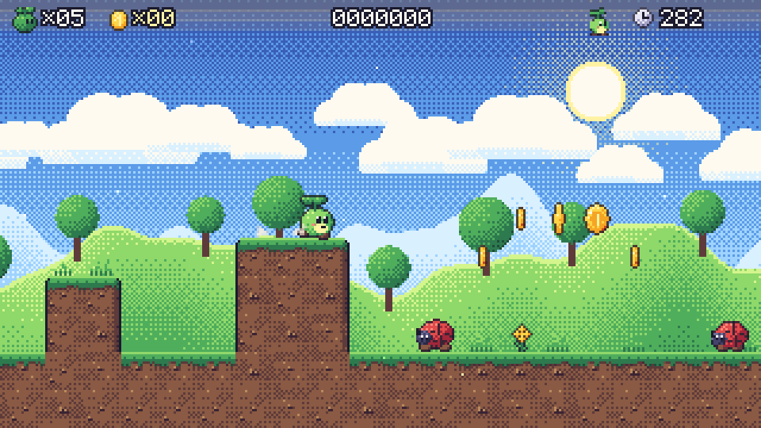
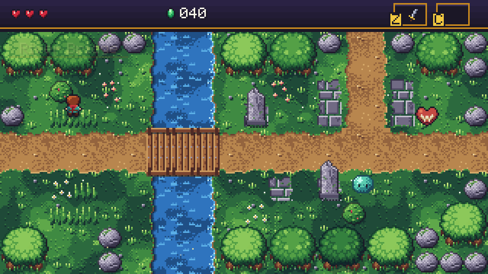
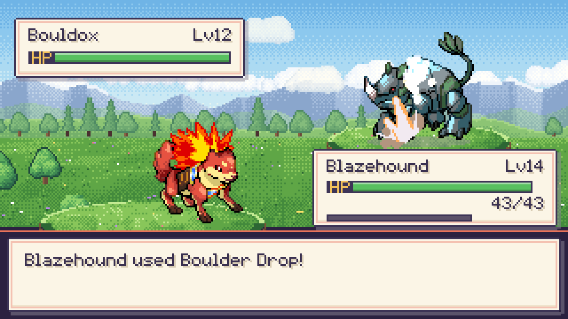
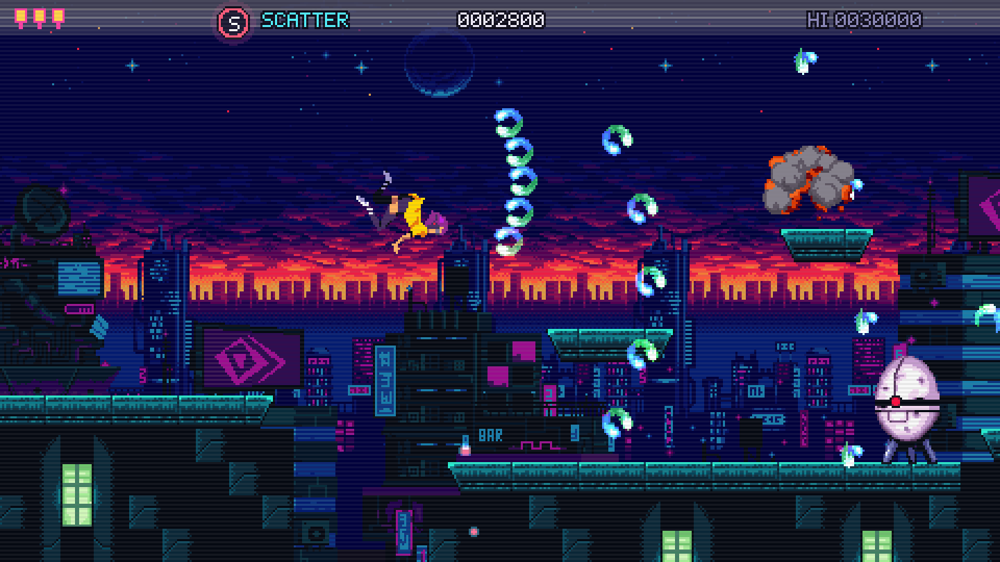

<p align="center">
  <a href="https://micro-engine.vercel.app">
    <picture>
      <source media="(prefers-color-scheme: dark)" srcset="site/src/assets/brand/lockup-dark.svg">
      
    </picture>
  </a>
</p>

<h3 align="center">A game engine that orchestrates, not reinvents.</h3>

<p align="center">
  Make 2D games in plain C# and ship them to Windows, Linux, macOS, Android, iOS and the browser from one project.
</p>

<p align="center">
  <a href="https://www.nuget.org/packages/MicroEngine"></a>
  <a href="https://github.com/NastMz/MicroEngine/actions/workflows/ci.yml"></a>
  
  <a href="LICENSE"></a>
</p>

<p align="center">
  <a href="https://micro-engine.vercel.app"><b>Website</b></a> ·
  <a href="https://micro-engine.vercel.app/demos/"><b>Play the demos</b></a> ·
  <a href="https://micro-engine.vercel.app/docs/getting-started/"><b>Get started</b></a> ·
  <a href="https://micro-engine.vercel.app/docs/tutorial/"><b>Tutorial</b></a> ·
  <a href="https://micro-engine.vercel.app/docs/api/"><b>API reference</b></a>
</p>

<table>
  <tr>
    <td width="50%"><a href="https://micro-engine.vercel.app/demos/meadow-run/"></a></td>
    <td width="50%"><a href="https://micro-engine.vercel.app/demos/courtyard-key/"></a></td>
  </tr>
  <tr>
    <td width="50%"><a href="https://micro-engine.vercel.app/demos/trail-duel/"></a></td>
    <td width="50%"><a href="https://micro-engine.vercel.app/demos/neon-rift/"></a></td>
  </tr>
</table>
<p align="center"><sub>Four complete games made with MicroEngine. Click one to play it in your browser.</sub></p>

## Why MicroEngine

Windows, sound, GPUs, phones and browsers are solved problems, solved well by libraries with years of use behind them.
MicroEngine builds on SDL 3, raylib and .NET, puts one contract in front of them, and spends its own code on what a
game needs on top: the loop, scenes, input actions, drawing, audio, saves and the tools.

- **Code first.** Scenes, rules and art are plain C#. A sprite can be a palette and a string map; sounds and music can
  be synthesized in code. Content files (PNG, WAV, OGG, TrueType) are there when you want them.
- **One project, every platform.** `microengine package` builds the same game for Windows, Linux, macOS, Android, iOS
  and the web, with its name, icon and version declared once in the project file.
- **Small kernel, swappable modules.** Every subsystem sits behind a contract. Pick SDL 3 or raylib on desktops, or add
  a platform of your own, without touching game code.
- **Testable by design.** A headless platform and scripted input let you play your game in unit tests, deterministically,
  and capture frames to compare.
- **Yours to ship.** The engine is MIT-licensed. No royalties, no permission needed to sell your game.

## Get started

You need the [.NET 10 SDK](https://dotnet.microsoft.com/download). Then:

```bash
dotnet tool install -g MicroEngine.Cli --prerelease
microengine new MyGame
cd MyGame
microengine run
```

A game is a class that composes itself once for every platform, and scenes that update and draw:

```csharp
public sealed class MainGame : Game
{
    public static void Configure(HostBuilder host) => host.UseGame(() => new MainGame());
    public override GameSettings Settings { get; } = new("Hello MicroEngine");
    protected override void Load() => Scenes.Push(new HelloScene());
}

sealed class HelloScene : Scene
{
    private Vector2 _position = new(160, 90);

    public override void Update(float dt) =>
        _position += new Vector2(Input.Axis("left", "right"), Input.Axis("up", "down")) * 90 * dt;

    public override void Draw(IRenderer r) =>
        Font.DrawCentered(r, "Hello, MicroEngine!", _position, Color.Hex("fff1e8"));
}
```

From there, [Your first game](https://micro-engine.vercel.app/docs/first-game/) explains each file of the project, and
the [Gem Garden tutorial](https://micro-engine.vercel.app/docs/tutorial/) builds a complete small game step by step,
all the way to a package for each platform.

## What's in the box

| Area | What you get |
| --- | --- |
| Game structure | Fixed-step loop, scene stack with overlays and transitions, coroutines, tweens, a scene world with transform hierarchies |
| Graphics | Pixel-art and HD 2D, sprite atlases, animation, particles, a camera with dead zone, bounds and shake, parallax, tile layers and autotiling |
| Text | A built-in pixel font, TrueType and OpenType fonts, and optional shaping for Arabic, Hebrew and Indic scripts |
| Input | Named actions over keyboard, gamepad, mouse and touch, on-screen controls for phones, and prompts that show the player's own buttons |
| Audio | One mixer on every platform, streamed OGG music, and a retro synthesizer with a step sequencer for effects and songs in code |
| Physics | Swept tile collision with one-way platforms, and physics worlds behind a contract |
| UI | Widgets (labels, buttons, panels, stacks, grids, scroll views, text fields) with focus, pointer and gamepad navigation, and themes of your own |
| Persistence | JSON saves in the right place on every platform, and achievements with saved progress |
| Tools | `microengine new`, `run`, `package` and `doctor`; a `dotnet new` template; scripted playthroughs and frame captures for tests |

The [SDK status](https://micro-engine.vercel.app/docs/sdk/) page lists the seven NuGet packages and what each one holds.

## Platforms

| Windows | Linux | macOS | Android | iOS | Browsers |
| :---: | :---: | :---: | :---: | :---: | :---: |
| ✓ | ✓ | ✓ | ✓ | ✓ | ✓ (WebAssembly) |

Desktops run on SDL 3 by default, with raylib as an alternative; phones and browsers run on SDL 3. See
[Platforms](https://micro-engine.vercel.app/docs/platforms/) for what each target needs.

## The demo games

Each demo is a complete game, playable in the browser and downloadable for each system from the
[releases](https://github.com/NastMz/MicroEngine/releases). Their source is here to read and learn from.

| Game | Genre | How it is made |
| --- | --- | --- |
| [Meadow Run](games/MeadowRun/README.md) | Side-scrolling platformer | Fully procedural: every sprite, tile, sound and song is generated in code |
| [Courtyard Key](games/CourtyardKey/README.md) | Top-down action adventure | Cast, boss and lit dungeon drawn in code, with one crafted enemy and CC0 houses and trees recoloured to its palette |
| [Trail Duel](games/TrailDuel/README.md) | Creature-collecting RPG | Hand-drawn CC0 creatures and a CC BY tileset, with interface and music in code |
| [Neon Rift](games/NeonRift/README.md) | Run & gun | Built from CC0 sprite sheets, tilesets, sound effects and music files |

To run one from source: `dotnet run --project games/MeadowRun -c Release`.

## Status

MicroEngine is in **Alpha** (0.x). It works on all six platforms and the four demos ship on it, but public APIs can
still change between versions. Every change is listed in the
[release notes](https://micro-engine.vercel.app/docs/release-notes/), and every breaking change comes with
[migration notes](docs/migrations.md).

## Community

- **Questions, bugs and ideas:** open an [issue](https://github.com/NastMz/MicroEngine/issues/new/choose).
- **Contributing:** see [CONTRIBUTING.md](CONTRIBUTING.md) for how to build, test and propose a change.
- **Security:** report vulnerabilities privately, as [SECURITY.md](SECURITY.md) describes.
- Everyone taking part follows the [Code of Conduct](CODE_OF_CONDUCT.md).

## License

The engine, its tools, samples and documentation are open source under the [MIT License](LICENSE). Games you make
with MicroEngine are yours: ship them commercially with no royalty or permission, and include MicroEngine's licence and
the [third-party notices](THIRD-PARTY-NOTICES.md) with them (`microengine package` adds both for you).

The four demo games are published to play and to learn from, with **all rights reserved** ([games/LICENSE](games/LICENSE)),
except the third-party art and audio listed in each game's `CREDITS.md`, which keep their own licences.

| Part | Paths | Licence |
| --- | --- | --- |
| Engine, tools, hosts, samples, site and docs | `src/`, `samples/`, `templates/`, `web/`, `platforms/`, `packaging/`, `site/`, `docs/`, `tests/MicroEngine*.Tests/` | [MIT](LICENSE) |
| Demo games, their tests and builds | `games/<Name>/`, `tests/<Name>.Tests/` | [All rights reserved](games/LICENSE) |
| Third-party art and audio of the demos | the files in each game's `CREDITS.md` | their own (CC0 1.0, CC BY) |
| Third-party libraries | SDL 3, raylib, .NET, NVorbis, HarfBuzz and others | see [THIRD-PARTY-NOTICES.md](THIRD-PARTY-NOTICES.md) |
