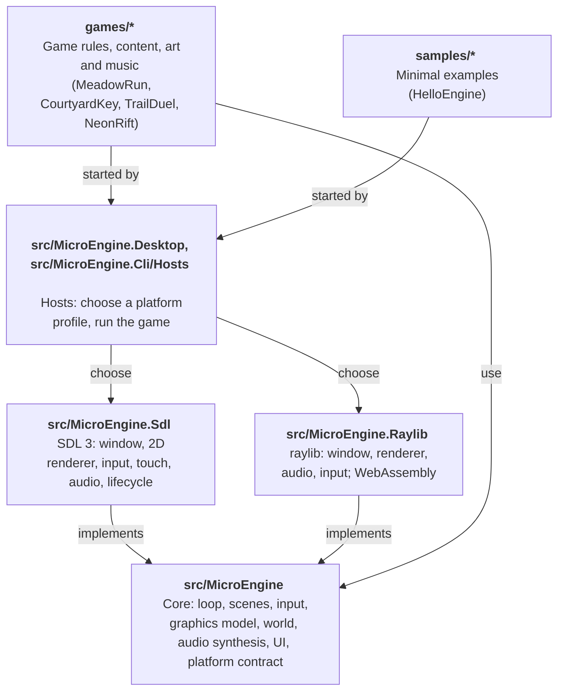

# MicroEngine architecture

MicroEngine is a small, code-first 2D framework for pixel-art games in C#/.NET 10. It is
deliberately compact: one backend-independent core library, two platform backends (SDL 3 for Windows, Linux, macOS,
Android and iOS; raylib for browsers and as a desktop alternative), and games that are ordinary .NET programs. This
document explains how the pieces fit and why.

## Layers

The core references no backend library. Everything platform-specific sits behind `MicroEngine.Core.IPlatform` and
four device interfaces:

| Interface | Responsibility | Implementations |
| --- | --- | --- |
| `IRenderer` | Immediate-mode drawing into the virtual canvas | `SdlRenderer`, `RaylibRenderer`, `HeadlessRenderer` |
| `IGraphicsDevice` | Turning `PixelImage`s into textures | SDL, raylib, headless |
| `IAudioDevice` | Loading/playing PCM sounds and looping music | SDL, raylib, `SilentAudioDevice` |
| `IInputSource` | Raw key, gamepad and mouse state | SDL, raylib, `HeadlessInput` |
| `ITouchScreen` (optional, `IPlatform.Touch`) | Touches, safe area, density, vibration and an overlay drawn over the frame | SDL, raylib (from the browser page), `HeadlessTouchScreen` |

Hosts choose a platform through a `PlatformCatalog` of named `PlatformProfile`s (`sdl`, `raylib`, `sdl-software`,
`headless`, or one of the developer's own) and may supply an audio device or extra input sources of their own; window,
renderer and graphics device stay together because they share a graphics context
([ADR 0016](decisions/0016-platform-profiles.md), [Backends](manual/backends.md)). SDL is the default on the native
systems ([ADR 0017](decisions/0017-sdl3-native-platform.md)). The raylib backend also runs in a browser (raylib
compiled to WebAssembly): `BrowserLauncher` returns a `GameSession` that the page starts, ticks from
`requestAnimationFrame` and restarts, and keeps saves in `localStorage`. One host project builds any game into a
static package ([ADR 0007](decisions/0007-browser-host.md), [ADR 0008](decisions/0008-web-packages.md),
[web/](../web/README.md)).

## The frame

`GameLoop` runs one frame per `Tick()`; `GameRunner.Run(game, platform, options)` ticks it until the game
ends. Hosts that outlive a run (a browser page) use `GameSession`, which builds the game and platform, ticks the
loop from `requestAnimationFrame` and releases the platform when the run ends. Each frame:

1. Poll platform events. While the platform is suspended (a phone app in the background) the frame stops here:
   no simulation and no rendering; on the way out of suspension the clock restarts, so the time away is not simulated.
2. Accumulate wall-clock time (headless: exactly one step per frame).
3. Hand the frame's touches to the game's on-screen controls (`VirtualControls`), which update their state and
   drawing immediately.
4. For each fixed step (60 Hz, at most five per frame): apply scripted input, sample devices and action sources
   (touch controls among them) into the `InputMap`, update scenes, update the audio mixer and achievement banners (flushing achievement
   progress about once a second), advance input edge detection.
5. Render once: clear, draw the scene stack, draw any transition, draw achievement banners; the backend then draws
   the touch controls over the letterboxed frame (never into captures).
6. Optionally write a capture.

Fixed-step simulation keeps platformer physics and combat deterministic, which is what makes
scripted playthrough tests and reproducible screenshots possible.

## Core modules

| Namespace | Contents |
| --- | --- |
| `MicroEngine` | `Color`, `RectF`, `MathX` (approach, damp, waves), `Ease` |
| `MicroEngine.Core` | `Game`, `GameSettings`, `GameRunner`, `GameLoop`, `GameSession`, `InputScript`, `HeadlessPlatform`, `SaveStore` (over `ISaveStorage`), `ContentFolder`, `Achievement`, `AchievementTracker` |
| `MicroEngine.Scenes` | `Scene`, `SceneManager` (stack, overlays), `Transition` (fade, iris, diamonds, wipe), `CoroutineRunner`, `Tweener` |
| `MicroEngine.Input` | `InputMap`: named actions, digital and analog, bound to keys, pad buttons, sticks and triggers, plus action sources; `VirtualControls` and `TouchLayout`: per-game on-screen d-pads, joysticks and buttons; `ITouchScreen`, `FrameLayout` |
| `MicroEngine.Graphics` | `PixelImage` (CPU art, PNG loading, crop/rotate), `Art` (noise, dither, ramps), `SpriteAtlasBuilder` (incl. grid sheets), `Sprite`, `Animator`, `Camera2D`, `ParallaxLayer`, `ParticleSystem`, `LightMap`, `BitmapFont`, `IRenderer` |
| `MicroEngine.World` | `TileLayer`, `TileGrid`, `TileMotion` (swept AABB with one-way tiles), `Autotile`, `TileRenderer`, `Entity`, `EntityList<T>` |
| `MicroEngine.Audio` | `Synth` (retro SFX), `Song` (step sequencer), `AudioClip` (incl. WAV decoding), `AudioMixer` (incl. sound/music files) |
| `MicroEngine.UI` | `Typewriter`, `DialogueBox`, `SelectionList`, `UiTheme`, `AchievementToasts`, `AchievementsScene` |

## Key design decisions

Each of these is recorded as a design decision. In short:

- **Code-first content by default, files when a game wants them.** Sprites, tiles and fonts can be
  authored as code (`PixelImage`, char maps, palettes, noise) and sounds synthesized, so a game can ship
  no binary assets. Games that use existing packs load PNG and WAV in managed code and stream OGG/MP3
  through the audio device (ADR 0004); Neon Rift does this with CC0 assets listed in its `CREDITS.md`.
  Games can also mix both per element (ADR 0005): Courtyard Key and Trail Duel load a few crafted
  pieces and keep the rest procedural, repainting imported sprites with their own palette at load.
- **Scenes on a stack, not a global state machine.** Pause menus, dialogue and inventories are overlay
  scenes that freeze (or not) the scene below; transitions swap scenes at their midpoint.
- **Plain entities, not an ECS.** Each sample has at most a few hundred objects. Small classes with
  `Update`/`Draw` and an `EntityList<T>` with deferred add/remove are easier to read and debug than
  component plumbing at this scale. Games that outgrow it can add their own systems on top.
- **Actions, never keys.** Games query `"jump"` or `"confirm"` (and `Value`/`Vector` for analog strength); keys,
  gamepads, touch controls and custom sources all press the same actions, and scripts and tests force the same
  actions or touch the same controls, so automated runs exercise exactly the code players do (ADR 0020).
- **Touch controls belong to the engine, layouts to the game.** Hit testing, finger tracking, feedback and drawing
  are core code; backends report touches, the safe area and density, and draw primitives. One `TouchLayout` per game
  works on phones, in mobile browsers and in headless tests.
- **Achievements: the engine keeps score, the game decides.** `AchievementTracker` owns the catalog,
  progress, one-time unlocks and persistence (through `SaveStore`, so each game keeps its own file); games
  only call `Unlock`/`AddProgress`/`SetProgress` where their events already happen (ADR 0006).
- **Virtual canvas.** Games draw at 320×180 (configurable); the backend scales by the largest integer
  factor that fits the safe area and letterboxes, keeping pixels square at any window size (fractionally only when
  whole factors would waste a fifth of a small screen). F11 toggles fullscreen.

## Validation tooling

- `tests/MicroEngine.Tests` covers the engine contracts (motion, input edges, scenes, runner, audio).
- Each game has its own test project with rule tests and headless scripted playthroughs.
- Any game accepts `--script file --hidden --captures dir` to replay input deterministically and save
  3× PNG captures, used for visual review and the screenshots in each game's README.
