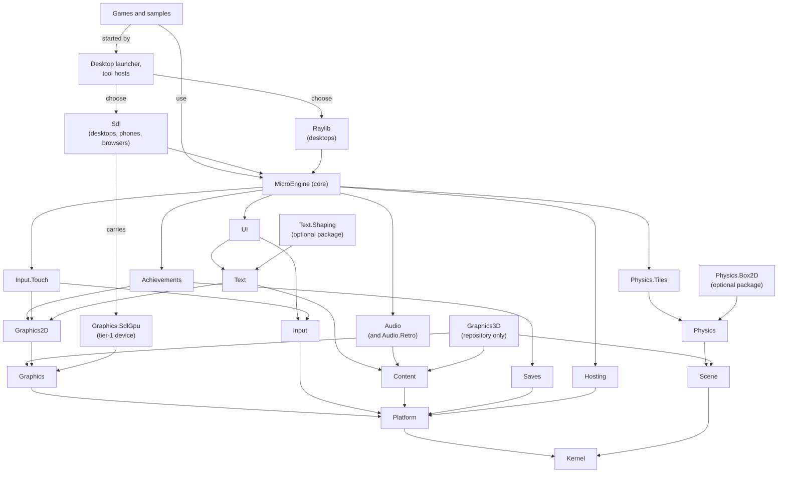

# MicroEngine architecture

MicroEngine is a small, code-first 2D framework for C#/.NET 10, for pixel-art and HD games. It is
deliberately compact: a kernel that knows no domain, one backend-independent core library on top of it, two platform
backends (SDL 3 for Windows, Linux, macOS, Android, iOS and browsers; raylib as a desktop
alternative), and games that are ordinary .NET programs. This
document explains how the pieces fit and why.

## Layers

Each box is an assembly, named without its `MicroEngine.` prefix; the table under [Core modules](#core-modules) says what each holds. Arrows read "references". The diagram leaves out arrows that follow from others: every assembly references the
kernel, those that touch the host also the platform contracts, and the core references every engine module. The
`MicroEngine` package carries the kernel, the contracts, hosting, the engine modules and the core; the `MicroEngine.Sdl`
package carries the tier-1 device. Text shaping (`MicroEngine.Text.Shaping`) is an optional package of its own, with
HarfBuzz, and so is the Box2D backend (`MicroEngine.Physics.Box2D`), with Box2D's native library for each runtime.
The 3D path (`MicroEngine.Graphics3D`) is not in the SDK packages: it is in the repository only.

The kernel is its own assembly,
`MicroEngine.Kernel`, shipped inside the `MicroEngine` package. It references no other engine assembly; modules
register services, frame systems and capabilities on an `EngineBuilder`, and `Game` is one of them. The platform
contracts are a second assembly, `MicroEngine.Platform`, also shipped inside the `MicroEngine` package, which references
only the kernel: `IPlatformHost` (a monotonic clock, an event pump whose events become the engine's lifecycle events,
the main surface, optional features found with `TryGetCapability<T>`, and whether the host may block), `ISurface`,
`IStorage` and `IContentSource`. `IPlatform` extends `IPlatformHost` with the devices and frame presentation that
later move to their own contracts. The engine never casts a platform to find an optional feature, never wraps one, and
nothing a platform does depends on the time mode ([The platform host](manual/backends.md#the-platform-host)).
Input is a third assembly, `MicroEngine.Input` (kernel and platform contracts only, shipped inside the `MicroEngine`
package): device events with ids, the polled state derived from the events no input layer took, players with device
pairing, input layers, the text channel and `InputMap` ([Devices, players and layers](manual/input.md#devices-players-and-layers)).
The touch controls are `MicroEngine.Input.Touch` (input, 2D graphics, kernel and platform contracts): the touch screen
contract and the on-screen controls, an optional module that is active on touch-first screens or once the game sets a
layout, and costs nothing otherwise ([Touch controls](manual/input.md#touch-controls)).

The graphics device contract is an assembly
of the `MicroEngine` package too, `MicroEngine.Graphics`, which references only the kernel and the platform contracts.
It holds one device contract for every backend (capabilities with a typed error for anything undeclared, resources
owned by their device with generational handles and deferred release, samplers as values, buffers, the built-in
`Textured` pipeline, command lists with passes, fenced readback of render targets and the window's target), the core
validation every backend inherits (`GraphicsDeviceBase`) and the CPU reference device that executes the written rules
([The graphics device](manual/rendering.md#the-graphics-device)).
The tier-1 device is `MicroEngine.Graphics.SdlGpu` (carried by the `MicroEngine.Sdl` package, which offers it as the `sdl-gpu` graphics device next to SDL_Renderer), which references only the
graphics and platform contracts and SDL3: the contract on pure SDL_GPU with custom shaders compiled ahead of time and
depth, checked by the same conformance suite as every other device. The 3D path over it is `MicroEngine.Graphics3D`
(also in the repository only), which references the graphics contract, content and the scene world: glTF meshes as a
content asset kind, `Camera3D`, one material compiled ahead of time and a renderer that draws a world's mesh attachments
at their interpolated transforms ([The 3D path](manual/rendering.md#the-3d-path)).
The 2D layer is `MicroEngine.Graphics2D`, also carried by the `MicroEngine` package, which references the graphics
contract only: the batcher (`Renderer2D`) and `Camera2D`, and the 2D drawing model games use (`IRenderer`, textures,
`PixelImage`, sprites and atlases, animation, particles, light, parallax), moved out of `MicroEngine.dll` with its
namespace unchanged (`MicroEngine.dll` forwards each type). The SDL and raylib platforms draw every frame into a canvas
render target through it, with `IRenderer` as its façade, and compose the canvas into the window as the game's
`Presentation` says ([The 2D batcher and the camera](manual/rendering.md#the-2d-batcher-and-the-camera)).

Text is `MicroEngine.Text`, another assembly
of the `MicroEngine` package, which references only the 2D layer, the graphics contract, content, the kernel and the
platform contracts. It holds the fonts with their `MicroEngine.Graphics` namespace (`IFont` and `FontExtensions`,
`BitmapFont`, `ScalableFont`, `SizedFont`, `FontOptions`; `MicroEngine.dll` forwards each type), FontStashSharp, which
rasterizes scalable fonts, and the font loader the asset store registers under the kind "font"
([Text](manual/text.md)). Shaped text is `MicroEngine.Text.Shaping`, an optional package over text and the 2D layer:
`ShapedFont` shapes with HarfBuzz (a native library for every runtime, linked into browser packages) and rasterizes
each glyph by its index with StbTrueTypeSharp, the scalable fonts' rasterizer, into glyph pages of its own; lines
that mix directions are split into runs by its own implementation of Unicode's bidirectional algorithm (implicit levels,
with a class table generated from the Unicode Character Database by `Bidi/generate.mjs`)
([Shaped text](manual/text.md#shaped-text-arabic-hebrew-and-indic-scripts)).

The UI is `MicroEngine.UI`, another assembly
of the `MicroEngine` package, which references only the 2D layer, text, input, the graphics contract, content, the
kernel and the platform contracts. It holds the widget tree (`Widget`, `Label`, `Button`, `Panel`, `Stack`,
`ScrollView`, `Grid`, `Layer`, `TextField`), `UiTheme` and `UiRoot`, which lays a tree out in UI units in the UI view, keeps the focus, moves it with
the engine's actions under the input map's names and, as the highest input layer, takes the pointer presses and keys
it handles from gameplay. Scenes stay in the core, which hosts one root per scene (`Scene.Widgets`), and so does
`PromptText`, which reads the action prompts ([UI widgets](manual/ui.md)).

Hosting is another assembly of the
`MicroEngine` package, `MicroEngine.Hosting`, which references only the kernel and the platform contracts. It holds the
launcher model every host shares: what a launch asks for (`LaunchRequest`, from a command line, a page or a phone) and
its rules (a script means deterministic time and seed 1 on every host), how a host chooses a platform, the host's
environment, and the composition a game configures once (`HostBuilder`): a `Configure` entry point that the desktop
`Program.cs` hands to the launcher and that the browser, Android and iOS hosts call too. Content folders and save media
are parts of that composition, never process-wide settings
([One composition for every platform](manual/backends.md#one-composition-for-every-platform)).

Content is another assembly of the
`MicroEngine` package, `MicroEngine.Content`, which references only the kernel and the platform contracts. It holds
the asset store under `Game.Assets`: typed handles (`Asset<T>`) whose generation goes stale once every scope released
the asset, scopes that share one object and dispose it with its last holder, a loader registry with one loader per
kind of asset (images, atlases and fonts register theirs from the core for now; sounds and music too), a reserved
build-time import step (`IAssetImporter`), and content sources beyond folders: zip archives and files a host lists
and opens itself ([Handles, loaders and content sources](manual/assets.md#handles-loaders-and-content-sources)).

Audio is another assembly of the `MicroEngine`
package, `MicroEngine.Audio`, which references the kernel, the platform contracts and content. It holds the one mixer
every backend plays through (`AudioEngine`: voices with handles and priorities, one voice policy, buses, music streams
decoded ahead outside the simulation step, sounds started at exact output frames), the audio device contract and the
`AudioMixer` games use, offline rendering for tests, and the synthesizer. The platform contracts gain `IAudioSink`, the
PCM output a backend implements: an SDL audio stream fed by a thread, a raylib audio stream, a browser AudioWorklet
([One mixer on every platform](manual/audio.md#one-mixer-on-every-platform)).

The scene world is another assembly of the
`MicroEngine` package, `MicroEngine.Scene`, which references only the kernel. Its types are in the `MicroEngine.Scenes`
namespace, beside the scene stack: `IWorld` and its implementation `SceneWorld` (entities with generational `EntityId`s,
a `Transform` hierarchy stored in 3D with 2D helpers, typed attachments walked in attach order, interpolation for
drawing with teleports, per-world step tracking, and a `WorldClock` with time scale and freezes), and the world's part of
the per-step state hash.

Physics is two more assemblies of the
`MicroEngine` package. `MicroEngine.Physics` (scene world and kernel only) is the 2D contract, `IPhysicsWorld2D`: bodies
owned by entities, box shapes with collision layers, collide-and-slide moves that return their contacts, exact ray and
overlap queries, sensors with buffered events, declared `PhysicsCapabilities` with a typed error for anything a backend
does not declare, and `PhysicsModule`, which steps worlds in the `Physics` phase and writes body poses to transforms.
`MicroEngine.Physics.Tiles` is its tile backend, `TilePhysicsWorld2D`, and now holds the tile types (`TileLayer`,
`TileGrid`, `TileFlags`, `ICollisionGrid`, `Autotile`, `TileMotion`) with their `MicroEngine.World` namespace;
`TileRenderer` stays in the core because it draws ([Physics worlds](manual/world.md#physics-worlds)).
`MicroEngine.Physics.Box2D` (physics contract, scene world and kernel only; an optional package of its own) is the
second backend, `Box2DPhysicsWorld2D`: native Box2D 3.2 behind a flat C layer of the engine's own,
across which only integers, floats and pointers pass and no game code runs, with the native library for each platform in
its package ([The Box2D backend](manual/world.md#the-box2d-backend)).

Saves and achievements are optional engine
modules. `MicroEngine.Saves` (kernel and platform contracts only, shipped inside the `MicroEngine` package) holds
`SaveStore`, `ISaveStorage` and `FileSaveStorage` with their `MicroEngine.Core` namespace, and `SavesModule`, which
registers a store as the engine's `SaveStore` service. `MicroEngine.Achievements` (kernel, platform contracts, saves and 2D
graphics, also shipped inside the `MicroEngine` package) holds the catalog and tracker types with their `MicroEngine.Core`
namespace and `AchievementsModule`, which registers a game's `AchievementTracker`
and schedules `engine.achievements`, which writes progress. `Game` adds both when the game declares achievements
(`TrackAchievements` from its constructor or `Configure`); a game that declares none has no achievement or save service,
no `engine.achievements` system and no achievement file ([Achievements](manual/achievements.md)).

The core references no backend library. Everything platform-specific sits behind `MicroEngine.Core.IPlatform` and
four device interfaces:

| Interface | Responsibility | Implementations |
| --- | --- | --- |
| `IRenderer` | Immediate-mode drawing into the virtual canvas | `DeviceRenderer` over each backend's graphics device (SDL_Renderer, SDL_GPU, raylib), `HeadlessRenderer` |
| `IGraphicsDevice` | Turning `PixelImage`s into textures with a filter (nearest, linear); textures take region updates | SDL, raylib, headless |
| `IAudioDevice` | Loading/playing PCM sounds and looping music | SDL, raylib, `SilentAudioDevice` |
| `IInputBackend` | Device events: keys, text, pointers, wheel, gamepads, devices connecting (a capability) | `HeadlessInputBackend` |
| `IInputSource` | Raw key, gamepad and mouse state, polled; read as one device | SDL, raylib, `HeadlessInput` |
| `ITouchScreen` (optional, a capability) | Touches, safe area, density, vibration and an overlay drawn over the frame | SDL (phones; browsers from the page), `HeadlessTouchScreen`; a raylib desktop window reports none |

Hosts choose a platform through a `PlatformCatalog` of named `PlatformProfile`s (`sdl`, `raylib`, `sdl-software`,
`headless`, or one of the developer's own) and may supply an audio device or extra input sources of their own; window,
renderer and graphics device stay together because they share a graphics context ([Backends](manual/backends.md)).
SDL is the default on desktops and phones, and the platform of browsers too (SDL compiled to
WebAssembly by `src/MicroEngine.Sdl/native/build.sh`, with its `BrowserLauncher` and `BrowserPage` in
`MicroEngine.Sdl`); raylib runs on desktops only. `BrowserLauncher` returns a `GameSession` that the page starts, ticks
from `requestAnimationFrame` and restarts; saves go to `localStorage` (`BrowserStorage`). Every host composes the game with its `Configure` entry
point through the same launcher model (`GameHost`), so a page's scripted run is deterministic like a desktop one.
`microengine package web` builds any game into a static site
([The browser host](examples/embedding.md)).

## The frame

`GameLoop` runs one frame per `Tick()`; `GameRunner.Run(game, platform, options)` ticks it until the game
ends. The loop owns time; the platform only
supplies a monotonic clock,
and the engine's `FrameClock` turns each frame's time into fixed steps following `TimeSettings` (fixed rate, at most
`MaxStepsPerFrame` steps, frames of at most `MaxFrameDelta`, real or deterministic time). A frame runs the engine's
frame schedule: `BeginFrame` and `Input` once, `PreFixed`, `FixedUpdate`, `Physics` and `PostFixed` once per step,
then `Update`, `LateUpdate`, `Extract`, `Render`, `Present` and `EndFrame`. `Game` registers the built-in systems
(`engine.assets`, `engine.input.events`, `engine.touch` (only with active touch controls), `engine.input`, `engine.time`, `engine.scenes`, `engine.audio`,
`engine.achievements` (only in games that declare achievements), `engine.input.end`, `engine.render`, `engine.present`...) in the order listed below, and a game
adds its own from `Game.Configure`. Hosts that outlive a run (a browser page) use `GameSession`, which builds the game and platform, ticks the
loop from `requestAnimationFrame` and releases the platform when the run ends. Each frame:

1. Poll platform events. While the platform is suspended (a phone app in the background) the frame stops here:
   no simulation and no rendering; on the way out of suspension the clock restarts, so the time away is not simulated.
2. Accumulate wall-clock time in real time, exactly one step in deterministic time (headless and scripted runs by default).
3. Hand the frame's touches to the game's on-screen controls (`VirtualControls`), which update their state and
   drawing immediately.
4. For each fixed step (60 Hz, at most five per frame): apply scripted input, sample each player's devices and action
   sources (touch controls among them) into their `InputMap` (the frame's device events were routed through the input
   layers before the steps), update scenes, update the audio mixer and achievement banners (flushing achievement
   progress about once a second), advance input edge detection.
5. Render once: clear, draw the scene stack, draw any transition, draw achievement banners; the backend then draws
   the touch controls over the letterboxed frame (never into captures).
6. Optionally write a capture.

Fixed-step simulation keeps platformer physics and combat deterministic, which is what makes
scripted playthrough tests and reproducible screenshots possible.

## Core modules

One row per assembly, in the order of the layers above. Namespaces in parentheses are those of moved types, which kept
the namespace they had in `MicroEngine.dll`.

| Assembly | Namespaces | Contents |
| --- | --- | --- |
| `MicroEngine.Kernel` | `MicroEngine.Kernel`, `MicroEngine` | `EngineBuilder`, `Engine`, `IEngineModule`, `ServiceRegistry`, `CapabilityRegistry`, `FrameSchedule`, `FramePhase`, `FrameContext`, `TimeSettings`, `FrameClock`, `IEngineLifecycle`, `ILog`, `Handle<T>`, `HandlePool<T>`, `SeededRandom`, the per-step state hash (`StateHasher`, `IStateHashed`, `StateTrace`); `Color`, `ColorF`, `RectF`, `MathX`, `Ease` |
| `MicroEngine.Platform` | `MicroEngine.Platform` | `IPlatformHost`, `IMonotonicClock`, `IEngineEventSink`, `ISurface`, `HostSurface`, `IDisplayPacing`, `IPreciseDelay`, `IStorage`, `IContentSource`, `FolderContentSource`, `IAudioSink` |
| `MicroEngine.Graphics` | `MicroEngine.Graphics.Devices` | `IGraphicsDevice`, `GraphicsDeviceBase`, `GraphicsCapabilities`, `GraphicsCapabilityException`, `Texture`, `RenderTarget`, `Sampler`, `GpuBuffer`, `Pipeline`, `CommandList`, `ReadbackRequest`, `Vertex2D`, `GraphicsCounters`, `ReferenceGraphicsDevice` |
| `MicroEngine.Input` | `MicroEngine.Input` | Device ids and events (`InputEvent`, `IInputBackend`), the state derived from them (`InputDevices`), players and pairing (`Players`), input layers (`InputLayers`), the text channel, `InputSystem`, and `InputMap`: named actions, digital and analog, bound to keys, pad buttons, sticks and triggers, with saved bindings |
| `MicroEngine.Content` | `MicroEngine.Content` | `AssetStore` (`Game.Assets`), `Asset<T>`, `AssetScope`, `AssetLoaderRegistry`, `IAssetLoader<T>`, `IAssetImporter`, `ZipContentSource`, `ListedContentSource` |
| `MicroEngine.Hosting` | `MicroEngine.Hosting` | `HostBuilder` (the composition a game's `Configure` entry point fills), `LaunchRequest`, `ProfileSelection`, `HostEnvironment` |
| `MicroEngine.Scene` | (`MicroEngine.Scenes`) | `IWorld`, `SceneWorld`, `EntityId`, `Transform`, `Attachments<T>`, `EntityChildren`, `IDestroyedCallback`, `WorldClock` |
| `MicroEngine.Physics` | `MicroEngine.Physics` | `IPhysicsWorld2D`, `PhysicsCapabilities`, `PhysicsCapabilityException`, `BodyId`, `ShapeId`, `BodyDescription`, `ShapeDescription`, `QueryFilter`, `MoveResult`, `RayHit`, `SensorEvent`, `ContactEvent`, `PhysicsModule`, `PhysicsSystem`, `PhysicsSync` |
| `MicroEngine.Physics.Tiles` | `MicroEngine.Physics.Tiles`, (`MicroEngine.World`) | `TilePhysicsWorld2D` (tile grids as static geometry, the swept mover, one-way platforms, moving solids); `TileLayer`, `TileGrid`, `TileFlags`, `ICollisionGrid`, `Autotile`, `TileMotion` (whose `Move` returns a `TileMoveResult`; it was `MoveResult`, the physics contract's name) |
| `MicroEngine.Graphics2D` | (`MicroEngine.Graphics`) | `IRenderer2D`, `Renderer2D` (the batcher the `IRenderer` façade draws through), `BatchSettings`, `RenderState`, `SortMode`, `Camera2D`, and the 2D drawing model: `IRenderer`, `Texture`, `IGraphicsDevice`, `TextureFilter`, `BlendMode`, `DrawOptions`, `PixelImage`, `Art`, `Sprite`, `SpriteAtlas`, `SpriteAtlasBuilder`, `AtlasData`, `Animator`, `ParticleSystem`, `LightMap`, `ParallaxLayer`, `RendererExtensions` |
| `MicroEngine.Text` | (`MicroEngine.Graphics`) | `IFont`, `FontExtensions`, `BitmapFont`, `ScalableFont`, `SizedFont`, `FontOptions`, the font loader |
| `MicroEngine.Text.Shaping` | (`MicroEngine.Graphics`) | `ShapedFont`, `ShapedFontSize`, `ShapedGlyph`: HarfBuzz shaping, glyphs rasterized by index; an optional package of its own |
| `MicroEngine.Input.Touch` | (`MicroEngine.Input`) | `ITouchScreen`, `TouchEvent`, `ITouchOverlay`, `IOverlayCanvas`, `FrameLayout`, `TouchLayout`, `TouchDPad`, `TouchStick`, `TouchButton`, `VirtualControls`, `TouchStyle`, `ITouchSkin` |
| `MicroEngine.Audio` | `MicroEngine.Audio`, `MicroEngine.Audio.Retro` | `AudioEngine` (voices, buses, music streams, exact-frame scheduling), `AudioMixer`, `IAudioDevice`, `MixerAudioDevice`, `AudioClip` (incl. WAV and OGG decoding), `OfflineAudioSink`, `SilentAudioDevice`; in `MicroEngine.Audio.Retro`: `Synth`, `SfxParams`, `Wave` (retro sound effects), `Song`, `Instrument` (step sequencer) |
| `MicroEngine.Saves` | `MicroEngine.Saves`, (`MicroEngine.Core`) | `SavesModule`; `SaveStore`, `ISaveStorage`, `FileSaveStorage` |
| `MicroEngine.Achievements` | `MicroEngine.Achievements`, (`MicroEngine.Core`) | `AchievementsModule` (the tracker as a service, the `engine.achievements` system); `Achievement`, `AchievementStatus`, `AchievementTracker`, `AchievementSaveData`, `AchievementRecord` |
| `MicroEngine.UI` | `MicroEngine.UI` | `UiRoot`, `UiActions`, `UiContext`, `Widget`, `Label`, `Button`, `Panel`, `Stack`, `ScrollView`, `Grid`, `Layer`, `TextField`, `UiTheme` |
| `MicroEngine` (core) | `MicroEngine.Core`, `MicroEngine.Scenes`, `MicroEngine.Graphics`, `MicroEngine.UI`, `MicroEngine.World` | `Game`, `GameSettings`, `GameRunner`, `GameLoop`, `GameSession`, `GameHost`, `GameLauncher`, `PlatformCatalog`, `PlatformProfile`, `ContentFolder`, `AssetCache`; `Scene`, `SceneManager` (stack, overlays), `Transition` (fade, iris, diamonds, wipe), `CoroutineRunner`, `Tweener`; `DeviceCanvas`; `PromptText`; `TileRenderer`; forwards for every moved type |
| `MicroEngine` (core): testing support | `MicroEngine.Core` | `HeadlessPlatform` (no window, no sound, deterministic time), `InputScript` (scripted input for playthroughs), captures; with the kernel's state hash (`StateHasher`, `StateTrace`), the reference device (`ReferenceGraphicsDevice`) and offline audio (`OfflineAudioSink`) ([Testing your game](examples/testing.md)) |
| `MicroEngine.Graphics.SdlGpu` | `MicroEngine.Graphics.SdlGpu` | `SdlGpuDevice`: the tier-1 device (custom shaders compiled ahead of time, depth) on SDL_GPU, carried by the `MicroEngine.Sdl` package as the `sdl-gpu` graphics device |
| `MicroEngine.Graphics3D` | `MicroEngine.Graphics3D` | `MeshAssets` (glTF meshes as an asset kind, `GltfReader`), `MeshData`, `GpuMesh`, `Camera3D`, `Renderer3D`, `MeshRenderer`; in the repository only |
| `MicroEngine.Physics.Box2D` | `MicroEngine.Physics.Box2D` | `Box2DPhysicsWorld2D`, `Box2DWorldOptions`: native Box2D 3.2 behind the engine's flat C layer, with the native library of each platform; an optional package |
| `MicroEngine.Sdl` | `MicroEngine.Sdl` | `SdlPlatform`, `SdlRendererDevice`, `SdlAudioDevice`; for browsers `BrowserLauncher` and `BrowserPage` (SDL 3 compiled to WebAssembly, the platform of every browser build) |
| `MicroEngine.Raylib` | `MicroEngine.Raylib` | `RaylibPlatform`, `RaylibDevice`, the raylib audio device: the second desktop platform |
| `MicroEngine.Desktop` | `MicroEngine.Desktop` | `DesktopLauncher` with the official desktop platforms (SDL 3, raylib, SDL software, headless) |

## Key design decisions

In short:

- **Files ship as they are; the engine decodes, caches and releases them.** `Content/` is copied with every game;
  images (StbImageSharp), atlases from packing tools and TTF/OTF fonts (FontStashSharp) are decoded in managed code at
  load, the same on every platform. `Game.Assets` returns one object per file and options, releases each scope's assets
  with it, and reports loads that would hitch during play. The platform locates files and makes textures; the game
  decides what to load and when.
- **Code-first content by default, files when a game wants them.** Sprites, tiles and fonts can be
  authored as code (`PixelImage`, char maps, palettes, noise) and sounds synthesized, so a game can ship
  no binary assets. Games that use existing packs load PNG and WAV in managed code and stream OGG (or MP3 on raylib)
  through the audio device; Neon Rift does this with CC0 assets listed in its `CREDITS.md`.
  Games can also mix both per element: Courtyard Key loads its village houses, trees and one enemy from a CC0
  pack and keeps its ground, dungeon, characters and audio procedural; Trail Duel loads its village from a CC BY 4.0
  tileset, its creatures, trainers, battle effects and jingles from CC0 packs, and draws the rest in code. Both
  harmonise imported art at load (cutting along outlines, recolouring, colour-grading) so it shares one palette.
- **Scenes on a stack, not a global state machine.** Pause menus, dialogue and inventories are overlay
  scenes that freeze (or not) the scene below; transitions swap scenes at their midpoint.
- **Plain entities, not an ECS.** A game of this kind has at most a few hundred objects. Small classes with
  `Update`/`Draw`, kept in the scene's world (`Scene.Objects`, an `IWorld`: each entity has an id, a transform, an
  optional parent and your own classes as attachments, walked in a stable order) or simply in a `List<T>`, are easier
  to read and debug than component plumbing at this scale. Games that outgrow it can add their own systems on top.
- **Actions, never keys.** Games query `"jump"` or `"confirm"` (and `Value`/`Vector` for analog strength); keys,
  gamepads, touch controls and custom sources all press the same actions, and scripts and tests force the same
  actions or touch the same controls, so automated runs exercise exactly the code players do.
- **Touch controls belong to the engine, layouts to the game.** Hit testing, finger tracking, feedback and drawing
  are core code; backends report touches, the safe area and density, and draw primitives. One `TouchLayout` per game
  works on phones, in mobile browsers and in headless tests.
- **Achievements: the engine keeps score, the game decides.** `AchievementTracker` owns the catalog,
  progress, one-time unlocks and persistence (through `SaveStore`, so each game keeps its own file); games
  only call `Unlock`/`AddProgress`/`SetProgress` where their events already happen.
- **Virtual canvas.** Games draw at 320×180 (configurable, up to HD sizes such as 1920×1080). With pixel scaling, the
  default, the backend scales by the largest integer factor that fits the safe area and letterboxes, keeping pixels
  square at any window size (fractionally only when whole factors would waste a fifth of a small screen); with smooth
  scaling it fills the window and samples linearly. Texture filtering is per texture. F11 toggles fullscreen.

## Testing a game

- `HeadlessPlatform` runs a game without a window or sound; runs on it default to deterministic time (one step per
  frame), so tests are reproducible. That default is the headless platform's stated preset
  (`RunPreset.Testing`), which a run or a game overrides; nothing the platform does depends on it.
- Any game accepts `--script file --hidden --captures dir` to replay input and save 3× PNG captures, for visual
  review and screenshots ([Testing](examples/testing.md)).
