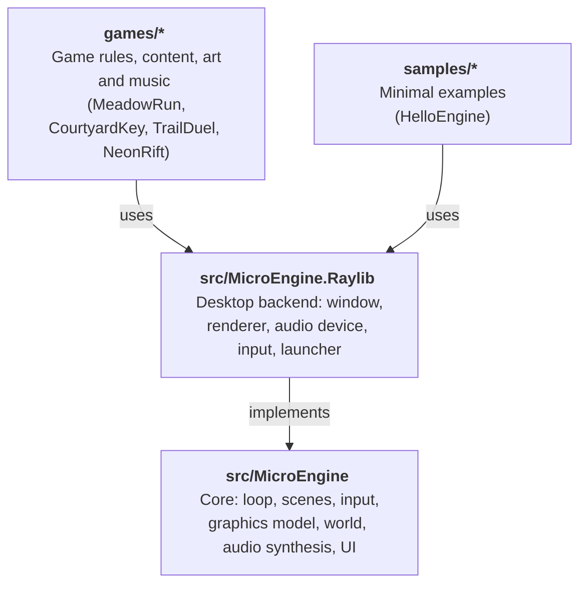

# MicroEngine architecture

MicroEngine is a small, code-first 2D framework for pixel-art games in C#/.NET 10. It is
deliberately compact: one backend-independent core library, one desktop backend, and games that
are ordinary .NET programs. This document explains how the pieces fit and why.

## Layers

The core never references raylib. Everything platform-specific sits behind four interfaces in
`MicroEngine.Core.IPlatform`:

| Interface | Responsibility | Implementations |
| --- | --- | --- |
| `IRenderer` | Immediate-mode drawing into the virtual canvas | `RaylibRenderer`, `HeadlessRenderer` |
| `IGraphicsDevice` | Turning `PixelImage`s into textures | raylib, headless |
| `IAudioDevice` | Loading/playing PCM sounds and looping music | raylib, `SilentAudioDevice` |
| `IInputSource` | Raw key/gamepad state | raylib, `HeadlessInput` |

A new backend (another windowing library) implements `IPlatform`; no game code changes. The raylib backend
also runs in a browser (raylib compiled to WebAssembly): `BrowserLauncher` returns a `GameSession` that the page
starts, ticks from `requestAnimationFrame` and restarts, and keeps saves in `localStorage`. One host project
builds any game into a static package ([ADR 0007](decisions/0007-browser-host.md),
[ADR 0008](decisions/0008-web-packages.md), [web/](../web/README.md)).

## The frame

`GameLoop` runs one frame per `Tick()`; `GameRunner.Run(game, platform, options)` ticks it until the game
ends. Hosts that outlive a run (a browser page) use `GameSession`, which builds the game and platform, ticks the
loop from `requestAnimationFrame` and releases the platform when the run ends. Each frame:

1. Poll platform events.
2. Accumulate wall-clock time (headless: exactly one step per frame).
3. For each fixed step (60 Hz, at most five per frame): apply scripted input, sample devices into the
   `InputMap`, update scenes, update the audio mixer and achievement banners (flushing achievement
   progress about once a second), advance input edge detection.
4. Render once: clear, draw the scene stack, draw any transition, draw achievement banners.
5. Optionally write a capture.

Fixed-step simulation keeps platformer physics and combat deterministic, which is what makes
scripted playthrough tests and reproducible screenshots possible.

## Core modules

| Namespace | Contents |
| --- | --- |
| `MicroEngine` | `Color`, `RectF`, `MathX` (approach, damp, waves), `Ease` |
| `MicroEngine.Core` | `Game`, `GameSettings`, `GameRunner`, `GameLoop`, `GameSession`, `InputScript`, `HeadlessPlatform`, `SaveStore` (over `ISaveStorage`), `ContentFolder`, `Achievement`, `AchievementTracker` |
| `MicroEngine.Scenes` | `Scene`, `SceneManager` (stack, overlays), `Transition` (fade, iris, diamonds, wipe), `CoroutineRunner`, `Tweener` |
| `MicroEngine.Input` | `InputMap`: named actions bound to keys, pad buttons and stick directions |
| `MicroEngine.Graphics` | `PixelImage` (CPU art, PNG loading, crop/rotate), `Art` (noise, dither, ramps), `SpriteAtlasBuilder` (incl. grid sheets), `Sprite`, `Animator`, `Camera2D`, `ParallaxLayer`, `ParticleSystem`, `LightMap`, `BitmapFont`, `IRenderer` |
| `MicroEngine.World` | `TileLayer`, `TileGrid`, `TileMotion` (swept AABB with one-way tiles), `Autotile`, `TileRenderer`, `Entity`, `EntityList<T>` |
| `MicroEngine.Audio` | `Synth` (retro SFX), `Song` (step sequencer), `AudioClip` (incl. WAV decoding), `AudioMixer` (incl. sound/music files) |
| `MicroEngine.UI` | `Typewriter`, `DialogueBox`, `SelectionList`, `UiTheme`, `AchievementToasts`, `AchievementsScene` |

## Key design decisions

Each of these is recorded as a design decision. In short:

- **Code-first content by default, files when a game wants them.** Sprites, tiles and fonts can be
  authored as code (`PixelImage`, char maps, palettes, noise) and sounds synthesized, so a game can ship
  no binary assets. Games that use existing packs load PNG and WAV in managed code and stream OGG/MP3
  through the audio device (ADR 0004); Neon Rift does this with CC0 assets listed in its `CREDITS.md`.
  Games can also mix both per element (ADR 0005): Courtyard Key and Trail Duel load a few crafted
  pieces and keep the rest procedural, repainting imported sprites with their own palette at load.
- **Scenes on a stack, not a global state machine.** Pause menus, dialogue and inventories are overlay
  scenes that freeze (or not) the scene below; transitions swap scenes at their midpoint.
- **Plain entities, not an ECS.** Each sample has at most a few hundred objects. Small classes with
  `Update`/`Draw` and an `EntityList<T>` with deferred add/remove are easier to read and debug than
  component plumbing at this scale. Games that outgrow it can add their own systems on top.
- **Actions, never keys.** Games query `"jump"` or `"confirm"`; scripts and tests force the same
  actions, so automated runs exercise exactly the code players do.
- **Achievements: the engine keeps score, the game decides.** `AchievementTracker` owns the catalog,
  progress, one-time unlocks and persistence (through `SaveStore`, so each game keeps its own file); games
  only call `Unlock`/`AddProgress`/`SetProgress` where their events already happen (ADR 0006).
- **Virtual canvas.** Games draw at 320×180 (configurable); the backend scales by the largest integer
  factor and letterboxes, keeping pixels square at any window size. F11 toggles fullscreen.

## Validation tooling

- `tests/MicroEngine.Tests` covers the engine contracts (motion, input edges, scenes, runner, audio).
- Each game has its own test project with rule tests and headless scripted playthroughs.
- Any game accepts `--script file --hidden --captures dir` to replay input deterministically and save
  3× PNG captures, used for visual review and the screenshots in each game's README.
