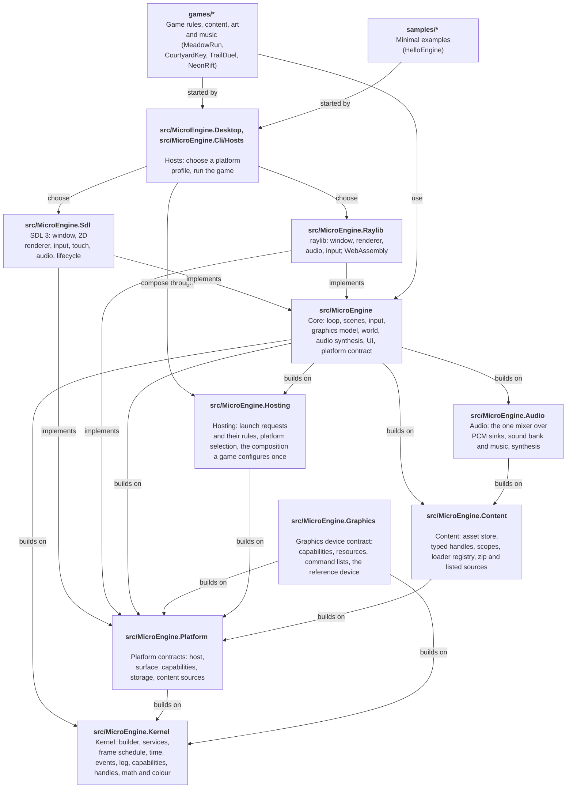

# MicroEngine architecture

MicroEngine is a small, code-first 2D framework for C#/.NET 10, for pixel-art and HD games. It is
deliberately compact: a kernel that knows no domain, one backend-independent core library on top of it, two platform
backends (SDL 3 for Windows, Linux, macOS,
Android and iOS; raylib for browsers and as a desktop alternative), and games that are ordinary .NET programs. This
document explains how the pieces fit and why.

## Layers

Next SDK version (not published yet: arrives with the next SDK version): the kernel is its own assembly,
`MicroEngine.Kernel`, shipped inside the `MicroEngine` package. It references no other engine assembly; modules
register services, frame systems and capabilities on an `EngineBuilder`, and `Game` is one of them. The platform
contracts are a second assembly, `MicroEngine.Platform`, also shipped inside the `MicroEngine` package, which references
only the kernel: `IPlatformHost` (a monotonic clock, an event pump whose events become the engine's lifecycle events,
the main surface, optional features found with `TryGetCapability<T>`, and whether the host may block), `ISurface`,
`IStorage` and `IContentSource`. `IPlatform` extends `IPlatformHost` with the devices and frame presentation that
later move to their own contracts. The engine never casts a platform to find an optional feature, never wraps one, and
nothing a platform does depends on the time mode ([The platform host](manual/backends.md#the-platform-host)).

Next SDK version (not published yet: arrives with the next SDK version): the graphics device contract is an assembly
of the `MicroEngine` package too, `MicroEngine.Graphics`, which references only the kernel and the platform contracts.
It holds one device contract for every backend (capabilities with a typed error for anything undeclared, resources
owned by their device with generational handles and deferred release, samplers as values, buffers, the built-in
`Textured` pipeline, command lists with passes, fenced readback of render targets and the window's target), the core
validation every backend inherits (`GraphicsDeviceBase`) and the CPU reference device that executes the written rules
([The graphics device](manual/rendering.md#the-graphics-device)).
The 2D layer is `MicroEngine.Graphics2D`, also carried by the `MicroEngine` package, which references the graphics
contract only: the batcher (`Renderer2D`) and `Camera2D`. The SDL and raylib platforms draw every frame into a canvas
render target through it, with `IRenderer` as its façade, and compose the canvas into the window as the game's
`Presentation` says ([The 2D batcher and the camera](manual/rendering.md#the-2d-batcher-and-the-camera)).

Next SDK version (not published yet: arrives with the next SDK version): hosting is another assembly of the
`MicroEngine` package, `MicroEngine.Hosting`, which references only the kernel and the platform contracts. It holds the
launcher model every host shares: what a launch asks for (`LaunchRequest`, from a command line, a page or a phone) and
its rules (a script means deterministic time and seed 1 on every host), how a host chooses a platform, the host's
environment, and the composition a game configures once (`HostBuilder`): a `Configure` entry point that the desktop
`Program.cs` hands to the launcher and that the browser, Android and iOS hosts call too. Content folders and save media
are parts of that composition, never process-wide settings
([One composition for every platform](manual/backends.md#one-composition-for-every-platform)).

Next SDK version (not published yet: arrives with the next SDK version): content is a fourth assembly of the
`MicroEngine` package, `MicroEngine.Content`, which references only the kernel and the platform contracts. It holds
the asset store under `Game.Assets`: typed handles (`Asset<T>`) whose generation goes stale once every scope released
the asset, scopes that share one object and dispose it with its last holder, a loader registry with one loader per
kind of asset (images, atlases and fonts register theirs from the core for now; sounds and music too), a reserved
build-time import step (`IAssetImporter`), and content sources beyond folders: zip archives and files a host lists
and opens itself ([Handles, loaders and content sources](manual/assets.md#handles-loaders-and-content-sources)).

Next SDK version (not published yet: arrives with the next SDK version): audio is a fifth assembly of the `MicroEngine`
package, `MicroEngine.Audio`, which references the kernel, the platform contracts and content. It holds the one mixer
every backend plays through (`AudioEngine`: voices with handles and priorities, one voice policy, buses, music streams
decoded ahead outside the simulation step, sounds started at exact output frames), the audio device contract and the
`AudioMixer` games use, offline rendering for tests, and the synthesizer. The platform contracts gain `IAudioSink`, the
PCM output a backend implements: an SDL audio stream fed by a thread, a raylib audio stream, a browser AudioWorklet
([One mixer on every platform](manual/audio.md#one-mixer-on-every-platform)).

The core references no backend library. Everything platform-specific sits behind `MicroEngine.Core.IPlatform` and
four device interfaces:

| Interface | Responsibility | Implementations |
| --- | --- | --- |
| `IRenderer` | Immediate-mode drawing into the virtual canvas | `SdlRenderer`, `RaylibRenderer`, `HeadlessRenderer` |
| `IGraphicsDevice` | Turning `PixelImage`s into textures with a filter (nearest, linear); textures take region updates | SDL, raylib, headless |
| `IAudioDevice` | Loading/playing PCM sounds and looping music | SDL, raylib, `SilentAudioDevice` |
| `IInputSource` | Raw key, gamepad and mouse state | SDL, raylib, `HeadlessInput` |
| `ITouchScreen` (optional, `IPlatform.Touch`; next SDK version: a capability) | Touches, safe area, density, vibration and an overlay drawn over the frame | SDL, raylib (from the browser page), `HeadlessTouchScreen` |

Hosts choose a platform through a `PlatformCatalog` of named `PlatformProfile`s (`sdl`, `raylib`, `sdl-software`,
`headless`, or one of the developer's own) and may supply an audio device or extra input sources of their own; window,
renderer and graphics device stay together because they share a graphics context ([Backends](manual/backends.md)).
SDL is the default on desktops and phones. The raylib backend also runs in a browser (raylib compiled to
WebAssembly): `BrowserLauncher` returns a `GameSession` that the page starts, ticks from `requestAnimationFrame` and
restarts, and keeps saves in `localStorage`. Next SDK version: every host composes the game with its `Configure` entry
point through the same launcher model (`GameHost`), so a page's scripted run is deterministic like a desktop one.
`microengine package web` builds any game into a static site
([The browser host](examples/embedding.md)).

## The frame

`GameLoop` runs one frame per `Tick()`; `GameRunner.Run(game, platform, options)` ticks it until the game
ends. Next SDK version (not published yet: arrives with the next SDK version): the loop owns time; the platform only
supplies a monotonic clock,
and the engine's `FrameClock` turns each frame's time into fixed steps following `TimeSettings` (fixed rate, at most
`MaxStepsPerFrame` steps, frames of at most `MaxFrameDelta`, real or deterministic time). A frame runs the engine's
frame schedule: `BeginFrame` and `Input` once, `PreFixed`, `FixedUpdate`, `Physics` and `PostFixed` once per step,
then `Update`, `LateUpdate`, `Extract`, `Render`, `Present` and `EndFrame`. `Game` registers the built-in systems
(`engine.assets`, `engine.touch`, `engine.input`, `engine.time`, `engine.scenes`, `engine.audio`,
`engine.achievements`, `engine.input.end`, `engine.render`, `engine.present`...) in the order listed below, and a game
adds its own from `Game.Configure`. Hosts that outlive a run (a browser page) use `GameSession`, which builds the game and platform, ticks the
loop from `requestAnimationFrame` and releases the platform when the run ends. Each frame:

1. Poll platform events. While the platform is suspended (a phone app in the background) the frame stops here:
   no simulation and no rendering; on the way out of suspension the clock restarts, so the time away is not simulated.
2. Accumulate wall-clock time in real time, exactly one step in deterministic time (headless and scripted runs by default).
3. Hand the frame's touches to the game's on-screen controls (`VirtualControls`), which update their state and
   drawing immediately.
4. For each fixed step (60 Hz, at most five per frame): apply scripted input, sample devices and action sources
   (touch controls among them) into the `InputMap`, update scenes, update the audio mixer and achievement banners (flushing achievement
   progress about once a second), advance input edge detection.
5. Render once: clear, draw the scene stack, draw any transition, draw achievement banners; the backend then draws
   the touch controls over the letterboxed frame (never into captures).
6. Optionally write a capture.

Fixed-step simulation keeps platformer physics and combat deterministic, which is what makes
scripted playthrough tests and reproducible screenshots possible.

## Core modules

| Namespace | Contents |
| --- | --- |
| `MicroEngine` | `Color`, `RectF`, `MathX` (approach, damp, waves), `Ease`; next SDK version: `ColorF` (linear, premultiplied helpers), all in the kernel assembly |
| `MicroEngine.Kernel` (next SDK version) | `EngineBuilder`, `Engine`, `IEngineModule`, `ServiceRegistry`, `CapabilityRegistry`, `FrameSchedule`, `FramePhase`, `FrameContext`, `TimeSettings`, `FrameClock`, `IEngineLifecycle`, `ILog`, `Handle<T>`, `HandlePool<T>` |
| `MicroEngine.Platform` (next SDK version) | `IPlatformHost`, `IMonotonicClock`, `IEngineEventSink`, `ISurface`, `HostSurface`, `IDisplayPacing`, `IPreciseDelay`, `IStorage`, `IContentSource`, `FolderContentSource` |
| `MicroEngine.Graphics` in `MicroEngine.Graphics2D.dll` (next SDK version) | `IRenderer2D`, `Renderer2D` (the batcher the `IRenderer` façade draws through), `BatchSettings`, `RenderState`, `SortMode`, `Camera2D` |
| `MicroEngine.Graphics.Devices` (next SDK version) | `IGraphicsDevice`, `GraphicsDeviceBase`, `GraphicsCapabilities`, `GraphicsCapabilityException`, `Texture`, `RenderTarget`, `Sampler`, `GpuBuffer`, `Pipeline`, `CommandList`, `ReadbackRequest`, `Vertex2D`, `GraphicsCounters`, `ReferenceGraphicsDevice` |
| `MicroEngine.Core` | `Game`, `GameSettings`, `GameRunner`, `GameLoop`, `GameSession`, `InputScript`, `HeadlessPlatform`, `SaveStore` (over `ISaveStorage`), `ContentFolder`, `AssetCache` (`Game.Assets`), `Achievement`, `AchievementTracker` |
| `MicroEngine.Scenes` | `Scene`, `SceneManager` (stack, overlays), `Transition` (fade, iris, diamonds, wipe), `CoroutineRunner`, `Tweener` |
| `MicroEngine.Input` | `InputMap`: named actions, digital and analog, bound to keys, pad buttons, sticks and triggers, plus action sources; `VirtualControls` and `TouchLayout`: per-game on-screen d-pads, joysticks and buttons; `ITouchScreen`, `FrameLayout` |
| `MicroEngine.Graphics` | `PixelImage` (CPU art, image decoding, crop/rotate), `Art` (noise, dither, ramps), `SpriteAtlasBuilder` (incl. grid sheets), `AtlasData` (packing tools' files), `Sprite`, `Animator`, `Camera2D`, `ParallaxLayer`, `ParticleSystem`, `LightMap`, `IFont` (`BitmapFont`, `ScalableFont`), `TextureFilter`, `IRenderer` |
| `MicroEngine.World` | `TileLayer`, `TileGrid`, `TileMotion` (swept AABB with one-way tiles), `Autotile`, `TileRenderer`, `Entity`, `EntityList<T>` |
| `MicroEngine.Audio` | `Synth` (retro SFX), `Song` (step sequencer), `AudioClip` (incl. WAV decoding), `AudioMixer` (incl. sound/music files) |
| `MicroEngine.UI` | `Typewriter`, `DialogueBox`, `SelectionList`, `UiTheme`, `AchievementToasts`, `AchievementsScene` |

## Key design decisions

In short:

- **Files ship as they are; the engine decodes, caches and releases them.** `Content/` is copied with every game;
  images (StbImageSharp), atlases from packing tools and TTF/OTF fonts (FontStashSharp) are decoded in managed code at
  load, the same on every platform. `Game.Assets` returns one object per file and options, releases each scope's assets
  with it, and reports loads that would hitch during play. The platform locates files and makes textures; the game
  decides what to load and when.
- **Code-first content by default, files when a game wants them.** Sprites, tiles and fonts can be
  authored as code (`PixelImage`, char maps, palettes, noise) and sounds synthesized, so a game can ship
  no binary assets. Games that use existing packs load PNG and WAV in managed code and stream OGG (or MP3 on raylib)
  through the audio device; Neon Rift does this with CC0 assets listed in its `CREDITS.md`.
  Games can also mix both per element: Courtyard Key and Trail Duel load a few crafted
  pieces and keep the rest procedural, repainting imported sprites with their own palette at load.
- **Scenes on a stack, not a global state machine.** Pause menus, dialogue and inventories are overlay
  scenes that freeze (or not) the scene below; transitions swap scenes at their midpoint.
- **Plain entities, not an ECS.** A game of this kind has at most a few hundred objects. Small classes with
  `Update`/`Draw` and an `EntityList<T>` with deferred add/remove are easier to read and debug than
  component plumbing at this scale. Games that outgrow it can add their own systems on top.
- **Actions, never keys.** Games query `"jump"` or `"confirm"` (and `Value`/`Vector` for analog strength); keys,
  gamepads, touch controls and custom sources all press the same actions, and scripts and tests force the same
  actions or touch the same controls, so automated runs exercise exactly the code players do.
- **Touch controls belong to the engine, layouts to the game.** Hit testing, finger tracking, feedback and drawing
  are core code; backends report touches, the safe area and density, and draw primitives. One `TouchLayout` per game
  works on phones, in mobile browsers and in headless tests.
- **Achievements: the engine keeps score, the game decides.** `AchievementTracker` owns the catalog,
  progress, one-time unlocks and persistence (through `SaveStore`, so each game keeps its own file); games
  only call `Unlock`/`AddProgress`/`SetProgress` where their events already happen.
- **Virtual canvas.** Games draw at 320×180 (configurable, up to HD sizes such as 1920×1080). With pixel scaling, the
  default, the backend scales by the largest integer factor that fits the safe area and letterboxes, keeping pixels
  square at any window size (fractionally only when whole factors would waste a fifth of a small screen); with smooth
  scaling it fills the window and samples linearly. Texture filtering is per texture. F11 toggles fullscreen.

## Testing a game

- `HeadlessPlatform` runs a game without a window or sound; runs on it default to deterministic time (one step per
  frame), so tests are reproducible. Next SDK version: that default is the headless platform's stated preset
  (`RunPreset.Testing`), which a run or a game overrides; nothing the platform does depends on it.
- Any game accepts `--script file --hidden --captures dir` to replay input and save 3× PNG captures, for visual
  review and screenshots ([Testing](examples/testing.md)).
