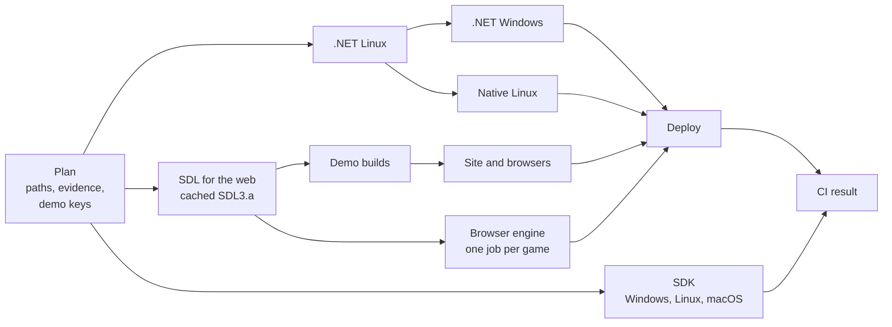
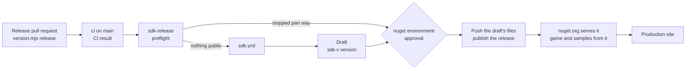

# CI, validation and releases

How MicroEngine is checked and published, and what it costs. Internal document: it is not published on the site.
Decision: [ADR 0013](decisions/0013-ci-cost-and-manual-releases.md). Audit, costs and risks:
[INFRA-1 evaluation](evaluations/infra-1.md). Site build and Vercel settings: [publishing the site](deployment.md).

**In one sentence:** pull requests and `main` run the checks a change needs, once per content; a full validation of
`main` runs every night; everything else (manual validation, experimental platforms, releases) runs only when someone
starts it (the experimental platforms also monthly).

| Flow | Workflow | Starts | Publishes |
| --- | --- | --- | --- |
| Daily CI | [`ci.yml`](../.github/workflows/ci.yml) | every pull request, every push to `main` | site previews; production only when `main` changes the published site, always with the released demos |
| Full validation | [`validate.yml`](../.github/workflows/validate.yml) | every night on `main` (every supported check); Actions → validate → Run workflow (any ref) | nothing |
| Experimental platforms | [`platforms.yml`](../.github/workflows/platforms.yml) | manually, from validate, and on the 1st of each month | nothing |
| Release | [`release.yml`](../.github/workflows/release.yml) | Actions → release → Run workflow (ref; version optional) | a demo release and the site that serves it |
| SDK release | [`sdk-release.yml`](../.github/workflows/sdk-release.yml) | after ci passes on `main` (ends at once unless `main` documents an unpublished version), or by hand to resume | the SDK on nuget.org after the `nuget` environment's approval, then the site |
| Rollback | [`rollback.yml`](../.github/workflows/rollback.yml) | manually | an earlier production deployment |

The jobs themselves live in three reusable workflows: [`checks.yml`](../.github/workflows/checks.yml) (.NET, native
Linux, demo builds, site and browsers, browser engine suites), [`sdk.yml`](../.github/workflows/sdk.yml) (the SDK packages from outside the
repository) and [`deploy-site.yml`](../.github/workflows/deploy-site.yml) (Vercel). How the three publications relate
and how to run each: [Releasing](releasing.md); decision: [ADR 0022](decisions/0022-release-coordination.md).

**While [`.github/phase-freeze`](../.github/phase-freeze) exists, nothing in this table publishes**, except Rollback:
see [Publication freeze](#publication-freeze).

## Daily CI



1. **Plan** runs the planner and release tool tests, checks that every documentation reference names the documented
   SDK version ([`sdk/version.mjs check`](../sdk/version.mjs)), maps the changed paths to checks
   ([`changes.mjs`](../.github/scripts/changes.mjs)), looks up evidence that a needed check already passed for the same
   inputs ([`evidence.mjs`](../.github/scripts/evidence.mjs)), lints the workflows when they changed, and decides the
   demo builds ([`demos.mjs plan --policy ci`](../site/scripts/demos.mjs)).
2. **Checks** run what is needed and not already proven. Windows and native Linux start only after the Linux tests
   pass, so a broken change never occupies a Windows runner. **SDK** (`sdk.yml`) runs beside them when a package
   input changed: pack, check, and a game made from the packages on Windows, Linux and macOS. The **browser engine**
   suites run beside them too, one job per game the change reaches, after SDL for the web
   ([SDL for the web](#sdl-for-the-web), [Browser tests](#browser-tests)).
3. **Deploy**: a protected preview for pull requests that change the site or a demo; production for pushes to
   `main` that change the published site (documentation, site, game pages). Production always uses the latest
   demo release, and is held (the current deployment stays, with a warning) while the documentation presents an SDK
   version nuget.org does not serve yet ([Releasing](releasing.md#versions)), and never while publication is frozen
   ([Publication freeze](#publication-freeze)). The decision is `deployTarget` in
   [`freeze.mjs`](../.github/scripts/freeze.mjs).
4. **CI result** is the gate: it fails if anything needed failed, was cancelled or did not run, or if a wanted
   deployment did not succeed. Its summary says, per check, whether it ran here, was proven by an earlier run (with a
   link) or was not needed, and what the run cost.

Pull requests are cancelled when a newer commit arrives; pushes to `main` are not, because they may deploy.

### What runs for a change

| Change | .NET Linux | .NET Windows | Native Linux | SDK | Demo builds | Browser suites | Browser engine | Deploy |
| --- | --- | --- | --- | --- | --- | --- | --- | --- |
| Engine core (`src/MicroEngine`) | yes | yes | yes | yes | the canary game | all | all games | preview |
| raylib backend (`src/MicroEngine.Raylib`, desktop only) | yes | yes | yes | yes | the canary game | all | all games | preview |
| SDL backend (`src/MicroEngine.Sdl`) | yes | yes | yes | yes | the canary game | all | all games | preview |
| SDL for the web (`src/MicroEngine.Sdl/native`) | — | — | — | yes | the canary game | all | all games | preview |
| One game's code (`games/<Name>`) | that game's tests | — | that game's captures | — | that game | all | that game | preview |
| A game's Markdown or screenshots | — | — | — | — | — | layout | — | preview, production |
| Engine or backend tests | those tests | yes | backend tests only | — | — | — | — | — |
| One game's tests | those tests | — | — | — | — | — | — | — |
| Samples | compile only | — | — | — | — | — | — | — |
| The tool, the template, SDK tests and the sample they play (`src/MicroEngine.Cli`, `templates/`, `sdk/tests/external.mjs`, `samples/AssetGallery`) | the tool's, template's and sample's tests | the tool's | — | yes | — | — | browser host only | — |
| Documented SDK version (`sdk/version.json`, `sdk/version.mjs`, `sdk/tests/docs.mjs`) | all, with the documented samples | — | — | — | — | — | — | — |
| Desktop capture scripts and references (`web/tests`) | — | — | yes | its browser driver only | — | — | the scenarios, the desktop runner, the suites (`run.mjs`, `mobile.mjs`, `measure.mjs`) and the browser driver | — |
| Web host or toolchain (`web/`) | — | — | — | toolchain, server | the canary game | all | all games | preview, production |
| Site (`site/`) | — | — | — | — | — | all | — | preview, production |
| Documentation (`docs/`, other Markdown) | — | — | — | — | — | layout | — | preview, production |
| Daily workflows (`sdk.yml`, `box2d.yml` and `sdl-web.yml` too), their scripts, build settings | yes | yes | yes | yes | as keys say | all | all games | preview, production |
| Manual workflows (validate, release, sdk-release, platforms, rollback) | lint only | — | — | — | — | — | — | — |
| Mobile hosts (`platforms/`) | advisory only: run validate or platforms | — | — | — | — | — | — | — |
| Task records, experiments (`odd/`, `experiments/`) | — | — | — | — | — | — | — | — |
| A path no rule knows | everything | everything | everything | yes | as keys say | all | all games | preview, production |

- **Scope** comes from the project graph ([`projects.mjs`](../.github/scripts/projects.mjs), ADR 0014): the .NET jobs
  run the test projects that reference the changed project, directly or not, and native Linux compares the captures
  of the games it reaches. The engine core reaches everything; the raylib backend reaches every game and the backend
  tests but not the core tests. A file outside every project (build settings, `web/tests`, a new folder) runs
  everything. The Plan summary prints the scope; evidence keys include it.
- **Advisory** means the Plan summary recommends running macOS, Android or iOS. Daily CI never starts an emulator or
  a simulator; it starts a macOS runner only on public runners (below).
- **Windows** runs for the engine, the backend, their tests and build settings. A game is managed code the Linux
  tests already ran; Windows-only behaviour lives in the engine. Every full validation runs the games' tests on
  Windows, and every demo build compiles them there.
- **Browser suites** (`site/tests/browser.mjs --suites`): `layout` opens every page at three widths; `play` loads,
  plays, restarts and exits each demo; `touch` checks the touch panels. A rebuilt package is always played.
- **Browser engine** (`web/tests/run.mjs`, [Browser tests](#browser-tests)): one job per game, on a development
  package built in the job. It plays the games whose own folders changed when every change that needs it
  is a game's; any other input (the engine, the raylib and SDL backends, SDL for the web, the web host and build, the
  suites, an unknown path) plays all four. The desktop launcher is not part of the browser build and does not run it.

### Evidence: a check runs once per content

Each check has a key: a hash of the Git blobs of every file it can read. Files are excluded by rule, not included,
so a new folder is an input until a rule says otherwise; `.github/` is an input of every check.

| Check | Not an input |
| --- | --- |
| `dotnet`, `windows` | `docs/`, `site/`, `web/`, `platforms/`, `odd/`, `experiments/`, Markdown (except in a game's `Content/`) |
| `native` | the same, but `web/tests/` is an input |
| `site` | `src/`, `tests/`, `samples/`, `platforms/`, `odd/`, `experiments/`, game files other than Markdown and screenshots; the key adds the demo packages used and the browser suites |
| `sdk` | `docs/`, `site/`, `platforms/`, `games/`, `tests/`, `samples/`, `odd/`, `experiments/`, Markdown outside `src/`, `templates/` and `sdk/` (except `THIRD-PARTY-NOTICES.md`, which the packages ship) |
| `web` (browser engine) | `docs/`, `site/`, `platforms/`, `tests/`, `samples/`, `sdk/`, `odd/`, `experiments/`, the Android and iOS hosts, Markdown (except in a game's `Content/`); the key adds the games played |

When a job passes it uploads the artifact `evidence-<check>-<key>` (kept 30 days); the browser engine check records
its evidence only when the job of every game passed. Plan skips a needed check when
such an artifact exists, is unexpired, and was produced by a commit with an identical `.github` folder. Examples:

- A pull request that passed its engine tests and then gets a documentation fix runs only the site.
- Merging an up-to-date pull request into `main` re-runs nothing it already passed; if `main` moved and the merge
  changes an input, the keys differ and the checks run.
- Any failure to look evidence up (API error, unknown commit) runs the check.

### Demo builds in daily CI

Packages are keyed by content ([publishing the site](deployment.md#demo-packages-are-addressed-by-content)). Daily
CI builds a missing package only when it brings new evidence:

- a change to one game's own inputs (its folder or registry entry) builds that game;
- a change to the shared inputs (engine, web host, toolchain) builds one **canary** game (`NeonRift`, or the
  repository variable `DEMO_CANARY`), which proves the engine still compiles to WebAssembly;
- before the first release, every missing package is built.

The other games are built by the next full validation or release. The site in a pull request uses each game's
current package when it is stored, otherwise the released one, and its build record (`/play/demos.json`) says
which.

## Full validation

Actions → **validate** → Run workflow: a ref, and boxes for each part. Every selected check runs, whatever changed
and whatever evidence exists; nothing is deployed or released. Demo packages (web and native downloads) that pass
their checks are stored in the integration store (prerelease `demo-artifacts`), as daily CI stores them.

**Nightly:** validate also runs every night at 03:17 UTC on `main` with every supported box (.NET, native Linux, web,
SDK, native packages) and no experimental platform, so a drifted reference, runner image or toolchain shows within a
day instead of at the next release. Packages are keyed by content: a night after a change to their inputs builds and
checks them; a night with no such change finds them stored and does not rebuild them. A red nightly run is fixed like
any failed check, by a pull request.

| Box | Jobs | Support |
| --- | --- | --- |
| .NET | .NET tests on Linux and Windows | supported |
| Native Linux | SDL and raylib under Xvfb: native tests, scripted captures against each backend's Linux reference | supported |
| Web | every missing demo package built; site; all browser suites in Chrome and Firefox; the browser engine suites of all four games in Chrome | supported |
| SDK | `sdk.yml`: the packages packed, checked and used from outside the repository on Windows, Linux and macOS | supported |
| Packages | every missing native download built, checked as the file a player downloads (Linux packages also on other distributions) and stored | supported |
| macOS | .NET tests, OpenGL probe, captures when a window can be opened | experimental |
| Android | APK built with the NDK and played on an emulator | experimental |
| iOS | the iOS host in the simulator, headless | experimental |

The **Report by platform** job lists outcome and cost per platform and fails only when a supported check failed;
experimental failures are reported as such and never gate a release. Untick what is not needed: macOS minutes cost
about ten times Linux minutes.

## Platform workflow

[`platforms.yml`](../.github/workflows/platforms.yml) runs macOS, Android, iOS and the web demos on mobile: from validate, manually (each
platform separately), and on the 1st of each month on `main`, to notice runner image and toolchain drift (Xcode,
workloads). It no longer runs weekly or on pull requests: a full run cost about $0.36 before PLATFORM-3, of which the
iOS job's macOS minutes were half. The repository is public now, so hosted runners cost nothing; jobs are tuned for
wall-clock time instead (below). Run it after changing `platforms/`, the SDL or raylib backends, or the desktop launcher.

| Job | Proves |
| --- | --- |
| macOS | build and tests; the 15 scenarios on SDL (Metal) against `sdl.json`; why raylib can or cannot open a window, and raylib captures when it can |
| Android | APKs on SDL for Meadow Run (code-first) and Neon Rift (content files), or the games listed in the `games` input: installed, started, drawn (captures against the emulator reference `sdl-android-x86_64.json`), audio device, keys, system taps on the confirm control and a finger held on the movement control at the positions the game logs, a scripted two-thumb run, background and back |
| iOS | the same games on SDL in the simulator: installed, started, drawn (captures against `sdl-ios-simulator-arm64.json`: the macOS Metal reference, which the simulator matches pixel for pixel, with its own touch-first Controls screens), audio device, scripted touches on the simulator's layout, background and back |
| Web mobile | the four web demos (development packages) on four emulated phones and tablets in Chrome with real multi-touch (`web/tests/mobile.mjs`); screenshots as an artifact |

Time goes to waiting, not to the checks, so they run side by side wherever results cannot depend on it (PLATFORM-3,
validation runs 41257531549 and 41258648571; the repository is public, so runner minutes are not the constraint):

| Where | How | Before → after |
| --- | --- | --- |
| Scripted captures (`desktop.mjs --jobs`, default up to 4) | Deterministic scripted runs side by side; results print in scenario order | macOS 197 s → 98 s; Native Linux, now with SDL as well as raylib, 148 s → 127 s |
| Site browser checks (`browser.mjs`) | Chrome and Firefox at once; four layout pages at a time in Chrome (one in Firefox, whose WebDriver BiDi loses contexts opened together) | 186 s → 115 s |
| Android, iOS | One job per game | Android 404 s → 258 s and 316 s; iOS 18 min → about 8.5 min each |
| iOS | Xcode pinned (`IOS_XCODE`) instead of found by a failing build; the background check waits for the game's log lines | included above |

Tried and reverted: booting the iOS simulator while the app builds. On the 3-core runner the two compete; the build and
setup steps slowed by more than the boot (about 3.5 minutes) saved. The iOS job's floor is now the simulator boot
plus the AOT build (about 2.7 minutes).

Native Linux in daily CI checks both desktop platforms: raylib against `linux-x64.json` and SDL (OpenGL on Mesa
llvmpipe) against `sdl-linux-x64.json`, plus the native tests of both (`tests/MicroEngine.Raylib.Tests`,
`tests/MicroEngine.Desktop.Tests`): keyboard and sound-server output for each, SDL gamepads, renderer equivalence.

The same job checks the tier-1 graphics device (SDL_GPU) on a software rasterizer: it installs Mesa's Vulkan drivers,
points the Vulkan loader at lavapipe alone (`lvp_icd*.json`, found by pattern because its file name changes between
Mesa versions), logs `vulkaninfo`'s device lines, and runs the `Gpu` test category (`TestCategory=Gpu`: the device
conformance suite on SDL_GPU, the 3D path's properties and a tier-1 game through the launcher) with
`MICROENGINE_GPU_ADAPTER=llvmpipe`, which fails any device whose adapter is not lavapipe. The existing native step
excludes that category. Then it runs the `samples/Slice3D` game with its script on the same adapter and keeps its
capture as the `gpu-captures` artifact; the job summary records the adapter, driver, depth formats and the capture.
The native category's tests of SDL_GPU are skipped where no SDL_GPU driver exists (macOS runners in this job's sense,
machines without Direct3D 12, Vulkan or Metal) and fail under `MICROENGINE_NATIVE_TESTS=1` when the default driver
cannot start.

## SDK checks and releases

| Workflow | When | What |
| --- | --- | --- |
| `sdk.yml` | called by daily CI when a package input changed (the `sdk` check, with evidence, required through **CI result**), by validate, by `sdk-release.yml`, or by hand | packs every SDK package (with SDL for the web), checks them (`sdk/tests/packages.mjs`), then on Windows, Linux and macOS installs the tool and template from that feed into a folder outside the repository and creates, builds, runs and packages a game (`sdk/tests/external.mjs`) |
| `sdk-release.yml` | after every ci run that passed for a push to `main`; by hand to resume | preflight (`sdk/version.mjs release-plan`) reads nuget.org and the GitHub release `sdk-v<version>`: nothing to do unless `main` documents a version nuget.org lacks; otherwise checks with `sdk.yml`, drafts, waits for the `nuget` environment's approval, pushes exactly the draft's packages with a one-hour Trusted Publishing key (GitHub OIDC), publishes the release, waits for nuget.org and builds a game and the documented samples from it, then deploys the site |



The procedure, the versions and recovery are in [Releasing](releasing.md). Nothing in daily CI publishes a package.

## Releases

A demo release `v<version>` is a GitHub release holding copies of the approved packages (`<Game>-<key>.tar.gz`
with their manifests), the native downloads (`<Game>-<game version>-<target>.<zip|tar.gz|apk>`, [packaging](../packaging/README.md))
and `release.json` (per game: key, archive SHA-256, the commit that built it, toolchain; per download: file, size,
SHA-256, versions, where it was checked). The **latest published release is what production serves**, and the demo
pages offer exactly its downloads; merging code never changes it.

Two kinds of artifact, never mixed up:

| | Integration packages | Approved packages |
| --- | --- | --- |
| Where | prerelease `demo-artifacts` | release `v<version>` |
| Written by | daily CI, validation, the release build | the release workflow only |
| Used by | CI site checks and previews | production |
| Identified by | content key | version, then key and SHA-256 |

### Publishing a release

Actions → **release** → Run workflow:

- **version**: `1.2.0` or `v1.2.0`; must be new. Empty takes the minor after the latest release (`v0.4.0` → `0.5.0`).
- **ref**: whose packages to release, default `main`. It must be on `main` and have a passed `ci` run (`main`'s head
  or a merge commit).
- **dry-run**: everything except deploying and publishing; the draft is discarded.

| Step | What it does | If it fails |
| --- | --- | --- |
| Preflight | version new; ref on `main` with a passed `ci` run; current `main` has a passed `ci` run (its site is deployed) and documents an SDK version nuget.org serves; chooses the downloadable targets (Android only with the signing key); lists missing packages | nothing happened |
| Build | builds only the missing packages, into the integration store: web packages, and native packages each built, played on its own system and only then stored | nothing public changed |
| Draft | copies every package after checking its archive against its manifest's SHA-256, native ones under player-facing names; writes `release.json`; refuses if any game lacks a package for an offered target | the partial draft is deleted |
| Verify | builds current `main`'s site with the draft's packages, checks every file against the release, downloads and hashes every native package again, runs unit tests, `check-dist` and every browser suite | the draft is discarded |
| Publish | `vercel build` with the draft's packages, every file checked again, staged production deployment, `vercel promote`, then the draft is published as latest | before the promote: nothing public changed; if publishing fails after it, production is rolled back |
| Record or clean up | a published release is written to the summary and each download's public address is checked; otherwise the draft is discarded | the release stays published (site and release agree); the address problem is reported |

Releases run one at a time, and the publish step holds the production lock from its build to the switch. If `main` moves while a release is
verified, it stops before deploying: run it again.

### First release

Until a demo release exists, production deployments from `main` are skipped with a warning and the current
production deployment stays. After this workflow reaches `main` and its `ci` run passes: run release with version
`0.1.0` and ref `main`. The four packages of `main` are already stored, so nothing is built.

### Rolling back

- **The site:** Actions → rollback (previous production deployment; the Hobby plan allows only that one).
- **The demos:** mark the previous release as latest (GitHub → Releases → edit → "Set as the latest release"), then
  roll back the site, or let the next production deployment pick it up. To publish older code, revert it on `main`
  and release a new version.

## Gates and required checks

`main` is protected by the repository ruleset **main**: changes arrive through pull requests, the **CI result**
check is required, force pushes and deletion are blocked (repository admins can bypass). Within a run, the
workflows are the gate:

| Kind | Examples | Effect |
| --- | --- | --- |
| Required | every needed daily check (the SDK check included); supported checks in validate and release | failure, cancellation or absence stops the deployment, fails **CI result** or refuses the release |
| Legitimately skipped | not needed for the change, or proven by evidence for identical inputs | reported as such in CI result |
| Informative | the Plan's advisory platforms, the cost summary | never blocks |
| Experimental | macOS, Android, iOS | reported per platform, never a gate |

Only **CI result** is required: it always runs and is green only when everything needed passed, so skipped jobs
never block a merge.

## Publication freeze

A long series of merges to `main` that must not reach the public (a reconstruction in progress) is protected by one
checked-in file, [`.github/phase-freeze`](../.github/phase-freeze). Its first line that is neither blank nor a `#`
comment is the reason shown in run summaries. It needs no secret, variable or repository setting.

| While the file exists on the commit | Effect |
| --- | --- |
| `ci.yml`, push to `main` | **Plan** decides `deploy=none` instead of `production` ([`freeze.mjs`](../.github/scripts/freeze.mjs) `deployTarget`); its summary says production was not deployed and why. Every check runs exactly as without the freeze, and **CI result** gates the same way |
| `ci.yml`, pull request | unchanged: the checks and the protected preview run |
| `sdk-release.yml` (after ci, or by hand) | **Preflight** ends with the decision `frozen` and a "Frozen" summary before asking nuget.org or GitHub ([`sdk/version.mjs`](../sdk/version.mjs) `release-plan`); check, draft, publish, verify and site are skipped. The run succeeds: a frozen merge is not a failure |
| `release.yml` | refused in **Preflight**, dry run included, when the file exists on the ref or on `main`: nothing is built, drafted or deployed |
| `rollback.yml` | unchanged: it only returns production to an earlier deployment |
| `validate.yml` (nightly and manual), `platforms.yml` | unchanged: they publish nothing |

Adding or removing the file is a change of its own for the planner (rule "publication freeze"): it builds the site and
checks its page layouts, nothing else.

**Lifting it** is the owner's decision: a pull request that deletes `.github/phase-freeze`. When it merges, `main`'s
ci deploys production with the site `main` accumulated meanwhile (held, as always, while the documentation presents an
SDK version nuget.org does not serve), and sdk-release runs again: if `main` documents a version nuget.org lacks, it
checks, drafts and waits for the `nuget` environment's approval ([Releasing](releasing.md#publication-freeze)). Demo
releases are again possible by hand.

## Public repository

What changes when the repository is public (decision: ADR 0014; publication steps: [PUBLIC-1](evaluations/public-1.md)):

- **Runners.** Standard GitHub-hosted runners are free for public repositories; larger runners are not. Set the
  repository variable `PUBLIC_RUNNERS=true` and daily CI also runs the headless .NET tests on macOS when the engine
  or backend changes: informative, `continue-on-error`, never evidence. Android and iOS stay in `platforms.yml`.
  The same variable switches the demo plan from one canary game to every game whose key changed (`--policy all`):
  an engine change builds and plays all four packages, still once per key, and the next release copies them all.
- **macOS runners switched off.** When GitHub has no macOS runner to give (jobs queued until they are cancelled, as
  during its macOS fleet migration on 2026-11-02), set the repository variable `MACOS_RUNNERS=off`: daily CI skips
  the informative macOS tests, the SDK check runs its external project on Windows and Linux only, and the macOS and
  iOS jobs of `platforms.yml` are skipped. Delete the variable to turn them back on; nothing else changes. Native
  macOS and iOS packages (releases) still need a macOS runner and are not skipped.
- **Fork pull requests are untrusted code.** They run under `pull_request` with a read-only token and no secrets;
  no workflow uses `pull_request_target`, and no self-hosted runner exists. Their runs are never accepted as evidence
  and record none; their demo packages stay in the run (workflow artifacts read through `DEMOS_OVERLAY`), never in
  the shared store; they get no preview deployment.
- **Settings to apply at publication:** Actions → General → "Require approval for all external contributors";
  workflow permissions read-only (already); a ruleset on `main` requiring pull requests and the **CI result**
  check, no force pushes or deletions; private vulnerability reporting and secret scanning with push protection on;
  environments `preview` and `production` limited to `main` and branches of this repository.
- **The demo store becomes public.** Assets of the `demo-artifacts` prerelease are downloadable by anyone, including
  packages of unreleased commits. They carry the third-party notices; production still serves only releases.

## Measuring cost

GitHub bills each job, rounded up to whole minutes, at the runner's rate: Linux $0.006, Windows $0.010, macOS
$0.062 per minute ([runner pricing](https://docs.github.com/en/billing/reference/actions-runner-pricing), read
2026-10-31). GitHub Free includes $12 per month for private repositories. Wall-clock duration is not what is billed:
parallel jobs add up, and a 10-second macOS job costs a full macOS minute.

```bash
node .github/scripts/ci-cost.mjs measure <run-id> [<run-id> ...]   # measured: billed minutes and cost of finished runs
node .github/scripts/ci-cost.mjs estimate                          # estimated: every change class, before and after
gh run list -L 20                                                  # run ids
```

Every CI result and validate report includes the cost of its own run. Re-run attempts count each executed job once.

**Real consumption** (the authority; the tools above estimate at list rates):

- github.com/settings/billing → the Actions tab → **View details**, or the **Metered usage** view ("Actions grouped
  by SKU"; filters, group and time frame). **Get usage report** emails a CSV.
- **Budgets and alerts** → **New budget** → Product-level budget, Actions; scope the account or this repository;
  an amount; "Stop usage when budget limit is reached" if available; "Receive budget threshold alerts" (75 %, 90 %,
  100 %). Included-usage alerts at 90 % and 100 % can be switched on separately
  ([budgets](https://docs.github.com/en/billing/how-tos/set-up-budgets)).

## Troubleshooting

| Symptom | Cause | Fix |
| --- | --- | --- |
| Production deployment skipped: "No demo release is published yet" | no release exists | [First release](#first-release) |
| A check you expected did not run | proven by evidence, or not needed | the CI result summary links the run that proved it |
| A check should not have been skipped | a rule in `changes.mjs` or `evidence.mjs` is too narrow | fix the rule and its test; a manual validate run checks everything meanwhile |
| Release refused: "ci has no passed run on main" | the ref is an intermediate commit or its run failed | release `main`'s head or a merge commit |
| Release stopped: "main moved" | a merge landed during the release | run it again |
| Production deployment skipped: "The documentation presents SDK …, which nuget.org does not serve" | a release pull request was merged and is waiting for approval | approve sdk-release, or revert the release pull request ([Releasing](releasing.md)) |
| Release refused: "main documents SDK …" | the same window | let sdk-release finish first |
| sdk-release: "Nothing to release" | the normal outcome of every merge that is not an SDK release | nothing |
| sdk-release refused, or stopped after publishing | a state its preflight cannot repair, or a failed verification | [Releasing, Recovering](releasing.md#recovering) |
| `release-verify` fails | a deployed file differs from the release | nothing was published; inspect the build |
| Site (Chrome and Firefox) fails with `TimeoutError: Timed out after 30000 ms while waiting for the WS endpoint URL to appear in stdout!` after its unit tests passed (known flake, ci run 41540582635) | a browser took longer than puppeteer's default 30 s to start on a busy runner; no check had run | re-run the failed job. The launcher is `launch()` in `site/tests/browser.mjs`, which has no longer timeout or retry yet; the browser engine suites (`web/tests/run.mjs`) give the launch alone 90 s and one retry that prints the browser's output, never retrying a check |
| Browser engine job: a frame difference against the desktop build | the two builds drift in some scrolling scenes (see [Browser tests](#browser-tests)) | reported only; the job's own checks decide pass or fail |

## Engine checks beyond unit tests

Moved from the public testing guide, which is for game developers.

### Native desktop checks

Scripts force actions on `InputMap` and headless tests never open a window, so neither proves that the desktop
backend works on a given system. The native checks do, and on Linux they run under a virtual display (Xvfb) and a
virtual sound server (PulseAudio):

| Check | What it shows | Where it runs |
| --- | --- | --- |
| Scripted scenarios on the desktop build | raylib and SDL draw the 15 browser-test scenarios (138 captures), each compared with its per-system visual reference | Linux automatically (both backends); macOS: SDL against its reference, raylib attempted |
| Keyboard | Key events from the X server (XTEST) reach the game through raylib and through SDL: a held key gives one press, stays down and gives one release; a tap shorter than a frame is still seen; two keys are independent (`KeyboardTests`, `SdlKeyboardTests`) | Linux |
| Audio device | The raylib audio device opens on the sound server instead of falling back to silence | Linux; macOS attempted |
| Audio output | A 440 Hz tone played through the engine, as a sound and as streamed music, is recorded from the virtual sink and recognised by level and frequency, through raylib and through SDL's default device (`AudioTests`, `SdlAudioTests`) | Linux |
| Gamepads | SDL's virtual pads connect, are recognised by family, press, and hand over when one is unplugged (`GamepadTests`) | Linux |
| Native packages | The downloadable package played by its own executable against its target's SDL reference ([packaging](../packaging/README.md)) | validate (nightly on `main`) and release, on each target's runner |

The keyboard and sound-server helpers are shared by both backends' tests (`tests/MicroEngine.Raylib.Tests/Shared`,
linked into `MicroEngine.Desktop.Tests`).

The visual reference keeps, for each capture, its size, a hash of its exact pixels and the mean colour of each cell of
a 32 × 18 grid. A run passes when every capture is there with its size and no cell moved by more than 3 out of 255:
another driver may round blending differently without failing, while a missing sprite, a wrong frame or a changed
HUD digit fails. Exact pixel equality is reported. Windows and Linux are not expected to produce identical pixels,
so each system gets its own reference; hosted Windows runners have no GPU and render with WARP, so their package
checks use `sdl-windows-ci.json`. A change that alters a capture on purpose re-records it in every reference that
holds it (`desktop.mjs --write-reference`, or only the changed entries), the Windows runner one included: that one is
read only by the package checks of validate and release.

### SDL for the web

The browser build of SDL (`SDL3.a`, a static WebAssembly library) is not in any package SDL publishes: MicroEngine
builds it from the SDL commit `src/MicroEngine.Sdl/native/sdl.env` pins (the one the `ppy.SDL3-CS` bindings were made
from) with the Emscripten of the .NET `wasm-tools` workload, by `src/MicroEngine.Sdl/native/build.sh`. Locally
`web/setup.sh` runs it into its toolchain folder. In CI the reusable workflow
[`sdl-web.yml`](../.github/workflows/sdl-web.yml) (called by `checks.yml` before every job that builds a web package,
or started by hand) builds it once per content: its cache key is `build.sh key browser-wasm`, a hash of `sdl.env`,
`build.sh` and the toolchain (Emscripten pack and CMake versions), so a cache hit reuses the library and only a change
of one of them rebuilds it (about two minutes). The build fails when the archive lacks a function the engine calls;
the job verifies `SHA256SUMS` and uploads the artifact `sdl-web-browser-wasm` (30 days), which the web jobs put where
`web/setup.sh` would have built it, so none of them compiles SDL. The `MicroEngine.Sdl` package carries the library
for browser builds; a release pack (`-p:MicroEngineRelease=true`) fails without it. Changing `sdl.env` or `build.sh`
runs the browser checks, the SDK check and the browser engine suites.

### Browser tests

`web/tests/run.mjs` plays development packages (`web/build.sh --dev`, SDL 3 in WebAssembly) in real browsers. In daily
CI (the **Browser engine** jobs, Chrome and Firefox on a virtual X server with a virtual sound server, one job per game
the change reaches) and in validate (all four games), it runs these suites, and the job fails when any of their checks
fails:

| Suite | What it shows |
| --- | --- |
| `platform` | loading, starting by a gesture, audio running after it, the canvas filling the page and the game frame filling the canvas, about 60 updates per second, held, released and sub-frame key presses, focus loss releasing keys, saves (corrupt and full storage, with Neon Rift's and Meadow Run's), playing again without reloading |
| `scripts` | the games' scripts replayed in the browser to their end; their captures are then compared byte for byte with the same scripts on the SDL desktop build (OpenGL on Mesa, `desktop.mjs --backend sdl` with the same `--out`). The comparison is **measured, not a gate**: on the first runs most captures were identical, but some scrolling scenes drift by a few pixels between the two builds (Meadow Run's level, Neon Rift's stage 1, a few Courtyard Key frames), so differences are listed in the job summary and kept as an artifact |
| `keyboard` | the same scripts typed through the browser's real key events reach the scene the scripted run ends in |
| `framerate` | 60 updates per second whether the page draws every frame, every second or every fourth |
| `audio` | the sound reaching the page's audio output has a measurable level within 15 seconds of the start (the result says when it came: title music is rendered in the background, later on a slow runner); suspended audio is explained and resumed by one click; a hidden page suspends its sound and resumes it when shown |
| `repeat` | each script played twice in fresh pages writes byte-identical captures (scripted runs are deterministic in a page as on desktop) |
| `gamepad` | an emulated standard-mapping gamepad (the Gamepad API, faked in the page): d-pad and left stick held and released, unplugging releases what it held |

Every suite runs in Chrome and in Firefox; each job then plays the game on four emulated phones and tablets
(`web/tests/mobile.mjs`: multi-touch, safe-area insets, rotation, focus loss; Chromium with mobile user agents, not
Safari), which also fails the job, and reports without gating the package's download size, its load and start-up time
and the time inside each frame (`web/tests/measure.mjs`, medians of three runs in Chrome). These are the checks that
made SDL the browser platform in place of raylib (they ran on both until then). Real phones, Safari and iOS are not
checked by CI.

The `autopilot` suite (Neon Rift's autopilot clearing stages 1 to 3) is run by hand:
`node web/tests/run.mjs platform scripts autopilot --browsers chrome,firefox`. Each scenario names a game, a script
and its environment; from the browser test scenarios:

```json
{ "game": "MeadowRun", "script": "smoke.script", "keyboard": true, "env": {} },
{ "game": "CourtyardKey", "script": "boss.script", "env": { "COURTYARD_START": "boss" } },
```

## Documentation checks

- The site build fails when a quoted code block differs from its sample (`site/src/lib/repo-docs.mjs`) or a page links
  to a page or anchor the site does not have (`site/scripts/check-dist.mjs`).
- The Linux .NET job checks that `docs/api` matches the XML comments (`site/scripts/api-reference.mjs --check`) when an
  engine project is tested, and builds the documented samples outside the repository at the documented SDK version
  (`sdk/tests/docs.mjs`: from nuget.org, or from this commit's packages before that version is published) when
  `tests/Samples.Tests` is selected.
- Plan checks that every active documentation reference names the documented SDK version (`sdk/version.mjs check`,
  [Releasing, Versions](releasing.md#versions)).
- The CI planner (`.github/scripts/projects.mjs`) reads the `ProjectReference` items a `Directory.Build.targets` adds,
  so an engine change also selects `tests/Samples.Tests`.
