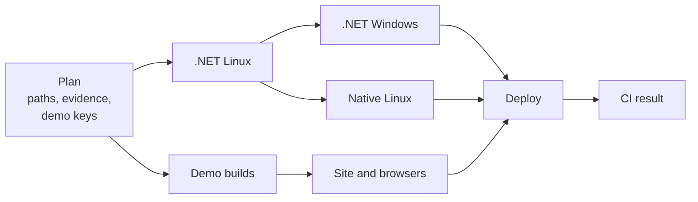

# CI, validation and releases

How MicroEngine is checked and published, and what it costs. Internal document: it is not published on the site.
Decision: [ADR 0013](decisions/0013-ci-cost-and-manual-releases.md). Audit, costs and risks:
[INFRA-1 evaluation](evaluations/infra-1.md). Site build and Vercel settings: [publishing the site](deployment.md).

**In one sentence:** pull requests and `main` run the checks a change needs, once per content; everything else
(full validation, experimental platforms, releases) runs only when someone starts it.

| Flow | Workflow | Starts | Publishes |
| --- | --- | --- | --- |
| Daily CI | [`ci.yml`](../.github/workflows/ci.yml) | every pull request, every push to `main` | site previews; production only when `main` changes the published site, always with the released demos |
| Full validation | [`validate.yml`](../.github/workflows/validate.yml) | Actions → validate → Run workflow (any ref) | nothing |
| Experimental platforms | [`platforms.yml`](../.github/workflows/platforms.yml) | manually, from validate, and on the 1st of each month | nothing |
| Release | [`release.yml`](../.github/workflows/release.yml) | Actions → release → Run workflow (version, ref) | a demo release and the site that serves it |
| Rollback | [`rollback.yml`](../.github/workflows/rollback.yml) | manually | an earlier production deployment |

The jobs themselves live in two reusable workflows: [`checks.yml`](../.github/workflows/checks.yml) (.NET, native
Linux, demo builds, site and browsers) and [`deploy-site.yml`](../.github/workflows/deploy-site.yml) (Vercel).

## Daily CI



1. **Plan** runs the planner tests, maps the changed paths to checks
   ([`changes.mjs`](../.github/scripts/changes.mjs)), looks up evidence that a needed check already passed for the same
   inputs ([`evidence.mjs`](../.github/scripts/evidence.mjs)), lints the workflows when they changed, and decides the
   demo builds ([`demos.mjs plan --policy ci`](../site/scripts/demos.mjs)).
2. **Checks** run what is needed and not already proven. Windows and native Linux start only after the Linux tests
   pass, so a broken change never occupies a Windows runner.
3. **Deploy**: a protected preview for pull requests that change the site or a demo; production for pushes to
   `main` that change the published site (documentation, site, game pages). Production always uses the latest
   demo release.
4. **CI result** is the gate: it fails if anything needed failed, was cancelled or did not run, or if a wanted
   deployment did not succeed. Its summary says, per check, whether it ran here, was proven by an earlier run (with a
   link) or was not needed, and what the run cost.

Pull requests are cancelled when a newer commit arrives; pushes to `main` are not, because they may deploy.

### What runs for a change

| Change | .NET Linux | .NET Windows | Native Linux | Demo builds | Browser suites | Deploy |
| --- | --- | --- | --- | --- | --- | --- |
| Engine core (`src/MicroEngine`) | yes | yes | yes | the canary game | all | preview |
| raylib backend (`src/MicroEngine.Raylib`) | yes | yes | yes | the canary game | all | preview |
| One game's code (`games/<Name>`) | that game's tests | — | that game's captures | that game | all | preview |
| A game's Markdown or screenshots | — | — | — | — | layout | preview, production |
| Engine or backend tests | those tests | yes | backend tests only | — | — | — |
| One game's tests | those tests | — | — | — | — | — |
| Samples | compile only | — | — | — | — | — |
| Desktop capture scripts (`web/tests`) | — | — | yes | — | — | — |
| Web host or toolchain (`web/`) | — | — | — | the canary game | all | preview, production |
| Site (`site/`) | — | — | — | — | all | preview, production |
| Documentation (`docs/`, other Markdown) | — | — | — | — | layout | preview, production |
| Daily workflows, their scripts, build settings | yes | yes | yes | as keys say | all | preview, production |
| Manual workflows (validate, release, platforms, rollback) | lint only | — | — | — | — | — |
| Mobile hosts (`platforms/`) | advisory only: run validate or platforms | — | — | — | — | — |
| Task records, experiments (`odd/`, `experiments/`) | — | — | — | — | — | — |
| A path no rule knows | everything | everything | everything | as keys say | all | preview, production |

- **Scope** comes from the project graph ([`projects.mjs`](../.github/scripts/projects.mjs), ADR 0014): the .NET jobs
  run the test projects that reference the changed project, directly or not, and native Linux compares the captures
  of the games it reaches. The engine core reaches everything; the raylib backend reaches every game and the backend
  tests but not the core tests. A file outside every project (build settings, `web/tests`, a new folder) runs
  everything. The Plan summary prints the scope; evidence keys include it.
- **Advisory** means the Plan summary recommends running macOS, Android or iOS. Daily CI never starts an emulator or
  a simulator; it starts a macOS runner only on public runners (below).
- **Windows** runs for the engine, the backend, their tests and build settings. A game is managed code the Linux
  tests already ran; Windows-only behaviour lives in the engine. Every full validation runs the games' tests on
  Windows, and every demo build compiles them there.
- **Browser suites** (`site/tests/browser.mjs --suites`): `layout` opens every page at three widths; `play` loads,
  plays, restarts and exits each demo; `touch` checks the touch panels. A rebuilt package is always played.

### Evidence: a check runs once per content

Each check has a key: a hash of the Git blobs of every file it can read. Files are excluded by rule, not included,
so a new folder is an input until a rule says otherwise; `.github/` is an input of every check.

| Check | Not an input |
| --- | --- |
| `dotnet`, `windows` | `docs/`, `site/`, `web/`, `platforms/`, `odd/`, `experiments/`, Markdown (except in a game's `Content/`) |
| `native` | the same, but `web/tests/` is an input |
| `site` | `src/`, `tests/`, `samples/`, `platforms/`, `odd/`, `experiments/`, game files other than Markdown and screenshots; the key adds the demo packages used and the browser suites |

When a job passes it uploads the artifact `evidence-<check>-<key>` (kept 30 days). Plan skips a needed check when
such an artifact exists, is unexpired, and was produced by a commit with an identical `.github` folder. Examples:

- A pull request that passed its engine tests and then gets a documentation fix runs only the site.
- Merging an up-to-date pull request into `main` re-runs nothing it already passed; if `main` moved and the merge
  changes an input, the keys differ and the checks run.
- Any failure to look evidence up (API error, unknown commit) runs the check.

### Demo builds in daily CI

Packages are keyed by content ([publishing the site](deployment.md#demo-packages-are-addressed-by-content)). Daily
CI builds a missing package only when it brings new evidence:

- a change to one game's own inputs (its folder or registry entry) builds that game;
- a change to the shared inputs (engine, web host, toolchain) builds one **canary** game (`NeonRift`, or the
  repository variable `DEMO_CANARY`), which proves the engine still compiles to WebAssembly;
- before the first release, every missing package is built.

The other games are built by the next full validation or release. The site in a pull request uses each game's
current package when it is stored, otherwise the released one, and its build record (`/play/demos.json`) says
which.

## Full validation

Actions → **validate** → Run workflow: a ref, and boxes for each part. Every selected check runs, whatever changed
and whatever evidence exists; nothing is deployed.

| Box | Jobs | Support |
| --- | --- | --- |
| .NET | .NET tests on Linux and Windows | supported |
| Native Linux | raylib under Xvfb: native tests, scripted captures against the Linux reference | supported |
| Web | every missing demo package built; site; all browser suites in Chrome and Firefox | supported |
| macOS | .NET tests, OpenGL probe, captures when a window can be opened | experimental |
| Android | APK built with the NDK and played on an emulator | experimental |
| iOS | the iOS host in the simulator, headless | experimental |

The **Report by platform** job lists outcome and cost per platform and fails only when a supported check failed;
experimental failures are reported as such and never gate a release. Untick what is not needed: macOS minutes cost
about ten times Linux minutes.

## Platform workflow

[`platforms.yml`](../.github/workflows/platforms.yml) runs macOS, Android, iOS and the web demos on mobile: from validate, manually (each
platform separately), and on the 1st of each month on `main`, to notice runner image and toolchain drift (Xcode,
workloads). It no longer runs weekly or on pull requests: a full run cost about $0.36 before PLATFORM-3, of which the
iOS job's macOS minutes were half. The repository is public now, so hosted runners cost nothing; jobs are tuned for
wall-clock time instead (below). Run it after changing `platforms/`, the SDL or raylib backends, or the desktop launcher.

| Job | Proves |
| --- | --- |
| macOS | build and tests; the 15 scenarios on SDL (Metal) against `sdl.json`; why raylib can or cannot open a window, and raylib captures when it can |
| Android | APKs on SDL for Meadow Run (code-first) and Neon Rift (content files), or the games listed in the `games` input: installed, started, drawn (captures against `sdl.json`), audio device, keys, system taps on the confirm control and a held drag on the movement control at the positions the game logs, a scripted two-thumb run, background and back |
| iOS | the same games on SDL in the simulator: installed, started, drawn (captures against the Metal reference `sdl-macos-arm64.json`, which the simulator matches pixel for pixel), audio device, scripted touches on the simulator's layout, background and back |
| Web mobile | the four web demos (development packages) on four emulated phones and tablets in Chrome with real multi-touch (`web/tests/mobile.mjs`); screenshots as an artifact |

Time goes to waiting, not to the checks, so they run side by side wherever results cannot depend on it (PLATFORM-3,
validation runs 41257531549 and 41258648571; the repository is public, so runner minutes are not the constraint):

| Where | How | Before → after |
| --- | --- | --- |
| Scripted captures (`desktop.mjs --jobs`, default up to 4) | Deterministic scripted runs side by side; results print in scenario order | macOS 197 s → 98 s; Native Linux, now with SDL as well as raylib, 148 s → 127 s |
| Site browser checks (`browser.mjs`) | Chrome and Firefox at once; four layout pages at a time in Chrome (one in Firefox, whose WebDriver BiDi loses contexts opened together) | 186 s → 115 s |
| Android, iOS | One job per game | Android 404 s → 258 s and 316 s; iOS 18 min → about 8.5 min each |
| iOS | Xcode pinned (`IOS_XCODE`) instead of found by a failing build; the background check waits for the game's log lines | included above |

Tried and reverted: booting the iOS simulator while the app builds. On the 3-core runner the two compete; the build and
setup steps slowed by more than the boot (about 3.5 minutes) saved. The iOS job's floor is now the simulator boot
plus the AOT build (about 2.7 minutes).

Native Linux in daily CI checks both desktop platforms: raylib against `linux-x64.json` and SDL (OpenGL on Mesa
llvmpipe) against `sdl-linux-x64.json`, plus the SDL platform tests (`tests/MicroEngine.Desktop.Tests`).

## Releases

A demo release `v<version>` is a GitHub release holding copies of the approved packages (`<Game>-<key>.tar.gz`
with their manifests), the native downloads (`<Game>-<game version>-<target>.<zip|tar.gz|apk>`, [packaging](../packaging/README.md))
and `release.json` (per game: key, archive SHA-256, the commit that built it, toolchain; per download: file, size,
SHA-256, versions, where it was checked). The **latest published release is what production serves**, and the demo
pages offer exactly its downloads; merging code never changes it.

Two kinds of artifact, never mixed up:

| | Integration packages | Approved packages |
| --- | --- | --- |
| Where | prerelease `demo-artifacts` | release `v<version>` |
| Written by | daily CI, validation, the release build | the release workflow only |
| Used by | CI site checks and previews | production |
| Identified by | content key | version, then key and SHA-256 |

### Publishing a release

Actions → **release** → Run workflow:

- **version**: `1.2.0` or `v1.2.0`; must be new.
- **ref**: whose packages to release, default `main`. It must be on `main` and have a passed `ci` run (`main`'s head
  or a merge commit).
- **dry-run**: everything except deploying and publishing; the draft is discarded.

| Step | What it does | If it fails |
| --- | --- | --- |
| Preflight | version new; ref on `main` with a passed `ci` run; current `main` has a passed `ci` run (its site is deployed); chooses the downloadable targets (Android only with the signing key); lists missing packages | nothing happened |
| Build | builds only the missing packages, into the integration store: web packages, and native packages each built, played on its own system and only then stored | nothing public changed |
| Draft | copies every package after checking its archive against its manifest's SHA-256, native ones under player-facing names; writes `release.json`; refuses if any game lacks a package for an offered target | the partial draft is deleted |
| Verify | builds current `main`'s site with the draft's packages, checks every file against the release, downloads and hashes every native package again, runs unit tests, `check-dist` and every browser suite | the draft is discarded |
| Publish | `vercel build` with the draft's packages, every file checked again, staged production deployment, `vercel promote`, then the draft is published as latest | before the promote: nothing public changed; if publishing fails after it, production is rolled back |
| Record or clean up | a published release is written to the summary and each download's public address is checked; otherwise the draft is discarded | the release stays published (site and release agree); the address problem is reported |

Releases run one at a time, and the publish step holds the production lock from its build to the switch. If `main` moves while a release is
verified, it stops before deploying: run it again.

### First release

Until a demo release exists, production deployments from `main` are skipped with a warning and the current
production deployment stays. After this workflow reaches `main` and its `ci` run passes: run release with version
`0.1.0` and ref `main`. The four packages of `main` are already stored, so nothing is built.

### Rolling back

- **The site:** Actions → rollback (previous production deployment; the Hobby plan allows only that one).
- **The demos:** mark the previous release as latest (GitHub → Releases → edit → "Set as the latest release"), then
  roll back the site, or let the next production deployment pick it up. To publish older code, revert it on `main`
  and release a new version.

## Gates and required checks

`main` is protected by the repository ruleset **main**: changes arrive through pull requests, the **CI result**
check is required, force pushes and deletion are blocked (repository admins can bypass). Within a run, the
workflows are the gate:

| Kind | Examples | Effect |
| --- | --- | --- |
| Required | every needed daily check; supported checks in validate and release | failure, cancellation or absence stops the deployment, fails **CI result** or refuses the release |
| Legitimately skipped | not needed for the change, or proven by evidence for identical inputs | reported as such in CI result |
| Informative | the Plan's advisory platforms, the cost summary | never blocks |
| Experimental | macOS, Android, iOS | reported per platform, never a gate |

Only **CI result** is required: it always runs and is green only when everything needed passed, so skipped jobs
never block a merge.

## Public repository

What changes when the repository is public (decision: ADR 0014; publication steps: [PUBLIC-1](evaluations/public-1.md)):

- **Runners.** Standard GitHub-hosted runners are free for public repositories; larger runners are not. Set the
  repository variable `PUBLIC_RUNNERS=true` and daily CI also runs the headless .NET tests on macOS when the engine
  or backend changes: informative, `continue-on-error`, never evidence. Android and iOS stay in `platforms.yml`.
  The same variable switches the demo plan from one canary game to every game whose key changed (`--policy all`):
  an engine change builds and plays all four packages, still once per key, and the next release copies them all.
- **Fork pull requests are untrusted code.** They run under `pull_request` with a read-only token and no secrets;
  no workflow uses `pull_request_target`, and no self-hosted runner exists. Their runs are never accepted as evidence
  and record none; their demo packages stay in the run (workflow artifacts read through `DEMOS_OVERLAY`), never in
  the shared store; they get no preview deployment.
- **Settings to apply at publication:** Actions → General → "Require approval for all external contributors";
  workflow permissions read-only (already); a ruleset on `main` requiring pull requests and the **CI result**
  check, no force pushes or deletions; private vulnerability reporting and secret scanning with push protection on;
  environments `preview` and `production` limited to `main` and branches of this repository.
- **The demo store becomes public.** Assets of the `demo-artifacts` prerelease are downloadable by anyone, including
  packages of unreleased commits. They carry the third-party notices; production still serves only releases.

## Measuring cost

GitHub bills each job, rounded up to whole minutes, at the runner's rate: Linux $0.006, Windows $0.010, macOS
$0.062 per minute ([runner pricing](https://docs.github.com/en/billing/reference/actions-runner-pricing), read
2026-10-31). GitHub Free includes $12 per month for private repositories. Wall-clock duration is not what is billed:
parallel jobs add up, and a 10-second macOS job costs a full macOS minute.

```bash
node .github/scripts/ci-cost.mjs measure <run-id> [<run-id> ...]   # measured: billed minutes and cost of finished runs
node .github/scripts/ci-cost.mjs estimate                          # estimated: every change class, before and after
gh run list -L 20                                                  # run ids
```

Every CI result and validate report includes the cost of its own run. Re-run attempts count each executed job once.

**Real consumption** (the authority; the tools above estimate at list rates):

- github.com/settings/billing → the Actions tab → **View details**, or the **Metered usage** view ("Actions grouped
  by SKU"; filters, group and time frame). **Get usage report** emails a CSV.
- **Budgets and alerts** → **New budget** → Product-level budget, Actions; scope the account or this repository;
  an amount; "Stop usage when budget limit is reached" if available; "Receive budget threshold alerts" (75 %, 90 %,
  100 %). Included-usage alerts at 90 % and 100 % can be switched on separately
  ([budgets](https://docs.github.com/en/billing/how-tos/set-up-budgets)).

## Troubleshooting

| Symptom | Cause | Fix |
| --- | --- | --- |
| Production deployment skipped: "No demo release is published yet" | no release exists | [First release](#first-release) |
| A check you expected did not run | proven by evidence, or not needed | the CI result summary links the run that proved it |
| A check should not have been skipped | a rule in `changes.mjs` or `evidence.mjs` is too narrow | fix the rule and its test; a manual validate run checks everything meanwhile |
| Release refused: "ci has no passed run on main" | the ref is an intermediate commit or its run failed | release `main`'s head or a merge commit |
| Release stopped: "main moved" | a merge landed during the release | run it again |
| `release-verify` fails | a deployed file differs from the release | nothing was published; inspect the build |
