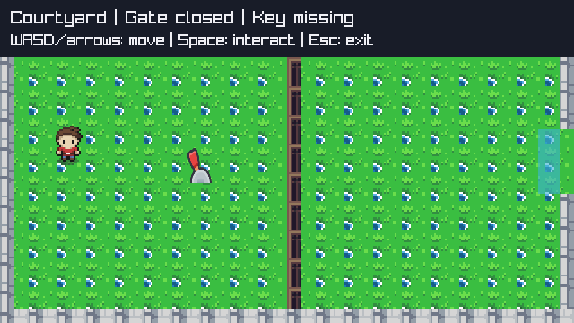
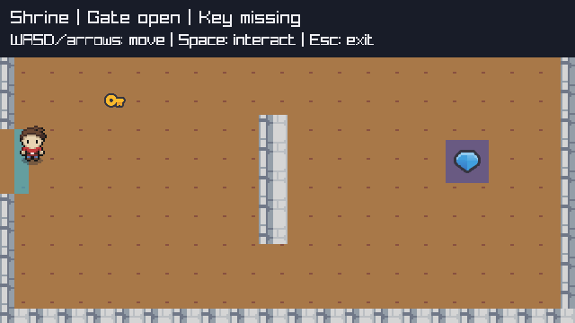

# ADV-ART-1 — real adventure art

Current candidate: local `feat/adventure-art`, baseline `0a6e95f`. Technical verification passed; no subjective acceptance, push or main integration. [Contract](../../specs/adventure-art.md).

## Resource decision

| Candidate | Verified publication | Consequence / selection |
| --- | --- | --- |
| ArMM1998 | [OpenGameArt author page](https://opengameart.org/content/zelda-like-tilesets-and-sprites?page=1), CC0; actual gfx_3.zip inspected | Selected original character272x256, Overworld640x576, Inner640x400. Directional16x32 cells and16px tiles exercise existing atlas API without a new importer. No embedded license/metadata: publication declaration and content coordinates are explicit. |
| Legend of Faune | [Ansimuz](https://ansimuz.itch.io/legend-of-faune), CC0; independent assessment found named down/side/up walk sequences | Viable alternative, not imported. Side direction does not itself prove both horizontal directions; existing public API cannot mirror. No reason to add flipping or a second character pack for current scope. |
| Scribble Dungeons | [Kenney](https://kenney-assets.itch.io/scribble-dungeons), CC0 | Viable dungeon fallback, not imported. Publication does not establish four-direction walking character; mixing another environment is unnecessary. |

Independent research preferred Legend of Faune's explicit frame names; root selects the
owner's first option because its explicit four-direction atlas is sufficient and validates
source-region reuse. No sword/combat/cave/NPC/object-system scope is inferred from available art.
Existing Kenney lever/key/gem remain independently licensed, unchanged and easy to recognize.

The ArMM1998 publication includes an unverified tree-similarity concern and author disagreement.
No disputed tree region is rendered. Complete original sheets retain unused pixels, so this
is not a claim that third-party-rights questions disappear. See [source notice](../../../../examples/Adventure/Assets/ArMM1998/NOTICE.md)
and [hash manifest](../../../../examples/Adventure/Assets/ArMM1998/provenance.json).
[CC0](https://creativecommons.org/publicdomain/zero/1.0/) does not provide third-party clearance or warranty.
Reassess before wider use/external distribution; no external publication is authorized now.

## Reproduction and boundaries

```powershell
pwsh -NoProfile -File checks/VerifyAdventureAssets.ps1
dotnet test checks/Adventure.Contracts/Adventure.Contracts.csproj -c Release --no-restore -p:UseSharedCompilation=false -m:1 -nodeReuse:false
pwsh -NoProfile -File checks/AdventureNativeSmoke.ps1
dotnet run --project examples/Adventure/Adventure.csproj -c Release
```

Managed new expectations were observed RED3/3 before presentation changes, then GREEN12/12
including all9 unchanged model tests. A first native wrapper run correctly rejected its
outdated six-image marker; updated to seven actual original sheets/icons, retaining strict
count/lifecycle checks. A transparent candidate grass cell was rejected by the opaque native
reference check; selected a fully opaque grass cell and reran successfully. No test reduction.
Native new art, gateclosed/open original RGB, HUD,460step public course/key/altar/reset/identical
replay/seven cached image leases and seven productionCLI exits0/1/2 passed before independent review.

No engine/model/backend/dependency or old-game changes. No new public engine contract;
directional facing is local presentation inferred from resolved motion, not gameplay/facing API.
Point-sampled2x is a choice of this content, not a Core style rule. General atlas loading,
animation/reset, optional labels, scaling and ownership are reused. Native probe may reference
Raylib solely to read framebuffer evidence; production game contains no native/vendor access.

## Owner-only evaluation

After technical closure, evaluate only new art readability, directional movement appearance
and whether walls/gate/objects/passages are clear. Existing controls, puzzle and replay remain
unchanged. No requirement to rerun tests or accept fullH2/combat/future art. Main remains unchanged.

## Independent technical closure2026-10-18

Frozen implementation892d8ff581355eb4640df89f6b73d78163272706 vs0a6e95f:
independent kenney_platformer_verify PASS S1-S4, no blockers/correction. Fresh serial
Release Hosting31/Loop159/Desktop38/TwoD10/Platformer6/Adventure12 =256/256PASS;
all15nativeharnessesPASS including Adventure actualPNG/originalpixel2x/gateRGB/HUD/
460stepcourse/consumedreset/identicalreplay/shared7imageleases plus7productionCLIcases0/1/2.
Fresh Adventure build0warnings/errors. All10originalfiles match manifests and committed
Gitblobs. Visual source inspection confirms down0/right32/up64/left96; selected floor/wall/gate
cells fully opaque/inbounds. Engine/model/olderconsumers/Program/config/dependencies unchanged.

Isolated gitarchive scratch269files, no.git/.codegraph/buildoutput copied; initial/final
source digest b8043260ce58c11886d130c360616c5f221cfbe77d1072e4ccc9b309bbedf656 identical.
Scratch: C:/Users/Usuario/AppData/Local/Temp/MicroEngine-ADVART-verify-dbe44a73cf6343628c37a7148fcef824.
One setup-only --no-restore build lacked executable assetsfile; local-cache restore and same
build passed. Earlier reviewer interruption returned no verdict and was not counted as proof.
Root accepts objective ADV-ART-1/ME061 only. No subjective/fullH2 acceptance, legal clearance,
external distribution or main integration inferred. RDD remains explicitly disabled.

Captures from actual native rendering, not concept art:



