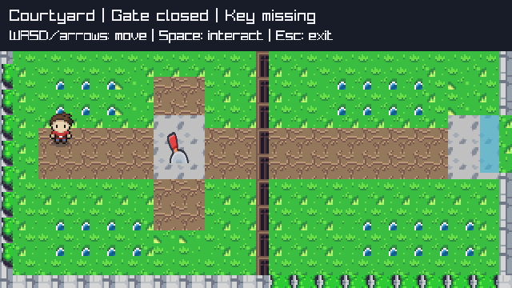
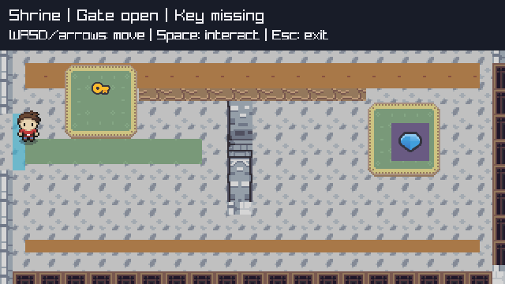

# ADV-ART-2 — finite scene composition and lessons

Local feat/adventure-composition, baseline31ebe37. Owner accepts the functional cycle,
not the earlier basic presentation. [Contract](../../specs/adventure-composition.md).
Technically accepted after independent verification; new subjective composition not accepted.

## What changed, and why no engine expansion

The selected existing ArMM1998 sheets contain enough paths, terrain, stonework and interior
decoration. Legend of Faune and Scribble Dungeons remain the previously assessed alternatives;
neither adds value sufficient to import more art or replace working character/interaction assets
for this finite composition pass. Same original bytes, CC0 declaration, [notice](../../../../examples/Adventure/Assets/ArMM1998/NOTICE.md)
and [provenance](../../../../examples/Adventure/Assets/ArMM1998/provenance.json); no download or disputed tree region.

| Content | Original source rectangle | Destination / role |
| --- | --- | --- |
| Grass | Overworld0,48,16,16;32,96,16,16;32,48,16,16 | Base and four flat garden patches; no new solid |
| Dirt | Overworld192,224,16,16 | Main eastbound route48,160,576,64; lever branch192,96,64,192 |
| Paving | Overworld224,192,16,16 | Lever/passage pads; Shrine stone floor |
| Low boundary foliage | Overworld0,240,16,16 | Clipped to existing Courtyard west/bottom solids only |
| Indoor inlay | Inner176,32,16,16;16,128,16,16 | Warm perimeter bands and flat green runner |
| Complete rug | Inner0,112,48,48 | Key80,80,96,96 and altar464,128,96,96 |
| Column relief | Inner80,112,16,64 |288,128,32,128 inside existing32x144pillar |
| Wall frieze | Inner96,0,16,16 | Existing Shrine east/bottom solid strips only |

Actual scaled source rectangles are integer/positive and2x, including boundary crops.
Layering: ground/paths/rugs, passage hint, exact active solids, solid-aligned decorations,
gate/interactable icons, directional player, HUD. No freestanding furniture or houses placed
on walkable space: they would falsely suggest new blocking geometry. Explicitly decorative
ground remains traversable; unchanged collision bounds define every real barrier.
Existing gate/key/altar states continue to control their original icon/render behavior.

## Reproduce technical proof

```powershell
dotnet test checks/Adventure.Contracts/Adventure.Contracts.csproj -c Release --no-restore -p:UseSharedCompilation=false -m:1 -nodeReuse:false
pwsh -NoProfile -File checks/AdventureNativeSmoke.ps1
pwsh -NoProfile -File checks/VerifyAdventureAssets.ps1
```

New composition test observed RED1 before content, then GREEN13/13 including unchanged9model
tests and prior3presentation tests. It checks complete-tile diversity separately from cropped
edge diversity, solid-aligned column and player-last art layering. Native retains all existing
proof and adds originalRGBsamples for path/grass/stonefloor/rug plus a required composition
marker;460step course/replay, shared7leases, avatar2x/HUD/gate pixels and7CLIcases0/1/2PASS.
Gate-open reference now samples the authored path rather than historical grass; closed-gate
and all previous invariant checks remain. Asset hashesPASS; build0warnings/errors.

## What this teaches, and what it does not

1. **Pipeline:** existing public PNG decode, cache, integer source regions and scaled drawing
   already support multi-cell props and layered tile scenes. No runtime tilemap/editor/atlas
   import abstraction is justified by two fixed rooms. Original source hashes remain valid.
2. **Authoring:** sheets without metadata need explicit consumer-owned palette/rectangles.
   Source bounds alone cannot prove that a crop depicts the intended material. Opaque-pixel,
   native-reference checks and screenshot inspection complement each other; terrain variants
   must be assessed as a composed scene, not just counted as distinct rectangles.
3. **Composition:** paths, contrast, complete rugs and landmarks communicate purpose better
   than repeating a single tile. Gameplay affordances must stay legible and decorative volume
   must not suggest new collision. Richness is an authored-content need, not evidence of a
   missing Core capability.
4. **Boundary:** this game's fixed palette, layout, layers and room identity belong to the
   consumer. Decoder/lease/animation/canvas remain general, unchanged and pack-independent.
5. **Limits:** static rooms, no occlusion/depth sorter/autotiling/editor/lighting/general map
   format or performance guarantee. A future demonstrated many-map authoring need may justify
   offline content metadata; it is a candidate, not a new task or approved engine API now.

## Subjective-only handoff and finite stop

Same run command and controls as [ADV-1](README.md). Evaluate whether the patio now reads as a
landscaped route and the shrine as a purposeful interior; walls, passage, lever, key and altar
must remain clear. No requirement to repeat functional or technical checks. Do not infer fullH2
acceptance or start another polish/mechanics horizon without a real roadmap need.




## Independent closure2026-10-18

Frozen39f35fce3c3f1d7ef4808a5747ef1bd7bfdfc6b2 vs31ebe37: independent
kenney_platformer_verify PASS S1-S3, no blockers/correction. FreshserialRelease
Hosting31/Loop159/Desktop38/TwoD10/Platformer6/Adventure13 =257/257PASS;
Adventure build0warnings/errors. Fresh Adventure native course460/reuse7/reset/composition/
cleanclose and7CLIexits0/1/2PASS; Platformer native/course/replay/CLIregressionPASS.
Remaining13nativeharnesses not rerun: priorproof892d8ff retained on unchangedprotectedpaths,
not represented as a fresh15harness run. All10assetmanifest/Gitblobhashes and baselineblobparityPASS.

Fresh gitarchive scratch274sourcefiles, initial/finaldigest
36a928645c6df1c991b3ff82baafa264ea0de8805243cd74e20387f482d68f6a identical;
no.git/.codegraph/bin/obj/.vs copied. Scratch:
C:/Users/Usuario/AppData/Local/Temp/MicroEngine-ADVART2-verify-bf23d1e1e7a143fe99adb1aaa0a4bc13.
No requiredcheckfailure. Independent crop/geometry/publicboundary reviewPASS: all volumetric
art lies within current solids, flatdecor does not imply newbarriers, originalassets/provenance
and engine/model/oldconsumer/config/dependencies unchanged. Fresh native captures pixel-identical
to committed screenshots (courtyard6b28bf930cc138d82fabcf5b75c38dea556bbc6b61c54d8abeedd59477b7dd1b;
shrineb648df89910649452d6b9e08b3d90b9a5692c7bf0b4811dafe6a69466d83b0f6).
Root accepts objective ADV-ART-2/ME062 only. Owner functional feedback recorded; new visual
composition/fullH2acceptance not inferred. This bounded pass ends at subjective composition,
not more speculative polish/editor work. Local-only, no push/main, unrelated.gitignore/.codegraph preserved.

## Subsequent owner interpretation review2026-10-18
The owner identifies underused combinable sheet pieces and asks for learning rather than continued demo expansion. [Tileset/depth assessment](tileset-assessment.md) supersedes any reading of the earlier crop/coherence PASS as proof of terrain-edge compatibility or general depth/elevation support. Earlier tests and frozen-source verdict remain valid for their actual pixel/bounds/route/lifetime scope; visual/fullH2 acceptance is not inferred. No composition source changed for this review.
