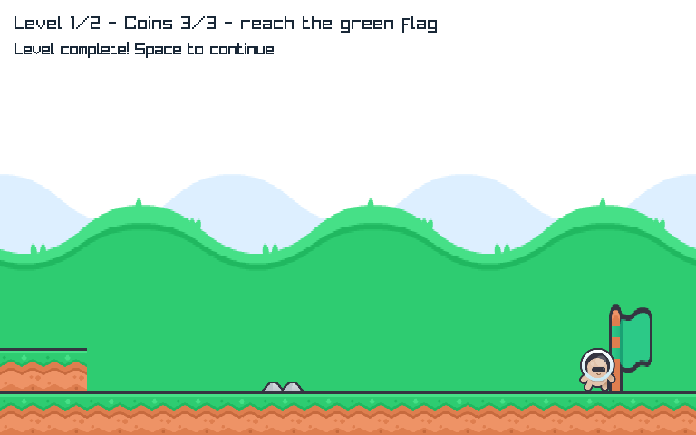
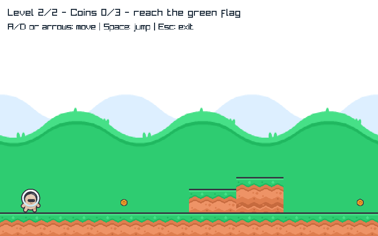
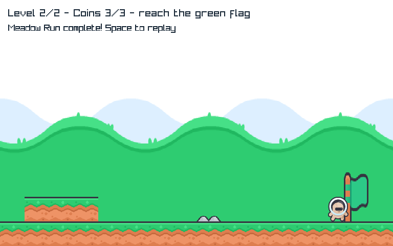

# MR-2 — Meadow Run two-level campaign
Technical verification in progress; owner subjective progression acceptance is not yet recorded.

## Play
```powershell
dotnet run --project C:\Proyectos\MicroEngine\examples\Platformer\Platformer.csproj -c Release
```
A/D or arrows move, Space jumps. Collect three coins in each level and reach the flag.
At the first flag, movement freezes and a fresh Space continues to level2. Death+fresh Space
retries only the current level. At the second flag, fresh Space replays the entire campaign.
Transition/retry input is consumed; held jump does not continue. Escape/window close exits.
No enemies, powers, music, effects, pause/menu or save progression are promised by this slice.

## Content and architectural evidence
[Approved contract](../../specs/meadow-progression.md), [staged roadmap/audio shortlist](roadmap.md).
All seven originalPNG images and XML/license/provenance are reused; no new assets imported.
Source roles/scaling/tile composition and seven-image cache retained. Game-owned levelcontent
and CampaignGame choose progression; MicroEngine lifecycle/input/static collision/imageleases/
animation/renderer remain unchanged. No scene/level/audio/particle module added to Core.
Existing single-level LevelGame/nativecourse/replay contracts remain usable and tested.

## Observed author checks
- Three campaign tests failed against a stub, then original6+new3 passed.
- Two presentation tests failed (stubHUD and missing same-run instance animation reset), then11passed.
- Additional constructor/immutability/defaultAPI regression brings Platformer to12passing cases.
- Counting managedcanvas proves7acquisitions across levels/finalrestart and one release perlease;
  new activeinstance with RunNumber0 resets walk animation. Native does not claim leasevisibility.
- PlatformerNativeSmoke retains original atlas/sourcepixels/defaultbudget/decoder/course/reset,
  adds twolevel publicroutes<=2000updates each, distinct terrainpixel/captures, currentlevel
  death/retry/finalreplay equivalence, samewindow and seven productionCLIcases0/1/2.
- First new smoke marker assertion had a PowerShell comma-expression mistake; corrected to
  an independent required -notmatch clause. Same native proof rerun PASS, no assertion removed.
- Full delegated own verification:289/289, all3representative native harnesses and bothotherasset
  verifiers PASS;9/9Platformer provenancehashes andall11trackedassetbytes unchanged.
- Initial sandbox testhost hang resolved with same required command outside sandbox. No skipped
  required checks or remaining author failure. Independent frozen-commit gate follows.

Reproduce with checks/PlatformerNativeSmoke.ps1 and dotnet test
checks/Platformer.Contracts/Platformer.Contracts.csproj -c Release plus documented serial flags.
The other13baseline native harnesses retain prior accepted proof, not freshly rerun this slice.

## Subjective handoff after objective closure
Only new continuation/retry/final-replay clarity, two-level pacing and control feel need owner
experience. Do not repeat automated course/hash/CLI checks manually. This second level is a
bounded geometry variation to validate progression, not a claim of rich enemy/level variety.




