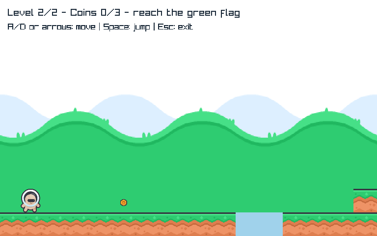
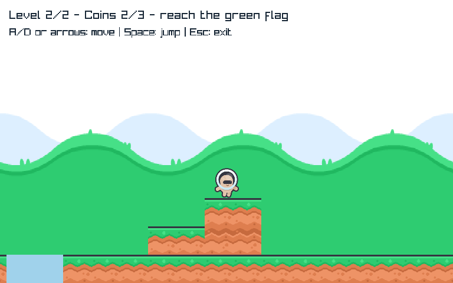

# MR-3 — Different authored challenge, same infrastructure
Technical verification in progress; owner acceptance of the new experience is pending.
MR-2 remains accepted for transitions only, not distinct scenario authoring.

## Play and scope
```powershell
dotnet run --project C:\Proyectos\MicroEngine\examples\Platformer\Platformer.csproj -c Release
```
Level1 remains the accepted original. Continue with Space. Level2 now requires an intentional
jump across a96unit gap and a climb to an elevated coin. Existing controls/retry/finalrestart
remain. No enemy/audio/menu system or claim of complete variedcampaign is included.

[Approved contract/evaluation](../../specs/meadow-distinct-levels.md) and
[staged maturation roadmap](../meadow-2/roadmap.md). Reuse: public StaticWorld, FrameAnimation,
ImageSet, Loop/Desktop unchanged. LevelContent is immutable authored game data, not a new
engine format/editor; same controller/rendering process both contents with no per-level rules.
Coin count is derived from content; shared world/viewport/camera/physics stay intentionallyfixed.

## Author evidence
New physical-gap/elevated-content and nojumpfailure tests:2RED againstMR2 then16GREEN after
construction and additional route/renderer regressions. All12 prior checks retained; the old
secondlayout coordinate assertion intentionally points to newcontent, not reducedcoverage.
Nojump proof observes unsupporteddescent insidegap thenfallY>528 beforex720, notspikes. An
initialtest incorrectly expected death beforex576, ignoring continuedhorizontal fall belowfloor;
correctedcausalassertions retain failureproof without changing physics or acceptance.
The oldverification route without gapanticipation fails; newpublicinput driver jumps before
unsupportededge then follows existingobstaclehandling. Driver is test-only, no gameautojump.
Nativepreserves oldlevel1/sourcepixels/defaultbudget/decoder/replay/CLI7; newgapfloorpixel at
(500,450) differsfromlevel1, elevatedcoin collectedabovefloor andactualrenderer captured.
Managedrenderer asserts no terraindraw insidegap and elevatedcoin destination; existing7lease
andanimation/retry/campaign tests remain. Captures inspected for technicalclarity, not playfeel.
Ownlongverification293/293 plus3representative nativeharnesses/assetintegrity PASS. Initial
sandbox verification failedenvironmentally, same escalatedcheckPASS; no requiredskip.
Independent frozen verification follows; no main/push for new MR3 pending ownerexperience.

## Subjective-only handoff after closure
Assess whether gap and raisedroute are readable, reachable and meaningfully different in play.
Do not repeat tests/hashchecks manually. This proves one distinctchallenge, not richcampaign
variety, arbitrarylevelauthoring/editor support, enemies/audio or general scene infrastructure.




## Independent closure — 2026-10-21
Frozen101fd10vsf27d971: launch_final_verify S1-S5 PASS, no blockers/corrections.
293/293freshmanaged,3representative nativeharnesses/bothotherassetverifiersPASS; Platformer
9/9manifesthashes/all11trackedassetbytes unchanged. Independent routes: level1=517updates
(same retained baseline), level2=509; no-gap-inputroute failsbyfall, bodyapproximately569,537,
onecoin/notspikes. Renderer/probe causality and oldstaticidentity/defaultcourse preserved.
Protected104entries identical SHA256
2DCDD2F3824BEA58177EF34630DD7D3B4B6FE2A552210B68DA05FF8B529FC43C.
Freshsourcecaptures inspectedtechnicalclarityonly. Initialsandboxrestoretempfailure resolved
with identicalescalatedverification; no requiredchecks skipped. Othernativeharnesses retained
historicalproof, notfresh. Parentcurrent PlatformerNativeSmoke-NoBuild/CLI7PASS.
RootacceptsobjectiveMR3/ME075/076. No owner acceptance of newgap/raisedroute yet, no main/push.
MR2 evaluatedstack integratedlocally tof27d971; newMR3 remains feat/meadow-distinct-levels.
This validates a bounded differentcontent/usecase, not arbitrarylevelauthoring or richcampaign.
No furtherpreparedtask: nextmanualgate is significant gap/raisedroutefeel/readability, never
puredatarefactor. Futureenemy/feedback/audio/menu roadmap continues after usefulexperience.
