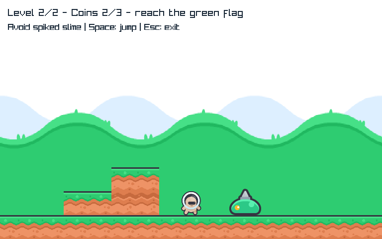

# MR-4 — One avoid-only spiked slime
Technical proof in review; no owner acceptance of the enemy experience yet.

## Play
```powershell
dotnet run --project C:\Proyectos\MicroEngine\examples\Platformer\Platformer.csproj -c Release
```
Level1 unchanged. Level2 keeps the gap/elevatedcoin and adds one moving spikedslime afterthe
stairs. Jump over it; touching anyside causes defeat, including landingonit. No stomp/combat.
Space retries currentlevel, resetspatrol; finalcampaignreplay unchanged. New HUD says Avoid
spikedslime; defeatmessage is cause-neutral (not falsely labeling enemy/fall deaths as spikes).

## Asset Readiness and separation
[Approved contract](../../specs/meadow-patrol.md). Two original64x64spike-slimeposes from the
same verified Kenney New Platformer Pack1.1, CC0-1.0, preservepalette/style. Archivehash and
originalembeddedlicense match priorprovenance; separate patrol-provenance.json records both
selectedoriginalfiles. No borrowedplayercolors, extra packmixing or imageedits.
ImageSet now caches9images across campaign,7forunchangedlevel1, and releases eachonce.
Patrol/reflection/contactdeath are game-owned. Existingpublicoverlap/render/loop/lifecycle
services reused; no engineAI/ECS/dynamicphysics/audio/particle abstraction added.

## Author checks
4newmodeltests RED withEnemyBody stub ->20GREEN; renderer/cache/phase2RED ->21GREEN.
Modelchecks exact/overshootbounds,100mscontact, invalidatomicity, terminalfreeze, resetinitial
position/direction, publicavoidancecompletion andunchanged517-steplevel1.
Rendererchecks actualposekeychange120ms, negativeelapsedatomicity, terminalphaseretained,
freshretry resets and total9leasecache/releaseonce. Newcontentcount is not reducedcoverage.
Native originalKPF/MR2/MR3 checks retained; actualoriginalPNGinteriorpixels verify bothposes,
then public100mscontactdeath/freeze/currentretry/avoidancecampaigncompletion. Capturesinspected
for technicalreadability only, not subjectiveenemyfairness/feel.
Fullownchecks298managedPASS,3nativewrappers emittedallnative/CLI PASS markers but didnotexit
before the delegated runner's bounded stop. Therefore those wrapper exitresults remain
unconfirmed in this ownrun, not silently counted exit0; finalfreshindependent gate must resolve.
Parentearliernativewholewrapperexited0 before the finalcause-neutralmessagechange.
All3assetverifiersPASS,9oldmanifestfiles/all11oldassets unchanged;2neworiginalPNGs matchhash.
No engine/CampaignGame/GamePlatform/Program/othergame/dependency edits.

Reproduce checks/PlatformerNativeSmoke.ps1 and checks/VerifyPlatformerPatrolAssets.ps1;
managed checks use documented serialtoolchain. Requiredfinalfrozenproof stillpending.
The otherhistorical nativeharnesses retainacceptedproof, not a newallharnessrun.



