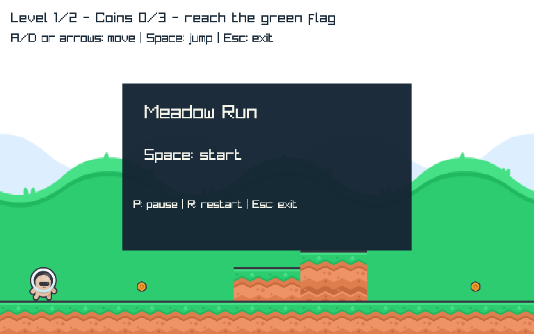
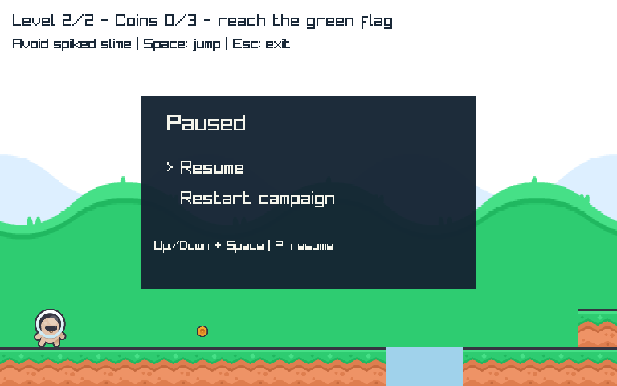
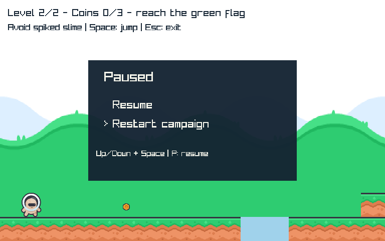

# MR-5 — Start, pause, resume and campaign restart
Technical review in progress; owner UX acceptance is not yet recorded.

## Play
```powershell
dotnet run --project C:\Proyectos\MicroEngine\examples\Platformer\Platformer.csproj -c Release
```
Space starts fromtitle. A/D/arrows move, Space jumps/continues/retries/replays asbefore.
P pauses/resumes. Whilepaused Up/Down changes Resume/Restartcampaign selection, Space confirms.
R explicitly restarts entirecampaign fromanyphase; Escape still exits. No save/autopause/focus
menu or remapping introduced. Pause polls/renders responsively but freezes game/animationclock.
Transitioninput is consumed; heldjump/movement duringmenu is not replayed afterresume.

## Design, assets and boundaries
[ADR0014](../../decisions/0014-game-session-input.md), [approved MR-5](../../specs/meadow-session-flow.md).
Onlyadapterchange: append semanticpause=P/restart=R to existingfixedDesktopprofile. No new Core
UI/scene/clock/lifecycle contract or nativeinput in game. Legacyknownaction consumers ignore
newstrings, with representativeLevelGame/Campaign/RPGexplore/battle regressions.
MeadowSession wraps unchangedCampaignGame; Title/Running/Paused andmenu selection belong to game.
Existing GamePlatform delegation clears currentCampaignbuffer afterrestart, focusloss behavior
unchanged/noautopause. Oldconstructors/factories remain valid. CLIusage/exits/counters/cleanup
retained; smoke canremain onTitle, fail-update still failsnormally.
AssetReadinessreadyreused existingart/defaultlabels, no newfont/menuPNG/audio/imagefiles.
StrictsessionDrawrequireslabels+imageregions beforeeffects; legacyDrawCampaign optional-label
behavior unchanged. Same9maxleases retained acrosspause/restart, no window or texture recreation.

## Author proof
DesktopnewP/R/order/querytests4RED ->40GREEN. Sessionstub6RED ->27PlatformerGREEN;
newpanel/pausedphase1RED ->28GREEN, focusreplacementbufferregression->29GREEN. RPGcompat22GREEN.
Allprior298tests retained; newtotal309. Managedtests cover titleconsumption, pausebody/enemy/
coin/level freeze, resume/restartpriority/order/helddiscard, invalidatomicity, clearlandingbuffer,
restartfromdeath/finallevel, postrestartfocusbufferforwarding and lifecycleforwarding.
Rendereractualpanellabels/selection/phasefreeze/resume/no-reacquire9leases allreleasedonce.
Nativeoriginalcourse/realart/patrol/gap/retry/CLI7 retained; newtitle/pause actualpanelpixels,
selectionarrowchange, frozenpublicstate/resume/restartsamewindow and captures PASS.
PhysicalP/R are fakekeyboardprovider tests, not OSinjectedkeypress evidence. Publicsemantic
snapshotdrivesnativegamejourney withoutproductionautomationflags.

OwnlongserialRelease309/309green,3native-NoBuildwrappers actualexit0 and3assetchecksPASS.
A laterouterPowerShellrerun hungafterPASSmarkers and wasinterrupted; not anextraexitconfirmed
run. Finalfresharchive/rebuildindependentgatepending. No requiredfailure silentlywaived.
Nativeframes inspectedtechnicalreadability only, not ownerergonomicsapproval.

## Subjective-only handoff after closure
Evaluate start/menu/pause/resume/restart clarity and whether the controls feel coherent.
No need manuallyrepeat clock/cleanup/hash/inputordering checks. Audio/music/particles/powers
remain laterstaged candidates, not bundled justtofillroadmaplist.




