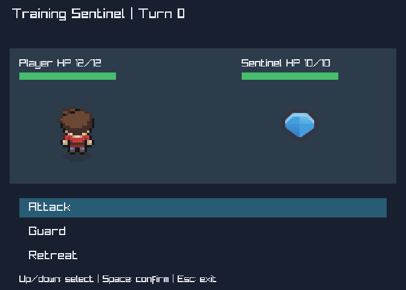

# RPG-1 — Trail Duel

First bounded H3 integration: public exploration/portals, trainer interaction, menu,
game-owned deterministic combat, result and return. [Contract](../../specs/rpg-encounter.md),
[ADR0013](../../decisions/0013-consumer-rpg-encounter.md), backlogME064/065/066.
Technically accepted after independent verification; product/fullH3 acceptance unobserved.

## Run and owner-only experience

```powershell
dotnet run --project C:\Proyectos\MicroEngine\examples\Rpg\Rpg.csproj -c Release
```

WASD/arrows move. The cyan right passage leads from Camp to Meadow; the left passage
returns. Both areas remain freely explorable, no forced visit sequence. In Camp move onto
the blue trainer/sentinel marker and press a fresh Space. Up/down select Attack, Guard or
Retreat; fresh Space confirms. One confirmation resolves the player action and, unless the
opponent was defeated or you retreated, the response. Turn/HP/menu state are visible.

- Three Attacks win: player2HP, opponent0HP, turn3.
- Two Attacks then two Guards lose: player0HP, opponent2HP, turn4.
- Retreat ends without damage or advancing the turn.
- At result, fresh Space returns at the exact exploration position. Defeat/retreat permit
  a fresh challenge with fullHP; victory clears that encounter, but exploration continues.
- Escape closes. Held Space is not repeated confirmation. No saving, capture or RPG content library.

Only assess new experiential evidence: discoverability of challenge/commands, HP/turn/result
clarity, movement freeze during combat and return-to-exploration feel. Technical checks below
are agent-owned, not instructions to repeat tests. Art remains deliberately bounded; no new
map composition/semantic/assisted-visual tools or depth systems are part of this slice.

## Technical reproduction and current evidence

```powershell
dotnet test checks/Rpg.Contracts/Rpg.Contracts.csproj -c Release --no-restore -p:UseSharedCompilation=false -m:1 -nodeReuse:false
pwsh -NoProfile -File checks/RpgNativeSmoke.ps1
pwsh -NoProfile -File checks/VerifyAdventureAssets.ps1
```

Author modelRED13/13 against runnable stubs ->GREEN13/13 plus held/case regression14/14;
presentationRED6/6 -> combined20/20GREEN. Native actualPNG source2x, numericHP/bar pixels,
selected-row highlight, visible result/return glyphs, public portals and all3combat outcomes,
frozen/resumed position, retry/fullHP, one-shot victory, shared4leases and clean native closePASS.
ProductionCLI7cases with exact0/1/2 exitsPASS, invalid flags before native acquisition;
fresh build0warnings/errors. Independent baseline/horizon verification passed; final results below.

## Reuse and boundaries

Engine unchanged. Public Explorer assembly supplies existing movement/clamps/portals, while
RpgSession strips its interaction edges and owns only encounter/menu/HP/progression rules.
TurnSession/old checkpoint formats remain untouched. New snapshot is a game value, not a
public engine combat/storage contract. New public model, native probe and renderer tests
use the same public interface; no production native/vendor/reflection/friend access.

Presentation reuses public FrameLoop/input/canvases, ImageSet, FrameAnimation and Desktop PNG
decoder. Original ArMM1998 sheets and Kenney gem are build-linked from existing Adventure
content (no Adventure binary reference or copied source blobs). Existing manifests/notices
and hashes remain authoritative. This explicit consumer content-path dependency is not a
general asset package/loader or a promise that every backend provides image regions/labels.
Windows validation only; SDK/package/target/budget policy unchanged. One window/cache across
exploration, battle, result and retries. Combat has no random/types/team/capture/inventory/
abilities/status effects/quests/persistence/audio/menu framework or new spatial/layer API.

## What the slice validates

Existing navigation can coexist with a game-owned modal flow without rebuilding movement,
runtime, input retention or resource lifetime. Fresh-edge consumption and terminal ordering
prevent menu-opening attacks, duplicate turns, post-win retaliation and result-return movement
leaks. Pixel/route tests are objective evidence, not combat balance or product acceptance.
Future battle/content/metadata needs must arise from demonstrated requirements, not Pokemon
feature imitation. F014/F015 and visual-tool candidates remain deferred.

## Independent technical closure2026-10-18

Frozen eb595a8a25f676144ad55b5a3f0e0b2c1cea9890 vsbb82c0b; independent
kenney_platformer_verify PASS S1-S5, no blockers/correction. Reviewed design ecf239c preceded
model e35b9bd and desktop integration eb595a8. FreshserialRelease Hosting31/Loop159/Desktop38/
TwoD10/Platformer6/Adventure13/Rpg20 =277/277PASS. Fresh RPG build0warnings/errors.
Fresh RpgNativeSmoke/AdventureNativeSmoke/TurnExplorerSmokePASS; newRpg proves all3outcomes,
exactHP/turn/resume/retry/one-shot/sourcePNG/menu/result/framebuffer/4leases/cleanclose and
7productionCLIcases0/1/2. Other13baseline nativeharnesses not freshly rerun: previous accepted
proof retained on unchangedprotectedpaths, not claimed as a freshall16run. Requiredfailures:none.

All10original assetmanifest/baseline/candidate/Gitblobhashes identical; engine/oldgames/oldtests/
config/tooling unchanged. Independent public-only boundary and actualcapture inspectionPASS.
Fresh gitarchive scratch294sourcefiles initial/finaldigest
036e903f09df7a56dc53dca160570e83bf57a3c305671446ec756c83a4b4bf2a identical;
no.git/.codegraph/bin/obj/.vs copied. Scratch:
C:/Users/Usuario/AppData/Local/Temp/MicroEngine-RPG1-verify-76213064edb44986b4c3b180abc52333.
Committedcamp/battle/Victory captures match independentfreshpixels/hashes:
c401d7c80ae7388a02035da60d4b94cd7af68974e9de9b78bc03fd8d109aab0a;
053f65038a51a16a1679d5f2af1f5cb3320fee40967b9914ad609edf564f3c7b;
319e70a7c2803affdd9b54ab5eb639ac7505bc66db061f49ad7d5904ba91e286.

Parent final currentnative -NoBuild/CLI7 and originalassethash spotcheckPASS. Root accepts
objective RPG1/ME066 only and agrees with independent localmain maturity recommendation:
bounded rollback, reviewedspec, no protectedsourcechanges, complete requiredproof.
Latest owner permits localmain integration without furtherordinaryapproval; no remote push,
product/fullH3 acceptance or deferredtile/visualtool authority inferred. RDD remains explicitlyoff.
No independentreadytask beyond newplayable subjectivegate; do not add more RPG features by analogy.



## Local main delivery
Normal fast-forward2415072..b6660cf completed under the latest owner maturity authorization,
including the earlier verified ancestorstack. No history rewrite or remote publication.
Frozen executableeb595a8 parity and integrated RpgNativeSmoke-NoBuild/CLI7spotcheckPASS;
.gitignore's pre-existing working bytes preserved. Origin/main remains2415072.
This changes local delivery state, not product/fullH3 acceptance. Current main's later passive
commit records this event without modifying executable bytes. Sourceworkunits ecf239c/e35b9bd/
eb595a8 and technicalclosureb6660cf remain traceable.

## Current art horizon
The original captures and four-image proof above describe frozen RPG1. The subsequent
[RPG-ART-1 selection and evidence](assets.md) replaces presentation content with three owned
images, preserving all functional rules. The current encounter is the red sentinel marker,
not the former blue marker. No subjective H3 acceptance is inferred from technical proof.
