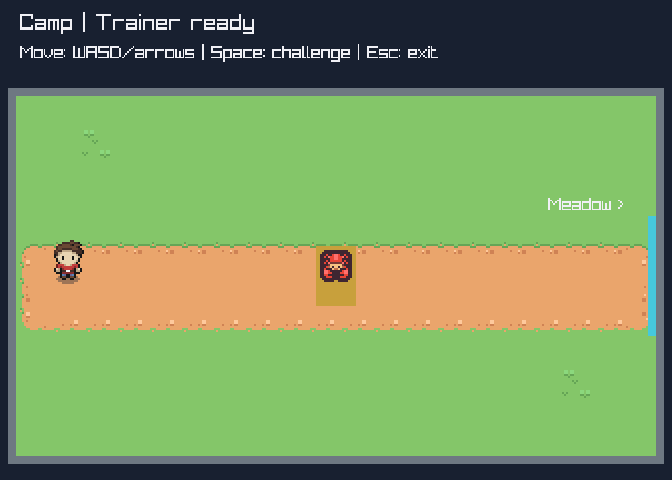
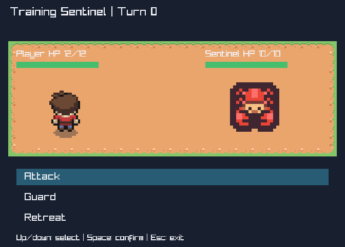
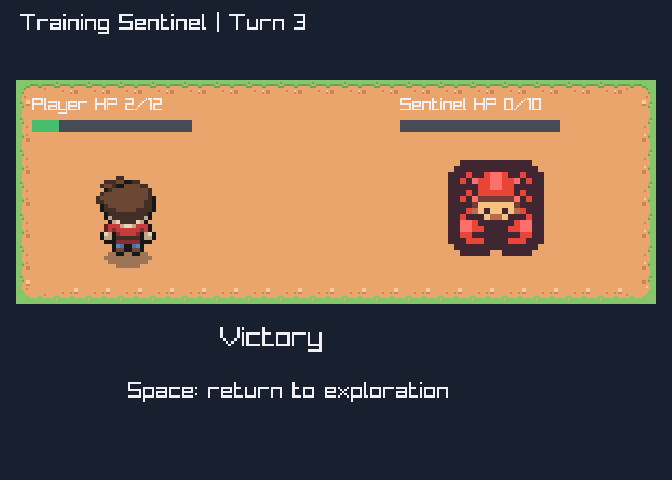

# H3 asset selection — verified candidates and bounded use

Selection2026-10-18, before replacing RPG1's working provisional presentation. Choose
**Tiny Town + Tiny Dungeon**, retaining the previously verified animated ArMM protagonist.
This is two new matched16px packs, not a six-pack mix; current game rules/HP/rooms do not change.

## Candidate matrix

| Candidate / official source | Availability and license | Resolution / animation / fit | Decision |
| --- | --- | --- | --- |
| [Tiny Town](https://kenney.nl/assets/tiny-town) | OfficialZIP downloaded; embedded License.txt declares CC0; pack1.1 | Actual132separate16x16PNGs; packed192x176, unpacked203x186; static terrain/buildings/props/NPCs; Sample/Preview show intended combinations | Select packed atlas, terrain roles only now; houses/interiors are not new gameplay. |
| [Tiny Dungeon](https://kenney.nl/assets/tiny-dungeon) | OfficialZIP downloaded; embedded CC0; pack1.0 | Actual132separate16x16PNGs and both atlases; TiledTSX/TMXreference; static humans/monsters/items/interior props, no verified walk animation sequences | Select one static red monster from packed atlas; compatible outline/pixel density with Town. |
| [RPG Urban](https://kenney.nl/assets/rpg-urban-pack) | OfficialZIP downloaded; embeddedCC0 pack1.0 | Inspected486individual16x16sprites/tiles plus4preview/sample/atlasPNGs; noXMLmetadata. Listing advertises6four-direction walkers, exact frame mapping not adopted; urban rather than fantasy | Not imported; walking alternatives do not justify replacing already tested animated hero. |
| [Monster RPG2](https://opengameart.org/content/main-art-from-monster-rpg-2) | OGA declares CC0; CombatMediaZIP downloaded | Actual subset164PNGs/110XMLs,47animated definitions with2-7frames and heterogeneous sizes; broader page describes TGA/XML but that is not the inspected PNG subset | Rich future battlers/background/effects, not needed for a single static encounter. No new TGA/XML runtime decoder. |
| [Cartoon Enemies](https://opengameart.org/content/cartoon-enemies) | CC0 publication; enemies_1.zip inspected |62PNGs, approximately21-442 by29-356 pixels, no animation metadata; painted/cartoon style differs from Tiny pixel art | Not imported; do not mix several unrelated battler styles. |
| [Stalagmite Monster](https://opengameart.org/content/stalagmite-monster) | CC0 publication; ZIP inspected |6PNGs including96x144,576x512,144x192 and3Aseprite sources; world/battler representations, darker/spoopy style | Viable future hand-mapped creature; not the current palette/need. No inferred engine RPGMaker dependency. |

Tiny Battle was briefly considered as another matching Kenney pack, but its official
war/tank/vehicle focus adds no RPG creature need; not imported. No extra pack is necessary.
Public downloads only, no donation/purchase/authenticated session. CC0 records the publisher's
declaration and does not independently clear third-party rights or provide warranty/endorsement.

## Actual file interpretation

Kenney listings advertise130tiles, but the current archives/metadata contain132cells. Source
references are based on inspected bytes, not listing counts. Tilesheet.txt describes1px gaps
in the UNPACKED atlas; packed192x176 equals12x16 by11x16 and has zero gap. DungeonTSX points
to the unpacked203x186 PNG. Never apply its17px step to the selected packed image.
Original Sample/Preview and whole3x3dirt motif establish the selected edge/corner/interior
roles; coordinate validity alone does not establish semantics. Consumer [art contract](../../specs/rpg-art.md)
records exact cells and destinations, no generic semantic atlas/importer is introduced.

ArMM hero is intentionally retained rather than relabeling unrelated static Tiny characters
as walk frames. It uses an already validated16x32 silhouette, unchanged animation/directions.
Tiny static monster is sufficient; current rules have no status ailments or animated VFX
acceptance requirement. UI remains numericHP/bar/selection/outcome, not a battle UI framework.
Per-context rendering uses the same public canvas, not a Pokemon-aware service.

## Archive evidence and provenance

| Download | SHA256 |
| --- | --- |
| [TownZIP](https://kenney.nl/media/pages/assets/tiny-town/a415fbeb49-1735736916/kenney_tiny-town.zip) |9768692dccff1d706408a5aedd6ca4f6cd1409506cbc84cb2f862919764be977 |
| [DungeonZIP](https://kenney.nl/media/pages/assets/tiny-dungeon/f8422efb44-1674742415/kenney_tiny-dungeon.zip) |c109438ab06f65fd80f9b2686a4cf9c7c11dc64444b47333ec71d602f8bb5fc7 |
| [UrbanZIP](https://kenney.nl/media/pages/assets/rpg-urban-pack/0a097d1dc7-1677578575/kenney_rpg-urban-pack.zip) |4541d89d639fc7d1e905dd925e55b1c4977a41d983516228db1d57173bb9afaf |
| [MonsterRPG2 combatZIP](https://opengameart.org/sites/default/files/Combat%20Media%20%28Monsters%2C%20Attacks%29.zip) |ff328e79f2edda6acaae3190c5b67f6967c3a930eb89067565d6b1ad7bb07f5f |
| [CartoonZIP](https://opengameart.org/sites/default/files/enemies_1.zip) |d28d1bb7b59dc7e360fdd1c013e4b9dd92b6971c8ba17e2bea6425f17de45a7c |
| [StalagmiteZIP](https://opengameart.org/sites/default/files/stalagmite_monster.zip) |c00a751e6d2a59e0d7223326ea3762b845055760fbcec9c963ade556b3d7405d |

Only selected original files/licenses will enter Rpg/Assets with SHA256manifest and exact
Git binary/-text attributes. Unselected archives remain inspection-only temporary downloads,
not project dependencies. Full original sheets may contain unused cells; availability does
not approve new entities, maps, props, statuses or mechanics. Existing ArMM provenance caveat
remains in its source notice; no disputed tree regions are used. Selection precedes construction;
actual integration/proof will be recorded here separately rather than inferred from this plan.

## Implemented art evidence
Selection/design commit: 8a2dd0a, before presentation replacement. The consumer now owns
three runtime images (Town/atlas, Dungeon/atlas, Hero/character); the previous four-image
RPG1 evidence remains historical, not the current bundle. No engine, session rules or old
consumer changed. Real hero animation remains unchanged; the static opponent is intentional.

Observed test-first evidence: the new compound-terrain test failed against the old renderer
(missing corner source 0,16), then all 21 RPG model/renderer cases passed. Native smoke passed
with zero build warnings/errors, all three outcomes and exact HP/turn/retry/resume rules,
original PNG terrain corner/interior samples, hero scaling and opponent scaling at 2x/6x,
three cached sheets, clean close, and seven production CLI cases with exits 0/1/2.
VerifyRpgAssets passed seven original SHA256 checks; an isolated corrupt copy was rejected.
All 264 packed cells were compared with original individual tiles: zero-gutter stride16 passed.

The flat route uses complete corners/edges/interior rather than random neighboring cells.
No decorative walls or houses imply nonexistent collision. No status/VFX mechanics or new UI
framework were introduced. Run checks/RpgNativeSmoke.ps1 and checks/VerifyRpgAssets.ps1.
Independent final verification is pending; subjective presentation acceptance remains owner-owned.

