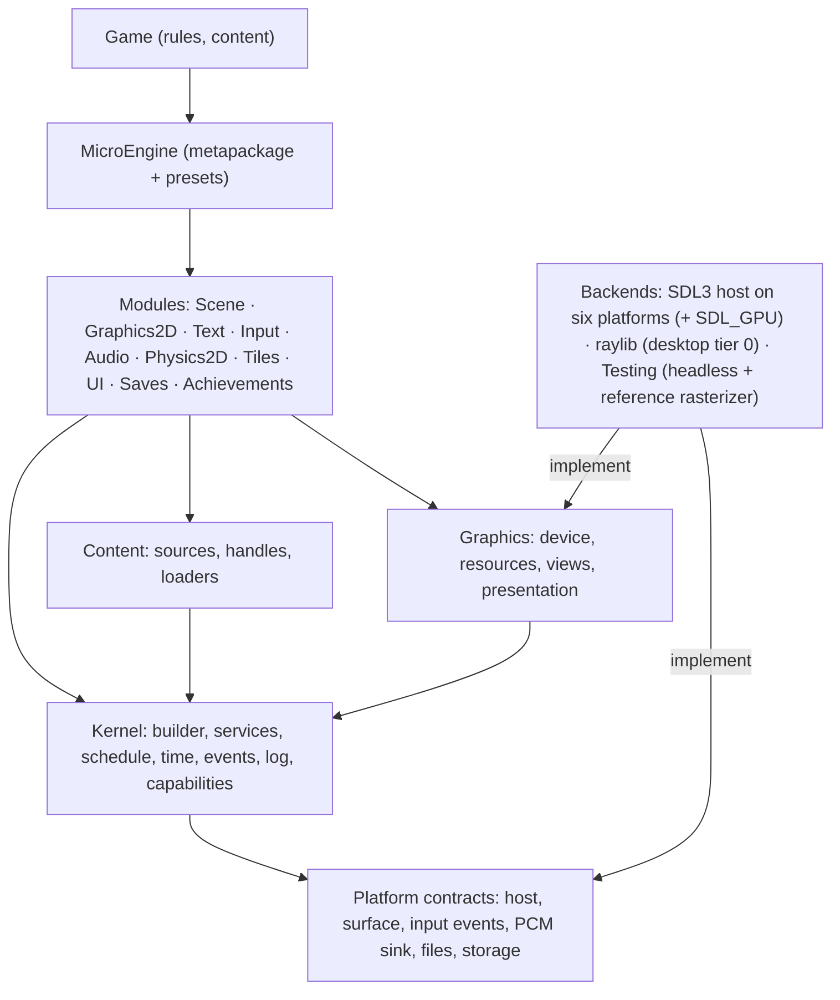

# ARCH-1: Adversarial architecture audit and target architecture (Phase I)

Status: **approved by the owner on 2026-11-02 with five amendments; Phase II under way.** The amendments are
integrated in place, not appended: prototypes run before the decision they validate (§9), one complete graphics
device contract validated by a tier-0/tier-1 spike (§6.4, §7, §9), the legacy `Entity` adapter is transitional and
deleted at the end of stage 5 (§6.3, §6.5, §9), stage closure criteria and property-based validation (§8, §9), and a
definition of done for Phase II with a 3D vertical slice and a physics substitution demonstration (§9.1). Prototypes
P1, P3, P4, P5, P6 and P7 have concluded and the graphics contract spike has met the stage 1 freeze gate; their
verdicts and the decisions taken on them (the architect's directives 2-12) are written in §9 (prototype verdicts) and
applied in place in §5, §6.1-§6.5, §7, §8, §9, §9.1 and §10: the graphics device contract v1, `IAudioSink` v1 and
`IWorld` v1 are frozen (§6.4), and the physics contract carries P6's revisions. Phase II progress on `main`
(2026-11-03): stages 0, 1 and 2 closed; stage 3 started (3a) (§9, Phase II progress). Phase I changed nothing in `src/`, `games/`, `samples/`, `templates/`
or the workflows. Audited code: `docs/arch-1` = `feat/asset-1` at 5706285 (the ASSET-1 work, since merged). Record and
Phase II register: [`odd/tasks/arch-1.md`](../../odd/tasks/arch-1.md). Date: 2026-11-02; last revised 2026-11-03.

The question applied to every decision: *if MicroEngine were designed today, for a generalist, modular,
multi-platform 2D/2.5D/3D engine with plug-and-play defaults, would we make this decision again?*

## How this audit was made

Seven agents worked in parallel. The integration, the contradictions they disagreed on and the target design below
are the architect's. Each report is kept in full as an annex; this document cites them by finding ID.

| Annex | Scope | Findings |
| --- | --- | --- |
| [A1 core](arch-1/A1-core.md) | Kernel, loop, composition, configuration, platform contract, assets, physical structure, SDK | F1-F17 |
| [A2 rendering](arch-1/A2-render.md) | Renderer contract, devices, resources, alpha, canvas, cameras, backends | R1-R12 |
| [A3 simulation](arch-1/A3-sim.md) | Input, audio, entities, scenes, physics, UI, what the demos reimplement | IN-, AU-, WO-, SC-, UI-, DM- |
| [A4 infrastructure](arch-1/A4-infra.md) | Test layers, visual checks, CI, packaging, benchmarks | F1-F15 (A4) |
| [R1 rendering research](arch-1/R1-render-research.md) | SDL_GPU, SDL_Renderer, FNA, MonoGame, Godot, bgfx/sokol/wgpu, Bevy, Unity, Unreal, web graphics | 60+ sources |
| [R2 engine research](arch-1/R2-engine-research.md) | Composition, loop, ECS vs scene trees, physics, assets, audio, input | 77 sources |
| [R3 validation research](arch-1/R3-validation-research.md) | Image comparison, conformance suites, perf regression, .NET native packaging | 94 sources |

Experiments are not opinions: each claim marked "measured" below was run. Their sources and outputs are in
[`arch-1/experiments/`](arch-1/experiments/) (project files carry a `.txt` suffix so no build picks them up; they
reference the engine as built at 5706285).

| Experiment | What it measured |
| --- | --- |
| `core-stub` (A1 E1-E5) | Capabilities lost when a profile is composed; a stub backend's size; the headless clock at 120 Hz; asset unload with shared holders; public API surface; namespace dependency graph (`nsdeps`) |
| `render-probe` (A2) | Six rendering probes (clip+clear, sub-pixel, disposed texture, foreign texture, linear-filter fringe, blend) on seven backends: SDL D3D11/D3D12/OpenGL/Vulkan/gpu/software and raylib |
| `render-stub` (A2) | A recording renderer, device and platform running a real `Game` |
| `sim-probe` (A3 E1-E5) | `TileMotion` tunnelling and embedding; `EntityList` clear during update; two devices on one action |
| `infra` (A4) | Sensitivity of the visual fingerprint to real and invisible changes; agreement between the seven reference sets; build and test timings |

Classification used throughout: **CP** confirmed problem, **AR** architectural risk, **DL** design limitation,
**LS** legitimate specialization, **MC** missing capability, **EX** needs an experiment.

## 1. Inventory of the current system

| Area | What exists |
| --- | --- |
| Physical | One engine assembly `MicroEngine` (~15.5 k lines, 173 public types, ~1,743 public members), `MicroEngine.Sdl`, `MicroEngine.Raylib`, `MicroEngine.Desktop` (launcher), `MicroEngine.Cli` (tool, with browser/Android/iOS hosts). StbImageSharp and FontStashSharp are dependencies of every game. |
| Kernel | `Game` creates every service in a fixed order; `GameLoop`/`GameRunner` run a fixed 60 Hz step (max 5 per frame, 0.25 s clamp), render once, no interpolation; `GameSession` for page-driven hosts; `GameLauncher` parses command lines. |
| Platform | `IPlatform` (window, events, clock, `BeginFrame` returning an `IRenderer`, `EndFrame`, screenshots) plus `IGraphicsDevice`, `IAudioDevice`, `IInputSource`, optional `ITouchScreen`; optional features found by casting (`IDisplayControl`, `IPlatformDiagnostics`). `PlatformCatalog` of named profiles; hosts may replace audio or add input only. |
| Rendering | `IRenderer`: 13 members, immediate 2D, `Vector2`/`RectF`, translation-only camera, three blend modes; CPU `PixelImage` uploaded as RGBA8 textures with a mutable filter; one virtual canvas (default 320×180 ×4) letterboxed by `CanvasScaling`. |
| Input | One `InputMap` of named actions over one merged `IInputSource`; 66-key enum; one gamepad; `VirtualControls` own every touch. |
| Audio | `AudioMixer` front end; mixing done by each device (SDL: 16 shared voices, raylib: 4 per sound, capture: unlimited); `Synth`/`Song` for retro sound; fire-and-forget `Play`. |
| World and scenes | `Entity` (`Vector2` position, 16×16 hitbox, `Draw(IRenderer)`), `EntityList<T>`, tile layers and `TileMotion`; a scene stack with overlays and transitions; coroutines, tweens. No physics, no transforms, no ids. |
| Assets | `Game.Assets` (`AssetCache`): one object per file and options, string-kinded, scoped release, hitch reports; images, atlases and fonts decoded in managed code; audio outside the cache. Files only (`ContentFolder`). |
| Other core features | Achievements, toasts, saves, UI widgets, touch skin, action prompts, frame profiler. |
| Validation | 533 .NET tests (~45 s), 15 scripted capture scenarios (138 captures) compared to 7 per-platform fingerprint references, ~120 JS tooling tests, SDK acceptance from an external project, package verification, phone checks monthly. CI skips checks whose inputs already passed. |

What is sound and is kept (A1 F17, A3, A4): the deterministic fixed step with scripted runs; actions instead of keys;
`IActionSource`, `ICollisionGrid`, the deferred scene-change queue, `TouchLayout`; asset scopes and managed decoders
(the same pixels on every platform); the platform catalog idea; the SDK tested from outside the repository; evidence-
keyed CI; the capture audio device as a deterministic reference.

## 2. Dependency map and coupling

Measured (A1 §2, `experiments/core-stub/nsdeps.txt`):

- `MicroEngine.Core` depends on every other namespace except `World`; `Graphics` is the real leaf. **"Core" is at
  the top of the graph, not the bottom.**
- Cycles: `Core ↔ Scenes`, `Core ↔ UI`.
- The frame is wired to one 2D immediate renderer: `IPlatform.BeginFrame()` → `IRenderer` → `Game.Render` →
  `Scene.Draw(IRenderer)` → `Entity.Draw(IRenderer)`. Simulation objects draw themselves (A1 F3, A3 WO-3).
- `CanvasScaling` alone decides five things: default texture filter, final upscale filter, integer fitting (the 80 %
  rule), initial window size and capture scale (A2 R6).
- In each backend the window, renderer, graphics device, input, touch overlay and gamepad start-up are built in one
  constructor and are `internal` (`SdlPlatform`, 854 lines; A2 R2).
- Composition happens three ways: desktop through `GameLauncher` and the catalog plus the static
  `ContentFolder.DefaultRoot`; browser through `BrowserLauncher`, which sets `SaveStore.DefaultStorage` and builds
  `RaylibPlatform` directly; phones through environment variables and an MSBuild-generated factory. What a developer
  configures in `Program.cs` never reaches web or phone builds (A1 F6).

## 3. Issue register

Ranked by consequence for the vision. "Now" means it must be fixed in Phase II's foundation; it does not mean it is
the first commit.

### 3.1 Confirmed defects that exist today (independent of the redesign)

| ID | Defect | Evidence | Sev. |
| --- | --- | --- | --- |
| D1 | `ComposedPlatform` does not forward `DisplayRate`, `Wait`, `IDisplayControl`, `IPlatformDiagnostics`: replacing audio (e.g. `--audio-capture`) or adding input turns off display pacing, the precise frame timer, the run-time graphics menu and diagnostics. | `src/MicroEngine/Core/PlatformProfiles.cs:196-224`; measured 144 Hz → 0, `CanChange` false (A1 F1, E1). Spot-checked by the architect. | High |
| D2 | Release-gating package checks are red on `main` (stale WARP references, Debian 11 glibc check); daily CI does not run them, so a release from `main` would be refused. | Validate run 41515138843 (A4 F1); `odd/tasks/asset-1.md:93`. | High |
| D3 | The visual fingerprint passes real regressions (sprite moved 12 px, HUD "13"→"18", a blur standing in for nearest→linear) and fails an invisible +4/255 shift. | `web/tests/captures.mjs:10-11,76-93`; `experiments/infra/fingerprint-result.txt` (A4 F2). | High |
| D4 | `HeadlessPlatform.Now` is `_frames / 60.0` whatever `UpdateRate` is; at 120 Hz headless touch timing runs at half speed. | `src/MicroEngine/Core/HeadlessPlatform.cs:40`; measured (A1 F4, E3). Spot-checked. | Medium |
| D5 | Backends disagree: `Clear` after `SetClip` clears everything on SDL, the clip on raylib; a 1-px rect at y=2.5 lands on different rows; a disposed texture draws nothing (SDL), black (raylib) or throws (headless) while the docs say it fails; raylib captures carry alpha 0xBF. | `experiments/render-probe` on seven backends (A2 R3). | High |
| D6 | `TileMotion` is documented as swept AABB but is sub-stepped discrete overlap: a 2×2 body moving 15.9 px tunnels through a 4 px solid; a rising platform leaves a resting body embedded 4 px with `IsOnGround` false. | `World/TileMotion.cs:40-68,106-118`; `docs/architecture.md:78`; `experiments/sim-probe` (A3 WO-2). | High |
| D7 | Straight alpha everywhere: a red-to-transparent edge sampled linearly over white measures R=191 on all seven backends (premultiplied: 255). Affects every smooth game and scaled glyph. | `experiments/render-probe` fringe (A2 R5). | Medium |
| D8 | Three mixers with three voice policies; the test reference (capture, unlimited voices) cannot detect voice stealing. | `SdlAudioDevice.cs:15,139-159`, `RaylibAudioDevice.cs:15,92-101`, `CaptureAudioDevice.cs:77-150` (A3 AU-1). | High |
| D9 | `AssetCache.Unload` disposes a texture other code still holds; sibling scopes load the same file twice. | A1 F7, E4. | Medium |
| D10 | The browser suite `web/tests/run.mjs` (frames, keys, audio level, frame rate) runs in no workflow; SDL, the default backend, has no native keyboard or audio-output test. | A4 F6, F7. | Medium |
| D11 | Smaller: `EntityList` throws if an entity clears the list during `Update` (A3 WO-5, measured); `FontOptions.Antialiasing` picks the glyph filter, contradicting `docs/manual/rendering.md:46-47` (A2 R6, the ASSET-1 example); `AssetGalleryTests.cs:58` waits 120 ms for a background load (latent flake); `docs/ci.md` drifted (A4); a frozen scene under an overlay still receives the global `FrameBlend` (A3 WO-4); key prompts assume QWERTY (A3 IN-5). | as cited | Low-Med |

These do not need the target architecture and should not wait for it (see §9, stage 0).

### 3.2 Structural problems (the reasons for the redesign)

| ID | Problem | Class | Evidence | Sev. |
| --- | --- | --- | --- | --- |
| S1 | **No composition model.** `Game` is a fixed god object: no way to register a module, add a frame phase or replace a built-in service; every game gets touch controls, the pixel font, achievements. Physics, ECS, networking or 3D can only live inside a scene's `Update`/`Draw`. | DL/AR | `Game.cs:132-207` (A1 F2, F16) | Critical |
| S2 | **The rendering contract is a closed 2D immediate API narrower than its own backends.** No matrices, depth, vertex data, render targets, shaders, materials, wrap modes, premultiplied blend. SDL3-CS and Raylib-cs already expose most of that. `LightMap` fakes a light buffer with a grid of multiply-blended rects. | DL/AR | `IGraphics.cs:115-152`, `Platform.cs:431` (A2 R1) | Critical |
| S3 | **No substitution seam for the renderer, device or window.** Hosts can replace audio or add input only. A custom renderer on a real window means forking `SdlPlatform`. The SDL `gpu` driver (pixel-identical to D3D11 in every probe) exists, but its device is unreachable. | CP | `PlatformProfiles.cs:10-18`, `SdlPlatform.cs:160-164,445` (A2 R2) | High |
| S4 | **The backend contract is unwritten.** `IPlatform` is a real contract (a ~32-member stub ran a game first try, A1 E2), but canvas scaling, letterboxing, capture scale, touch overlay, clock, hotkeys, rasterization rules and resource rules live only in backend code, and the backends disagree (D5). No conformance suite exists. | CP | A1 F11, A2 R3, A4 F4 | High |
| S5 | **Resource model is CPU-first RGBA8, texture = sampler.** No formats, mipmaps, render-target textures, readback, buffers; filter is mutable texture state; foreign textures fail by `InvalidCastException`; device reset/loss unhandled with no CPU copies kept. | MC/AR | `IGraphics.cs:27-34,163` (A2 R4) | High |
| S6 | **No transforms, no identity, drawing inside entities.** `Entity` is a sprite object with a 16×16 pixel-art hitbox; no hierarchy, ids, attachments, serialization. All four demos wrap or replace it. ADR 0003 bundled "no ECS" with "no transform or hierarchy": separate decisions. | DL | `World/Entities.cs:14-31` (A3 WO-3) | High |
| S7 | **No physics contract.** No body, collider, contact, query or step hook; the demos write 24 pairwise overlap loops and two private collision grids. | MC | A3 WO-1 | Critical for the vision |
| S8 | **The engine does not interpolate.** Three demos reimplement per-scene interpolation (`MeadowRun/Scenes/Motion.cs`, `NeonRift/Scenes/DrawBlend.cs`, `CourtyardKey/Entities/Actor.cs`), contradicting ADR 0023. At 60 Hz on 144 Hz displays 84 of 144 frames show no new state or input. | CP | A3 WO-4/SC-2, A1 F5 | High |
| S9 | **Time is owned by backends.** SDL and raylib each compute fixed-step time; headless hard-codes 60 (D4); loop limits are literals; a hidden window implies fixed-step time and no audio; no time scale (MeadowRun builds its own hitstop). | CP/DL | `GameRunner.cs:246,258,274`, `GameLauncher.cs:79` (A1 F4-F5, A3 SC-3) | Medium |
| S10 | **Single-player input contract.** `IInputSource` has no device index; SDL opens the first pad, raylib reads pad 0; `CompositeInput` merges by "any source down": keyboard Left + pad Right = axis 0 (measured). | DL | `Input/Input.cs:54-75`, `Sdl/SdlInput.cs:8,36-53` (A3 IN-1, A1 F15) | High |
| S11 | **Input vocabulary and routing.** Polled 66-key enum, no text/IME, wheel, rumble or event stream; every touch drained by on-screen controls (and SDL touch-to-mouse disabled), so no tap-to-move, swipe or pinch; no consumption between UI, overlays and gameplay. | MC/DL | `VirtualControls.cs:482`, `SdlPlatform.cs:90-91` (A3 IN-2..4) | High |
| S12 | **Audio API.** `Play` returns `void` (no stop, no control); one music channel; audio outside the asset lifecycle and no unload on the device; demos compute pan themselves; music fed from the simulation step on the main thread. | MC/CP | `Audio.cs:138,308,327` (A3 AU-2..6) | High |
| S13 | **Assets.** Sealed cache with string kinds; live objects, not handles; physical files only (no archives, Android assets in place, browser fetch); no loader registry or import seam (glTF, GPU formats, shaders, SDF fonts); no hot reload. | AR/MC | A1 F7 | High |
| S14 | **Hidden defaults and coupled options.** Fifteen in core (A1 F8) and twenty in rendering (A2 §4): `CanvasScaling` ×5 (above), font antialiasing → filter, atlas padding fixed at build by a filter that can change later, `DefaultFilter` mutable device state written by `Game.Initialize`, F11/Alt+Enter hard-wired in backends and also delivered to the game, seed depends on whether a script was given, camera `PixelSnap = true`, 320×180 ×4, `FillGradient` one rect per row, on-screen control text drawn with each backend's debug font, engine-owned action names (`confirm`, `up`) shared with engine widgets. | CP | A1 F8, A2 R6, A3 §4 | Medium (High in aggregate) |
| S15 | **One fixed-resolution canvas is the only render path.** No HD UI over a low-res world, no native-resolution text, letterbox only, no run-time resize; the touch overlay has its own drawing contract. | DL | A2 R7, A1 F14 | Medium |
| S16 | **2D-only math and colour.** `Matrix3x2`, `Matrix4x4`, `Vector3`, `Quaternion` appear nowhere in `src`, `games` or `samples`; `Camera2D` is sealed, translation-only; `Color` is 8-bit straight. | DL | A2 R8, A1 F3 | Medium |
| S17 | **Physical structure.** One assembly; namespaces are not boundaries (cycles); public test hooks (`InitializeForTest`, `StepForTest`), the CLI launcher and `HeadlessPlatform` ship in the runtime package; no events, no logging abstraction (`Console.Error`), implicit threading. | AR | A1 F9, F10, F12, F13 | Medium |
| S18 | **Validation proves the wrong thing for replaceable backends.** Cross-backend equivalence = exact RGB equality; correctness = closeness to 7 per-platform fingerprints (two renderer families, A4 measured raylib and SDL on Linux agree on 136/138); headless rendering only counts draw calls; scripts force actions rather than device input; no perf regression detection. Any SDL_GPU, linear, MSAA or sRGB change means re-recording 7 × 138 captures with no way to tell intent from regression. | CP | A4 F2-F5, F8 | High |
| S19 | **UI.** Widgets respond to actions only: no pointer/touch, layout, focus or text field; sizes in pixel-art units. | MC | A3 UI-1, UI-2 | Medium |

### 3.3 Legitimate specializations (keep, but as modules, not as the core)

Integer pixel scaling and nearest sampling as a **preset**; tile layers, autotiling and a kinematic tile mover for
platformers; the retro synthesizer and step sequencer; achievements; the touch skin. Each is valuable and none belongs
in the kernel (A1 F16-F17, A3 WO-2, R1 §Godot: viewport stretch + integer scale is what Godot recommends for pixel
art).

## 4. Industry lessons that change the design

Only lessons that move a decision are listed; sources are in the R annexes. [F] = documented, [I] = inference.

| Lesson | Source | Consequence for MicroEngine |
| --- | --- | --- |
| Engines that wrote one backend per graphics API backed away: FNA dropped its Metal driver and moved onto SDL_GPU [F]; MonoGame 3.8.5 calls its dozen wrappers a problem and moves to one native library with Vulkan/DX12 [F]; SDL removed SDL_GPU's D3D11 backend for maintenance cost [F]. | R1 | Never write a renderer per API. Target a portable device layer (SDL_GPU on native). |
| SDL 3.4 added a 2D renderer on top of SDL_GPU with custom fragment shaders (`SDL_CreateGPURenderState`), GPU texture interop and `SDL_SCALEMODE_PIXELART` [F]. | R1 | A staged path exists: today's SDL backend can move onto the `gpu` driver and share its device with engine-owned GPU passes. Measured since (§9, P1 and P3): the path is correct but not taken; tier 0 keeps SDL's default driver and tier 1 is pure SDL_GPU. The SDL the binding bundles is 3.5.0, a development series (§10). |
| SDL_GPU has no web backend; its WebGPU backend is an unmerged draft (PR #16020) with no date; WebGPU is still not default on Firefox Linux/Android or most Chrome Linux [F]. Every layer that runs on web today keeps a GL/WebGL path [F]. Godot had to bring back an OpenGL renderer and it is its only web renderer [F]. | R1 | Plan for two GPU paths on the web for years. Do not make 3D or shaders depend on WebGPU. |
| Godot's renderer rewrite lost 2D batching until 4.4 (573,440 → 36 draw calls on one map once restored) [F]. | R1 | Draw-call counts and batching are tested invariants, as deterministic counters, from day one. |
| Pixel-art: render at base size, scale by whole factors (Godot `viewport` + integer) [F]; per-node "snap" flags cause jitter and gaps [F]. | R1 | Pixel vs smooth is one presentation policy, not per-sprite flags. MicroEngine's canvas idea is right; its coupling is wrong. |
| Samplers separate from textures in SDL_GPU, WebGPU, Vulkan, D3D12 [F]; generation-checked handles catch use-after-free [F]. | R1 | Immutable sampler values; texture handles with generations; deferred destruction after the last frame that used them. |
| Unity's GameObject/Entities split has needed years of reconciliation and still centres on one id type in Unity 6.6 [F]. Godot argues ECS pays off only at tens of thousands of objects; flecs' author: a home-made ECS will not beat established ones; hierarchies are hard in any ECS [F]. Bevy and Unity both rebuilt identity and hierarchy [F]. | R2 | No core ECS and never two object models. Get identity and hierarchy right first. Leave room for an optional data-oriented module behind the same ids. |
| Godot keeps physics, rendering and audio in "servers" addressed by ids; nodes are only the user layer; `SceneTree` is a replaceable `MainLoop` [F]. Unreal subsystems get their lifetime from a parent (engine, game instance, world, player) [F]. | R2 | Subsystems are services with an owner scope; the scene layer is a default module over them, not the kernel. |
| Fixed step + render blend `alpha = accumulator/dt` is the standard [F]; Godot added 2D physics interpolation only in 4.3 to fix jitter, and teleports need a reset call [F]. | R2 | The engine interpolates transforms for drawing, with an explicit teleport. |
| Box2D v3: id-based C API, substepping solver, persistent islands, separate sensors, buffered events; cross-platform determinism with FMA off [F]. Godot's Jolt behind the same nodes still changed behaviour [F]. | R2 | Physics contract shaped after Box2D v3 (ids, steps inside the fixed phase, buffered events). Accept that a physics abstraction leaks semantics; validate each backend against the contract. |
| Godot rejected a central UID database (merge conflicts, does not move with files) for `.uid` sidecars [F]; Unity `.meta` loss silently breaks references [F]; Unreal soft references are not cooked unless declared [F]; Bevy v2 keeps path identity and makes processing optional [F]; MonoGame XNB hinders modding [F]. | R2 | Keep raw files and path identity as the default; typed handles; an optional, build-time processing step later; never mandatory compiled formats. |
| miniaudio separates the device (data callback) from an optional engine with a node graph and spatialization [F]; SDL3 audio is device-bound streams [F]; Godot buses are acyclic, named [F]. | R2 | Backends become PCM sinks; one managed mixer in the engine; middleware (FMOD/Wwise) replaces the mixer service, not the sink. |
| Unity rewrote input; its complexity cost adoption and it later added a default project-wide action asset [F]. Godot has no per-player map [F]. leafwing assigns pads per player explicitly; unassigned maps hear every pad [F]. SDL3 gives gamepad types, labels, player index [F]. | R2 | Per-player maps with explicit pairing, but a zero-setup default (player 1 gets every device). |
| dEQP/VK-GL-CTS compare with thresholds and position tolerance [F]; wgpu uses NVIDIA FLIP with mean/percentile thresholds [F] (but silently adopts a missing reference: do not copy); Skia Gold keys baselines by configuration with several accepted images [F]; WPT declares fuzz per test [F]; Mesa replays traces with per-device checksums and flake lists [F]. | R3 | Per-test declared tolerances, a perceptual metric, references keyed by renderer family, a missing reference is a failure. |
| `Microsoft.Extensions.DependencyInjection.Specification.Tests` and EF Core specification tests are suites a provider subclasses [F]. | R3 | A published backend conformance kit on the same pattern. |
| lavapipe, llvmpipe, SwiftShader, WARP run real GPU APIs on GPU-less CI; SDL_GPU picks software Vulkan unless hardware is required; raylib 6 has the CPU `rlsw` renderer [F]. | R3 | GPU backends are testable on hosted runners. Not yet shown for SDL_GPU: P3 found no lavapipe ICD locally and no way to request WARP through SDL_GPU (§10). |
| Change-point detection raised useful perf alerts from 1 % to 67 % at MongoDB; Perfherder uses a t-test and a 2 % floor [F]. | R3 | Gate merges only on deterministic counters; time is an alert trend. |

What we deliberately do not copy: a render graph or a second render world (yet), XNA-style effect files, data-file
content pipelines as the default, parallel render pipelines (Unity URP/HDRP), engine-owned math types (Stride is now
discussing a move to System.Numerics), a reflection-based DI container (AOT and WebAssembly), and wgpu's
auto-adoption of missing references.

## 5. Contradictions between the reports and how they are resolved

| Topic | A says | B says | Resolution |
| --- | --- | --- | --- |
| Graphics end state | A2: a device layer with tier 0 (SDL_Renderer, raylib) and tier 1 (SDL_GPU native, WebGPU/WebGL2 in browsers). | R1: keep `IRenderer` as the 2D contract, add an optional SDL_GPU device through SDL_Renderer's `gpu` driver; browsers stay on raylib; WebGPU later. | The **contract** is A2's (one device abstraction shaped after SDL_GPU/WebGPU concepts, with capabilities). The **implementation order** is R1's: tier 0 first on existing backends, then tier 1 on native. Revised by P1 and P3 (§9): tier 1 is a pure SDL_GPU adapter with its own built-in 2D pipelines, **not** SDL_Renderer's `gpu` driver (deferred draw ordering, custom render-state shaders dropped silently on D3D12; start-up and memory cost), and tier-0 SDL keeps SDL's default renderer driver. No engine-written WebGL or WebGPU backend; P4 settled the web host (SDL, tier 0 on SDL_Renderer). Today's `IRenderer` survives as a façade over the 2D batcher. |
| Physics timing | A3: contracts `IPhysicsWorld2D/3D` now, Box2D v3 adapter "prepare". | R2: prepare the boundary; avoid native dependencies before WebAssembly packaging and determinism are checked. | Contracts and a contract test suite in the foundation; the in-house tile mover becomes the first implementation of the 2D query/kinematic part; the Box2D adapter only after P6 (Box2D.NET managed port vs native Box2D in wasm). Resolved by P6 (§9): native Box2D v3.2.0 built from pinned source behind the engine's own flat C layer (only scalars and pointers cross it, which the wasm interpreter requires); not Box2D.NET; packaged as an optional backend in stage 6, nothing published in Phase II. |
| Entity model | A3: ids, 3D-capable transform, optional parent, typed attachments; ECS vs attachments needs a prototype. | R2: no core ECS; stable id before serialization. | No core ECS. One object model: generation-checked `EntityId`, `Transform` (3D storage with 2D helpers), optional parent, typed attachments (components without a scheduler). An ECS may be added later as a module that stores attachments, behind the same ids (P7 checks ergonomics on one demo). |
| Package granularity | A1: many packages split by boundary, enforced by an architecture test. | R3: add an abstractions package only once third-party backends exist; version everything together. | Assemblies split by real boundary (enforced by tests) now; **published packages grouped** into fewer units with one version (`MicroEngine` metapackage for the default experience). Abstractions are a separate assembly from day one but are only published separately when a third-party backend needs it. |
| Mixer location | A3: one managed engine mixer over PCM sinks. | R2: keep the engine mixer, device as sink; "mixer off" mode for middleware. | Agree; plus P5 must prove a pull-callback sink on the web (AudioWorklet) and phone output threads before the device contract is frozen. Resolved by P5 (§9): a pull contract whose caller the sink chooses (`SinkThread` or `HostPump`); a managed callback on the web audio thread is impossible on single-threaded .NET wasm, so the browser sink is an AudioWorklet queue pumped once per frame on the main thread; SDL3 platforms use a feeder thread, not SDL's device callback, by default. `IAudioSink` v1 is frozen (§6.4). |
| Raylib's place | A1/A2: can raylib's "window owns the context" fit a surface abstraction? | R1: raylib remains the browser backend for now. Resolved by P4 (§9): the platform contract has **no "integrated backend" concept**; SDL is the single host for all six platforms (Windows, Linux, macOS, Android, iOS, browsers). A backend package may still provide a host plus a device factory that accepts only its own surfaces, declared through `IGraphicsBackendFactory.UnsupportedReason`; that needs no special contract shape. raylib on the web is retired in stage 5 in favour of an SDL browser launcher (gates in §9); raylib on desktop stays as the second tier-0 implementation, and its future is decided in stage 2a. |
| Asset processing | A2: premultiplying, mipmaps, GPU formats push toward build-time processing, reopening ADR 0025. | A1/R2: keep raw files; optional processed mode later. | ADR 0025 holds for 2D defaults: premultiply and mip generation happen at load in managed code. A build-time importer seam is reserved; it becomes mandatory only for formats that cannot be decoded at load (compressed GPU textures, compiled shaders). |

## 6. Target architecture

### 6.1 Principles

1. **The kernel knows no domain.** It composes services, owns time and the frame schedule, routes events. Rendering,
   input, audio, physics, assets and scenes are modules.
2. **Defaults are presets, not side effects.** Every default is an explicit, documented value in a settings object;
   options never derive from each other silently. `Presets.PixelArt` and `Presets.HighResolution2D` give today's
   plug-and-play; a game can override any single field.
3. **Contracts are written and executable.** Each replaceable subsystem has a contract document and a conformance
   suite every implementation runs; capabilities are queried, never discovered by casting.
4. **One object model, 3D-ready storage, 2D ergonomics.** Transforms store 3D (`Vector3`, `Quaternion`, `Vector3`
   scale) with 2D helpers; math is `System.Numerics`.
5. **Simulation never draws.** Entities and scenes produce state; presentation modules read it (interpolated).
6. **Deterministic by construction.** The loop owns the clock; scripted runs inject device events, not actions.
7. **Portable through layers we do not write.** SDL3 on every platform, browsers included (P4), with SDL_GPU for tier
   1 on native; raylib in browsers only until stage 5; no engine code per graphics API. The one exception to "SDL
   everywhere" is browser audio: an AudioWorklet sink, because SDL's Emscripten audio cannot survive main-thread
   stalls (P5); and Box2D, built natively per target behind the engine's own C layer (P6).
8. **No reflection in the composition path** (NativeAOT, trimming, WebAssembly).

### 6.2 Logical layers



### 6.3 Physical structure

Assemblies (each is a project; arrows are the only allowed references, checked by an architecture test):

| Assembly | Contents | References |
| --- | --- | --- |
| `MicroEngine.Kernel` | `EngineBuilder`, `ServiceRegistry`, `FrameSchedule`/phases, `TimeSettings` and the loop-owned clock, `IEngineLifecycle` events, `ILog`, capability registry, `Handle<T>`/generations, math helpers over `System.Numerics`, `Color` + `ColorF` (linear, premultiplied helpers), `RectF` | — |
| `MicroEngine.Platform` | `IPlatformHost`, `ISurface` (as frozen in graphics contract v1), `IInputBackend` (event stream), `IAudioSink` (v1 frozen by P5; implemented in stage 2c), `IFileSystem`/`IContentSource`/`IStorage`. Exists since stage 1B (ADR 0037) with the host, surface, capability query, storage and content-source parts | Kernel |
| `MicroEngine.Graphics` | The single device contract (§6.4, frozen v1): `IGraphicsBackendFactory` (over the platform's `ISurface`), `IGraphicsDevice`, `GraphicsCapabilities`, `GraphicsCapabilityException`; texture, render-target, sampler, buffer, shader and pipeline descriptions; built-in pipelines; `CommandList` with passes; views, `Presentation`, `ICamera` | Kernel, Platform |
| `MicroEngine.Content` | `IAssetStore`, `Asset<T>`, owners/scopes, `IAssetLoader<T>` registry, content sources (folder, zip; Android and browser fetch from their backends), reserved `IAssetImporter` | Kernel, Platform |
| `MicroEngine.Graphics2D` | `IRenderer2D` batcher (matrix stack, state stack, sort), sprites, atlases, `Camera2D` (zoom, rotation, optional snap), particles, light buffer, image loaders (StbImageSharp) | Graphics, Content |
| `MicroEngine.Text` | Bitmap and scalable fonts (FontStashSharp), layout, measurement | Graphics2D |
| `MicroEngine.Input` | Devices with ids, players and pairing, per-player action maps, input layers, rebinding persistence hook, text/IME channel; `Input.Touch` (virtual controls, touch skin) | Kernel, Platform (+ Graphics2D, Text for `Input.Touch`) |
| `MicroEngine.Audio` | Managed mixer, `SoundHandle`, voices with priority, acyclic buses, listener/emitters, clips and streams as assets; `Audio.Retro` (Synth, Song) | Kernel, Platform, Content |
| `MicroEngine.Scene` | `World`, `EntityId`, `Transform` hierarchy, typed attachments, interpolation, world clocks (scale, pause, hitstop), scene stack as screen flow with results, transitions, coroutines, tweens | Kernel |
| `MicroEngine.Physics` | `IPhysicsWorld2D` (and, reserved, `IPhysicsWorld3D`): the common contract every backend passes (static colliders, kinematic collide-and-slide moves with contacts, layers and masks, ray and AABB queries, sensors with buffered events, contact normals, step inside the fixed phase) plus declared `PhysicsCapabilities` and `PhysicsCapabilityException` (§9.1); `Physics.Tiles` (tile grids, autotile, the fixed kinematic tile mover, the first backend) | Scene |
| `MicroEngine.Physics.Box2D` | Box2D v3 backend of `IPhysicsWorld2D`: native Box2D v3.2.0 built from the pinned upstream tag for every target, behind the engine's own flat C layer (only `int`, `float`, `ulong` and pointers cross it; P6); native binaries built by CI with checksums, shipped as `runtimes/<rid>/native` assets plus the browser static library (`NativeFileReference`); Phase II completion work (§9.1), designed and validated in stage 6 | Physics |
| `MicroEngine.UI` | Widgets with focus, pointer, layout in screen units, theme; highest input layer | Graphics2D, Text, Input |
| `MicroEngine.Saves`, `MicroEngine.Achievements` | Optional modules (`SaveStore` over `IStorage`; tracker and toasts) | Kernel, Platform (+ UI for toasts) |
| `MicroEngine.Hosting` | One launcher model for desktop, web, phones and tests; command-line parsing; profile catalog; `Configure` entry point used by generated hosts instead of `MicroEngineGameFactory` | Kernel, Platform |
| `MicroEngine.Backend.Sdl` | SDL3 host for all six platforms (callback or blocking loop on native, page-driven loop in browsers through the SDL browser launcher), input backend (all pads, events), PCM sink (native: a feeder thread keeping 60 ms queued in SDL's audio stream, P5; browsers: an AudioWorklet sink pumped once per frame, not SDL audio), tier-0 device on SDL_Renderer (SDL's default driver, P1), later the tier-1 device on pure SDL_GPU (P3); the engine's own P/Invoke declarations for the SDL functions the .NET wasm interpreter mis-calls (K-P4-1, §9) | abstractions |
| `MicroEngine.Backend.Raylib` | A host, a tier-0 device whose factory accepts only raylib's own surfaces (`UnsupportedReason`), and a sink, in one assembly; no special contract shape. Desktop: the second tier-0 implementation (real substitution evidence), future decided in stage 2a. Browsers: until the SDL browser launcher replaces it in stage 5 | abstractions |
| `MicroEngine.Testing` | Headless host, deterministic clock, device-event scripts, recording device + CPU reference rasterizer, conformance suites, architecture test helpers | abstractions + modules |
| `MicroEngine` (metapackage) | Default modules, presets, `Game` façade | modules |
| `MicroEngine.Migration.Entities` (transitional) | The legacy `Entity`/`EntityList` adapter over `IWorld`, `[Obsolete]` from its first commit; a non-packable project consumed only by the demos while they migrate; **deleted at the end of stage 5** | Scene, Graphics2D |

The migration adapter is never part of `MicroEngine.Scene` nor of any published package, and it is not a permanent
public API. The architecture test fails if any project still references it once stage 5 closes; stage 5 cannot close
until the project is gone (§9).

Published packages (one version for all, from `MicroEngineVersion`): `MicroEngine` (metapackage: kernel, platform,
graphics, content, graphics2D, text, input, audio, scene, physics + tiles, UI, saves, achievements, hosting),
`MicroEngine.Sdl`, `MicroEngine.Raylib`, `MicroEngine.Desktop`, `MicroEngine.Testing`, and the `microengine` tool.
The Box2D backend is not in the metapackage: it becomes a new optional package `MicroEngine.Physics.Box2D` carrying its
native assets (P6), designed and validated in stage 6 and not published in Phase II; the migration adapter is never
packaged. Since stage 1A and 1B, `MicroEngine.Kernel.dll` and `MicroEngine.Platform.dll` ship inside the `MicroEngine`
package; the published package set is unchanged.
Individual module packages are published only when a consumer needs to leave one out (the abstraction assemblies
already exist, so splitting a package later is not a breaking change for code). Native binaries move to `*.Native`
packages only if the SDL_GPU work or the static `SDL3.a` the web build links (P4) makes their size or RIDs a problem.

### 6.4 Fundamental contracts

The sketches with rationale are in A1 §4.2, A2 §6 and A3 §7; this is the integrated core. A contract is frozen only at
its gate in §9; after that, any change is a recorded contract revision with evidence (a version bump in the contract
text). State on 2026-11-03 (after stage 2 closed and P7 concluded):

| Contract | State | Where the text lives |
| --- | --- | --- |
| Kernel (builder, registry, schedule, loop-owned time, lifecycle events, log, capabilities, per-step state hash) | implemented in stage 1A (ADRs 0026, 0027); state hash by T0 (#42) | `src/MicroEngine.Kernel`; the sketch below is superseded where the code differs |
| Platform host (`IPlatformHost`, `ISurface`, capability query, storage, content sources, page-driven rules) | implemented in stage 1B (ADR 0037) | `src/MicroEngine.Platform` and the contract text in `IPlatformHost`'s documentation |
| Hosting (one composition path, `Configure` entry point, `HostBuilder`) | implemented in stage 1C (ADR 0038, #43) | `src/MicroEngine.Hosting` |
| Graphics device | **frozen, v1** (graphics contract spike, architect directive 5); implemented in stage 2a (ADR 0028, #45): `GraphicsContract.Version = 1`, with `Textured` | `src/MicroEngine.Graphics` (namespace `MicroEngine.Graphics.Devices`; the XML documentation is the contract text); the spike's [`Contract/`](../../experiments/arch-1/graphics-spike/Contract) is its historical source |
| `Presentation`, `IRenderer2D`, `Camera2D` | implemented in stage 2a (ADR 0029, #48, #52); the code is authoritative where it differs from the 2D sketch below | `src/MicroEngine.Graphics` (`Presentation`), `src/MicroEngine.Graphics2D` |
| Input (device events, players, layers, `IInputBackend`) | implemented in stage 2b (ADR 0032, #46, #49, #51) | `src/MicroEngine.Input`; `IInputBackend` lives there, not in `MicroEngine.Platform` as §6.3 sketches (open point, below) |
| `IAudioSink` | **frozen, v1** (P5, architect directive 7); implemented in stage 2c (ADR 0033, #47) | `src/MicroEngine.Platform/Audio/IAudioSink.cs`; the sketch below |
| Content (`AssetStore`, `Asset<T>`, loader registry, sources) | implemented in stage 2c (ADR 0034, #44, #50) | `src/MicroEngine.Content` |
| `IPhysicsWorld2D` and `PhysicsCapabilities` | P6 gate met; revised by P6 (architect directive 8); written and frozen in stage 3b | the sketch below and §9.1 |
| `IWorld` | **frozen, v1** (P7, architect directive 11); implemented in stage 3a-1 | the Scene part of the sketch below, which restates P7's [verdict](../../experiments/arch-1/p7-entities/README.md#verdict-the-api-to-freeze-in-stage-3) with directive 11's corrections |

#### Graphics device contract v1 (frozen)

The graphics contract spike ([report](../../experiments/arch-1/graphics-spike/README.md),
[PR #32](https://github.com/NastMz/MicroEngine/pull/32)) implemented one `IGraphicsDevice` contract with a tier-0
adapter on SDL_Renderer (Direct3D 11, OpenGL, Vulkan) and a tier-1 adapter on pure SDL_GPU (Direct3D 12, Vulkan), both
driving the same 2D batcher, which references nothing but the contract. The frozen contract v1 is the text in
[`Contract/`](../../experiments/arch-1/graphics-spike/Contract) (about 1,640 lines; every rule is in its XML
documentation) with changes E1-E14 applied and one architect decision on top of it. Stage 2a moved it into the engine
(`src/MicroEngine.Graphics`, [PR #45](https://github.com/NastMz/MicroEngine/pull/45), ADR 0028) with the `Textured`
merge and the version marker `GraphicsContract.Version = 1`; that code is now the contract text, and it is not
restated here. Its shape:

- **`IGraphicsDevice`**: `Capabilities`; optional `DeviceLost`; `CreateTexture`, `CreateRenderTarget`, `GetSampler`
  (cached, device-owned), `CreateBuffer` (every tier), `CreateShader`, `CreatePipeline`,
  `GetBuiltInPipeline(kind, blend, colorFormat, depthFormat?)`; `BeginCommands`, `Submit`;
  `ReadPixels(RenderTarget, RectI)` returning a fenced `ReadbackRequest` (offscreen targets only);
  `TryAcquireSurfaceTarget(out RenderTarget)`; `Present()` with an explicit present mode chosen at creation.
- **`GraphicsDeviceBase`** (core) validates every call before the backend's `*Core` member runs, so errors and the
  moment they are thrown are identical on every tier; **`CommandList`** (core, sealed) records passes with colour and
  optional depth attachments (load, store, clear values), viewport and scissor (`RectI`), pipeline, textures with
  samplers, vertex and index buffers (`IndexSize`), stage-qualified uniforms, `Draw`/`DrawIndexed`, and
  `UpdateBuffer`/`UpdateTexture` between passes.
- **Capabilities**: tier; `GraphicsFeatures` (RenderTargets, AddressRepeat, AddressMirror, Mipmaps, CustomBlend,
  Shaders, DepthBuffer, Instancing, ComputeShaders, SeparateFilters); shader formats; `Supports(format, usage)`;
  built-in blend states (at least Opaque, AlphaPremultiplied, Additive, Multiply); present modes; limits as guaranteed
  minimums; `ApiName` and adapter as reported after creation. A request that needs an undeclared capability fails with
  `GraphicsCapabilityException` (`Operation`, `Device`, `Missing`, `Requirement`); there is no silent degradation.
- **Written rules** the conformance suite checks: premultiplied colour; built-in vertices (`Vertex2D`, 32 bytes) are
  target pixels relative to the viewport origin, y down, pixel centres at +0.5; coverage by pixel centre; clears ignore
  viewport and scissor; bindings, viewport and scissor are pass-scoped, uniforms persist for the rest of the list;
  execution in submit and recording order; surface targets expire at `Present` and cannot be sampled or read back; P3's
  numeric conventions (System.Numerics right-handed matrices uploaded as-is, `mul(M, v)`, counter-clockwise front
  faces, depth 0..1, NDC y up, row 0 at the top).
- `ISurface` is the platform's (stage 1B implements it exactly as frozen here: pixel size, density, `IsMinimized`,
  `Resized`, `Lost`, opaque native handle).

Changes from the sketch this dossier carried before the freeze (P3's sixteen revisions, §9, are all in; E-numbers are
the spike's ad hoc exceptions, each resolved by a contract change or rule):

| # | Change |
| --- | --- |
| E1 | `GraphicsFeatures.SeparateFilters`: different min and mag filters require it (SDL_Renderer has one scale mode per texture) |
| E2 | `AddressRepeat` and `AddressMirror` replace `AddressModes` (SDL_Renderer wraps but cannot mirror) |
| E3 | The mip filter applies only to textures with more than one level; `Mipmaps` is checked at `CreateTexture(MipLevels > 1)` |
| E4 | Built-in vertices are target pixels relative to the viewport origin; built-in pipelines take no uniforms; the batcher transforms on the CPU |
| E5 | `GetBuiltInPipeline(kind, blend, colorFormat, depthFormat?)`, cached; `SetPipeline` refuses a format mismatch |
| E6 | `ISurface.IsMinimized` |
| E7 | `GraphicsCapabilityException.Requirement` for formats, shader formats and present modes (`Missing = None`) |
| E8 | `RenderTarget.Color` (the owned sampled texture; null for the surface), plus `ColorFormat`, `DepthFormat`, `IsSurface`, `Bounds` |
| E9 | Uniform data persist for the rest of the command list, across built-in draws |
| E10 | Limits are guaranteed minimums (API minimums where not queryable) |
| E11 | No uniform buffers (`BufferUsage` is Vertex and Index) and no scissor flag in `RasterState` (scissor is dynamic and always on); `TexturedGeometry` is no longer a flag (buffers and geometry are mandatory) |
| E12 | No contract change: tier 1 renders the surface into its own texture and copies it to the swapchain at `Present` (one full-surface copy per frame; mobile cost measured in the 3D vertical slice, §10) |
| E13 | The surface target's `ColorFormat` is the format its pipelines declare; tier 0 reports its nominal back-buffer format (`Bgra8Unorm`) |
| E14 | Index values are not validated; an index outside the bound buffer is undefined behaviour (tier 0 may throw at `Submit`) |
| Directive 5 | `BuiltInPipeline.Sprite` and `TexturedGeometry` (identical rules) merge into one built-in pipeline, **`Textured`** |

Also from the spike: explicit `GraphicsDeviceOptions.PresentMode` and `Capabilities.PresentModes` (an unsupported
mode is a typed error at creation; K-P1-1), `Bgra8Unorm` for swapchains, the `FloatTextures` and `CompressedTextures`
flags dropped in favour of per-format support, and samplers and built-in pipelines owned by the device. SDL's software
renderer does not satisfy the coverage rule (18 of 240 pixels on a rotated quad): it stays a diagnostic fallback
(`sdl-software`) that runs the suite with a named tolerance and does not claim conformance. Open risks that do not
change the shape (lavapipe/WARP, Metal, phones, web, raylib on the new contract, mipmaps, sRGB, several colour
attachments, `DeviceLost` through the host's event queue on SDL_Renderer, no ETC2 in SDL_GPU, SDL 3.5.0) are in §10.

#### Other contracts

The platform sketch carries P4's decisions (no integrated-backend concept, the page-driven host rules) and P5's sink;
the physics sketch carries P6's revisions; the Scene part is `IWorld` v1 as frozen by P7 (architect directive 11).
The 2D, input and audio parts were implemented in stage 2 and the code is authoritative where it differs (noted in
each part).

```csharp
// Kernel (implemented in stage 1A; the code is authoritative) ----------------
public interface IEngineModule { void Configure(EngineBuilder builder); }

public sealed class EngineBuilder
{
    public ServiceRegistry Services { get; }
    public FrameSchedule Schedule { get; }
    public EngineBuilder Add<TModule>(TModule module) where TModule : IEngineModule;
    public EngineBuilder Configure<TSettings>(Action<TSettings> edit) where TSettings : class, new();
    public Engine Build();
}

public enum FramePhase { BeginFrame, Input, PreFixed, FixedUpdate, Physics, PostFixed, Update, LateUpdate,
                         Extract, Render, Present, EndFrame }

public sealed record TimeSettings
{
    public int FixedRate { get; init; } = 60;
    public int MaxStepsPerFrame { get; init; } = 5;
    public double MaxFrameDelta { get; init; } = 0.25;
    public TimeMode Mode { get; init; } = TimeMode.RealTime;   // Deterministic: loop-owned clock, any rate
}

public readonly record struct FrameContext(double Delta, double FixedDelta, float Blend, long FixedStep, long Frame);

// Platform (host implemented in stage 1B, ADR 0037; the code is authoritative) -----
public interface IPlatformHost : IDisposable
{
    IMonotonicClock Clock { get; }
    bool PumpEvents(IEngineEventSink sink);           // window, lifecycle, input events, timestamped
    ISurface? MainSurface { get; }
    bool TryGetCapability<T>([NotNullWhen(true)] out T? capability) where T : class;
    bool CanBlock { get; }                            // page-driven hosts: false (SDL_AppIterate shape)
}
// Page-driven host rules (P4), part of the contract text: a host with CanBlock = false never blocks (no waits,
// sleeps or precise delays; the page paces frames); it reads the surface size from the canvas after start, not from
// the size requested at creation; it opens the audio sink inside the user gesture that starts the game, and suspends
// audio while the page is hidden (P5).
// There is no "integrated backend" kind: SDL is the single host for all six platforms. A backend package may still
// ship a host plus a device factory that accepts only its own surfaces (declared through UnsupportedReason).

// IAudioSink v1 (frozen by P5, architect directive 7; implemented in stage 2c) ------
public readonly record struct AudioFormat(int SampleRate, int Channels);   // interleaved float32
public delegate void AudioRender(Span<float> buffer);
    // fills the whole buffer; called by one thread at a time; never blocks, allocates, takes a lock the main
    // thread holds, or throws
public enum AudioSinkSchedule { SinkThread, HostPump }
    // SinkThread: the sink calls AudioRender on a thread it owns and Pump does nothing (SDL3 platforms: a feeder
    // thread keeping 60 ms queued in SDL's audio stream). HostPump: the host calls Pump once per frame on the main
    // thread (browsers: an AudioWorklet queue filled up to 100 ms ahead; tests: an offline sink rendering exactly one
    // simulation step per pump)
public interface IAudioSink : IDisposable
{
    AudioFormat Format { get; }
    AudioSinkSchedule Schedule { get; }
    int LatencyFrames { get; }                        // queue target + device period: the mixer's minimum delay
    void Start(AudioRender render);                   // page-driven hosts: inside the user gesture
    void Pump();                                      // main thread, once per host frame, after the steps
}
// Threading rules (P5): the mixer is written once, thread-agnostic; game code reaches it only through a lock-free
// single-producer/single-consumer command queue; render never allocates or touches files; Dispose returns only after
// the sink has stopped calling render. Determinism rule for the engine mixer: a sound starts at an exact output frame
// = its simulation step + a fixed delay >= LatencyFrames, so output is independent of block sizes (measured identical
// on CoreCLR, Mono Android and .NET wasm). Targets are documented, configurable audio settings. SDL's own get-callback
// sink stays available as a low-latency option (13-18 ms), not as the default.

// 2D (implemented in stage 2a, #48 and #52, ADR 0029; the code is authoritative) -----
// As implemented: Presentation (MicroEngine.Graphics) has Rounding Fractional | Integer | IntegerUnlessWasteful,
// Aspect Keep | Stretch (no Expand yet), Upscale, DefaultSampler, CaptureScale, CameraPixelSnap (on in the PixelArt
// preset, off in HighResolution2D); IRenderer2D/Renderer2D and Camera2D (zoom, rotation) live in MicroEngine.Graphics2D.
public sealed record Presentation                       // replaces the five-way CanvasScaling coupling
{
    public Size? Canvas { get; init; }                   // null = native resolution
    public StretchMode Stretch { get; init; }            // Viewport (render at canvas, scale) | Canvas (scale draws) | None
    public AspectMode Aspect { get; init; }              // Keep (letterbox) | Expand | Ignore
    public ScaleRounding Rounding { get; init; }         // Integer | Fractional
    public SamplerDescription Upscale { get; init; }
    public SamplerDescription DefaultSampler { get; init; }
}

public interface IRenderer2D                              // implemented once, in core, over IGraphicsDevice
{
    void Begin(in BatchSettings settings);               // Matrix3x2 view, blend (premultiplied default), sampler, sort, scissor, target
    void Draw(Texture texture, RectF source, Matrix3x2 world, ColorF tint, float depth = 0);
    void DrawGeometry(Texture? texture, ReadOnlySpan<Vertex2D> vertices, ReadOnlySpan<ushort> indices);
    void PushState(in RenderState state); void PopState();
    void End();
}
// The batcher writes GpuBuffers (UpdateBuffer) and drives only the built-in Textured pipeline, so it runs unchanged
// on every tier (the spike's batcher did, with no per-tier branch). A Material with a custom shader is accepted only
// where Capabilities declares Shaders (otherwise GraphicsCapabilityException). Today's IRenderer survives as a
// façade over IRenderer2D.

// Scene: IWorld v1, frozen by P7 with architect directive 11 (implemented in stage 3a-1) --------
// Namespace MicroEngine.Scene (assembly references Kernel only). Games program against IWorld; the concrete,
// engine-owned type is SceneWorld. Signatures are P7's verdict with directive 11's corrections applied: no blend
// arguments (the world owns its blend), Children(parent) added, struct attachments left out of v1.
public readonly record struct EntityId(uint Index, uint Generation)
{
    public static EntityId None { get; }        // default; generation 0 is never issued
    public bool IsNone { get; }
}

public struct Transform
{
    public Vector3 Position; public Quaternion Rotation; public Vector3 Scale;
    public static Transform Identity { get; }
    public Vector2 Position2D { readonly get; set; }   // exact
    public float Rotation2D { readonly get; set; }     // about Z; reads back within a few ulps
    public Vector2 Scale2D { readonly get; set; }
    public readonly Matrix4x4 ToMatrix();
    public static Transform Interpolate(in Transform from, in Transform to, float t);   // exactly `to` at t >= 1 or when equal
}

public interface IWorld
{
    int Count { get; }
    WorldClock Clock { get; }
    float Blend { get; }                         // the engine's blend if this world stepped in the latest engine step, else 1

    EntityId Create(EntityId parent = default);
    bool IsAlive(EntityId entity);
    void Destroy(EntityId entity);
    EntityId ParentOf(EntityId entity);
    void SetParent(EntityId entity, EntityId parent);
    Children Children(EntityId parent);          // allocation-free walk; fast path for 2D parents (directive 11.4)

    ref Transform Local(EntityId entity);
    Matrix4x4 WorldMatrix(EntityId entity);      // interpolated at the world's own Blend (directive 11.1a)
    Vector2 DrawPosition2D(EntityId entity);     // idem; roots never build a matrix
    void Teleport(EntityId entity);

    T Attach<T>(EntityId entity, T attachment) where T : class;
    bool TryGet<T>(EntityId entity, [NotNullWhen(true)] out T? attachment) where T : class;
    T Get<T>(EntityId entity) where T : class;
    bool Detach<T>(EntityId entity) where T : class;
    Attachments<T> All<T>() where T : class;     // attach order, stable under removal (directive 11.1b)
}

public interface IDestroyedCallback { void OnDestroyed(EntityId entity); }

public readonly struct Attachments<T> : IEnumerable<T> where T : class
{
    public Enumerator GetEnumerator();
    public struct Enumerator : IEnumerator<T> { public T Current { get; } public EntityId Entity { get; } public bool MoveNext(); }
}

public sealed class WorldClock
{
    public float Scale { get; set; }             // >= 0; 1 by default (slow motion)
    public double Time { get; }                  // scaled seconds
    public float Delta { get; }                  // scaled length of the latest step; 0 while frozen
    public float FreezeRemaining { get; }
    public bool Frozen { get; }
    public void Freeze(float seconds);           // hitstop; the longer freeze wins
    public void Unfreeze();
}
// The Children return type's exact shape (an allocation-free enumerable) is fixed by stage 3a-1.
// Engine side (the scene module, not games): BeginStep(engineStep) / EndStep() around the world's step,
// BeginDraw(latestEngineStep, engineBlend) before drawing; the clock advances as part of the world's step, so a
// paused world consumes no time, hitstop included (directive 11.5).
// Rules (P7's nine, each a conformance test, 44 in the prototype): generation-checked ids, a stale id throws
// InvalidOperationException naming it; Destroy takes effect at once for queries, data stay readable until the step
// ends, then IDestroyedCallback in destroy order; creation visible to every later iteration, never to the running
// one (no spawn queue); All<T> in attach order, stable under removal (swap-remove forbidden), keyed by the type
// argument, allocation-free; interpolation exact at blend 1; Teleport holds until the next step and carries
// children; per-world step tracking (the D11/SC-2 fix); clocks bit-exact at scale 1; storage one dense array per
// attachment type with a sparse slot index, compacted at the step's end (directive 11.2).

// Input (implemented in stage 2b, #46, #49, #51, ADR 0032; the code is authoritative) ---------
// As implemented, IInputBackend and the event types live in MicroEngine.Input (open point: §6.3 places the input
// backend contract in MicroEngine.Platform); players are reached as Game.InputSystem.Players.
public readonly record struct DeviceId(int Value);
public interface IPlayers { PlayerInput this[int index] { get; } PlayerInput Join(DeviceId device); }
public interface IInputLayer { bool Handle(in InputEvent e); }   // UI → touch controls → gameplay; true = consumed

// Audio (implemented in stage 2c, #47, #50, ADR 0033; the code is authoritative) ----------
// As implemented: the mixer is AudioEngine (MicroEngine.Audio) and its handle is VoiceHandle(int Index, uint
// Generation), not SoundHandle; streamed music is decoded half a second ahead by Pump; AudioMixer stays the façade.
public readonly record struct SoundHandle(uint Id, uint Generation);
public interface IAudioEngine
{
    SoundHandle Play(Asset<AudioClip> clip, in PlayParameters parameters);   // bus, volume, pitch, pan or emitter, loop, priority
    void Stop(SoundHandle sound, double fade = 0); void Set(SoundHandle sound, in PlayParameters parameters);
    AudioBus Bus(string name);
    IAudioListener Listener { get; }
}

// Physics: a common contract plus declared capabilities (§9.1), revised by P6 ---
[Flags] public enum PhysicsCapabilities
{
    None = 0, TileGeometry = 1, OneWayPlatforms = 2, DynamicBodies = 4, Rotation = 8, Joints = 16,
    FrictionRestitution = 32, ContinuousCollision = 64, RoundShapes = 128 /* circles, capsules */, Polygons = 256, MassProperties = 512,
}

public interface IPhysicsWorld2D
{
    PhysicsCapabilities Capabilities { get; }                  // undeclared requests throw PhysicsCapabilityException
    BodyId CreateBody(EntityId owner, in BodyDescription body); // static and kinematic: common; dynamic: DynamicBodies
    ShapeId AddShape(BodyId body, in ShapeDescription shape);  // axis-aligned boxes common; layers, masks, sensor flag,
                                                               // one-way flag (OneWayPlatforms)
    MoveResult Move(BodyId kinematic, Vector2 delta, QueryFilter filter);
        // collide-and-slide of an axis-aligned box (the common character shape; capsules need RoundShapes); may rest
        // within a backend-defined gap ("skin") of a surface, inside a tolerance the backend declares (tiles: exact;
        // Box2D: its slop and the skin of its box emulation); conformance asserts properties within that tolerance.
        // A kinematic body's contacts and ground normals come from MoveResult
    bool RayCast(Vector2 from, Vector2 to, QueryFilter filter, out RayHit hit);
    int Overlap(in RectF aabb, QueryFilter filter, Span<ShapeId> results);   // exact shape overlap, not broad phase
    ReadOnlySpan<ContactEvent> ContactEvents { get; }          // buffered per step, with normals; only pairs with a
                                                               // dynamic body (a kinematic body's contacts: MoveResult)
    ReadOnlySpan<SensorEvent> SensorEvents { get; }            // enter/exit
}
// QueryFilter states whether sensor shapes are included. Sensor events require sensor events enabled on the visiting
// shape too; the backend enables it, and the contract states the rule. No managed callbacks run during Step: per-shape
// rules (one-way platforms) are shape flags implemented inside the backend. Stepping is scheduled by the physics module
// in FramePhase.Physics, inside the fixed step. Determinism promise: identical results for the same backend build on
// every target (native builds with FMA contraction off, single-threaded stepping); no promise between backends or
// between Box2D versions.
```

### 6.5 Subsystem decisions: now, prepare, later

| Subsystem | Implement now (Phase II foundation) | Prepare (contract in place, minimal or no implementation) | Later |
| --- | --- | --- | --- |
| Kernel | Builder, typed registry, phased schedule, loop-owned time, capability query (deletes `ComposedPlatform`), events, `ILog`; one composition path; `Game` façade keeps `Program.cs` one line | Job abstraction (inline on WASM), main-thread dispatcher; per-step state hash (T0) | Multithreaded submission; deterministic math for engine code across platforms (browser determinism R4; not needed by physics, P6) |
| Graphics | The single device contract v1 (§6.4) with capabilities and the typed capability error, frozen after the stage 1 contract spike (tier-0 SDL_Renderer adapter + tier-1 pure SDL_GPU adapter) implemented it without open exceptions; tier-0 devices on SDL_Renderer (SDL's default driver, P1) and on raylib for desktop (the second tier-0 implementation; its future decided in stage 2a) (the built-in `Textured` pipeline, CPU-backed buffers, textured geometry, blend states incl. premultiplied, samplers, render targets, scissor, wrap); fenced readback of offscreen targets; written rasterization/alpha/resource rules; deferred destruction and generations; `Presentation` presets; views (world view + UI view at screen resolution); 2D batcher over built-in pipelines with `IRenderer` as a façade; `Camera2D` zoom/rotation; F11 as a rebindable action | Phase II completion (§9.1): the tier-1 pure SDL_GPU device with its own built-in 2D pipelines, offline shader compilation in the tool (P2), one material, depth, a minimal glTF mesh path in the 3D vertical slice; device-loss recovery from retained CPU copies on backends that can detect loss | Full 3D renderer, lighting, compressed GPU formats, SDF text, HDR, web tier 1 |
| Content | Typed handles, shared owners, loader registry, audio as assets, zip source, Android/browser sources from backends | Build-time `IAssetImporter` + sidecar settings | Hot reload, GUIDs, streaming, mod overlays |
| Input | Device ids and timestamped events, all pads, text/IME channel, wheel, rumble, touches as pointers, input layers with consumption; player 1 owns every device by default; a press shorter than a frame is kept until an update reads it (taps expire by updates, not by drawn frames) | Multiple players with pairing and join policy, rebinding persistence, gesture recognizers | Network input sources |
| Audio | One managed mixer over PCM sinks (`IAudioSink` v1: feeder-thread sink on SDL3 platforms, AudioWorklet sink in browsers, offline sink in tests; P5), sounds started at an exact output frame (step + a fixed delay ≥ the sink's latency), handles, priorities, buses, multiple music streams, streaming and music rendering off the simulation step (browser determinism R2); audio suspended while the page is hidden | Listener/emitters (2D pan from emitters now, 3D later), effects on buses, "mixer off" for middleware | HRTF, FMOD/Wwise modules |
| Scene/world | `EntityId`, `Transform` hierarchy, attachments, engine interpolation + teleport, per-scene step tracking (fixes D11's frozen-overlay blend), world clocks, scene results; the legacy `Entity`/`EntityList` only as a transitional, `[Obsolete]` migration adapter outside the engine packages, deleted at the end of stage 5 | Serialization of worlds | Prefabs, editor, data-oriented module |
| Physics | Common contract + conformance suite, `PhysicsCapabilities` with capability-specific suites; tile mover fixed (true swept test, moving solids) as `Physics.Tiles`, the first backend | Phase II completion (§9.1): native Box2D v3.2.0 backend behind the engine's flat C layer (P6), its optional package with native assets, and the substitution demonstration | Jolt (3D); Box2D's multithreaded step |
| UI | Pointer/touch, focus, layout in screen units, input layer; action names owned by the game with engine defaults declared | Text fields with IME | Rich text |
| Platform | Split host / device / sink / input backend; SDL3 callback-shaped loop on every host; SDL the single host for all six platforms, with no integrated-backend concept (P4); page-driven host rules (never block, size from the canvas after start, audio opened inside the user gesture) in the contract text; host, surface, capability query and explicit options with no time coupling done in stage 1B (ADR 0037) | The SDL browser launcher replaces raylib on the web in stage 5 (gates in §9) | Consoles (out of scope) |

## 7. Architectural decisions and discarded alternatives

Approved by the owner on 2026-11-02 (§11). Each becomes an ADR in `docs/decisions/` in the stage that implements it
(numbers are provisional until the ADR is merged). Merged so far: [0026](../decisions/0026-kernel-modules-and-schedule.md)
and [0027](../decisions/0027-loop-owned-time.md) (stage 1A), and [0037](../decisions/0037-platform-host-contract.md),
the platform host contract with capabilities, explicit options and no time coupling (stage 1B; amends 0016 and 0027;
numbered after the range 0028-0036 this table reserves). The amendments recorded below come from the prototype
verdicts in §9.

| # | Decision | Discarded alternatives (and why) | Amends |
| --- | --- | --- | --- |
| 0026 | Kernel with modules, typed service registry, phased schedule; `Game` is a module façade. | Keep `Game` (S1 blocks every new subsystem); reflection DI container (AOT/WASM); a full ECS scheduler as the kernel (Unity's dual-model cost). | 0003, 0016 |
| 0027 | The loop owns time; engine interpolation with teleport; world clocks. | Backends own time (D4); games interpolate (three copies today). | 0003, 0023 |
| 0028 | **One complete graphics device contract** for every tier, modelled on SDL_GPU/WebGPU: textures, render targets, immutable samplers, buffers, shaders, pipelines, command lists with passes, presentation; explicit `GraphicsCapabilities` (tier, features, shader formats, limits); built-in pipelines on every tier; one typed `GraphicsCapabilityException`, never silent degradation; premultiplied alpha; 2D batcher over built-in pipelines; `IRenderer` as façade. Frozen only after the stage 1 contract spike (tier 0 on SDL_Renderer and tier 1 on pure SDL_GPU) implements it without ad hoc exceptions; P3 revised its shape before the freeze (§6.4). **Frozen as v1** on 2026-11-02 (architect directive 5): the spike's `Contract/` with E1-E14, `Sprite` and `TexturedGeometry` merged into one built-in `Textured` pipeline; later changes are versioned contract revisions with evidence. | Tier 1 through SDL_Renderer's `gpu` driver (P3: draw ordering deferred until present or readback, custom render-state shaders dropped silently on D3D12; P1: start-up and memory cost); specialized 2D and 3D device interfaces (they fork the resource model; composing 2D over 3D would cross two APIs); per-mechanism queryable extensions (they fragment the contract into untested combinations); keep `IRenderer` as the only contract (S2); one renderer per graphics API (industry reversals); WebGPU everywhere now (web coverage, Rust/C++ dependency, overlaps SDL windowing); a render graph now (no consumer yet). | 0003, 0017, 0024 |
| 0029 | `Presentation` record replaces `CanvasScaling`; pixel art is a preset. | Per-sprite snap flags (Godot's experience); keep the five-way coupling. | 0024 |
| 0030 | One object model: ids, 3D-storage transforms, hierarchy, attachments; no core ECS. The legacy `Entity` survives only as a transitional `[Obsolete]` migration adapter outside every engine package, deleted at the end of stage 5 and guarded by the architecture test; `IWorld` frozen after P7. | Core ECS; keep `Entity` as is (S6); two object models; keep `Entity` as a permanent compatibility layer (it would become a second object model and constrain the new one). | 0003 |
| 0031 | Physics contract after Box2D v3, split into a **common contract** every backend passes (static colliders, kinematic collide-and-slide, layers, queries, sensors, contact normals, fixed-phase step) and **declared `PhysicsCapabilities`** with their own suites (tile geometry and one-way platforms; dynamic bodies, rotation, joints, friction/restitution, CCD, round and polygon shapes, mass); undeclared requests fail with a typed error; tile mover as the first backend; Box2D backend after P6, demonstrated by substitution (§9.1). Revised by P6 (architect directive 8): `OneWayPlatforms` replaces `OneWayTiles` and both backends may declare it; the axis-aligned box is the common character shape for `Move` (capsules a declared capability); `Move` may rest within a backend-declared skin tolerance; a kinematic body's contacts come from `MoveResult`, `ContactEvents` only from pairs with a dynamic body; `Overlap` is exact; query filters state whether sensors are included; no managed callbacks during `Step`; determinism promised per backend build, not across backends or Box2D versions. The Box2D backend is native Box2D v3.2.0 behind the engine's flat C layer. | In-house rigid-body solver; bind Box2D first and abstract later (would leak Box2D's API to games); one contract presuming the tile mover and Box2D are functionally equivalent (they are not); silent emulation of missing capabilities; Box2D.NET (≈23 ms per step for 500 boxes on the wasm interpreter, lags upstream, one maintainer) and existing raw bindings (8-byte structs by value abort on the wasm interpreter) (P6). | — |
| 0032 | Input as device events with ids, players, layers. | Keep merged polled state (S10-S11); copy Unity's full action-asset system (adoption cost). | 0020 |
| 0033 | One managed mixer; backends are PCM sinks through `IAudioSink` v1 (pull contract; the sink chooses the calling thread). The default SDL sink is a **feeder thread**, not SDL's audio callback; browsers use an AudioWorklet sink pumped once per frame; tests an offline sink (P5, architect directive 7). | Mixing per backend (D8); miniaudio as the engine mixer (native dependency in the browser; kept as an option for a future sink); SDL's get callback as the default sink (managed code on SDL's device thread loses audio on every long garbage collection; kept as a low-latency option); push from the main loop (loses about stall − target); SDL audio on the web (dropouts on every main-thread stall) (P5). | — |
| 0034 | Content handles, loader registry, content sources; optional build-time import. | Mandatory content pipeline (MonoGame criticisms); central UID database (Godot's rejection). | 0025 |
| 0035 | Validation by contract: conformance kit, reference rasterizer, declared properties checked exactly where the contract is exact, tolerances derived from named sources of variation, perceptual metric only for unspecified appearance, references per renderer family; stage closure criteria and a checked-in exclusion list for temporarily incompatible consumers (§8, §9). | Pixel equality across backends (D3, S18); a global tolerance constant; auto-adopting missing references. | 0011, 0013 |
| 0036 | Assemblies by boundary, enforced by an architecture test; few published packages, one version. | One assembly (S17); one package per assembly now (versioning and discovery cost with no consumer). | 0019, 0021 |

## 8. Validation strategy

The goal changes from "output identical to a recording" to "each subsystem meets its written contract".

| Tier | What it proves | Runs | Blocks | Comparison |
| --- | --- | --- | --- | --- |
| T0 Simulation | Determinism: a state hash per fixed step (`StateHasher`, explicit contributions, never reflection; draw-time caches excluded), first diverging step and section reported; scripted device events | every PR, every OS (as implemented by T0, #42: Linux on every change; Windows and macOS when the engine or shared inputs change, per the CI change plan, macOS informative) | yes: two runs of the same build and script on the same OS | exact run to run; across platforms (desktop vs browser) recorded and reported, not gating, because last-bit float differences from FMA and per-platform `MathF` reach state (browser determinism R4) |
| T1 Conformance | Each backend meets its contract: lifecycle, input events, audio sink (offline buffer vs reference WAV), clock, storage, rendering rules (clip, rasterization, alpha, disposed and foreign resources, samplers, targets), capability declarations (an undeclared capability fails with the typed error) | every PR touching a backend or contract; SDL on lavapipe/WARP (unproven for SDL_GPU, §10), raylib on llvmpipe/`rlsw`; SDL's software renderer runs the graphics suite with a named tolerance as a diagnostic and does not claim conformance | yes | each assertion declares the property it checks; exact properties (positions, counts, state, command lists, resource and error behaviour) exactly; geometric invariants (bounding boxes, coverage, histograms) with tolerances only from a named source of variation the contract allows |
| T2 Commands and reference | The engine emits the right draw commands (text, exact) and the CPU reference rasterizer turns them into the reference image | every PR | yes | commands exact; reference image by declared property, per the tolerance policy below |
| T3 Scene goldens | Demos, gallery and integration scenarios look right on each renderer family | PRs touching rendering or a game | yes | declared properties first (geometry, coverage, colour, text legibility, state) checked as in T1; FLIP mean/percentile against references keyed by renderer family (not 7 OS sets) only for the appearance the contract does not specify; masks documented; a missing reference is a failure (candidate written) |
| T4 Platforms and devices | Real GPUs, Metal, phones, browsers | scheduled/manual | no (report) | Gold-style, several accepted images |
| Perf | Deterministic counters (allocations, GCs, draw calls, batches, steps) | every PR | yes | exact budgets |
| Perf trend | Frame and CPU time | nightly on a fixed runner | no (alert) | change-point detection |

**Tolerance policy.** Every visual or numeric check declares the property it evaluates: position or geometry,
coverage, colour, filtering, text legibility or state. Properties the contract makes exact (positions, counts, state,
command lists) are checked exactly. A tolerance is allowed only when it is derived from a **named source of variation
the contract allows**, and that source is documented next to the assertion, for example: ±1 px only on edge pixels,
per the written rasterization rule; ±1/255 per channel from 8-bit quantization; the bounds of the declared filtering
kernel. Perceptual metrics (FLIP) are used only for the appearance the contract does not specify, never to absorb a
property that should be exact. Widening a tolerance requires naming the new source of variation; a tolerance is never
widened to make a reference pass. A missing reference is a failure, never an adoption.

Also: run validate nightly on `main` (D2); wire `web/tests/run.mjs` into CI (D10); SDL keyboard and audio-output
tests; the conformance suites run from a small executable on the main thread (fixes the macOS inconclusive runs);
the grid fingerprint stays only as a fast pre-filter. The conformance suites ship in `MicroEngine.Testing` so a
third-party backend can run them (the `DependencyInjection.Specification.Tests` pattern).

## 9. Reconstruction plan (Phase II)

Each unit of work is a pull request from a feature branch; the architect reviews it against this plan and merges it
to `main` (§11). Nothing is published: no NuGet version, no public or demo release, no production site deployment.

**Stage closure criteria.** A stage closes when (a) its contract and conformance suites are green in CI; (b) at least
one small dedicated integration consumer exercises the stage's contracts end to end (the template, or an integration
scenario per contract under `tests/` or `samples/`); (c) the architecture test is green; (d) its ADRs are merged; and
(e) the register in [`odd/tasks/arch-1.md`](../../odd/tasks/arch-1.md) is updated.

**Temporarily incompatible consumers.** The old consumers (the four demos, the gallery, the samples) may be
temporarily incompatible between stage 1 and stage 5. They leave the build and CI graph only through an explicit,
checked-in **exclusion list**; each entry names the consumer, the reason, the owner (agent or task) and the stage that
resolves it, and the register mirrors the list. The required **CI result** check stays green and meaningful: it runs
everything not on the list. Stage 5 empties the list; the demos are migrated once, not once per stage.

**Prototypes run before the decision they validate.** A prototype is a throwaway under `experiments/` (or a draft
PR), measured and recorded in the register; its verdict is written into this dossier before the dependent contract is
frozen or the dependent decision is taken. P1, P3 and P4 start at the same time as stage 0. The stage table shows each
prototype in the stage where it must conclude, with its gate.

| Stage | Content | Prototypes and gates in this stage | Depends on | Parallel units |
| --- | --- | --- | --- | --- |
| 0. Repair and measure | D1-D4, D9-D11 fixes with tests; validate nightly on `main`; browser suite `web/tests/run.mjs` in CI; SDL keyboard and audio-output tests; conformance skeleton with the rules already agreed; recording device + CPU reference rasterizer; property-based goldens beside the fingerprint; the asset gallery's scripted captures on the deterministic clock (P1 finding); the T0 per-step state hash with first-divergence reporting (architect directive 9; it closes the stage) | P1, P3 and P4 start (all three concluded, verdicts below) | — | three: defects, CI, validation tooling; T0 |
| 1. Kernel and composition | `MicroEngine.Kernel`, `Platform`, `Hosting`; builder, schedule, time, capabilities, events, log; split `IPlatform` into host/device/sink/input backend; one composition path (desktop, web, phones, tests); `Game` façade; architecture test. **Ends with the graphics contract spike:** the single device contract (§6.4) implemented by a minimal tier-0 adapter on SDL_Renderer and a tier-1 adapter on pure SDL_GPU with its own built-in 2D pipelines (P3), both driving the same 2D batcher through buffers on both tiers; the spike records the exact SDL version (3.5.0, a development series, §10) and the tier-1 conformance suite measures the present mode (K-P1-1); the contract is frozen only when both implement it without ad hoc exceptions. Delivered as three sequential units sharing one contract (architect directive 4): 1A kernel and loop-owned time, 1B platform split, 1C hosting (one composition path, `Configure` entry point, no process-wide statics; raylib stays the web host) | P4 concluded: no integrated backends; SDL the single host; page-driven host rules in the contract. P3 concluded: the contract revised (§6.4). P1 concluded: tier-0 SDL keeps SDL's default driver. **Gate met:** the spike concluded and the graphics contract v1 is frozen (directive 5) | 0 | — (one shared contract; done first, alone; the spike's two adapters ran in parallel with 1A) |
| 2a. Graphics foundation | Real tier-0 devices on SDL (SDL's default renderer driver) and raylib (desktop) built on the frozen contract; decides raylib desktop's future; built-in pipelines, samplers, premultiplied alpha, targets, deferred destruction, typed capability error; `Presentation` and presets; views; `IRenderer2D` batcher with `IRenderer` façade; camera transforms; conformance suite T1-render; implements the frozen graphics contract v1 in engine assemblies; raylib's translucent canvas alpha darkening on screen (found in stage 0) | P1 concluded (entry gate met) | 1 (frozen graphics contract) | parallel with 2b, 2c |
| 2b. Input | Device events and ids, all pads, text/IME, touches as pointers, layers, default player; taps expire by updates, not by drawn frames (browser determinism finding) | — | 1 | parallel |
| 2c. Audio and content | Managed mixer over sinks, handles, buses, streaming; content handles, loader registry, sources; audio as assets; implements `IAudioSink` v1 and its default sinks; music rendering and logical music state independent of the wall clock (browser determinism R2); hidden-page audio suspension in the contract | P5 concluded: `IAudioSink` v1 frozen (gate met) | 1 | parallel |
| 3. World and physics | `MicroEngine.Scene` (ids, transforms, attachments, interpolation, clocks, scene results); physics common contract, `PhysicsCapabilities` and suites; `Physics.Tiles` with the fixed mover as the first backend; the **transitional** `Entity` adapter (`[Obsolete]`, in the non-packable `MicroEngine.Migration.Entities`, consumed only by the demos) | P7 concluded: `IWorld` v1 frozen (directive 11; gate met); P6 concluded: the physics contract is written with its revisions (§6.4, §9.1) | 1, 2a (presentation reads transforms) | two (architect directive 12): 3a `MicroEngine.Scene` as chained PRs (3a-1 world, 3a-2 scenes own worlds, 3a-3 `Entity` adapter; ADR 0030); 3b `MicroEngine.Physics` and `Physics.Tiles` after 3a-1 merges (ADR 0031) |
| 4. UI and modules | UI with pointer/focus/layout/screen-unit view; saves, achievements, touch controls as modules | — | 2a, 2b, 3 | parallel per module |
| 5. Consumers | Migrate the four demos, gallery, samples, template; docs, snippets and API reference regenerated; CLI hosts on the `Configure` entry point; packages and SDK acceptance; the SDL browser launcher replaces raylib on the web (gates under P4 below); release notes as a breaking Alpha (written, not published). **Deletes the `Entity` adapter** (the architecture test fails on any reference) and **empties the exclusion list**; the stage cannot close otherwise | — | 2-4 | per demo |
| 6. Phase II completion | The tier-1 pure SDL_GPU device, offline shader toolchain and the 3D vertical slice; the native Box2D v3 backend, its CI-built native binaries and optional package (validated on Linux, macOS, iOS and Android arm64, not published) and the physics substitution demonstration; the final report (§9.1) | P2 before the tier-1 shader toolchain is fixed (inside the 3D vertical slice) | 2a, 3 (contracts it exercises), P2, P6; Phase II completes only with stages 0-5 closed | 3D slice and physics substitution in parallel |

Prototypes (each a throwaway in `experiments/` or a draft PR, measured, recorded in the register; verdict written
here before its gate):

| P | Question | Decides | Must be resolved before | Verdict |
| --- | --- | --- | --- | --- |
| P1 | Do the four demos run on SDL_Renderer's `gpu` driver matching references (draw calls, frame and start-up time) on every desktop and phone? | The tier-0 SDL base driver; tier 1 path | Stage 2a starts | Concluded 2026-11-02: tier-0 SDL keeps SDL's default driver; Windows only measured ([evidence](#p1-verdict)) |
| P2 | One palette-swap and one full-screen effect with shaders compiled offline for every backend | Shader toolchain in the tool (toolchain, not contract shape, since P3 already exercises shaders) | The tier-1 shader toolchain is fixed (inside the 3D vertical slice) | Open; P3 supplied its input toolchain |
| P3 | A depth-tested mesh drawn with SDL_GPU composited with 2D on the same device; System.Numerics projection handedness vs SDL_GPU clip space. It is also the tier-1 half of the graphics contract spike | Whether the proposed device has limits; 3D readiness of the contract | The graphics contract is frozen (end of the stage 1 spike, before 2a implementation) | Concluded 2026-11-02: viable with sixteen revisions, applied in §6.4 ([evidence](#p3-verdict)) |
| P4 | SDL3 built for .NET 10's Emscripten running one demo in a browser vs raylib (size, frame time, audio) | Whether raylib stays the browser backend, and whether integrated (fused host + device) backends must exist in the contract | The platform/device split of stage 1 is frozen (hosts consolidated) | Concluded 2026-11-02: SDL runs the games in browsers; no integrated backends; raylib web retired in stage 5 ([evidence](#p4-verdict)) |
| P5 | Pull-callback PCM sink on web (AudioWorklet), Android and iOS output threads | The shape of `IAudioSink` | `IAudioSink` is frozen (before stage 2c closes; run at 2c start or earlier) | Concluded 2026-11-03: `IAudioSink` v1 frozen; feeder-thread default on SDL3 platforms, AudioWorklet sink in browsers; iOS unverified ([evidence](#p5-verdict)) |
| P6 | Box2D v3 in .NET on every target: Box2D.NET (managed, version unclear) vs native Box2D incl. WebAssembly; determinism flags | Physics backend choice; a native binding with wasm limits changes the contract | The physics contract of stage 3 is frozen | Concluded 2026-11-03: native Box2D v3.2.0 behind the engine's flat C layer; physics contract revised in eight points ([evidence](#p6-verdict)) |
| P7 | Port one demo (Courtyard Key) to ids/transforms/attachments; compare code and ergonomics with today | Attachment API shape; real ergonomics of `IWorld` | The `IWorld` contract of stage 3 is frozen | Concluded 2026-11-03: `IWorld` v1 frozen with corrections (world-owned blend, attach-order iteration, `Children`); dense storage per type ([evidence](#p7-verdict)) |

A prototype whose verdict contradicts an approved decision reopens that decision with its evidence; the decision is
not kept only because it was approved.

**Prototype verdicts.** Each verdict below was accepted by the architect (directives 2-11 of 2026-11-02 and 2026-11-03) and is applied in
place in this dossier. The evidence is the prototype's report under `experiments/arch-1/`.

<a id="p3-verdict"></a>**P3 — SDL_GPU 3D composited with 2D** ([report](../../experiments/arch-1/p3-sdl-gpu-3d/README.md),
[PR #25](https://github.com/NastMz/MicroEngine/pull/25)). 142/142 checks (18 numeric, 124 on pixels) on D3D12 and
Vulkan, on an NVIDIA and an AMD adapter: SDL_GPU draws a depth-tested mesh with a perspective camera composited with 2D
on one device, both as pure SDL_GPU passes and through SDL_Renderer's `gpu` driver (byte-identical frames). **Verdict:
the single device contract is viable, with sixteen revisions made before the stage 1 freeze**, all in §6.4:

1. The tier-1 adapter is pure SDL_GPU with its own built-in 2D pipelines, not SDL_Renderer's `gpu` driver (draw
   ordering deferred until present or readback; custom render-state shaders can be dropped silently on D3D12).
2. `CreateBuffer` exists on every tier: tier 0 implements buffers as device-owned CPU memory submitted to
   SDL_RenderGeometry or raylib's geometry calls, tier 1 as GPU buffers; the same 2D batcher writes buffers and issues
   built-in pipeline draws on both tiers. `GpuResidentBuffers` is informational, never required by the batcher.
3. No `BeginPass(null)` back buffer: `TryAcquireSurfaceTarget` returns false when the surface has no back buffer this
   frame (e.g. minimised) and the frame skips presentation. Readback works only on offscreen render targets: captures
   render offscreen, read back, then blit to the surface.
4. `ReadPixels(RenderTarget, RectI)` returns a `ReadbackRequest` completed by a fence (`IsCompleted`, `Wait()`), for
   tests and captures; a synchronous helper lives in Testing.
5. `DeviceLost` is optional: raised only by backends that can detect it; SDL_GPU never raises it. Mobile surface loss
   stays `ISurface.Lost`.
6. Pass attachments: colour attachments and an optional depth(-stencil) attachment, each with load (Load, Clear,
   DontCare) and store (Store, DontCare) operations and clear values.
7. Pipelines carry vertex layout, colour target formats and depth format.
8. `CommandList.UpdateBuffer` and `UpdateTexture` (a copy pass on tier 1; immediate on tier 0).
9. `SetUniforms(ShaderStage stage, int slot, ReadOnlySpan<byte> data)`.
10. `Draw(vertexCount, firstVertex)` and `DrawIndexed(indexCount, firstIndex, baseVertex)`; `IndexSize` 16/32 on
    `SetIndices`.
11. Depth formats D16Unorm, D24UnormS8, D32Float; support queried per format and usage
    (`Capabilities.Supports(TextureFormat, TextureUsage)`), because AMD's Vulkan driver lacks D24.
12. Shader formats remain declared capabilities; custom shaders are validated at creation (reflection and resource
    counts supplied by the tool), so failures surface as `GraphicsCapabilityException` or a creation error, never at
    draw time.
13. Backend identity is checked after creation (`Capabilities.ApiName`), since SDL's driver hint overrides requests.
14. Conventions fixed: System.Numerics right-handed `CreateLookAt` / `CreatePerspectiveFieldOfView`; matrices uploaded
    as-is, `mul(M, v)` in HLSL; counter-clockwise front faces; depth 0..1.
15. Shader toolchain (input to P2): HLSL source; DXC from the `Microsoft.Direct3D.DXC` package (DXIL, SPIR-V);
    SPIRV-Cross (`Silk.NET.SPIRV.Cross`) for MSL and reflection. Windows-only DXC binaries and unverified MSL are P2
    risks.
16. Risks recorded (§10): lavapipe/WARP untested, so the 3D slice's CI check must be proven on Linux lavapipe; the
    binding (`ppy.SDL3-CS` 2026.1002.1) bundles SDL 3.5.0, a development series, and the stage 1 spike records the
    exact SDL version.

The graphics contract was **not frozen** by this verdict: it froze at the end of the stage 1 spike (S1-2), when the
tier-0 and tier-1 adapters implemented the revised contract without open ad hoc exceptions ([graphics contract
spike](#graphics-spike-verdict) below).

<a id="p1-verdict"></a>**P1 — the demos on SDL_Renderer's `gpu` driver**
([report](../../experiments/arch-1/p1-sdl-gpu-driver/README.md), [PR #26](https://github.com/NastMz/MicroEngine/pull/26)).
The `gpu` driver reproduces all 138 demo captures exactly on NVIDIA (D3D12 and Vulkan) but costs start-up (+220-320 ms;
renderer creation 163 → 401/573 ms) and memory (peak commit 173 → 222/358 MB), and in desktop full screen on D3D12 it
waits for the display with VSync off. **Verdict: tier-0 SDL keeps its default SDL_Renderer driver** (Direct3D 11 on
Windows; the platform default elsewhere). Consistent with P3: tier 1 is pure SDL_GPU, not the `gpu` driver. Only
Windows was measured; other platforms keep their current defaults. Draw calls were not observable (SDL_Renderer
exposes no statistics). Follow-ups: known issue K-P1-1 (SDL_GPU D3D12 desktop full screen ignores VSync off; the
tier-1 device chooses the present mode explicitly and its conformance suite measures it); the asset gallery's tour
shows wall-clock load times, so its scripted captures must use the deterministic clock (stage 0 validation); the
bundled SDL 3.5.0 is a dependency risk (§10). The stage 2a entry gate is met. K-P1-1 has since been closed for tier 1:
it is specific to SDL_Renderer's `gpu` driver path, and pure SDL_GPU on D3D12 in full screen runs unthrottled with an
explicit Immediate present mode (graphics contract spike).

<a id="p4-verdict"></a>**P4 — SDL3 on .NET WebAssembly** ([report](../../experiments/arch-1/p4-sdl3-web/README.md),
[PR #28](https://github.com/NastMz/MicroEngine/pull/28)). SDL3 runs MicroEngine games in browsers through .NET 10
WebAssembly (Emscripten 3.1.56, a static `SDL3.a` linked through `NativeFileReference`, page-driven loop). Meadow Run
and Courtyard Key ran on `SdlPlatform` in Chrome and Firefox with no game change; download 2544 vs 2696 KB (Brotli,
binding trimmed), click to playing 727 vs 864 ms, equal frame time. **Verdict and decisions:**

1. The platform contract has **no "integrated backend" concept**. SDL is the single host for all six platforms. A
   backend package may still provide a host plus a device factory that only accepts its own surfaces (declared through
   `IGraphicsBackendFactory.UnsupportedReason`); that needs no special contract shape (§5, §6.3, §6.4, §6.5).
2. raylib for the web is **retired in stage 5** in favour of an SDL browser launcher, gated by: real phones and
   Safari/iOS; the `web/tests` suites and reference frames; hidden-page suspension; gamepads; safe-area insets;
   haptics; all four demos; binding trimming (SDL3-CS as `TrimmableAssembly`). raylib on desktop stays for now as the
   second tier-0 implementation (real substitution evidence); its future is decided in stage 2a.
3. The .NET wasm interpreter defects (64-bit enum P/Invoke parameters; `delegate* unmanaged` parameters) are worked
   around in the engine's own P/Invoke declarations (`ulong`, `nint`) for the affected SDL functions: known issue
   K-P4-1 (§10).
4. The host rules for page-driven hosts are part of the platform contract text: never block (`CanBlock = false`), size
   from the canvas after start, audio opened inside the user gesture (§6.4).

The platform/device split was not frozen by this verdict: it freezes in stage 1, when the hosts are consolidated. The
host contract was implemented in stage 1B (ADR 0037); the single composition path is stage 1C.

<a id="graphics-spike-verdict"></a>**Graphics contract spike — the stage 1 freeze gate**
([report](../../experiments/arch-1/graphics-spike/README.md), [PR #32](https://github.com/NastMz/MicroEngine/pull/32)).
A tier-0 adapter on SDL_Renderer (Direct3D 11, OpenGL, Vulkan) and a tier-1 adapter on pure SDL_GPU (Direct3D 12,
Vulkan), on NVIDIA and AMD, implement one contract and drive one batcher with no per-tier branch: conformance 125/125
(NVIDIA) and 50/50 (tier 1 on AMD), scenario 84/84 property checks, the 2D scene byte-identical across tiers, and
mutation testing caught 4 of 4 injected defects. The fourteen ad hoc exceptions it found (E1-E14) are all resolved by a
contract change or a written rule. **Verdict: freeze with changes** (architect directive 5):

1. The contract in `experiments/arch-1/graphics-spike/Contract`, with E1-E14 applied, is the frozen graphics device
   contract v1 (§6.4 summarises it and links it). The stage 1 gate "graphics contract frozen" is met. Stage 2a
   implements it in engine assemblies; any later change is a recorded contract revision with evidence (a version bump
   in the contract text).
2. `BuiltInPipeline.Sprite` and `TexturedGeometry` (identical rules) merge into one built-in pipeline, `Textured`.
3. E12 accepted: tier 1 renders into its own texture and copies it to the swapchain at `Present`; the per-frame copy
   cost on mobile is measured in the 3D vertical slice (risk kept, §10).
4. SDL's software renderer does not satisfy the coverage rule (18 of 240 pixels on a rotated quad): it stays a
   diagnostic fallback (`sdl-software`), runs the suite with a named tolerance and does not claim conformance.
5. K-P1-1 is specific to SDL_Renderer's `gpu` driver path; with an explicit present mode, pure SDL_GPU D3D12 full screen
   runs unthrottled with Immediate. Closed for tier 1.
6. Open risks (§10): lavapipe/WARP, Metal, phones, web, raylib on the new contract, mipmaps, sRGB, several colour
   attachments, `DeviceLost` through the host's event queue on SDL_Renderer; no ETC2 in SDL_GPU (Android compressed
   textures open); SDL 3.5.0 development series.

<a id="p5-verdict"></a>**P5 — PCM audio sinks** ([report](../../experiments/arch-1/p5-audio-sinks/README.md),
[PR #38](https://github.com/NastMz/MicroEngine/pull/38)). Measured on Windows (WASAPI), an Android emulator (AAudio) and
headless Chrome and Firefox (.NET 10 wasm). A pull callback on the web audio thread is impossible on single-threaded
.NET wasm (no runtime in the AudioWorklet's scope); SDL's Emscripten audio drops sound on every main-thread stall
whatever is queued; SDL's get callback runs managed code on SDL's device thread and loses 23-73 ms of audio on 50-90 ms
collections; push from the main loop loses about stall − target everywhere. A sink-owned feeder thread with 60 ms
queued lost nothing through 100 and 300 ms stalls and 53-60 ms collections; the browser worklet queue survives stalls
up to about its target. Offline rendering was bit-identical on CoreCLR, Mono Android and the .NET wasm interpreter.
**Verdict and decisions** (architect directive 7):

1. `IAudioSink` v1 is frozen as proposed (§6.4): a pull contract; `AudioFormat(SampleRate, Channels)` interleaved
   float32; `AudioRender(Span<float>)` called on one thread at a time and never blocking, allocating, locking or
   throwing; `AudioSinkSchedule { SinkThread, HostPump }`; `LatencyFrames`; `Start(render)` (page hosts: inside the
   user gesture); `Pump()` (HostPump renders up to its target, SinkThread does nothing; main thread, once per frame). The
   mixer works on any thread and receives commands through a lock-free queue (P5's six threading rules).
2. Default sinks: SDL3 platforms (desktop, Android, iOS) a feeder thread keeping 60 ms queued in SDL's audio stream
   (SinkThread); browsers an AudioWorklet queue filled once per frame with a 100 ms target (HostPump), SDL audio not used
   on the web; tests an offline sink where one pump renders exactly one simulation step. Targets are documented and
   configurable audio settings. SDL's own get-callback sink stays available as a low-latency option, not the default.
3. Determinism rule for the engine mixer: a sound starts at an exact output frame = its simulation step + a fixed delay
   of at least the sink's latency; output is then independent of block sizes.
4. Hidden browser tab: the page host suspends audio while the page is hidden (stage 2c for the contract, stage 5 for
   the SDL web host).
5. ADR 0033's wording: the default SDL sink is a feeder thread, not SDL's audio callback (§7).
6. Risks (§10): iOS unverified (read from SDL's CoreAudio source only); Android only on an emulator; browsers headless
   only (no Safari).

<a id="p6-verdict"></a>**P6 — Box2D v3 in .NET on every target** ([report](../../experiments/arch-1/p6-box2d/README.md),
[PR #40](https://github.com/NastMz/MicroEngine/pull/40)). Measured on Windows, Chrome (interpreter and AOT) and an
Android x86_64 emulator. 500 dynamic boxes cost 0.20 ms per step natively in the browser and about 23 ms per step on
Box2D.NET under the interpreter; native was faster everywhere (6× on Windows, 3.4-4.4× in the browser even against an
AOT-compiled port, 8× on the emulator). Raw Box2D bindings abort on the wasm interpreter, which cannot pass 8-byte
structs (Box2D's ids) by value; a flat layer passing only scalars and pointers ran unchanged on every target. The same
native build was bit-identical on Windows (MSVC), the browser (Emscripten) and Android x86_64 (NDK). **Verdict and
decisions** (architect directive 8):

1. The Box2D backend is native Box2D v3.2.0 built from pinned source for every target, behind the engine's own flat C
   layer (prototype `native/me_box2d.h`). Not Box2D.NET (about 23 ms per step for 500 boxes on the interpreter; lags
   upstream; single maintainer; its version number does not identify the code), and not existing bindings.
2. Physics contract revisions (§6.4, §9.1, the stage 3 contract): (a) `Move` allows a backend-defined resting gap
   ("skin") within a tolerance the backend declares, and conformance asserts properties within it; (b) a kinematic
   body's contacts and ground normals come from `MoveResult`, and `ContactEvents` reports only pairs with a dynamic
   body (Box2D creates no kinematic-static contacts); (c) `Overlap` is exact (`b2World_OverlapShape`, not the AABB
   query); (d) query filters state whether sensors are included, and sensor events require enabling on the visiting
   shape too (the backend does it; the contract states the rule); (e) no managed callbacks during `Step`: per-shape
   rules such as one-way platforms are shape flags implemented inside the backend; (f) `OneWayPlatforms` replaces
   `OneWayTiles`, declarable by both backends (Box2D: pre-solve for dynamic bodies, mover filtering for kinematic ones);
   (g) determinism: identical results for the same backend build on every target with FMA contraction off and
   single-threaded stepping, with no promise between backends or between Box2D versions; (h) the axis-aligned box is
   the common character shape for `Move`; capsules are a declared capability.
3. Native binaries are built by CI from the pinned upstream tag with checksums and shipped as
   `runtimes/<rid>/native` assets plus the browser static library (`NativeFileReference`), in a new optional package
   `MicroEngine.Physics.Box2D`, designed and validated in stage 6 (Linux, macOS, iOS and Android arm64 are still
   unverified). Nothing is published in Phase II.
4. Cross-platform deterministic math for engine code is not needed by physics (Box2D's own math is deterministic per
   build); it stays "later" (browser determinism R4).

<a id="browser-determinism"></a>**Browser determinism (T0 groundwork)**
([report](../../experiments/arch-1/browser-determinism/README.md), [PR #39](https://github.com/NastMz/MicroEngine/pull/39)).
The browser suite's frame differences against desktop were drawing, not simulation. Findings and owners (architect
directive 9):

| | Finding | Owner |
| --- | --- | --- |
| R1 | Browser scripted runs are real time (`BrowserLauncher` builds `new DesktopOptions()`), so steps per frame and the draw blend come from the wall clock; making scripted runs fixed-step made all 138 captures of the 15 scenarios byte-identical between two browser runs and between browser and desktop (one Windows machine) | stage 1C: browser scripted and deterministic runs honour the run's time mode like desktop and phones, proven by a browser test |
| R2 | Without threads, music renders in wall-clock slices inside `Game.Step`, so audio state (and `CurrentMusic`, which Courtyard Key's room logic reads) depends on CPU speed | stage 2c |
| R3 | Scenes keep caches written while drawing; a state hash must exclude them | T0 design: explicit contributions only, and a test that drawing a frame never changes the hash |
| R4 | Last-bit float differences across platforms (`Vector2.Lerp` fused on x64 with FMA; per-libm `MathF` results) reach cosmetic state updated in `Update` | report only: cross-platform identity is reported, not gated; deterministic engine math stays later |

Also found: `RaylibInput.CollectTaps` expires an unread tap after 8 drawn frames rather than after an update, so a
page drawing more than about eight frames per update drops sub-frame presses (owner: stage 2b). The intermittent CI
failure of the browser short-press check was a harness race, fixed by
[PR #36](https://github.com/NastMz/MicroEngine/pull/36). The browser-vs-desktop frame comparison stays reported, not
gated. Resolution: R1 fixed by stage 1C ([PR #43](https://github.com/NastMz/MicroEngine/pull/43): browser scripted
runs deterministic, byte-identical across two runs); R2 fixed by stage 2c
([PR #47](https://github.com/NastMz/MicroEngine/pull/47): music renders in `Pump`, outside the step, and music state
does not depend on rendering speed); R3 settled by T0's design ([PR #42](https://github.com/NastMz/MicroEngine/pull/42):
explicit contributions, drawing never changes the hash); tap expiry by updates fixed by stage 2b
([PR #46](https://github.com/NastMz/MicroEngine/pull/46), [PR #49](https://github.com/NastMz/MicroEngine/pull/49)); R4
remains report-only.

<a id="p7-verdict"></a>**P7 — Courtyard Key on ids, transforms and attachments**
([report](../../experiments/arch-1/p7-entities/README.md), [PR #53](https://github.com/NastMz/MicroEngine/pull/53)).
Courtyard Key's actors, hero, room objects, camera, interpolation and hitstop were ported onto a prototype world: the
port's per-step state traces are bit-identical to the original on 11 scripts with two storage designs (22 runs), the
game's 47 tests pass, 12 engine-like helpers leave the game (interpolation, snap, per-scene step tracking, spawn queue,
list choreography, hitstop timer), and frame time stays within ±5 % and allocation within ±0.1 %. The game is simpler,
not shorter (1645 → 1668 lines: the members the `Entity` base gave it and a 36-line room filter). A swap-remove store
changed the simulation of one script in eleven, so iteration order is behaviour. **Verdict and decisions** (architect
directive 11):

1. `IWorld` v1 is frozen as in the P7 report's exact signatures (§6.4, Scene), with two corrections: (a) the world owns
   its blend from per-world step tracking, so `WorldMatrix(id)` and the draw positions take no blend argument (fixes
   D11/SC-2 by construction); (b) iteration order is attach order, stable under removal, pinned directly by
   conformance tests.
2. Storage: one dense array per attachment type (a dictionary per entity is rejected: 4.7× slower lookups and 240 B per
   entity).
3. Struct attachments are not part of v1 (references are invalidated when storage grows; no consumer needs them).
4. Grouping: `Children(EntityId parent)`, an allocation-free enumeration with a fast path for 2D parents.
5. Clocks: the world clock advances as part of the world's step; a paused world consumes no time (hitstop included).
6. Naming: the concrete type is `SceneWorld`; games program against `IWorld`.
7. The transitional `Entity` adapter maps per the report's table; it lives in the non-packable
   `MicroEngine.Migration.Entities`, `[Obsolete]`, and is deleted at the end of stage 5.
8. Risks: measured on desktop .NET only (not WebAssembly or Android); the traces run at blend 1 (drawing between
   steps is covered by tests).

<a id="phase-ii-progress"></a>**Phase II progress (2026-11-03).** Pull requests, merge commits, validation results
and owners are in the register ([`odd/tasks/arch-1.md`](../../odd/tasks/arch-1.md)).

- Stage 0 **closed**: defects, CI and validation tooling (#24, #27, #30), the asset gallery's deterministic clock
  (#31, #35) and T0, the per-step state hash with first-divergence reporting (#42). T0's gate runs on Linux for every
  change and on Windows and macOS when the engine or shared inputs change (the CI change plan): a documented precision
  of §8's "every OS". Follow-up (stage 5): declare starting points for the scripts T0 skips (every game's touch
  script, Meadow Run's boss and tour, Trail Duel's catch) so its traces cover them.
- Stage 1 **closed**: 1A (kernel and loop-owned time, #33, #34, ADRs 0026 and 0027), 1B (platform host, #37, ADR
  0037), 1C (hosting, #43, ADR 0038: `GameHost`, the `Configure` entry point, no process-wide statics, browser scripted
  runs deterministic, `--state-trace`). Follow-ups: hosting carries GPU, window and audio options as command-line words
  until the modules split; phone `--env` variables are still read from the process environment by the demos (stage 5);
  no trace export from web or phone runs (declined).
- Stage 2 **closed**, three units in parallel (directive 10):
  - 2a graphics (#45 device contract v1 in the engine, reference device and conformance suite, ADR 0028; #48 tier-0
    SDL and raylib devices, `Presentation` and its presets, ADR 0029; #52 `Graphics2D` batcher, `IRenderer` façade over
    the device, old renderers deleted, `Camera2D` zoom and rotation with pixel snap set per preset; premultiplied alpha
    changed the translucent `Multiply` and `Clear` rules; SDL vs raylib captures within 3/255). Open: the F11/Alt+Enter
    rebindable action (in progress); the views hook for games (stage 3a-2); `Aspect.Expand` and font pages following
    `DefaultSampler` (follow-ups); the tier-1 adapter port (stage 6).
  - 2b input (#46 the input model, ADR 0032, with `IInputBackend` in `MicroEngine.Input` as an open point; #49 SDL and
    raylib event backends; #51 scripted device events, widgets consume the presses they act on, a two-player test).
  - 2c audio and content (#44 `MicroEngine.Content`, audio bytes as assets, ADR 0034; #47 one managed mixer over
    `IAudioSink` v1 with its default sinks, R2 fixed, NVorbis bundled in the `MicroEngine` package with its notice,
    ADR 0033; #50 sounds and music as asset kinds, `Synth`/`Song` in a `Retro` folder with the namespace move deferred to
    stage 5). Recorded: the voice handle is named `VoiceHandle`; streamed music is decoded only half a second ahead
    (a risk under long stalls).
- Stage 3 **started** (directive 12): 3a (`MicroEngine.Scene`: 3a-1 world, 3a-2 scenes own worlds, 3a-3 the `Entity`
  adapter); 3b (physics) starts after 3a-1 merges.
- Prototypes: P1, P3, P4, P5, P6, P7 concluded; P2 open (inside the 3D vertical slice, stage 6).
- The exclusion list of temporarily incompatible consumers is empty: stages 1 and 2 kept every demo, the gallery and
  the samples building and running in CI through the existing façades.

### 9.1 Definition of done for Phase II

Phase II is complete when all of the following hold, and only then is the architecture declared validated for 3D and
for physics substitution:

1. Stages 0-5 closed, including the `Entity` adapter deleted and the exclusion list empty: the four demos, the
   gallery, the samples and the template migrated and green.
2. **3D vertical slice** on the tier-1 pure SDL_GPU device, exercising the new contracts end to end: a mesh loaded as an
   asset (minimal glTF), an entity with a transform hierarchy and engine interpolation, a camera with a perspective
   projection, depth testing, one material with a shader compiled offline (P2 toolchain), composited with 2D on the
   same device; covered by conformance and property tests and run in CI on a software rasterizer: Linux lavapipe, which must
   first be proven to run SDL_GPU (P3 could not test it; WARP through SDL_GPU is unknown, §10). Not a 3D game.
3. **Physics substitution demonstration** (below).
4. The final report (state of the engine, implemented decisions, verified tests and platforms, pending capabilities,
   packages/demos/CLI/docs/CI state), delivered integrated in `main` without any release.

Interfaces that merely contain `Vector3`, `Quaternion` or optional graphics capabilities do not count as 3D
readiness; only the vertical slice does.

**Physics substitution: common capabilities vs implementation-specific ones.** Functional equivalence between the
kinematic tile mover and Box2D is not presumed.

| | Kinematic tile backend (`Physics.Tiles`) | Box2D v3 backend |
| --- | --- | --- |
| **Common contract** (`IPhysicsWorld2D` core; one conformance suite both pass) | Static colliders (tile grids are static shapes); kinematic axis-aligned boxes (the common character shape) moved by a collide-and-slide `Move` whose `MoveResult` reports the body's contacts and ground normals, resting exactly on surfaces (declared tolerance zero); collision layers and masks; ray casts and exact overlap queries, with query filters stating whether sensors are included; sensors with buffered enter/exit events; `ContactEvents` only for pairs with a dynamic body (none on this backend); stepping inside the fixed phase, with no managed callbacks during the step; deterministic for the same build on every target | The same, through native Box2D v3.2.0 behind the engine's flat C layer: the box `Move` emulated with a shape cast and a skin, resting within the declared tolerance (Box2D's slop, its mover tolerance and the skin); `Overlap` through `b2World_OverlapShape`; sensor events enabled on visiting shapes by the backend; deterministic for the same native build on every target with FMA contraction off and a single-threaded step |
| **Declared capabilities** (`PhysicsCapabilities` flags; capability-specific suites run only where declared) | Only or primarily here: grid-aligned static geometry fed directly from tile layers (`TileGeometry`). Both may declare: one-way platforms (`OneWayPlatforms`, a shape flag implemented inside the backend) | Only here: dynamic bodies, rotation, joints, friction/restitution, continuous collision, circles/capsules/polygons (capsule characters included), mass properties. Both may declare: `OneWayPlatforms` (pre-solve for dynamic bodies, mover filtering for kinematic ones) |
| **Undeclared request** | Fails with the typed `PhysicsCapabilityException`; never silent emulation | Same |
| **Not promised** | Identical results between the two backends, or between Box2D versions | Same |

Demonstration scenarios:

1. **Common-contract scenario.** The same gameplay code using only the common contract (a platformer controller over a
   tile level, for example a Meadow Run stage or a dedicated sample) runs on both backends, selected by composition,
   and passes the common suite plus scenario tests whose expected properties are those the contract fixes: lands on
   ground, blocked by walls, sensor events fire, no tunnelling at the tested speeds. Behavioural differences outside
   the contract (exact resting positions within the backend's declared `Move` tolerance, timing of contact events within one step) are
   documented, not hidden.
2. **Capability scenario.** A second scenario uses Box2D-only capabilities (dynamic bodies); it runs on Box2D and must
   fail cleanly with the typed error on the tile backend.

**Later, not part of Phase II:** the web tier-1 device, Jolt (3D physics), HRTF, middleware audio modules, the
editor.

## 10. Risks and costs

| Risk | Mitigation |
| --- | --- |
| Rebuild scope: every public API changes; four demos and the docs must follow. Roughly the size of the original rebuild. | Stages close on their own contracts and integration consumers, not on the demos; the demos are migrated once, in stage 5. The `Game` and `IRenderer` façades keep that migration small; the `Entity` adapter is transitional and deleted at the end of stage 5. |
| The exclusion list hides breakage: consumers left out of CI rot, or the list outlives its stage. | Every entry names consumer, reason, owner and resolving stage; the register mirrors it; the CI result check runs everything else; stage closure (e) reviews the list; stage 5 cannot close until it is empty. |
| The graphics contract spike costs time before any real backend exists (two adapters, one of them on SDL_GPU at stage 1). | Both adapters are minimal (built-in pipelines and the 2D batcher, plus P3's depth-tested mesh for tier 1); they are the cheapest way to avoid building two real backends on a contract that would then change. |
| The transitional `Entity` adapter becomes permanent. | `[Obsolete]` from the first commit, non-packable, outside the engine packages; the architecture test fails on any reference after stage 5. |
| A physics abstraction leaks the backend's semantics (Godot/Jolt). | Common suite per backend; capability-specific suites only where declared; typed errors for undeclared capabilities; semantics the contract does not fix are documented in the substitution demonstration. |
| SDL's GPU renderer (added in 3.4) and SDL_GPU fixes are recent; Android Vulkan driver quality varies; iOS simulator lacks SDL_GPU. | Tier 0 remains the default and keeps SDL's default renderer driver (P1); tier is a capability, not an assumption. |
| The binding (`ppy.SDL3-CS` 2026.1002.1) bundles SDL 3.5.0 (`ea7a2da`), a development series that tracks SDL `main`; P1, P3, P4, P5 and the graphics contract spike all ran on it, and results may move with point releases; the tier-0 adapter relies on recent APIs (`SDL_SetRenderTextureAddressMode`, per-draw scale mode) and tier 1 on SDL_GPU itself. | The spike recorded the exact SDL version (`SDL-3.5.0-ea7a2da`); binding updates are deliberate, re-run the conformance suites, and are paired with the web workload's Emscripten (P4). |
| SDL_Renderer's `gpu` driver on D3D12 ignores VSync off in desktop full screen (K-P1-1, measured by P1: 10 ms frames on a 100 Hz display). | Closed for tier 1: pure SDL_GPU with an explicit present mode runs unthrottled with Immediate (graphics contract spike); tier 0 keeps SDL's default driver, which does not take this path. Not reported upstream: outward publication is not authorised; listed for the owner. |
| Tier 1 renders the surface into its own texture and copies it to the swapchain at `Present` (E12): one full-surface copy per frame, negligible on the desktop GPUs measured, unmeasured on mobile. | Measured in the 3D vertical slice; if it matters, a later contract version may add an additive rule letting a list declared final for the frame render straight into the swapchain. |
| SDL_GPU 3.5 has no ETC2 format and the measured desktop GPUs lack ASTC, so Android compressed textures have no path yet. | Compressed formats stay a per-format capability (`Supports`); the Android texture decision belongs to stages 2c and 6. |
| Graphics contract v1 is unexercised on Metal, phones, the web, raylib, mipmaps, sRGB, several colour attachments and `DeviceLost` (SDL_Renderer reports device reset through the host's event queue). | Stage 2a and stage 6 work; none changes the shape; a needed change is a versioned contract revision with evidence. |
| Audio sinks are unverified on iOS (read from SDL's CoreAudio source only) and on real phones (Android only on an emulator), on Safari and on any browser with a real audio device (headless only); interruptions, background and device changes not tested (P5). | Default targets are documented, configurable audio settings; the feeder needs only a managed thread and `SDL_PutAudioStreamData` on iOS (the reverse P/Invoke is needed only for the optional callback mode). Verification on iOS and real devices stays open. |
| Box2D natives are unverified on Linux, macOS, iOS and Android arm64 (P6 ran Windows, Chrome and an x86_64 emulator), and the backend means six native builds to own, wasm archives rebuilt whenever .NET moves Emscripten, and wasm SIMD in browsers. | Stage 6 designs and validates the CI-built binaries with checksums on every target before the substitution demonstration; a test calls every export of the C layer on the wasm interpreter; Box2D.NET remains the documented fallback. |
| Cross-platform float differences (FMA contraction in `Vector2.Lerp`, per-libm `MathF`) make the same game logic produce last-bit different state on desktop and in the browser (browser determinism R4). | T0 gates run-to-run identity on each OS and reports cross-platform differences; deterministic engine math is later work. |
| .NET wasm interpreter defects: P/Invoke parameters of 64-bit enum type, `delegate* unmanaged` parameters (K-P4-1) and 8-byte structs passed by value (P6: Box2D's ids) fail at run time, not at build time. | The engine's own P/Invoke declarations use `ulong` and `nint` for the affected SDL functions (P4 recommends a browser test for each such call); the Box2D layer passes only scalars and pointers. Not reported upstream: listed for the owner. |
| Software rasterizers for SDL_GPU are unproven: P3 and the graphics spike found no lavapipe ICD locally and SDL_GPU exposes no way to request WARP; whether hosted runners can run tier 1 is unknown. SDL's software renderer fails the coverage rule (18 of 240 pixels). | The 3D slice's CI check must be proven on Linux lavapipe (§9.1); `sdl-software` stays a diagnostic fallback that does not claim conformance. |
| `IWorld` v1 was measured on desktop CoreCLR only (P7: not on WebAssembly or Android), its traces ran at blend 1, and iteration order is latent behaviour (one script in eleven caught a changed order). | Stage 3a-1's conformance suite pins the order and the hot accessor's cost; drawing between steps is covered by tests; stage 5 compares each demo's traces before and after its migration. |
| Streamed music is decoded only half a second ahead of playback by the mixer's `Pump` (stage 2c, #47); a main-thread stall longer than that starves the stream. | Recorded; the buffer length is a mixer setting; measured on real devices with the audio sink verification still open. |
| Two GPU paths on the web for years. | No engine-written web GPU backend in Phase II (web tier 1 is later); 3D marked unavailable on tier 0 through capabilities. |
| Interpolation adds one step of visual latency and needs previous state. | Opt-out per entity; teleport API; input sampled per frame for UI. |
| Shader toolchain adds native tools (DXC, SPIRV-Cross) to the SDK; the `Microsoft.Direct3D.DXC` package ships Windows binaries only, and MSL output was not executed (P3). | Offline only, in the tool (P2); games without shaders never need it; P2 settles non-Windows DXC and verifies MSL on Metal. |
| Conformance kit becomes a published contract to version. | Versioned with the SDK; capability-based skips. |
| Assembly split adds friction. | One metapackage, one version; the architecture test is the only new rule contributors meet. |
| A post-merge workflow publishes or deploys during Phase II. | Automatic production site deployments from `main` are frozen for Phase II by a separate pull request merged first; validation CI keeps running. |
| The audit itself: findings were produced by agents and integrated here. | Every high finding cites code or an experiment; two were spot-checked by the architect (D1, D4); experiments are kept and reproducible. |

## 11. Decisions taken

The owner approved the target architecture on 2026-11-02, with five amendments now integrated in this dossier:

1. Prototypes P1-P7 run before the contract or decision each one validates (§9).
2. One complete graphics contract with shared resources, explicit capabilities and validation through tier-0 and
   tier-1 prototypes before it is stabilised (§6.4, §7 ADR 0028, §9 stage 1).
3. The legacy `Entity` adapter is deleted at the end of stage 5 and never becomes permanent public API (§6.3, §6.5,
   §7 ADR 0030, §9).
4. Stage closure criteria and validation based on declared properties and justified tolerances (§8, §9).
5. A definition of done for Phase II, with a real 3D vertical slice and a physics substitution demonstration that
   separates the capabilities common to the tile mover and Box2D from those specific to each (§9.1).

With this, §6, the decisions in §7 (the basis for ADRs 0026-0036) and the stage plan in §9 are approved as the plan
for Phase II.

Decisions taken in Phase II on prototype evidence (the architect's directives of 2026-11-02, under the governance
below; verdicts and evidence in §9): P3 revised the graphics contract in sixteen points before its freeze, with tier 1
as pure SDL_GPU (§6.4); P1 kept SDL's default renderer driver for tier-0 SDL; P4 removed the integrated-backend
concept, made SDL the single host for all six platforms, scheduled raylib's web retirement for stage 5 behind the
listed gates, kept raylib on desktop as the second tier-0 implementation until stage 2a decides, and put the
page-driven host rules into the platform contract.

Further decisions (the architect's directives 4-9 of 2026-11-02 and 2026-11-03): stage 1 runs as three sequential
units, 1A kernel and loop-owned time, 1B platform split, 1C hosting (directives 4, 6, 9); the graphics contract spike
froze the graphics device contract v1 with E1-E14 and a single built-in `Textured` pipeline, kept SDL's software
renderer as a non-conformant diagnostic fallback and closed K-P1-1 for tier 1 (directive 5); P5 froze `IAudioSink` v1
with a feeder-thread default on SDL3 platforms and an AudioWorklet sink in browsers (directive 7); P6 chose native
Box2D v3.2.0 behind the engine's flat C layer and revised the physics contract in eight points (directive 8); the
browser determinism findings were assigned (R1 to 1C, R2 to 2c, R3 to T0's design, R4 report-only) and T0's per-step
state hash closes stage 0, gating run-to-run identity and reporting cross-platform differences (directive 9); tap
expiry by updates was assigned to 2b by the architect alongside directive 9.

Decisions of directives 10-12 (2026-11-03): stage 2 ran as three parallel units with disjoint assemblies (2a graphics,
2b input, 2c audio and content), keeping consumers working through the existing façades (`IRenderer`, `InputMap`,
`AudioMixer`, `Game.Assets`) rather than the exclusion list (directive 10); P7 froze `IWorld` v1 with a world-owned
blend, attach-order iteration stable under removal, dense per-type storage, `Children(parent)`, the world clock
advancing with the world's step, no struct attachments in v1 and the concrete type named `SceneWorld` (directive 11);
stage 3 runs as 3a (`MicroEngine.Scene`, chained 3a-1 to 3a-3, ADR 0030) and 3b (physics with `Physics.Tiles`, ADR
0031, after 3a-1 merges), with the Box2D backend in stage 6 (directive 12).

Governance for Phase II (the owner's protocol of 2026-11-02): the architect directs, reviews and merges; agents
implement every unit through a pull request and never merge their own; the architect may merge to `main` after
checking the acceptance criteria and CI, without per-merge approval from the owner. The authorization excludes
publishing to NuGet, public releases, demo releases, production site deployments, deleting the repository or changing
its visibility, and changing secrets, credentials or administrative permissions; publication and the final release are
reserved to the owner. The persistent register of stages, decisions, contracts, pull requests, validation results,
problems, blocks and next steps is [`odd/tasks/arch-1.md`](../../odd/tasks/arch-1.md).
