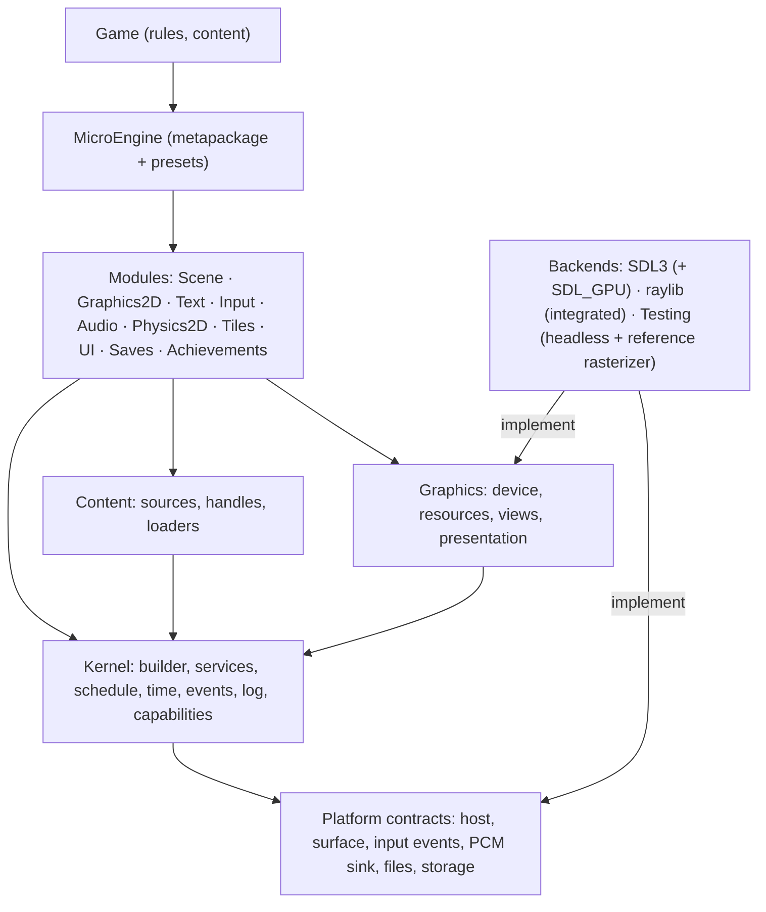

# ARCH-1: Adversarial architecture audit and target architecture (Phase I)

Status: **approved by the owner on 2026-11-02 with five amendments; Phase II under way.** The amendments are
integrated in place, not appended: prototypes run before the decision they validate (§9), one complete graphics
device contract validated by a tier-0/tier-1 spike (§6.4, §7, §9), the legacy `Entity` adapter is transitional and
deleted at the end of stage 5 (§6.3, §6.5, §9), stage closure criteria and property-based validation (§8, §9), and a
definition of done for Phase II with a 3D vertical slice and a physics substitution demonstration (§9.1). Phase I
changed nothing in `src/`, `games/`, `samples/`, `templates/` or the workflows. Audited code: `docs/arch-1` =
`feat/asset-1` at 5706285 (the ASSET-1 work, since merged). Record and Phase II register:
[`odd/tasks/arch-1.md`](../../odd/tasks/arch-1.md). Date: 2026-11-02.

The question applied to every decision: *if MicroEngine were designed today, for a generalist, modular,
multi-platform 2D/2.5D/3D engine with plug-and-play defaults, would we make this decision again?*

## How this audit was made

Seven agents worked in parallel. The integration, the contradictions they disagreed on and the target design below
are the architect's. Each report is kept in full as an annex; this document cites them by finding ID.

| Annex | Scope | Findings |
| --- | --- | --- |
| [A1 core](arch-1/A1-core.md) | Kernel, loop, composition, configuration, platform contract, assets, physical structure, SDK | F1-F17 |
| [A2 rendering](arch-1/A2-render.md) | Renderer contract, devices, resources, alpha, canvas, cameras, backends | R1-R12 |
| [A3 simulation](arch-1/A3-sim.md) | Input, audio, entities, scenes, physics, UI, what the demos reimplement | IN-, AU-, WO-, SC-, UI-, DM- |
| [A4 infrastructure](arch-1/A4-infra.md) | Test layers, visual checks, CI, packaging, benchmarks | F1-F15 (A4) |
| [R1 rendering research](arch-1/R1-render-research.md) | SDL_GPU, SDL_Renderer, FNA, MonoGame, Godot, bgfx/sokol/wgpu, Bevy, Unity, Unreal, web graphics | 60+ sources |
| [R2 engine research](arch-1/R2-engine-research.md) | Composition, loop, ECS vs scene trees, physics, assets, audio, input | 77 sources |
| [R3 validation research](arch-1/R3-validation-research.md) | Image comparison, conformance suites, perf regression, .NET native packaging | 94 sources |

Experiments are not opinions: each claim marked "measured" below was run. Their sources and outputs are in
[`arch-1/experiments/`](arch-1/experiments/) (project files carry a `.txt` suffix so no build picks them up; they
reference the engine as built at 5706285).

| Experiment | What it measured |
| --- | --- |
| `core-stub` (A1 E1-E5) | Capabilities lost when a profile is composed; a stub backend's size; the headless clock at 120 Hz; asset unload with shared holders; public API surface; namespace dependency graph (`nsdeps`) |
| `render-probe` (A2) | Six rendering probes (clip+clear, sub-pixel, disposed texture, foreign texture, linear-filter fringe, blend) on seven backends: SDL D3D11/D3D12/OpenGL/Vulkan/gpu/software and raylib |
| `render-stub` (A2) | A recording renderer, device and platform running a real `Game` |
| `sim-probe` (A3 E1-E5) | `TileMotion` tunnelling and embedding; `EntityList` clear during update; two devices on one action |
| `infra` (A4) | Sensitivity of the visual fingerprint to real and invisible changes; agreement between the seven reference sets; build and test timings |

Classification used throughout: **CP** confirmed problem, **AR** architectural risk, **DL** design limitation,
**LS** legitimate specialization, **MC** missing capability, **EX** needs an experiment.

## 1. Inventory of the current system

| Area | What exists |
| --- | --- |
| Physical | One engine assembly `MicroEngine` (~15.5 k lines, 173 public types, ~1,743 public members), `MicroEngine.Sdl`, `MicroEngine.Raylib`, `MicroEngine.Desktop` (launcher), `MicroEngine.Cli` (tool, with browser/Android/iOS hosts). StbImageSharp and FontStashSharp are dependencies of every game. |
| Kernel | `Game` creates every service in a fixed order; `GameLoop`/`GameRunner` run a fixed 60 Hz step (max 5 per frame, 0.25 s clamp), render once, no interpolation; `GameSession` for page-driven hosts; `GameLauncher` parses command lines. |
| Platform | `IPlatform` (window, events, clock, `BeginFrame` returning an `IRenderer`, `EndFrame`, screenshots) plus `IGraphicsDevice`, `IAudioDevice`, `IInputSource`, optional `ITouchScreen`; optional features found by casting (`IDisplayControl`, `IPlatformDiagnostics`). `PlatformCatalog` of named profiles; hosts may replace audio or add input only. |
| Rendering | `IRenderer`: 13 members, immediate 2D, `Vector2`/`RectF`, translation-only camera, three blend modes; CPU `PixelImage` uploaded as RGBA8 textures with a mutable filter; one virtual canvas (default 320×180 ×4) letterboxed by `CanvasScaling`. |
| Input | One `InputMap` of named actions over one merged `IInputSource`; 66-key enum; one gamepad; `VirtualControls` own every touch. |
| Audio | `AudioMixer` front end; mixing done by each device (SDL: 16 shared voices, raylib: 4 per sound, capture: unlimited); `Synth`/`Song` for retro sound; fire-and-forget `Play`. |
| World and scenes | `Entity` (`Vector2` position, 16×16 hitbox, `Draw(IRenderer)`), `EntityList<T>`, tile layers and `TileMotion`; a scene stack with overlays and transitions; coroutines, tweens. No physics, no transforms, no ids. |
| Assets | `Game.Assets` (`AssetCache`): one object per file and options, string-kinded, scoped release, hitch reports; images, atlases and fonts decoded in managed code; audio outside the cache. Files only (`ContentFolder`). |
| Other core features | Achievements, toasts, saves, UI widgets, touch skin, action prompts, frame profiler. |
| Validation | 533 .NET tests (~45 s), 15 scripted capture scenarios (138 captures) compared to 7 per-platform fingerprint references, ~120 JS tooling tests, SDK acceptance from an external project, package verification, phone checks monthly. CI skips checks whose inputs already passed. |

What is sound and is kept (A1 F17, A3, A4): the deterministic fixed step with scripted runs; actions instead of keys;
`IActionSource`, `ICollisionGrid`, the deferred scene-change queue, `TouchLayout`; asset scopes and managed decoders
(the same pixels on every platform); the platform catalog idea; the SDK tested from outside the repository; evidence-
keyed CI; the capture audio device as a deterministic reference.

## 2. Dependency map and coupling

Measured (A1 §2, `experiments/core-stub/nsdeps.txt`):

- `MicroEngine.Core` depends on every other namespace except `World`; `Graphics` is the real leaf. **"Core" is at
  the top of the graph, not the bottom.**
- Cycles: `Core ↔ Scenes`, `Core ↔ UI`.
- The frame is wired to one 2D immediate renderer: `IPlatform.BeginFrame()` → `IRenderer` → `Game.Render` →
  `Scene.Draw(IRenderer)` → `Entity.Draw(IRenderer)`. Simulation objects draw themselves (A1 F3, A3 WO-3).
- `CanvasScaling` alone decides five things: default texture filter, final upscale filter, integer fitting (the 80 %
  rule), initial window size and capture scale (A2 R6).
- In each backend the window, renderer, graphics device, input, touch overlay and gamepad start-up are built in one
  constructor and are `internal` (`SdlPlatform`, 854 lines; A2 R2).
- Composition happens three ways: desktop through `GameLauncher` and the catalog plus the static
  `ContentFolder.DefaultRoot`; browser through `BrowserLauncher`, which sets `SaveStore.DefaultStorage` and builds
  `RaylibPlatform` directly; phones through environment variables and an MSBuild-generated factory. What a developer
  configures in `Program.cs` never reaches web or phone builds (A1 F6).

## 3. Issue register

Ranked by consequence for the vision. "Now" means it must be fixed in Phase II's foundation; it does not mean it is
the first commit.

### 3.1 Confirmed defects that exist today (independent of the redesign)

| ID | Defect | Evidence | Sev. |
| --- | --- | --- | --- |
| D1 | `ComposedPlatform` does not forward `DisplayRate`, `Wait`, `IDisplayControl`, `IPlatformDiagnostics`: replacing audio (e.g. `--audio-capture`) or adding input turns off display pacing, the precise frame timer, the run-time graphics menu and diagnostics. | `src/MicroEngine/Core/PlatformProfiles.cs:196-224`; measured 144 Hz → 0, `CanChange` false (A1 F1, E1). Spot-checked by the architect. | High |
| D2 | Release-gating package checks are red on `main` (stale WARP references, Debian 11 glibc check); daily CI does not run them, so a release from `main` would be refused. | Validate run 41515138843 (A4 F1); `odd/tasks/asset-1.md:93`. | High |
| D3 | The visual fingerprint passes real regressions (sprite moved 12 px, HUD "13"→"18", a blur standing in for nearest→linear) and fails an invisible +4/255 shift. | `web/tests/captures.mjs:10-11,76-93`; `experiments/infra/fingerprint-result.txt` (A4 F2). | High |
| D4 | `HeadlessPlatform.Now` is `_frames / 60.0` whatever `UpdateRate` is; at 120 Hz headless touch timing runs at half speed. | `src/MicroEngine/Core/HeadlessPlatform.cs:40`; measured (A1 F4, E3). Spot-checked. | Medium |
| D5 | Backends disagree: `Clear` after `SetClip` clears everything on SDL, the clip on raylib; a 1-px rect at y=2.5 lands on different rows; a disposed texture draws nothing (SDL), black (raylib) or throws (headless) while the docs say it fails; raylib captures carry alpha 0xBF. | `experiments/render-probe` on seven backends (A2 R3). | High |
| D6 | `TileMotion` is documented as swept AABB but is sub-stepped discrete overlap: a 2×2 body moving 15.9 px tunnels through a 4 px solid; a rising platform leaves a resting body embedded 4 px with `IsOnGround` false. | `World/TileMotion.cs:40-68,106-118`; `docs/architecture.md:78`; `experiments/sim-probe` (A3 WO-2). | High |
| D7 | Straight alpha everywhere: a red-to-transparent edge sampled linearly over white measures R=191 on all seven backends (premultiplied: 255). Affects every smooth game and scaled glyph. | `experiments/render-probe` fringe (A2 R5). | Medium |
| D8 | Three mixers with three voice policies; the test reference (capture, unlimited voices) cannot detect voice stealing. | `SdlAudioDevice.cs:15,139-159`, `RaylibAudioDevice.cs:15,92-101`, `CaptureAudioDevice.cs:77-150` (A3 AU-1). | High |
| D9 | `AssetCache.Unload` disposes a texture other code still holds; sibling scopes load the same file twice. | A1 F7, E4. | Medium |
| D10 | The browser suite `web/tests/run.mjs` (frames, keys, audio level, frame rate) runs in no workflow; SDL, the default backend, has no native keyboard or audio-output test. | A4 F6, F7. | Medium |
| D11 | Smaller: `EntityList` throws if an entity clears the list during `Update` (A3 WO-5, measured); `FontOptions.Antialiasing` picks the glyph filter, contradicting `docs/manual/rendering.md:46-47` (A2 R6, the ASSET-1 example); `AssetGalleryTests.cs:58` waits 120 ms for a background load (latent flake); `docs/ci.md` drifted (A4); a frozen scene under an overlay still receives the global `FrameBlend` (A3 WO-4); key prompts assume QWERTY (A3 IN-5). | as cited | Low-Med |

These do not need the target architecture and should not wait for it (see §9, stage 0).

### 3.2 Structural problems (the reasons for the redesign)

| ID | Problem | Class | Evidence | Sev. |
| --- | --- | --- | --- | --- |
| S1 | **No composition model.** `Game` is a fixed god object: no way to register a module, add a frame phase or replace a built-in service; every game gets touch controls, the pixel font, achievements. Physics, ECS, networking or 3D can only live inside a scene's `Update`/`Draw`. | DL/AR | `Game.cs:132-207` (A1 F2, F16) | Critical |
| S2 | **The rendering contract is a closed 2D immediate API narrower than its own backends.** No matrices, depth, vertex data, render targets, shaders, materials, wrap modes, premultiplied blend. SDL3-CS and Raylib-cs already expose most of that. `LightMap` fakes a light buffer with a grid of multiply-blended rects. | DL/AR | `IGraphics.cs:115-152`, `Platform.cs:431` (A2 R1) | Critical |
| S3 | **No substitution seam for the renderer, device or window.** Hosts can replace audio or add input only. A custom renderer on a real window means forking `SdlPlatform`. The SDL `gpu` driver (pixel-identical to D3D11 in every probe) exists, but its device is unreachable. | CP | `PlatformProfiles.cs:10-18`, `SdlPlatform.cs:160-164,445` (A2 R2) | High |
| S4 | **The backend contract is unwritten.** `IPlatform` is a real contract (a ~32-member stub ran a game first try, A1 E2), but canvas scaling, letterboxing, capture scale, touch overlay, clock, hotkeys, rasterization rules and resource rules live only in backend code, and the backends disagree (D5). No conformance suite exists. | CP | A1 F11, A2 R3, A4 F4 | High |
| S5 | **Resource model is CPU-first RGBA8, texture = sampler.** No formats, mipmaps, render-target textures, readback, buffers; filter is mutable texture state; foreign textures fail by `InvalidCastException`; device reset/loss unhandled with no CPU copies kept. | MC/AR | `IGraphics.cs:27-34,163` (A2 R4) | High |
| S6 | **No transforms, no identity, drawing inside entities.** `Entity` is a sprite object with a 16×16 pixel-art hitbox; no hierarchy, ids, attachments, serialization. All four demos wrap or replace it. ADR 0003 bundled "no ECS" with "no transform or hierarchy": separate decisions. | DL | `World/Entities.cs:14-31` (A3 WO-3) | High |
| S7 | **No physics contract.** No body, collider, contact, query or step hook; the demos write 24 pairwise overlap loops and two private collision grids. | MC | A3 WO-1 | Critical for the vision |
| S8 | **The engine does not interpolate.** Three demos reimplement per-scene interpolation (`MeadowRun/Scenes/Motion.cs`, `NeonRift/Scenes/DrawBlend.cs`, `CourtyardKey/Entities/Actor.cs`), contradicting ADR 0023. At 60 Hz on 144 Hz displays 84 of 144 frames show no new state or input. | CP | A3 WO-4/SC-2, A1 F5 | High |
| S9 | **Time is owned by backends.** SDL and raylib each compute fixed-step time; headless hard-codes 60 (D4); loop limits are literals; a hidden window implies fixed-step time and no audio; no time scale (MeadowRun builds its own hitstop). | CP/DL | `GameRunner.cs:246,258,274`, `GameLauncher.cs:79` (A1 F4-F5, A3 SC-3) | Medium |
| S10 | **Single-player input contract.** `IInputSource` has no device index; SDL opens the first pad, raylib reads pad 0; `CompositeInput` merges by "any source down": keyboard Left + pad Right = axis 0 (measured). | DL | `Input/Input.cs:54-75`, `Sdl/SdlInput.cs:8,36-53` (A3 IN-1, A1 F15) | High |
| S11 | **Input vocabulary and routing.** Polled 66-key enum, no text/IME, wheel, rumble or event stream; every touch drained by on-screen controls (and SDL touch-to-mouse disabled), so no tap-to-move, swipe or pinch; no consumption between UI, overlays and gameplay. | MC/DL | `VirtualControls.cs:482`, `SdlPlatform.cs:90-91` (A3 IN-2..4) | High |
| S12 | **Audio API.** `Play` returns `void` (no stop, no control); one music channel; audio outside the asset lifecycle and no unload on the device; demos compute pan themselves; music fed from the simulation step on the main thread. | MC/CP | `Audio.cs:138,308,327` (A3 AU-2..6) | High |
| S13 | **Assets.** Sealed cache with string kinds; live objects, not handles; physical files only (no archives, Android assets in place, browser fetch); no loader registry or import seam (glTF, GPU formats, shaders, SDF fonts); no hot reload. | AR/MC | A1 F7 | High |
| S14 | **Hidden defaults and coupled options.** Fifteen in core (A1 F8) and twenty in rendering (A2 §4): `CanvasScaling` ×5 (above), font antialiasing → filter, atlas padding fixed at build by a filter that can change later, `DefaultFilter` mutable device state written by `Game.Initialize`, F11/Alt+Enter hard-wired in backends and also delivered to the game, seed depends on whether a script was given, camera `PixelSnap = true`, 320×180 ×4, `FillGradient` one rect per row, on-screen control text drawn with each backend's debug font, engine-owned action names (`confirm`, `up`) shared with engine widgets. | CP | A1 F8, A2 R6, A3 §4 | Medium (High in aggregate) |
| S15 | **One fixed-resolution canvas is the only render path.** No HD UI over a low-res world, no native-resolution text, letterbox only, no run-time resize; the touch overlay has its own drawing contract. | DL | A2 R7, A1 F14 | Medium |
| S16 | **2D-only math and colour.** `Matrix3x2`, `Matrix4x4`, `Vector3`, `Quaternion` appear nowhere in `src`, `games` or `samples`; `Camera2D` is sealed, translation-only; `Color` is 8-bit straight. | DL | A2 R8, A1 F3 | Medium |
| S17 | **Physical structure.** One assembly; namespaces are not boundaries (cycles); public test hooks (`InitializeForTest`, `StepForTest`), the CLI launcher and `HeadlessPlatform` ship in the runtime package; no events, no logging abstraction (`Console.Error`), implicit threading. | AR | A1 F9, F10, F12, F13 | Medium |
| S18 | **Validation proves the wrong thing for replaceable backends.** Cross-backend equivalence = exact RGB equality; correctness = closeness to 7 per-platform fingerprints (two renderer families, A4 measured raylib and SDL on Linux agree on 136/138); headless rendering only counts draw calls; scripts force actions rather than device input; no perf regression detection. Any SDL_GPU, linear, MSAA or sRGB change means re-recording 7 × 138 captures with no way to tell intent from regression. | CP | A4 F2-F5, F8 | High |
| S19 | **UI.** Widgets respond to actions only: no pointer/touch, layout, focus or text field; sizes in pixel-art units. | MC | A3 UI-1, UI-2 | Medium |

### 3.3 Legitimate specializations (keep, but as modules, not as the core)

Integer pixel scaling and nearest sampling as a **preset**; tile layers, autotiling and a kinematic tile mover for
platformers; the retro synthesizer and step sequencer; achievements; the touch skin. Each is valuable and none belongs
in the kernel (A1 F16-F17, A3 WO-2, R1 §Godot: viewport stretch + integer scale is what Godot recommends for pixel
art).

## 4. Industry lessons that change the design

Only lessons that move a decision are listed; sources are in the R annexes. [F] = documented, [I] = inference.

| Lesson | Source | Consequence for MicroEngine |
| --- | --- | --- |
| Engines that wrote one backend per graphics API backed away: FNA dropped its Metal driver and moved onto SDL_GPU [F]; MonoGame 3.8.5 calls its dozen wrappers a problem and moves to one native library with Vulkan/DX12 [F]; SDL removed SDL_GPU's D3D11 backend for maintenance cost [F]. | R1 | Never write a renderer per API. Target a portable device layer (SDL_GPU on native). |
| SDL 3.4 added a 2D renderer on top of SDL_GPU with custom fragment shaders (`SDL_CreateGPURenderState`), GPU texture interop and `SDL_SCALEMODE_PIXELART` [F]. | R1 | A staged path exists: today's SDL backend can move onto the `gpu` driver and share its device with engine-owned GPU passes. |
| SDL_GPU has no web backend; its WebGPU backend is an unmerged draft (PR #16020) with no date; WebGPU is still not default on Firefox Linux/Android or most Chrome Linux [F]. Every layer that runs on web today keeps a GL/WebGL path [F]. Godot had to bring back an OpenGL renderer and it is its only web renderer [F]. | R1 | Plan for two GPU paths on the web for years. Do not make 3D or shaders depend on WebGPU. |
| Godot's renderer rewrite lost 2D batching until 4.4 (573,440 → 36 draw calls on one map once restored) [F]. | R1 | Draw-call counts and batching are tested invariants, as deterministic counters, from day one. |
| Pixel-art: render at base size, scale by whole factors (Godot `viewport` + integer) [F]; per-node "snap" flags cause jitter and gaps [F]. | R1 | Pixel vs smooth is one presentation policy, not per-sprite flags. MicroEngine's canvas idea is right; its coupling is wrong. |
| Samplers separate from textures in SDL_GPU, WebGPU, Vulkan, D3D12 [F]; generation-checked handles catch use-after-free [F]. | R1 | Immutable sampler values; texture handles with generations; deferred destruction after the last frame that used them. |
| Unity's GameObject/Entities split has needed years of reconciliation and still centres on one id type in Unity 6.6 [F]. Godot argues ECS pays off only at tens of thousands of objects; flecs' author: a home-made ECS will not beat established ones; hierarchies are hard in any ECS [F]. Bevy and Unity both rebuilt identity and hierarchy [F]. | R2 | No core ECS and never two object models. Get identity and hierarchy right first. Leave room for an optional data-oriented module behind the same ids. |
| Godot keeps physics, rendering and audio in "servers" addressed by ids; nodes are only the user layer; `SceneTree` is a replaceable `MainLoop` [F]. Unreal subsystems get their lifetime from a parent (engine, game instance, world, player) [F]. | R2 | Subsystems are services with an owner scope; the scene layer is a default module over them, not the kernel. |
| Fixed step + render blend `alpha = accumulator/dt` is the standard [F]; Godot added 2D physics interpolation only in 4.3 to fix jitter, and teleports need a reset call [F]. | R2 | The engine interpolates transforms for drawing, with an explicit teleport. |
| Box2D v3: id-based C API, substepping solver, persistent islands, separate sensors, buffered events; cross-platform determinism with FMA off [F]. Godot's Jolt behind the same nodes still changed behaviour [F]. | R2 | Physics contract shaped after Box2D v3 (ids, steps inside the fixed phase, buffered events). Accept that a physics abstraction leaks semantics; validate each backend against the contract. |
| Godot rejected a central UID database (merge conflicts, does not move with files) for `.uid` sidecars [F]; Unity `.meta` loss silently breaks references [F]; Unreal soft references are not cooked unless declared [F]; Bevy v2 keeps path identity and makes processing optional [F]; MonoGame XNB hinders modding [F]. | R2 | Keep raw files and path identity as the default; typed handles; an optional, build-time processing step later; never mandatory compiled formats. |
| miniaudio separates the device (data callback) from an optional engine with a node graph and spatialization [F]; SDL3 audio is device-bound streams [F]; Godot buses are acyclic, named [F]. | R2 | Backends become PCM sinks; one managed mixer in the engine; middleware (FMOD/Wwise) replaces the mixer service, not the sink. |
| Unity rewrote input; its complexity cost adoption and it later added a default project-wide action asset [F]. Godot has no per-player map [F]. leafwing assigns pads per player explicitly; unassigned maps hear every pad [F]. SDL3 gives gamepad types, labels, player index [F]. | R2 | Per-player maps with explicit pairing, but a zero-setup default (player 1 gets every device). |
| dEQP/VK-GL-CTS compare with thresholds and position tolerance [F]; wgpu uses NVIDIA FLIP with mean/percentile thresholds [F] (but silently adopts a missing reference: do not copy); Skia Gold keys baselines by configuration with several accepted images [F]; WPT declares fuzz per test [F]; Mesa replays traces with per-device checksums and flake lists [F]. | R3 | Per-test declared tolerances, a perceptual metric, references keyed by renderer family, a missing reference is a failure. |
| `Microsoft.Extensions.DependencyInjection.Specification.Tests` and EF Core specification tests are suites a provider subclasses [F]. | R3 | A published backend conformance kit on the same pattern. |
| lavapipe, llvmpipe, SwiftShader, WARP run real GPU APIs on GPU-less CI; SDL_GPU picks software Vulkan unless hardware is required; raylib 6 has the CPU `rlsw` renderer [F]. | R3 | GPU backends are testable on hosted runners. |
| Change-point detection raised useful perf alerts from 1 % to 67 % at MongoDB; Perfherder uses a t-test and a 2 % floor [F]. | R3 | Gate merges only on deterministic counters; time is an alert trend. |

What we deliberately do not copy: a render graph or a second render world (yet), XNA-style effect files, data-file
content pipelines as the default, parallel render pipelines (Unity URP/HDRP), engine-owned math types (Stride is now
discussing a move to System.Numerics), a reflection-based DI container (AOT and WebAssembly), and wgpu's
auto-adoption of missing references.

## 5. Contradictions between the reports and how they are resolved

| Topic | A says | B says | Resolution |
| --- | --- | --- | --- |
| Graphics end state | A2: a device layer with tier 0 (SDL_Renderer, raylib) and tier 1 (SDL_GPU native, WebGPU/WebGL2 in browsers). | R1: keep `IRenderer` as the 2D contract, add an optional SDL_GPU device through SDL_Renderer's `gpu` driver; browsers stay on raylib; WebGPU later. | The **contract** is A2's (one device abstraction shaped after SDL_GPU/WebGPU concepts, with capabilities). The **implementation order** is R1's: tier 0 first on existing backends, tier 1 = SDL_GPU on native via the `gpu` driver; no engine-written WebGL or WebGPU backend until prototype P4 decides the web host. Today's `IRenderer` survives as a façade over the 2D batcher. |
| Physics timing | A3: contracts `IPhysicsWorld2D/3D` now, Box2D v3 adapter "prepare". | R2: prepare the boundary; avoid native dependencies before WebAssembly packaging and determinism are checked. | Contracts and a contract test suite in the foundation; the in-house tile mover becomes the first implementation of the 2D query/kinematic part; the Box2D adapter only after P6 (Box2D.NET managed port vs native Box2D in wasm). |
| Entity model | A3: ids, 3D-capable transform, optional parent, typed attachments; ECS vs attachments needs a prototype. | R2: no core ECS; stable id before serialization. | No core ECS. One object model: generation-checked `EntityId`, `Transform` (3D storage with 2D helpers), optional parent, typed attachments (components without a scheduler). An ECS may be added later as a module that stores attachments, behind the same ids (P7 checks ergonomics on one demo). |
| Package granularity | A1: many packages split by boundary, enforced by an architecture test. | R3: add an abstractions package only once third-party backends exist; version everything together. | Assemblies split by real boundary (enforced by tests) now; **published packages grouped** into fewer units with one version (`MicroEngine` metapackage for the default experience). Abstractions are a separate assembly from day one but are only published separately when a third-party backend needs it. |
| Mixer location | A3: one managed engine mixer over PCM sinks. | R2: keep the engine mixer, device as sink; "mixer off" mode for middleware. | Agree; plus P5 must prove a pull-callback sink on the web (AudioWorklet) and phone output threads before the device contract is frozen. |
| Raylib's place | A1/A2: can raylib's "window owns the context" fit a surface abstraction? | R1: raylib remains the browser backend for now. | Raylib is kept as an **integrated backend** (host + device fused, declared as such) until P4 decides whether SDL3 on Emscripten replaces it. The contract allows integrated backends: a backend may provide host and device together. |
| Asset processing | A2: premultiplying, mipmaps, GPU formats push toward build-time processing, reopening ADR 0025. | A1/R2: keep raw files; optional processed mode later. | ADR 0025 holds for 2D defaults: premultiply and mip generation happen at load in managed code. A build-time importer seam is reserved; it becomes mandatory only for formats that cannot be decoded at load (compressed GPU textures, compiled shaders). |

## 6. Target architecture

### 6.1 Principles

1. **The kernel knows no domain.** It composes services, owns time and the frame schedule, routes events. Rendering,
   input, audio, physics, assets and scenes are modules.
2. **Defaults are presets, not side effects.** Every default is an explicit, documented value in a settings object;
   options never derive from each other silently. `Presets.PixelArt` and `Presets.HighResolution2D` give today's
   plug-and-play; a game can override any single field.
3. **Contracts are written and executable.** Each replaceable subsystem has a contract document and a conformance
   suite every implementation runs; capabilities are queried, never discovered by casting.
4. **One object model, 3D-ready storage, 2D ergonomics.** Transforms store 3D (`Vector3`, `Quaternion`, `Vector3`
   scale) with 2D helpers; math is `System.Numerics`.
5. **Simulation never draws.** Entities and scenes produce state; presentation modules read it (interpolated).
6. **Deterministic by construction.** The loop owns the clock; scripted runs inject device events, not actions.
7. **Portable through layers we do not write.** SDL3 (and SDL_GPU) on native, raylib in browsers until P4; no engine
   code per graphics API.
8. **No reflection in the composition path** (NativeAOT, trimming, WebAssembly).

### 6.2 Logical layers



### 6.3 Physical structure

Assemblies (each is a project; arrows are the only allowed references, checked by an architecture test):

| Assembly | Contents | References |
| --- | --- | --- |
| `MicroEngine.Kernel` | `EngineBuilder`, `ServiceRegistry`, `FrameSchedule`/phases, `TimeSettings` and the loop-owned clock, `IEngineLifecycle` events, `ILog`, capability registry, `Handle<T>`/generations, math helpers over `System.Numerics`, `Color` + `ColorF` (linear, premultiplied helpers), `RectF` | — |
| `MicroEngine.Platform` | `IPlatformHost`, `ISurface`, `IInputBackend` (event stream), `IAudioSink`, `IFileSystem`/`IContentSource`/`IStorage` | Kernel |
| `MicroEngine.Graphics` | The single device contract (§6.4): `ISurface`, `IGraphicsBackendFactory`, `IGraphicsDevice`, `GraphicsCapabilities`, `GraphicsCapabilityException`; texture, render-target, sampler, buffer, shader and pipeline descriptions; built-in pipelines; `CommandList` with passes; views, `Presentation`, `ICamera` | Kernel, Platform |
| `MicroEngine.Content` | `IAssetStore`, `Asset<T>`, owners/scopes, `IAssetLoader<T>` registry, content sources (folder, zip; Android and browser fetch from their backends), reserved `IAssetImporter` | Kernel, Platform |
| `MicroEngine.Graphics2D` | `IRenderer2D` batcher (matrix stack, state stack, sort), sprites, atlases, `Camera2D` (zoom, rotation, optional snap), particles, light buffer, image loaders (StbImageSharp) | Graphics, Content |
| `MicroEngine.Text` | Bitmap and scalable fonts (FontStashSharp), layout, measurement | Graphics2D |
| `MicroEngine.Input` | Devices with ids, players and pairing, per-player action maps, input layers, rebinding persistence hook, text/IME channel; `Input.Touch` (virtual controls, touch skin) | Kernel, Platform (+ Graphics2D, Text for `Input.Touch`) |
| `MicroEngine.Audio` | Managed mixer, `SoundHandle`, voices with priority, acyclic buses, listener/emitters, clips and streams as assets; `Audio.Retro` (Synth, Song) | Kernel, Platform, Content |
| `MicroEngine.Scene` | `World`, `EntityId`, `Transform` hierarchy, typed attachments, interpolation, world clocks (scale, pause, hitstop), scene stack as screen flow with results, transitions, coroutines, tweens | Kernel |
| `MicroEngine.Physics` | `IPhysicsWorld2D` (and, reserved, `IPhysicsWorld3D`): the common contract every backend passes (static colliders, kinematic collide-and-slide moves with contacts, layers and masks, ray and AABB queries, sensors with buffered events, contact normals, step inside the fixed phase) plus declared `PhysicsCapabilities` and `PhysicsCapabilityException` (§9.1); `Physics.Tiles` (tile grids, autotile, the fixed kinematic tile mover, the first backend) | Scene |
| `MicroEngine.Physics.Box2D` | Box2D v3 backend of `IPhysicsWorld2D` (managed or native binding decided by P6); Phase II completion work (§9.1) | Physics |
| `MicroEngine.UI` | Widgets with focus, pointer, layout in screen units, theme; highest input layer | Graphics2D, Text, Input |
| `MicroEngine.Saves`, `MicroEngine.Achievements` | Optional modules (`SaveStore` over `IStorage`; tracker and toasts) | Kernel, Platform (+ UI for toasts) |
| `MicroEngine.Hosting` | One launcher model for desktop, web, phones and tests; command-line parsing; profile catalog; `Configure` entry point used by generated hosts instead of `MicroEngineGameFactory` | Kernel, Platform |
| `MicroEngine.Backend.Sdl` | SDL3 host, input backend (all pads, events), PCM sink, tier-0 device on SDL_Renderer, later tier-1 SDL_GPU device | abstractions |
| `MicroEngine.Backend.Raylib` | Integrated backend (host + device + sink) for browsers and as a desktop alternative | abstractions |
| `MicroEngine.Testing` | Headless host, deterministic clock, device-event scripts, recording device + CPU reference rasterizer, conformance suites, architecture test helpers | abstractions + modules |
| `MicroEngine` (metapackage) | Default modules, presets, `Game` façade | modules |
| `MicroEngine.Migration.Entities` (transitional) | The legacy `Entity`/`EntityList` adapter over `IWorld`, `[Obsolete]` from its first commit; a non-packable project consumed only by the demos while they migrate; **deleted at the end of stage 5** | Scene, Graphics2D |

The migration adapter is never part of `MicroEngine.Scene` nor of any published package, and it is not a permanent
public API. The architecture test fails if any project still references it once stage 5 closes; stage 5 cannot close
until the project is gone (§9).

Published packages (one version for all, from `MicroEngineVersion`): `MicroEngine` (metapackage: kernel, platform,
graphics, content, graphics2D, text, input, audio, scene, physics + tiles, UI, saves, achievements, hosting),
`MicroEngine.Sdl`, `MicroEngine.Raylib`, `MicroEngine.Desktop`, `MicroEngine.Testing`, and the `microengine` tool.
The Box2D backend is not in the metapackage (its packaging follows P6); the migration adapter is never packaged.
Individual module packages are published only when a consumer needs to leave one out (the abstraction assemblies
already exist, so splitting a package later is not a breaking change for code). Native binaries move to `*.Native`
packages only if P4 or the SDL_GPU work makes their size or RIDs a problem.

### 6.4 Fundamental contracts (sketch)

The sketches with rationale are in A1 §4.2, A2 §6 and A3 §7; this is the integrated core. The graphics device
contract below is the **complete, single contract** (it restores and amends A2 §6.1; the abbreviated version in the
first draft of this dossier was an omission, not a decision). Shapes are sketches: they are frozen only at the gates
in §9 (the graphics contract after the stage 1 spike, `IAudioSink` after P5, `IWorld` after P7, physics after P6).

```csharp
// Kernel ------------------------------------------------------------------
public interface IEngineModule { void Configure(EngineBuilder builder); }

public sealed class EngineBuilder
{
    public ServiceRegistry Services { get; }
    public FrameSchedule Schedule { get; }
    public EngineBuilder Add<TModule>(TModule module) where TModule : IEngineModule;
    public EngineBuilder Configure<TSettings>(Action<TSettings> edit) where TSettings : class, new();
    public Engine Build();
}

public enum FramePhase { BeginFrame, Input, PreFixed, FixedUpdate, Physics, PostFixed, Update, LateUpdate,
                         Extract, Render, Present, EndFrame }

public sealed record TimeSettings
{
    public int FixedRate { get; init; } = 60;
    public int MaxStepsPerFrame { get; init; } = 5;
    public double MaxFrameDelta { get; init; } = 0.25;
    public TimeMode Mode { get; init; } = TimeMode.RealTime;   // Deterministic: loop-owned clock, any rate
}

public readonly record struct FrameContext(double Delta, double FixedDelta, float Blend, long FixedStep, long Frame);

// Platform ----------------------------------------------------------------
public interface IPlatformHost : IDisposable
{
    IMonotonicClock Clock { get; }
    bool PumpEvents(IEngineEventSink sink);           // window, lifecycle, input events, timestamped
    ISurface? MainSurface { get; }
    bool TryGetCapability<T>([NotNullWhen(true)] out T? capability) where T : class;
    bool CanBlock { get; }                            // page-driven hosts: false (SDL_AppIterate shape)
}

public interface IAudioSink : IDisposable                 // pulled on the backend's audio thread
{
    AudioFormat Format { get; }
    void Start(AudioRender render);                   // delegate fills interleaved float frames
}

// Graphics: one device contract for every tier ------------------------------
// Tiers differ only in declared capabilities, never in API shape. A request that needs an undeclared capability
// fails with GraphicsCapabilityException; there is no silent degradation.
public interface ISurface                                  // produced by the host; integrated backends provide both
{
    nint NativeWindow { get; }                             // opaque; only backends read it
    (int Width, int Height) PixelSize { get; }
    float PixelDensity { get; }
    event Action? Resized;
    event Action? Lost;                                    // mobile surface destroyed, GPU reset
}

public interface IGraphicsBackendFactory
{
    string Name { get; }                                   // "sdl-renderer", "sdl-gpu", "raylib", "headless-ref"
    string? UnsupportedReason(ISurface? surface);
    IGraphicsDevice Create(ISurface? surface, GraphicsDeviceOptions options);
}

public enum GraphicsTier { Tier0, Tier1 }                  // 0: SDL_Renderer, raylib; 1: SDL_GPU (web tier 1 later)

[Flags] public enum GraphicsFeatures
{
    None = 0, RenderTargets = 1, TexturedGeometry = 2, AddressModes = 4, Mipmaps = 8, CustomBlend = 16,
    Shaders = 32, DepthBuffer = 64, Instancing = 128, ComputeShaders = 256, CompressedTextures = 512, FloatTextures = 1024,
}

[Flags] public enum ShaderFormat { None = 0, SpirV = 1, Dxil = 2, Msl = 4 }   // offline-compiled; formats per backend

public sealed record GraphicsLimits(int MaxTextureSize, int MaxRenderTargetSize, int MaxTextureSlots,
    int MaxUniformBytes, int MaxVertexAttributes);

public sealed record GraphicsCapabilities(
    GraphicsTier Tier,
    GraphicsFeatures Features,
    ShaderFormat ShaderFormats,                            // None on tier 0
    IReadOnlySet<TextureFormat> TextureFormats,
    IReadOnlySet<BlendState> BuiltInBlendStates,           // blend states the built-in pipelines support
    GraphicsLimits Limits,
    string ApiName, string? Adapter);

/// The one typed error for a missing capability: names the operation, the device and what it lacks.
public sealed class GraphicsCapabilityException : NotSupportedException
{
    public string Operation { get; }                       // e.g. "CreatePipeline(depth)"
    public string Device { get; }                          // factory name
    public GraphicsFeatures Missing { get; }
}

public enum BuiltInPipeline { Sprite, TexturedGeometry }  // every tier implements both, with each BuiltInBlendState

public interface IGraphicsDevice : IDisposable
{
    GraphicsCapabilities Capabilities { get; }
    event Action<DeviceLostReason>? DeviceLost;            // resources marked lost; restorable ones re-uploaded

    // Resources: every resource knows its device; core validates ownership, disposal and generation first;
    // destruction is deferred until the last submitted frame that used the resource completes.
    Texture CreateTexture(in TextureDescription description, ReadOnlySpan<byte> initialData = default);
    RenderTarget CreateRenderTarget(in RenderTargetDescription description);   // requires RenderTargets
    Sampler GetSampler(in SamplerDescription description);                     // immutable value, cached; never texture state
    GpuBuffer CreateBuffer(in BufferDescription description);                  // vertex, index, uniform; requires TexturedGeometry
    Shader CreateShader(in ShaderDescription description);                     // requires Shaders and a declared ShaderFormat
    Pipeline CreatePipeline(in PipelineDescription description);               // custom shaders, depth or custom blend: declared capabilities only
    Pipeline GetBuiltInPipeline(BuiltInPipeline kind, BlendState blend);       // every tier; the 2D batcher needs nothing else

    // Submission and presentation
    CommandList BeginCommands();
    void Submit(CommandList commands);
    void Present();                                         // swapchain of the device's surface
}

public enum TextureFormat { Rgba8Unorm, Rgba8UnormSrgb, R8Unorm, Rg8Unorm, Rgba16Float, Bc7, Etc2Rgba8, Astc4x4, Depth24Stencil8 }
public enum AlphaMode { Premultiplied, Straight }
[Flags] public enum TextureUsage { Sampled = 1, RenderTarget = 2, DepthStencil = 4 }
public readonly record struct TextureDescription(int Width, int Height, TextureFormat Format = TextureFormat.Rgba8Unorm,
    int MipLevels = 1, TextureUsage Usage = TextureUsage.Sampled, AlphaMode Alpha = AlphaMode.Premultiplied, string? Name = null);
public readonly record struct RenderTargetDescription(int Width, int Height, TextureFormat Format = TextureFormat.Rgba8Unorm,
    TextureFormat? Depth = null, string? Name = null);       // Depth requires DepthBuffer

public enum Filter { Nearest, Linear }
public enum AddressMode { Clamp, Repeat, Mirror }        // Repeat/Mirror require AddressModes
public readonly record struct SamplerDescription(Filter Min = Filter.Nearest, Filter Mag = Filter.Nearest,
    Filter Mip = Filter.Nearest, AddressMode U = AddressMode.Clamp, AddressMode V = AddressMode.Clamp)
{
    public static readonly SamplerDescription PointClamp = new();
    public static readonly SamplerDescription LinearClamp = new(Filter.Linear, Filter.Linear, Filter.Linear);
}

public sealed record BlendState(BlendFactor SrcColor, BlendFactor DstColor, BlendOp ColorOp,
    BlendFactor SrcAlpha, BlendFactor DstAlpha, BlendOp AlphaOp)
{
    public static readonly BlendState AlphaPremultiplied, Additive, Multiply, Opaque;   // premultiplied is the default
}

public readonly record struct BufferDescription(int SizeInBytes, BufferUsage Usage, string? Name = null);   // Vertex | Index | Uniform
public readonly record struct ShaderDescription(ShaderStage Stage, ShaderFormat Format, ReadOnlyMemory<byte> Code,
    string EntryPoint, ShaderResources Resources);           // bytecode produced offline by the tool (P2)
public readonly record struct DepthState(bool Test, bool Write, CompareOp Compare);
public readonly record struct RasterState(CullMode Cull, FrontFace Front, bool Scissor);
public sealed record PipelineDescription(Shader Vertex, Shader Fragment, VertexLayout Layout, BlendState Blend,
    DepthState Depth, RasterState Raster, TextureFormat ColorFormat, TextureFormat? DepthFormat);

public abstract class GraphicsResource : IDisposable     // Texture, RenderTarget, Sampler, GpuBuffer, Shader, Pipeline
{
    public IGraphicsDevice Device { get; }
    public bool IsDisposed { get; }
    public bool IsLost { get; }
}

public sealed class CommandList                           // recorded on the main thread, validated in core
{
    public void BeginPass(RenderTarget? target, in PassClear clear);   // null = surface back buffer; clear ignores scissor
    public void SetViewport(in RectF viewport);
    public void SetScissor(in RectF? scissor);
    public void SetPipeline(Pipeline pipeline);
    public void SetTexture(int slot, Texture texture, Sampler sampler);
    public void SetVertices(GpuBuffer buffer); public void SetIndices(GpuBuffer buffer);
    public void SetUniforms<T>(int slot, in T data) where T : unmanaged;
    public void DrawIndexed(int indexCount, int firstIndex = 0, int baseVertex = 0, int instances = 1);   // instances > 1 requires Instancing
    public void EndPass();
}

// Tier 0 (SDL_Renderer, raylib 2D batch) implements textures, samplers, render targets, scissor, textured geometry
// and the built-in pipelines with each supported blend state; CreateShader, and CreatePipeline with custom shaders
// or depth, throw GraphicsCapabilityException. Tier 1 (SDL_GPU on native) implements everything it declares.
// "headless-ref" is the CPU reference rasterizer implementing the written rules (tier 0 feature set).
// Raylib remains an integrated backend (host + device + sink) unless P4 decides otherwise.

public sealed record Presentation                       // replaces the five-way CanvasScaling coupling
{
    public Size? Canvas { get; init; }                   // null = native resolution
    public StretchMode Stretch { get; init; }            // Viewport (render at canvas, scale) | Canvas (scale draws) | None
    public AspectMode Aspect { get; init; }              // Keep (letterbox) | Expand | Ignore
    public ScaleRounding Rounding { get; init; }         // Integer | Fractional
    public SamplerDescription Upscale { get; init; }
    public SamplerDescription DefaultSampler { get; init; }
}

// 2D -----------------------------------------------------------------------
public interface IRenderer2D                              // implemented once, in core, over IGraphicsDevice
{
    void Begin(in BatchSettings settings);               // Matrix3x2 view, blend (premultiplied default), sampler, sort, scissor, target
    void Draw(Texture texture, RectF source, Matrix3x2 world, ColorF tint, float depth = 0);
    void DrawGeometry(Texture? texture, ReadOnlySpan<Vertex2D> vertices, ReadOnlySpan<ushort> indices);
    void PushState(in RenderState state); void PopState();
    void End();
}
// The batcher drives only built-in pipelines, so it runs unchanged on every tier. A Material with a custom shader
// is accepted only where Capabilities declares Shaders (otherwise GraphicsCapabilityException). Today's IRenderer
// survives as a façade over IRenderer2D.

// Scene -------------------------------------------------------------------
public readonly record struct EntityId(uint Index, uint Generation);

public struct Transform { public Vector3 Position; public Quaternion Rotation; public Vector3 Scale; }

public interface IWorld
{
    EntityId Create(EntityId? parent = null);
    void Destroy(EntityId entity);                       // deferred to the end of the phase
    ref Transform Local(EntityId entity);
    Matrix4x4 WorldMatrix(EntityId entity, float blend); // interpolated for drawing
    void Teleport(EntityId entity);                      // skip interpolation once
    T Attach<T>(EntityId entity, T attachment) where T : class;
    bool TryGet<T>(EntityId entity, [NotNullWhen(true)] out T? attachment) where T : class;
}

// Input -------------------------------------------------------------------
public readonly record struct DeviceId(int Value);
public interface IPlayers { PlayerInput this[int index] { get; } PlayerInput Join(DeviceId device); }
public interface IInputLayer { bool Handle(in InputEvent e); }   // UI → touch controls → gameplay; true = consumed

// Audio -------------------------------------------------------------------
public readonly record struct SoundHandle(uint Id, uint Generation);
public interface IAudioEngine
{
    SoundHandle Play(Asset<AudioClip> clip, in PlayParameters parameters);   // bus, volume, pitch, pan or emitter, loop, priority
    void Stop(SoundHandle sound, double fade = 0); void Set(SoundHandle sound, in PlayParameters parameters);
    AudioBus Bus(string name);
    IAudioListener Listener { get; }
}

// Physics: a common contract plus declared capabilities (§9.1) -------------
[Flags] public enum PhysicsCapabilities
{
    None = 0, TileGeometry = 1, OneWayTiles = 2, DynamicBodies = 4, Rotation = 8, Joints = 16,
    FrictionRestitution = 32, ContinuousCollision = 64, RoundShapes = 128 /* circles, capsules */, Polygons = 256, MassProperties = 512,
}

public interface IPhysicsWorld2D
{
    PhysicsCapabilities Capabilities { get; }                  // undeclared requests throw PhysicsCapabilityException
    BodyId CreateBody(EntityId owner, in BodyDescription body); // static and kinematic: common; dynamic: DynamicBodies
    ShapeId AddShape(BodyId body, in ShapeDescription shape);  // AABB boxes common; layers, masks, sensor flag
    MoveResult Move(BodyId kinematic, Vector2 delta, QueryFilter filter);   // collide-and-slide; contacts and normals
    bool RayCast(Vector2 from, Vector2 to, QueryFilter filter, out RayHit hit);
    int Overlap(in RectF aabb, QueryFilter filter, Span<ShapeId> results);
    ReadOnlySpan<ContactEvent> ContactEvents { get; }          // buffered per step, with normals
    ReadOnlySpan<SensorEvent> SensorEvents { get; }            // enter/exit
}
// Stepping is scheduled by the physics module in FramePhase.Physics, inside the fixed step.
```

### 6.5 Subsystem decisions: now, prepare, later

| Subsystem | Implement now (Phase II foundation) | Prepare (contract in place, minimal or no implementation) | Later |
| --- | --- | --- | --- |
| Kernel | Builder, typed registry, phased schedule, loop-owned time, capability query (deletes `ComposedPlatform`), events, `ILog`; one composition path; `Game` façade keeps `Program.cs` one line | Job abstraction (inline on WASM), main-thread dispatcher | Multithreaded submission |
| Graphics | The single device contract (§6.4) with capabilities and the typed capability error, validated by the stage 1 contract spike (tier-0 SDL_Renderer adapter + tier-1 SDL_GPU adapter, P3) before it is frozen; tier-0 devices on SDL_Renderer and raylib (built-in pipelines, textured geometry, blend states incl. premultiplied, samplers, render targets, scissor, wrap); written rasterization/alpha/resource rules; deferred destruction and generations; `Presentation` presets; views (world view + UI view at screen resolution); 2D batcher over built-in pipelines with `IRenderer` as a façade; `Camera2D` zoom/rotation; F11 as a rebindable action | Phase II completion (§9.1): the tier-1 SDL_GPU device, offline shader compilation in the tool (P2), one material, depth, a minimal glTF mesh path in the 3D vertical slice; device-loss recovery from retained CPU copies | Full 3D renderer, lighting, compressed GPU formats, SDF text, HDR, web tier 1 |
| Content | Typed handles, shared owners, loader registry, audio as assets, zip source, Android/browser sources from backends | Build-time `IAssetImporter` + sidecar settings | Hot reload, GUIDs, streaming, mod overlays |
| Input | Device ids and timestamped events, all pads, text/IME channel, wheel, rumble, touches as pointers, input layers with consumption; player 1 owns every device by default | Multiple players with pairing and join policy, rebinding persistence, gesture recognizers | Network input sources |
| Audio | One managed mixer over PCM sinks, handles, priorities, buses, multiple music streams, streaming off the simulation step | Listener/emitters (2D pan from emitters now, 3D later), effects on buses, "mixer off" for middleware | HRTF, FMOD/Wwise modules |
| Scene/world | `EntityId`, `Transform` hierarchy, attachments, engine interpolation + teleport, per-scene step tracking (fixes D11's frozen-overlay blend), world clocks, scene results; the legacy `Entity`/`EntityList` only as a transitional, `[Obsolete]` migration adapter outside the engine packages, deleted at the end of stage 5 | Serialization of worlds | Prefabs, editor, data-oriented module |
| Physics | Common contract + conformance suite, `PhysicsCapabilities` with capability-specific suites; tile mover fixed (true swept test, moving solids) as `Physics.Tiles`, the first backend | Phase II completion (§9.1): Box2D v3 backend after P6 and the substitution demonstration | Jolt (3D) |
| UI | Pointer/touch, focus, layout in screen units, input layer; action names owned by the game with engine defaults declared | Text fields with IME | Rich text |
| Platform | Split host / device / sink / input backend; SDL3 callback-shaped loop on every host; web host decided by P4 before the split is frozen | SDL3 on Emscripten if P4 favours it | Consoles (out of scope) |

## 7. Architectural decisions and discarded alternatives

Approved by the owner on 2026-11-02 (§11). Each becomes an ADR in `docs/decisions/` in the stage that implements it
(numbers are provisional until the ADR is merged).

| # | Decision | Discarded alternatives (and why) | Amends |
| --- | --- | --- | --- |
| 0026 | Kernel with modules, typed service registry, phased schedule; `Game` is a module façade. | Keep `Game` (S1 blocks every new subsystem); reflection DI container (AOT/WASM); a full ECS scheduler as the kernel (Unity's dual-model cost). | 0003, 0016 |
| 0027 | The loop owns time; engine interpolation with teleport; world clocks. | Backends own time (D4); games interpolate (three copies today). | 0023 |
| 0028 | **One complete graphics device contract** for every tier, modelled on SDL_GPU/WebGPU: textures, render targets, immutable samplers, buffers, shaders, pipelines, command lists with passes, presentation; explicit `GraphicsCapabilities` (tier, features, shader formats, limits); built-in pipelines on every tier; one typed `GraphicsCapabilityException`, never silent degradation; premultiplied alpha; 2D batcher over built-in pipelines; `IRenderer` as façade. Frozen only after the stage 1 contract spike (tier 0 on SDL_Renderer and tier 1 on SDL_GPU, P3) implements it without ad hoc exceptions. | Specialized 2D and 3D device interfaces (they fork the resource model; composing 2D over 3D would cross two APIs); per-mechanism queryable extensions (they fragment the contract into untested combinations); keep `IRenderer` as the only contract (S2); one renderer per graphics API (industry reversals); WebGPU everywhere now (web coverage, Rust/C++ dependency, overlaps SDL windowing); a render graph now (no consumer yet). | 0003, 0017, 0024 |
| 0029 | `Presentation` record replaces `CanvasScaling`; pixel art is a preset. | Per-sprite snap flags (Godot's experience); keep the five-way coupling. | 0024 |
| 0030 | One object model: ids, 3D-storage transforms, hierarchy, attachments; no core ECS. The legacy `Entity` survives only as a transitional `[Obsolete]` migration adapter outside every engine package, deleted at the end of stage 5 and guarded by the architecture test; `IWorld` frozen after P7. | Core ECS; keep `Entity` as is (S6); two object models; keep `Entity` as a permanent compatibility layer (it would become a second object model and constrain the new one). | 0003 |
| 0031 | Physics contract after Box2D v3, split into a **common contract** every backend passes (static colliders, kinematic collide-and-slide, layers, queries, sensors, contact normals, fixed-phase step) and **declared `PhysicsCapabilities`** with their own suites (tile geometry and one-way tiles; dynamic bodies, rotation, joints, friction/restitution, CCD, round and polygon shapes, mass); undeclared requests fail with a typed error; tile mover as the first backend; Box2D backend after P6, demonstrated by substitution (§9.1). | In-house rigid-body solver; bind Box2D first and abstract later (would leak Box2D's API to games); one contract presuming the tile mover and Box2D are functionally equivalent (they are not); silent emulation of missing capabilities. | — |
| 0032 | Input as device events with ids, players, layers. | Keep merged polled state (S10-S11); copy Unity's full action-asset system (adoption cost). | 0020 |
| 0033 | One managed mixer; backends are PCM sinks. | Mixing per backend (D8); miniaudio as the engine mixer (native dependency in the browser; kept as an option for a future sink). | — |
| 0034 | Content handles, loader registry, content sources; optional build-time import. | Mandatory content pipeline (MonoGame criticisms); central UID database (Godot's rejection). | 0025 |
| 0035 | Validation by contract: conformance kit, reference rasterizer, declared properties checked exactly where the contract is exact, tolerances derived from named sources of variation, perceptual metric only for unspecified appearance, references per renderer family; stage closure criteria and a checked-in exclusion list for temporarily incompatible consumers (§8, §9). | Pixel equality across backends (D3, S18); a global tolerance constant; auto-adopting missing references. | 0011, 0013 |
| 0036 | Assemblies by boundary, enforced by an architecture test; few published packages, one version. | One assembly (S17); one package per assembly now (versioning and discovery cost with no consumer). | 0019, 0021 |

## 8. Validation strategy

The goal changes from "output identical to a recording" to "each subsystem meets its written contract".

| Tier | What it proves | Runs | Blocks | Comparison |
| --- | --- | --- | --- | --- |
| T0 Simulation | Determinism: a state hash per fixed step, first diverging step reported; scripted device events | every PR, every OS | yes | exact |
| T1 Conformance | Each backend meets its contract: lifecycle, input events, audio sink (offline buffer vs reference WAV), clock, storage, rendering rules (clip, rasterization, alpha, disposed and foreign resources, samplers, targets), capability declarations (an undeclared capability fails with the typed error) | every PR touching a backend or contract; SDL on lavapipe/WARP, raylib on llvmpipe/`rlsw` | yes | each assertion declares the property it checks; exact properties (positions, counts, state, command lists, resource and error behaviour) exactly; geometric invariants (bounding boxes, coverage, histograms) with tolerances only from a named source of variation the contract allows |
| T2 Commands and reference | The engine emits the right draw commands (text, exact) and the CPU reference rasterizer turns them into the reference image | every PR | yes | commands exact; reference image by declared property, per the tolerance policy below |
| T3 Scene goldens | Demos, gallery and integration scenarios look right on each renderer family | PRs touching rendering or a game | yes | declared properties first (geometry, coverage, colour, text legibility, state) checked as in T1; FLIP mean/percentile against references keyed by renderer family (not 7 OS sets) only for the appearance the contract does not specify; masks documented; a missing reference is a failure (candidate written) |
| T4 Platforms and devices | Real GPUs, Metal, phones, browsers | scheduled/manual | no (report) | Gold-style, several accepted images |
| Perf | Deterministic counters (allocations, GCs, draw calls, batches, steps) | every PR | yes | exact budgets |
| Perf trend | Frame and CPU time | nightly on a fixed runner | no (alert) | change-point detection |

**Tolerance policy.** Every visual or numeric check declares the property it evaluates: position or geometry,
coverage, colour, filtering, text legibility or state. Properties the contract makes exact (positions, counts, state,
command lists) are checked exactly. A tolerance is allowed only when it is derived from a **named source of variation
the contract allows**, and that source is documented next to the assertion, for example: ±1 px only on edge pixels,
per the written rasterization rule; ±1/255 per channel from 8-bit quantization; the bounds of the declared filtering
kernel. Perceptual metrics (FLIP) are used only for the appearance the contract does not specify, never to absorb a
property that should be exact. Widening a tolerance requires naming the new source of variation; a tolerance is never
widened to make a reference pass. A missing reference is a failure, never an adoption.

Also: run validate nightly on `main` (D2); wire `web/tests/run.mjs` into CI (D10); SDL keyboard and audio-output
tests; the conformance suites run from a small executable on the main thread (fixes the macOS inconclusive runs);
the grid fingerprint stays only as a fast pre-filter. The conformance suites ship in `MicroEngine.Testing` so a
third-party backend can run them (the `DependencyInjection.Specification.Tests` pattern).

## 9. Reconstruction plan (Phase II)

Each unit of work is a pull request from a feature branch; the architect reviews it against this plan and merges it
to `main` (§11). Nothing is published: no NuGet version, no public or demo release, no production site deployment.

**Stage closure criteria.** A stage closes when (a) its contract and conformance suites are green in CI; (b) at least
one small dedicated integration consumer exercises the stage's contracts end to end (the template, or an integration
scenario per contract under `tests/` or `samples/`); (c) the architecture test is green; (d) its ADRs are merged; and
(e) the register in [`odd/tasks/arch-1.md`](../../odd/tasks/arch-1.md) is updated.

**Temporarily incompatible consumers.** The old consumers (the four demos, the gallery, the samples) may be
temporarily incompatible between stage 1 and stage 5. They leave the build and CI graph only through an explicit,
checked-in **exclusion list**; each entry names the consumer, the reason, the owner (agent or task) and the stage that
resolves it, and the register mirrors the list. The required **CI result** check stays green and meaningful: it runs
everything not on the list. Stage 5 empties the list; the demos are migrated once, not once per stage.

**Prototypes run before the decision they validate.** A prototype is a throwaway under `experiments/` (or a draft
PR), measured and recorded in the register; its verdict is written into this dossier before the dependent contract is
frozen or the dependent decision is taken. P1, P3 and P4 start at the same time as stage 0. The stage table shows each
prototype in the stage where it must conclude, with its gate.

| Stage | Content | Prototypes and gates in this stage | Depends on | Parallel units |
| --- | --- | --- | --- | --- |
| 0. Repair and measure | D1-D4, D9-D11 fixes with tests; validate nightly on `main`; browser suite `web/tests/run.mjs` in CI; SDL keyboard and audio-output tests; conformance skeleton with the rules already agreed; recording device + CPU reference rasterizer; property-based goldens beside the fingerprint | P1, P3 and P4 start | — | three: defects, CI, validation tooling |
| 1. Kernel and composition | `MicroEngine.Kernel`, `Platform`, `Hosting`; builder, schedule, time, capabilities, events, log; split `IPlatform` into host/device/sink/input backend; one composition path (desktop, web, phones, tests); `Game` façade; architecture test. **Ends with the graphics contract spike:** the single device contract (§6.4) implemented by a minimal tier-0 adapter on SDL_Renderer and a tier-1 adapter on SDL_GPU, both driving the same 2D batcher; the contract is frozen only when both implement it without ad hoc exceptions | P4 before the platform/device split is frozen (hosts consolidated): decides whether integrated backends must exist in the contract. P3 (the tier-1 half of the spike) before the graphics contract is frozen. P1 before stage 2a starts: decides the tier-0 SDL base driver | 0 | — (one shared contract; done first, alone; the spike's two adapters may run in parallel) |
| 2a. Graphics foundation | Real tier-0 devices on SDL and raylib built on the frozen contract; built-in pipelines, samplers, premultiplied alpha, targets, deferred destruction, typed capability error; `Presentation` and presets; views; `IRenderer2D` batcher with `IRenderer` façade; camera transforms; conformance suite T1-render | P1 concluded (entry gate) | 1 (frozen graphics contract) | parallel with 2b, 2c |
| 2b. Input | Device events and ids, all pads, text/IME, touches as pointers, layers, default player | — | 1 | parallel |
| 2c. Audio and content | Managed mixer over sinks, handles, buses, streaming; content handles, loader registry, sources; audio as assets | P5 before `IAudioSink` is frozen: run at 2c start or earlier; 2c does not close without it | 1 | parallel |
| 3. World and physics | `MicroEngine.Scene` (ids, transforms, attachments, interpolation, clocks, scene results); physics common contract, `PhysicsCapabilities` and suites; `Physics.Tiles` with the fixed mover as the first backend; the **transitional** `Entity` adapter (`[Obsolete]`, in the non-packable `MicroEngine.Migration.Entities`, consumed only by the demos) | P7 before the `IWorld` contract is frozen; P6 before the physics contract is frozen | 1, 2a (presentation reads transforms) | — |
| 4. UI and modules | UI with pointer/focus/layout/screen-unit view; saves, achievements, touch controls as modules | — | 2a, 2b, 3 | parallel per module |
| 5. Consumers | Migrate the four demos, gallery, samples, template; docs, snippets and API reference regenerated; CLI hosts on the `Configure` entry point; packages and SDK acceptance; release notes as a breaking Alpha (written, not published). **Deletes the `Entity` adapter** (the architecture test fails on any reference) and **empties the exclusion list**; the stage cannot close otherwise | — | 2-4 | per demo |
| 6. Phase II completion | The tier-1 SDL_GPU device, offline shader toolchain and the 3D vertical slice; the Box2D v3 backend and the physics substitution demonstration; the final report (§9.1) | P2 before the tier-1 shader toolchain is fixed (inside the 3D vertical slice) | 2a, 3 (contracts it exercises), P2, P6; Phase II completes only with stages 0-5 closed | 3D slice and physics substitution in parallel |

Prototypes (each a throwaway in `experiments/` or a draft PR, measured, recorded in the register; verdict written
here before its gate):

| P | Question | Decides | Must be resolved before |
| --- | --- | --- | --- |
| P1 | Do the four demos run on SDL_Renderer's `gpu` driver matching references (draw calls, frame and start-up time) on every desktop and phone? | The tier-0 SDL base driver; tier 1 path | Stage 2a starts |
| P2 | One palette-swap and one full-screen effect with shaders compiled offline for every backend | Shader toolchain in the tool (toolchain, not contract shape, since P3 already exercises shaders) | The tier-1 shader toolchain is fixed (inside the 3D vertical slice) |
| P3 | A depth-tested mesh drawn with SDL_GPU composited with 2D on the same device; System.Numerics projection handedness vs SDL_GPU clip space. It is also the tier-1 half of the graphics contract spike | Whether the proposed device has limits; 3D readiness of the contract | The graphics contract is frozen (end of the stage 1 spike, before 2a implementation) |
| P4 | SDL3 built for .NET 10's Emscripten running one demo in a browser vs raylib (size, frame time, audio) | Whether raylib stays the browser backend, and whether integrated (fused host + device) backends must exist in the contract | The platform/device split of stage 1 is frozen (hosts consolidated) |
| P5 | Pull-callback PCM sink on web (AudioWorklet), Android and iOS output threads | The shape of `IAudioSink` | `IAudioSink` is frozen (before stage 2c closes; run at 2c start or earlier) |
| P6 | Box2D v3 in .NET on every target: Box2D.NET (managed, version unclear) vs native Box2D incl. WebAssembly; determinism flags | Physics backend choice; a native binding with wasm limits changes the contract | The physics contract of stage 3 is frozen |
| P7 | Port one demo (Courtyard Key) to ids/transforms/attachments; compare code and ergonomics with today | Attachment API shape; real ergonomics of `IWorld` | The `IWorld` contract of stage 3 is frozen |

Raylib stays an integrated backend unless P4 says otherwise. A prototype whose verdict contradicts an approved
decision reopens that decision with its evidence; the decision is not kept only because it was approved.

### 9.1 Definition of done for Phase II

Phase II is complete when all of the following hold, and only then is the architecture declared validated for 3D and
for physics substitution:

1. Stages 0-5 closed, including the `Entity` adapter deleted and the exclusion list empty: the four demos, the
   gallery, the samples and the template migrated and green.
2. **3D vertical slice** on the tier-1 SDL_GPU device, exercising the new contracts end to end: a mesh loaded as an
   asset (minimal glTF), an entity with a transform hierarchy and engine interpolation, a camera with a perspective
   projection, depth testing, one material with a shader compiled offline (P2 toolchain), composited with 2D on the
   same device; covered by conformance and property tests and run in CI on a software rasterizer (lavapipe/WARP).
   Not a 3D game.
3. **Physics substitution demonstration** (below).
4. The final report (state of the engine, implemented decisions, verified tests and platforms, pending capabilities,
   packages/demos/CLI/docs/CI state), delivered integrated in `main` without any release.

Interfaces that merely contain `Vector3`, `Quaternion` or optional graphics capabilities do not count as 3D
readiness; only the vertical slice does.

**Physics substitution: common capabilities vs implementation-specific ones.** Functional equivalence between the
kinematic tile mover and Box2D is not presumed.

| | Kinematic tile backend (`Physics.Tiles`) | Box2D v3 backend |
| --- | --- | --- |
| **Common contract** (`IPhysicsWorld2D` core; one conformance suite both pass) | Static colliders (tile grids are static shapes); kinematic bodies moved by a collide-and-slide move with contacts reported; collision layers and masks; ray casts and AABB overlap queries; sensors with buffered enter/exit events; ground/contact normals reported per step; stepping inside the fixed phase | The same, through Box2D |
| **Declared capabilities** (`PhysicsCapabilities` flags; capability-specific suites run only where declared) | Only or primarily here: grid-aligned static geometry fed directly from tile layers (`TileGeometry`); one-way tiles (`OneWayTiles`) | Only here: dynamic bodies, rotation, joints, friction/restitution, continuous collision, circles/capsules/polygons, mass properties. One-way platforms only if implemented through its pre-solve/filter hook; otherwise not declared |
| **Undeclared request** | Fails with the typed `PhysicsCapabilityException`; never silent emulation | Same |

Demonstration scenarios:

1. **Common-contract scenario.** The same gameplay code using only the common contract (a platformer controller over a
   tile level, for example a Meadow Run stage or a dedicated sample) runs on both backends, selected by composition,
   and passes the common suite plus scenario tests whose expected properties are those the contract fixes: lands on
   ground, blocked by walls, sensor events fire, no tunnelling at the tested speeds. Behavioural differences outside
   the contract (exact resting positions within solver tolerance, timing of contact events within one step) are
   documented, not hidden.
2. **Capability scenario.** A second scenario uses Box2D-only capabilities (dynamic bodies); it runs on Box2D and must
   fail cleanly with the typed error on the tile backend.

**Later, not part of Phase II:** the web tier-1 device, Jolt (3D physics), HRTF, middleware audio modules, the
editor.

## 10. Risks and costs

| Risk | Mitigation |
| --- | --- |
| Rebuild scope: every public API changes; four demos and the docs must follow. Roughly the size of the original rebuild. | Stages close on their own contracts and integration consumers, not on the demos; the demos are migrated once, in stage 5. The `Game` and `IRenderer` façades keep that migration small; the `Entity` adapter is transitional and deleted at the end of stage 5. |
| The exclusion list hides breakage: consumers left out of CI rot, or the list outlives its stage. | Every entry names consumer, reason, owner and resolving stage; the register mirrors it; the CI result check runs everything else; stage closure (e) reviews the list; stage 5 cannot close until it is empty. |
| The graphics contract spike costs time before any real backend exists (two adapters, one of them on SDL_GPU at stage 1). | Both adapters are minimal (built-in pipelines and the 2D batcher, plus P3's depth-tested mesh for tier 1); they are the cheapest way to avoid building two real backends on a contract that would then change. |
| The transitional `Entity` adapter becomes permanent. | `[Obsolete]` from the first commit, non-packable, outside the engine packages; the architecture test fails on any reference after stage 5. |
| A physics abstraction leaks the backend's semantics (Godot/Jolt). | Common suite per backend; capability-specific suites only where declared; typed errors for undeclared capabilities; semantics the contract does not fix are documented in the substitution demonstration. |
| SDL 3.4 GPU renderer fixes are recent; Android Vulkan driver quality varies; iOS simulator lacks SDL_GPU. | Tier 0 remains the default; P1 decides the tier-0 SDL driver; tier is a capability, not an assumption. |
| Two GPU paths on the web for years. | No engine-written web GPU backend in Phase II (web tier 1 is later); 3D marked unavailable on tier 0 through capabilities. |
| Interpolation adds one step of visual latency and needs previous state. | Opt-out per entity; teleport API; input sampled per frame for UI. |
| Shader toolchain adds native tools (DXC, SPIRV-Cross) to the SDK. | Offline only, in the tool (P2); games without shaders never need it. |
| Conformance kit becomes a published contract to version. | Versioned with the SDK; capability-based skips. |
| Assembly split adds friction. | One metapackage, one version; the architecture test is the only new rule contributors meet. |
| A post-merge workflow publishes or deploys during Phase II. | Automatic production site deployments from `main` are frozen for Phase II by a separate pull request merged first; validation CI keeps running. |
| The audit itself: findings were produced by agents and integrated here. | Every high finding cites code or an experiment; two were spot-checked by the architect (D1, D4); experiments are kept and reproducible. |

## 11. Decisions taken

The owner approved the target architecture on 2026-11-02, with five amendments now integrated in this dossier:

1. Prototypes P1-P7 run before the contract or decision each one validates (§9).
2. One complete graphics contract with shared resources, explicit capabilities and validation through tier-0 and
   tier-1 prototypes before it is stabilised (§6.4, §7 ADR 0028, §9 stage 1).
3. The legacy `Entity` adapter is deleted at the end of stage 5 and never becomes permanent public API (§6.3, §6.5,
   §7 ADR 0030, §9).
4. Stage closure criteria and validation based on declared properties and justified tolerances (§8, §9).
5. A definition of done for Phase II, with a real 3D vertical slice and a physics substitution demonstration that
   separates the capabilities common to the tile mover and Box2D from those specific to each (§9.1).

With this, §6, the decisions in §7 (the basis for ADRs 0026-0036) and the stage plan in §9 are approved as the plan
for Phase II.

Governance for Phase II (the owner's protocol of 2026-11-02): the architect directs, reviews and merges; agents
implement every unit through a pull request and never merge their own; the architect may merge to `main` after
checking the acceptance criteria and CI, without per-merge approval from the owner. The authorization excludes
publishing to NuGet, public releases, demo releases, production site deployments, deleting the repository or changing
its visibility, and changing secrets, credentials or administrative permissions; publication and the final release are
reserved to the owner. The persistent register of stages, decisions, contracts, pull requests, validation results,
problems, blocks and next steps is [`odd/tasks/arch-1.md`](../../odd/tasks/arch-1.md).
