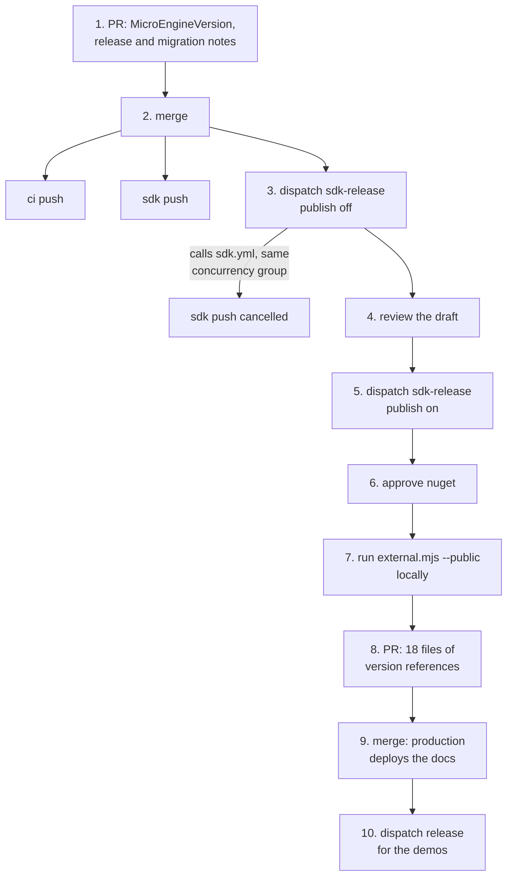
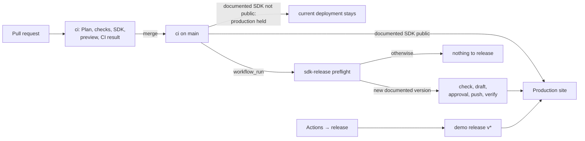

# DEVOPS-1: CI/CD architecture and release coordination

Engineering record, not published. Branch `feat/devops-1` from `main` at 56e9fb5 (2026-11-01). Decision:
[ADR 0022](../decisions/0022-release-coordination.md). Procedure: [Releasing](../releasing.md). Task record:
`odd/tasks/devops-1.md`. Measurements are GitHub Actions job times (`gh run view --json jobs`) of the runs quoted.

## 1. Diagnosis

Nine workflows. Daily CI (`ci.yml` → `checks.yml`, `deploy-site.yml`) is sound: a path planner, a project graph,
content-keyed evidence so a check runs once per content, one required check (**CI result**), previews and production
from prebuilt output, production only with released demos. The demo release (`release.yml`) is sound too: packages
keyed by content and promoted, never rebuilt; a draft verified file by file before a staged deployment; the draft
discarded on any failure; production rolled back if the publication fails after the switch.

The SDK was added beside these with its own triggers and procedure, and that is where the friction was.

### The SDK release as it ran for 0.4.0-alpha.2

Runs (2026-11-01): PR CI 41360630743 and SDK 41360630633; merge: ci 41361535220, sdk 41361535338 **cancelled** 43 s
in; sdk-release draft 41361543425 (5 min); sdk-release publish 41361975995 (1 min); docs PR 41362467474; merge
41362768802 (deployed production); demo release 41362905370 (23 min).

## 2. Problems and causes

| Problem | Cause |
| --- | --- |
| 9 human actions for an SDK release (10 with the demos) | publishing and documenting were separate pull requests because production deploys on every merge: the docs could only change after nuget.org served the version |
| 18 files edited by hand for version references | the published version had no source of truth: `docs.mjs` read it from a sentence of `getting-microengine.md`; the samples must stay literal for readers |
| `sdk.yml` could fail and the pull request still merge | it was a separate workflow, not part of **CI result** |
| `sdk.yml` ran twice for one merge, and the release's call cancelled the push run | its `push` trigger and `sdk-release`'s call shared a concurrency group (`sdk-refs/heads/main-<sha>`) |
| `sdk.yml` re-ran in full on every merge to `main` (≈404 runner-seconds, 41360374850) | it had no evidence, unlike every daily check |
| A publication that pushed some packages and then failed could not be finished by the workflow | preflight refused any version already on nuget.org ("raise MicroEngineVersion"), including its own partial push |
| `sdk-release` never checked that `ci` had passed for the commit it released | the check was manual |
| Post-publication verification ran on the maintainer's machine | no workflow step waited for nuget.org |
| The demo release needed a version typed by hand | no default |

Not problems, kept as they were: the site and the demos are already independent (a documentation change deploys
production with the latest demo release; a demo release deploys `main`'s site); demo packages are keyed by content, so
a release builds only what changed (scenario D); production is staged and verified before the switch; the six
packages share one version (ADR 0019).

## 3. Alternatives considered

| Alternative | Verdict |
| --- | --- |
| **A central orchestrator** (one workflow releasing SDK, demos and site) | rejected: an SDK release would wait on 20 native package jobs (23 min measured) it does not need; a site hotfix would carry both; its state would duplicate nuget.org's and the releases'; one failing service would block the others |
| **Release tooling** (release-please, changesets, semantic-release) | rejected: they generate versions from commit messages and open release PRs; the SDK's version is a product decision (Alpha numbering, ADR 0021) and the publish gate is an environment approval; another bot and its tokens for what one script does |
| **Templated docs** (the site build substitutes `{{sdk.version}}`) | rejected: the Markdown is read on GitHub too, the samples must stay copyable project files, and the snippet check compares fenced blocks with the samples byte for byte |
| **A bot pull request after publication** with the doc updates | rejected: a `GITHUB_TOKEN` pull request does not trigger CI, so **CI result** never runs; a PAT or App would be a new long-lived secret; it keeps two pull requests |
| **Independent package versions** | rejected (ADR 0019 stands): the tool builds games with the hosts of its own version; independent versions multiply the compatibility matrix to save pushing unchanged packages |
| **Prebuild native demo packages on `main`** so a demo release only promotes | deferred: it would cut the demo release from 23 to about 5 minutes, but it moves Android signing secrets to every push to `main` and needs its own decision |
| **Keep three publications, give them contracts** (chosen) | one source of truth per version concept; docs synchronised by a tool and checked in CI; production held while the documented SDK is not public; the SDK release a resumable run started by CI on `main`; the SDK check inside daily CI |

## 4. Target architecture

- **CI** (scenario A): unchanged design, plus the `sdk` check (planner rule, evidence key, `sdk.yml` called by
  `ci.yml`, required through **CI result**) and the version-reference check in Plan.
- **SDK** (B, E, F, G): `node sdk/version.mjs release <version>` in one pull request; after merge, `sdk-release`
  (`workflow_run` on `ci`, or by hand) reads the state and does what is left; the `nuget` environment approves; the
  approved draft is pushed; nuget.org is verified by building a game and the samples from it; the site deploys.
- **Site** (C, H): unchanged: merging deploys. New: production is held while `main` documents an unpublished SDK.
- **Demos** (D, E): unchanged pipeline; version defaults to the next minor; refused while the SDK window is open.

How each scenario is resolved:

| | Scenario | Now |
| --- | --- | --- |
| A | code change, no publication | PR → **CI result** (SDK check included when a package input changed) → merge; sdk-release ends with "nothing to release" |
| B | new SDK version | one PR (`version.mjs release`, notes) → merge → approve; the run publishes, verifies nuget.org and deploys the docs |
| C | documentation or landing only | PR → merge → production; no package, no release; the SDK check does not run (no package input) |
| D | one demo changed | PR → merge; `release` builds only that game's packages (content keys), copies the others |
| E | engine change for SDK and demos | both follow from the same `main`: the SDK release packs that commit; a demo release builds the games whose keys changed; each download records its engine version |
| F | failed publication | before the push: nothing public; run again (re-uses or replaces the draft). After: run again, it resumes |
| G | nuget.org has the version, a later step failed | preflight sees packages on nuget.org and the draft: pushes only what is missing, publishes the release, verifies, deploys |
| H | urgent hotfix | site: an ordinary PR, deploys on merge (held only inside an open SDK release window); SDK: a new patch version |

## 5. Versions and documentation

Four concepts, four sources of truth ([Releasing, Versions](../releasing.md#versions)): prepared
(`MicroEngineVersion`), documented (`sdk/version.json`), public (nuget.org, `sdk-v*`), demo distribution (latest
`v*`), plus the deployed site (Vercel production). The demo distribution's `v*` number is a release identifier, not an
API version: SemVer applies to the SDK, and to each game's own `<Version>`.

`sdk/version.mjs` holds the reference patterns (package references, install commands, "the current version is", the
SDK title, tool output). The 0.4.0-alpha.2 edit, replayed with `release 0.4.0-alpha.3` in a copy, rewrote the same 25
lines in 16 files plus `Directory.Build.props` and `sdk/version.json`, and left the release notes, the migration notes
and the two history paragraphs (audio, scenes) byte for byte. Four sentences that restated "the current version" in
prose (fonts, phone hosts, the SemVer example, AGENTS.md) were rewritten not to name a version, so they never go stale.

## 6. Test results

| What | Result |
| --- | --- |
| `node --test .github/scripts/*.test.mjs sdk/tests/version.test.mjs` | 62 pass: planner `sdk` rules, evidence scope, reference patterns, check, release rewrite (CRLF included), nuget.org state, wait-public, one test per release state (new version, nothing to do, re-approval, fix after draft, partial push 1/6 and 5/6, all pushed with draft, published, refusals) |
| `node --test site/tests/demos.test.mjs` | 14 pass, `nextVersion` included |
| `node sdk/version.mjs check` on this branch | RED before the docs were classified (9 unclassified mentions), then green |
| `node sdk/tests/docs.mjs` with the docs at an unpublished 0.4.0-alpha.3 (a copy) | packs this commit, builds and plays all six samples against those packages |
| `node sdk/tests/external.mjs --public --version 0.4.0-alpha.2 --targets linux` (the verify job's command) | all checks pass from nuget.org alone (run on Windows; the job runs it on Linux under Xvfb) |
| `sdk/version.mjs release-plan` against the live repository, read only | after a merge: nothing to release; by hand: finish; a copy documenting 0.4.0-alpha.3 without notes: refused; with notes: release |
| actionlint 1.7.7 with shellcheck on every workflow | clean |

Not run here, and why: the workflows on GitHub (they run after merge; a release would publish). The first real
SDK release exercises `workflow_run`, the approval wait and the site deployment from `sdk-release`; every merge before
it exercises the preflight's "nothing to release" path.

## 7. Before and after

| | Before | After |
| --- | --- | --- |
| Human actions for an SDK release | 9 (2 PRs, 3 dispatches, review, approval, a local command, an 18-file edit) | 3 (one PR with one command and the notes; merge; review the draft and approve) |
| Version references edited by hand | 18 files | 0 (`version.mjs release`, checked in CI) |
| SDK check in the required gate | no | yes |
| SDK check on a merge of an up-to-date PR | full re-run (≈404 runner-seconds, ≈4 min) | skipped by evidence |
| Partial publication | not resumable by the workflow | resumed by running it again |
| Post-publication check of nuget.org | by hand, locally | in the run, before the site deploys |
| `ci` passed before an SDK release | not checked | required (`workflow_run` after success; checked on a manual run) |
| Demo release inputs | version and ref | ref; version optional |

## 8. Risks and limitations

- **Production hold window.** Between merging a release PR and approving it, production does not deploy; a site
  hotfix waits for the approval or a revert. Pending approvals expire after 30 days.
- **Trusted Publishing under `workflow_run`.** The nuget.org policy names the workflow file and the environment, both
  unchanged; the OIDC token of a `workflow_run` run carries the same workflow and environment claims. Not proven until
  the first release; if nuget.org refuses, the run stops before pushing and a manual run (`workflow_dispatch`, the
  event of every earlier release) resumes it.
- **An sdk-release run per merge** (≈10 s, "nothing to release") is noise in the Actions list.
- **nuget.org indexing** can exceed the 30-minute wait; the run then fails after publishing and a manual run resumes.
- **macOS informative tests** still run on every main push even when evidence covers the commit (never evidence by
  design); out of scope.
- **Native demo packages** are still built at release time (deferred alternative).
- No owner action is required: environments, secrets, the ruleset and the Trusted Publishing policy are unchanged.
