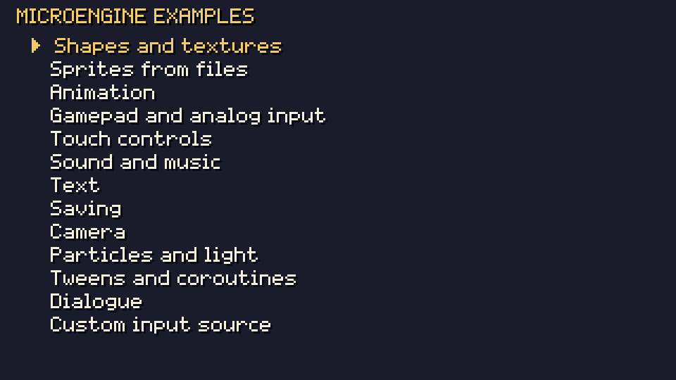
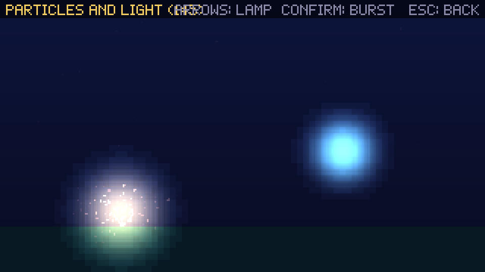

# Focused examples

Small examples, one topic each, so you can learn a single feature without reading a whole game. They are screens of one
project, [`samples/Examples`](../../samples/Examples), which builds against the published SDK and is played by
MicroEngine's automated tests. Every listing on this page is quoted from it.

Run them all from a clone of the repository, or copy the folder anywhere (it references the NuGet packages):

```bash
microengine run --project samples/Examples
```

Pick an example from the list with the arrows and confirm; Esc, P or the gamepad's Start goes back. Each example is an
ordinary `Scene`; the list pushes it, and it pops itself on `pause`.



## Shapes and textures

Every primitive of the renderer, and a texture made from an image in memory: drawn whole, stretched, cropped and tinted,
rotated, and with additive blending. Source: [`ShapesExample.cs`](../../samples/Examples/Examples/ShapesExample.cs).

<!-- code: samples/Examples/Examples/ShapesExample.cs#shapes -->
```csharp
r.FillRect(new RectF(16, 24, 48, 32), Color.Hex("3b5dc9"));
r.DrawRect(new RectF(72, 24, 48, 32), Color.White, thickness: 2);
r.FillCircle(new Vector2(148, 40), 16, Color.Hex("38b764"));
r.FillEllipse(new Vector2(196, 40), 22, 10, Color.Hex("73eff7"));
r.FillTriangle(new Vector2(232, 56), new Vector2(256, 24), new Vector2(280, 56), Color.Hex("ef7d57"));
r.DrawLine(new Vector2(16, 68), new Vector2(304, 76), 2, Color.Hex("a7f070"));
r.FillGradient(new RectF(16, 84, 288, 20), Color.Hex("29366f"), Color.Hex("41a6f6"), bands: 6);
```

A texture you create yourself from a `PixelImage`, and release when the scene leaves:

<!-- code: samples/Examples/Examples/ShapesExample.cs#texture -->
```csharp
private Texture _checker = null!;

public override void Enter()
{
    // A PixelImage is pixels in memory; CreateTexture uploads it to the graphics device once.
    var image = new PixelImage(16, 16).Map((x, y, _) => (x / 4 + y / 4) % 2 == 0 ? Color.Hex("ffcd75") : Color.Hex("b13e53"));
    _checker = Game.Graphics.CreateTexture(image);
}

// A texture you create is yours to release.
public override void Exit() => _checker.Dispose();
```

<!-- code: samples/Examples/Examples/ShapesExample.cs#draw-texture -->
```csharp
r.Draw(_checker, new Vector2(16, 120));                                                   // whole, at its top-left
r.DrawStretched(_checker, _checker.Bounds, new RectF(48, 116, 64, 24), Color.White);     // stretched into a rectangle
r.Draw(_checker, new RectF(0, 0, 8, 8), new Vector2(124, 124), Color.Hex("73eff7"));    // part of it, tinted
r.Draw(_checker, _checker.Bounds, new Vector2(176, 128), Color.White,
    new DrawOptions { Rotation = Age, Origin = new Vector2(8, 8), Scale = new Vector2(2) }); // rotated around its centre

r.SetBlendMode(BlendMode.Additive);                                                      // light adds up
r.FillCircle(new Vector2(250, 128), 14, Color.Hex("b13e53"));
r.FillCircle(new Vector2(266, 128), 14, Color.Hex("3b5dc9"));
r.SetBlendMode(BlendMode.Alpha);                                                         // back to normal
```

Most games draw sprites from an atlas instead of raw textures; textures are for images you build at run time (a
minimap, a generated background). Manual: [Graphics](../manual/rendering.md).

## Sprites from files

A PNG from `Content/` cut into frames, a region cropped by hand, origins, mirroring, tinting and scaling. Source:
[`SpritesExample.cs`](../../samples/Examples/Examples/SpritesExample.cs).

<!-- code: samples/Examples/Examples/SpritesExample.cs#load -->
```csharp
private SpriteAtlas _atlas = null!;

public override void Enter()
{
    // Content/hero.png is a 64x16 strip of four 16x16 frames, copied next to the executable by the project file.
    var content = new ContentFolder();
    var sheet = content.Image("hero.png");
    _atlas = new SpriteAtlasBuilder()
        .AddGrid("hero", sheet, 16, 16, origin: new Vector2(8, 16))      // hero0..hero3, origin at the feet
        .Add("head", sheet.Crop(0, 0, 16, 9), new Vector2(8, 9))         // part of the image
        .Build(Game.Graphics);                                           // one texture for all of them
}

public override void Exit() => _atlas.Dispose();
```

<!-- code: samples/Examples/Examples/SpritesExample.cs#draw -->
```csharp
// Draw puts the sprite's origin at the position: here the feet stand on the line.
r.DrawLine(new Vector2(20, 80), new Vector2(300, 80), 1, Color.Hex("566c86"));
var frames = _atlas.Frames("hero");
for (int i = 0; i < frames.Length; i++)
    r.Draw(frames[i], new Vector2(40 + i * 32, 80));
r.Draw(_atlas["hero0"], new Vector2(200, 80), flipX: true);                         // mirrored
r.Draw(_atlas["hero0"], new Vector2(240, 80), tint: Color.Hex("ef7d57"));          // tinted
r.DrawPivoted(_atlas["hero0"], new Vector2(280, 80), rotation: 0, scale: new Vector2(2, 2 + MathF.Sin(Age * 4) * 0.2f));
r.Draw(_atlas["head"], new Vector2(160, 130));
```

Manual: [Graphics](../manual/rendering.md#atlases-and-sprites), [Assets](../manual/assets.md).

## Animation

An `Animator` with a looping clip and a one-shot clip, and a speed you change with left and right. Source:
[`AnimationExample.cs`](../../samples/Examples/Examples/AnimationExample.cs).

<!-- code: samples/Examples/Examples/AnimationExample.cs#setup -->
```csharp
private SpriteAtlas _atlas = null!;
private readonly Animator _animator = new();

public override void Enter()
{
    _atlas = new SpriteAtlasBuilder()
        .AddGrid("hero", new ContentFolder().Image("hero.png"), 16, 16, origin: new Vector2(8, 16))
        .Build(Game.Graphics);
    var frames = _atlas.Frames("hero");
    _animator
        .Add("walk", new AnimationClip(frames, framesPerSecond: 8))                   // loops
        .Add("hop", new AnimationClip([frames[1], frames[3], frames[1]], 6, loop: false)); // plays once
    _animator.Play("walk");
}

public override void Exit() => _atlas.Dispose();
```

<!-- code: samples/Examples/Examples/AnimationExample.cs#update -->
```csharp
public override void Update(float dt)
{
    if (Input.Pressed("pause")) { Game.Scenes.Pop(); return; }
    if (Input.Pressed("confirm")) _animator.Play("hop", restart: true);
    if (_animator.CurrentName == "hop" && _animator.Finished) _animator.Play("walk");
    _animator.Speed = Math.Clamp(_animator.Speed + Input.Axis("left", "right") * dt, 0.25f, 3f);
    _animator.Update(dt);
}
```

## Gamepad and analog input

Actions bound to gamepad buttons, a trigger and the right stick, read as analog values; the left stick moves with
intensity; the bindings of an action listed for display. Keys do the same, so it works without a gamepad. Source:
[`GamepadExample.cs`](../../samples/Examples/Examples/GamepadExample.cs).

<!-- code: samples/Examples/Examples/GamepadExample.cs#bind -->
```csharp
public override void Enter()
{
    // Actions can be bound at any time; usually a game does it once in Game.CreateInput.
    Input.Bind("boost", [Key.LeftShift], [PadButton.A, PadButton.RightShoulder])
         .BindAxis("throttle", PadAxis.RightTrigger)                 // 0..1 as the trigger is pressed
         .BindAxis("throttle", PadAxis.RightY, positive: false);     // or the right stick pushed up
}

public override void Exit() => Input.Unbind("boost").Unbind("throttle");
```

<!-- code: samples/Examples/Examples/GamepadExample.cs#read -->
```csharp
public override void Update(float dt)
{
    if (Input.Pressed("pause")) { Game.Scenes.Pop(); return; }

    var move = Input.Vector("left", "right", "up", "down");   // length 0..1: a light push is a slow move
    float speed = 60 + 120 * Input.Value("throttle") + (Input.Down("boost") ? 60 : 0);
    _position += move * speed * dt;
    _position = Vector2.Clamp(_position, new Vector2(8, 20), new Vector2(312, 172));
}
```

A game usually binds its actions once, in `Game.CreateInput`; binding in a scene, as here, is also allowed. One gamepad
is read at a time. Manual: [Input](../manual/input.md).

## Touch controls

A d-pad, a fixed joystick for a second direction, a toggle button and a back button, for one screen only. Touch controls
are drawn and read where the platform has a touch screen (phones, tablets, touch laptops, mobile browsers). Source:
[`TouchExample.cs`](../../samples/Examples/Examples/TouchExample.cs).

<!-- code: samples/Examples/Examples/TouchExample.cs#layout -->
```csharp
public override void Enter()
{
    // A game normally declares one layout by overriding Game.CreateTouchLayout; a scene may switch to another.
    _previous = Game.Touch.Layout;
    Game.Touch.Layout = TouchLayout.Of(
        new TouchDPad { Offset = new(100, 100), Diagonals = false },
        new TouchStick("aim", "aim-left", "aim-right", "aim-up", "aim-down")
        {
            Placement = StickPlacement.Fixed, Anchor = TouchAnchor.BottomRight, Offset = new(100, 100),
        },
        new TouchButton("shield", "shield", "S") { Anchor = TouchAnchor.TopRight, Offset = new(40, 40), Mode = TouchButtonMode.Toggle },
        new TouchButton("back", "pause", "<") { Anchor = TouchAnchor.TopLeft, Offset = new(30, 30), Radius = 20 })
        with { Visibility = TouchVisibility.Always };
}

public override void Exit() => Game.Touch.Layout = _previous;
```

<!-- code: samples/Examples/Examples/TouchExample.cs#read -->
```csharp
// Touch controls press ordinary actions, so the game reads them like keys...
var walk = new Vector2(Input.Axis("left", "right"), Input.Axis("up", "down"));
// ...and an action no key is bound to (aim-*, shield) still works through the touch source.
var aim = Input.Vector("aim-left", "aim-right", "aim-up", "aim-down");
```

Manual: [Input, touch controls](../manual/input.md#touch-controls).

## Sound and music

A synthesized sound, a WAV file, music that starts and stops with a fade, the music volume and stereo pan. Source:
[`SoundExample.cs`](../../samples/Examples/Examples/SoundExample.cs).

<!-- code: samples/Examples/Examples/SoundExample.cs#register -->
```csharp
public override void Enter()
{
    // Register each sound once by name (a game does this in Load); playing it later is cheap.
    if (!Audio.HasSound("laser"))
    {
        Audio.AddSound("laser", Synth.Render(new SfxParams { Wave = Wave.Saw, Frequency = 900, EndFrequency = 200, Decay = 0.25f }));
        Audio.AddSoundFile("chime", new ContentFolder().PathOf("pickup.wav"));
        Audio.AddMusic("loop", new Song(126)
            .Track(Instrument.Lead, "A4 - C5 - E5 - C5 - | G4 - B4 - D5 - B4 -")
            .Track(Instrument.Bass, "A2 . A2 . A2 . A2 . | G2 . G2 . G2 . G2 .")
            .Drums("k . h . s . h . k k h . s . h .")
            .Render());
    }
}

public override void Exit() => Audio.StopMusic();
```

<!-- code: samples/Examples/Examples/SoundExample.cs#play -->
```csharp
public override void Update(float dt)
{
    if (Input.Pressed("pause")) { Game.Scenes.Pop(); return; }
    if (Input.Pressed("confirm")) Audio.Play("laser", pitchJitter: 0.1f);                    // a little variation
    if (Input.Pressed("action")) Audio.Play("chime", pan: Game.Random.NextSingle());        // 0 left .. 1 right
    if (Input.Pressed("cancel"))
    {
        if (Audio.CurrentMusic is null) Audio.PlayMusic("loop");
        else Audio.StopMusic(fadeSeconds: 1);
    }
    Audio.MusicVolume += Input.Axis("left", "right") * dt;                                  // clamped to 0..1
}
```

Manual: [Audio](../manual/audio.md).

## Text

The built-in pixel font: plain, shadowed, outlined, scaled, centred, measured and wrapped text. Source:
[`TextExample.cs`](../../samples/Examples/Examples/TextExample.cs).

<!-- code: samples/Examples/Examples/TextExample.cs#text -->
```csharp
Font.Draw(r, "Plain text, upper and lower case: 0123456789 !?.,:;()+-*/", new Vector2(8, 20), Color.White);
Font.DrawShadowed(r, "Shadowed text reads on any background", new Vector2(8, 32), Color.Hex("ffcd75"), Color.Black);
Font.DrawOutlined(r, "Outlined", new Vector2(8, 44), Color.White, Color.Hex("b13e53"));
Font.Draw(r, "x2", new Vector2(70, 40), Color.Hex("a7f070"), scale: 2);
Font.DrawCentered(r, "CENTRED ON A POINT", new Vector2(240, 48), Color.Hex("73eff7"), shadow: Color.Black);

// Measure: the size of a string, for boxes and right alignment.
var score = $"SCORE {Game.UpdateCount}";
Font.Draw(r, score, new Vector2(312 - Font.MeasureWidth(score), 62), Color.White);

// Wrap: lines that fit a width; LineHeight spaces them.
var box = new RectF(8, 78, 180, 60);
r.Panel(box, MicroEngine.UI.UiTheme.Default.Panel);
var lines = Font.Wrap(Story, (int)box.Width - 12);
for (int i = 0; i < lines.Count; i++)
    Font.Draw(r, lines[i], new Vector2(box.X + 6, box.Y + 6 + i * (Font.LineHeight + 1)), Color.White);
```

Manual: [Text](../manual/text.md).

## Saving

A save slot with a small class: loading it on entry, saving and deleting it, and where the file lives. Source:
[`SaveExample.cs`](../../samples/Examples/Examples/SaveExample.cs).

<!-- code: samples/Examples/Examples/SaveExample.cs#data -->
```csharp
/// <summary>The saved data: any class System.Text.Json can write (public properties with getters and setters).</summary>
public sealed class Progress
{
    public int Coins { get; set; }
    public List<string> Visited { get; set; } = [];
    public DateTime SavedAt { get; set; }
}
```

<!-- code: samples/Examples/Examples/SaveExample.cs#use -->
```csharp
private SaveStore _store = null!;
private Progress _progress = null!;
private string _status = "";

public override void Enter()
{
    // One store per game: the id names the save folder (or the browser's storage keys).
    _store = new SaveStore("MicroEngineExamples", saveDirectory);
    _progress = _store.Load<Progress>("example") ?? new Progress();   // null: no save yet, or unreadable
    _status = _store.Exists("example") ? "LOADED" : "NO SAVE YET";
}

public override void Update(float dt)
{
    if (Input.Pressed("pause")) { Game.Scenes.Pop(); return; }
    if (Input.Pressed("right")) _progress.Coins++;
    if (Input.Pressed("confirm"))
    {
        _progress.SavedAt = DateTime.UtcNow;
        _progress.Visited.Add($"room {_progress.Visited.Count + 1}");
        // Save writes the whole slot at once; false means the disk or the browser refused (keep playing).
        _status = _store.Save("example", _progress) ? "SAVED" : "COULD NOT SAVE";
    }
    if (Input.Pressed("cancel"))
    {
        _store.Delete("example");
        _progress = new Progress();
        _status = "DELETED";
    }
}
```

Manual: [Saving data](../manual/persistence.md).

## Camera

A world three screens wide and high, a camera that follows a marker inside the world's bounds with a dead zone, screen
shake, and conversions between world and screen coordinates (including the mouse). Source:
[`CameraExample.cs`](../../samples/Examples/Examples/CameraExample.cs).

<!-- code: samples/Examples/Examples/CameraExample.cs#setup -->
```csharp
private static readonly RectF World = new(0, 0, 960, 540);   // three screens wide, three high
private readonly Camera2D _camera = new(320, 180)
{
    Bounds = World,                       // never shows outside the world
    DeadZone = new Vector2(40, 24),       // the target moves freely in the middle before the camera follows
    FollowSharpness = 6,                  // higher catches up faster; 0 snaps
};
private Vector2 _target = new(160, 90);
```

<!-- code: samples/Examples/Examples/CameraExample.cs#update -->
```csharp
public override void Update(float dt)
{
    if (Input.Pressed("pause")) { Game.Scenes.Pop(); return; }
    _target += Input.Vector("left", "right", "up", "down") * 140 * dt;
    _target = Vector2.Clamp(_target, World.Position, World.Position + World.Size);
    if (Input.Pressed("confirm")) _camera.Shake(0.6f);   // trauma 0..1, fades by itself
    _camera.Follow(_target, dt);
    _camera.Update(dt);                                   // advances the shake
}
```

<!-- code: samples/Examples/Examples/CameraExample.cs#draw -->
```csharp
r.PushCamera(_camera);                                // from here on, positions are world pixels
for (int y = 0; y < World.Height; y += 30)
for (int x = 0; x < World.Width; x += 30)
    if (_camera.IsVisible(new RectF(x, y, 2, 2)))     // skip what is off screen
        r.FillRect(new RectF(x, y, 2, 2), Color.Hex("566c86"));
r.DrawRect(World, Color.Hex("ef7d57"), 2);
r.FillCircle(_target, 5, Color.Hex("ffcd75"));
r.PopCamera();                                        // back to screen pixels for the HUD

var screen = _camera.WorldToScreen(_target);
Font.Draw(r, $"WORLD {_target.X:0},{_target.Y:0}  SCREEN {screen.X:0},{screen.Y:0}", new Vector2(4, 168), UiTheme.Default.Text);
if (Input.Pointer.Present)
{
    var world = _camera.ScreenToWorld(Input.Pointer.Position);
    Font.Draw(r, $"MOUSE IN WORLD {world.X:0},{world.Y:0}", new Vector2(4, 156), UiTheme.Default.Muted);
}
```

## Particles and light

A particle fountain and bursts with additive blending, under a light map that darkens the scene around two lights.
Source: [`ParticlesExample.cs`](../../samples/Examples/Examples/ParticlesExample.cs).

<!-- code: samples/Examples/Examples/ParticlesExample.cs#setup -->
```csharp
private static readonly ParticleSpec Spark = new()
{
    StartColor = Color.Hex("ffcd75"), EndColor = Color.Hex("b13e5300"),   // fades to transparent
    Speed = (40, 90), Angle = (-MathF.PI * 0.75f, -MathF.PI * 0.25f),      // upwards (y grows down)
    Life = (0.6f, 1.2f), Gravity = 120, Size = (2, 1), Round = true,
};
private static readonly ParticleSpec Burst = Spark with { Angle = (0, MathF.Tau), Gravity = 0, Drag = 2, Speed = (60, 140) };

private readonly ParticleSystem _particles = new(capacity: 400) { Additive = true };   // glows add up
private LightMap _light = null!;
private Vector2 _lamp = new(160, 100);

public override void Enter() => _light = new LightMap(Game.Graphics) { Darkness = 0.85f, Shade = Color.Hex("101028") };
public override void Exit() => _light.Dispose();
```

<!-- code: samples/Examples/Examples/ParticlesExample.cs#update -->
```csharp
public override void Update(float dt)
{
    if (Input.Pressed("pause")) { Game.Scenes.Pop(); return; }
    _lamp += Input.Vector("left", "right", "up", "down") * 100 * dt;
    _particles.Emit(new Vector2(80, 150), Spark, count: 2);
    if (Input.Pressed("confirm")) _particles.Emit(_lamp, Burst, count: 60);
    _particles.Update(dt);
}
```

<!-- code: samples/Examples/Examples/ParticlesExample.cs#draw -->
```csharp
r.FillGradient(new RectF(0, 0, 320, 180), Color.Hex("3b5dc9"), Color.Hex("29366f"));
r.FillRect(new RectF(0, 150, 320, 30), Color.Hex("257179"));
_particles.Draw(r);

// Lights: rebuilt every frame, drawn over the finished scene.
_light.Clear();
_light.Add(new Vector2(80, 140), radius: 50, brightness: 1, glow: Color.Hex("ffcd75"));
_light.Add(_lamp, radius: 40, brightness: 0.9f, glow: Color.Hex("73eff7"));
_light.Draw(r, Vector2.Zero, new RectF(0, 0, 320, 180));   // no camera: world and screen are the same
```



## Tweens and coroutines

A tween animates a value with an easing curve; a coroutine runs a sequence (a countdown, then wait for a key) over many
updates without a hand-written state machine. Source: [`TweensExample.cs`](../../samples/Examples/Examples/TweensExample.cs).

<!-- code: samples/Examples/Examples/TweensExample.cs#tween -->
```csharp
private void Slide()
{
    float from = _x, to = _x < 160 ? 280 : 40;
    // Every update until the duration ends: apply(eased progress 0..1). Then done.
    Tweens.Add(0.8f, t => _x = MathX.Lerp(from, to, t), Ease.OutBounce, done: () => _caption = "LANDED");
}
```

<!-- code: samples/Examples/Examples/TweensExample.cs#coroutine -->
```csharp
private IEnumerator Countdown()
{
    foreach (var word in new[] { "THREE", "TWO", "ONE" })
    {
        _caption = word;
        Tweens.Add(0.3f, t => _scale = 1 + (1 - t));           // a little pop on each word
        yield return Wait.Seconds(0.6f);                        // simulated seconds, not frames
    }
    _caption = "PRESS CONFIRM";
    yield return Wait.Until(() => Input.Pressed("confirm"));    // checked every update
    _caption = "GO!";
    Slide();
}
```

Both belong to the scene: they stop when the scene leaves the stack. Manual: [Scenes](../manual/scenes.md#coroutines).

## Dialogue

A dialogue box revealing pages letter by letter with a sound per letter, then a yes/no answer with a menu. Source:
[`DialogueExample.cs`](../../samples/Examples/Examples/DialogueExample.cs).

<!-- code: samples/Examples/Examples/DialogueExample.cs#dialogue -->
```csharp
private readonly DialogueBox _box = new() { Lines = 3 };
private readonly SelectionList _answer = new("YES", "NO");
private bool _asking;
private string _result = "";

public override void Enter()
{
    _box.Blip += _ => Audio.TryPlay("select", 0.3f);      // a sound per letter, if the game registered one
    _box.Closed += () => _asking = true;
    _box.Show("GARDENER", "Welcome! The gems only grow at night.", "Will you help me collect them before sunrise?");
}

public override void Update(float dt)
{
    if (Input.Pressed("pause")) { Game.Scenes.Pop(); return; }
    if (_box.Update(dt, Input)) return;                   // true while the box is open: it owns confirm
    if (_asking && _answer.Update(Input) is { } choice)
    {
        _asking = false;
        _result = choice == 0 ? "THANK YOU!" : "OH... MAYBE TOMORROW.";
    }
}

public override void Draw(IRenderer r)
{
    _box.Draw(r, Font, new RectF(10, 120, 300, 50));
    if (_asking) _answer.Draw(r, Font, new Vector2(140, 60), UiTheme.Default, Age);
    Font.DrawCentered(r, _result, new Vector2(160, 90), UiTheme.Default.Accent);
    Heading.Draw(r, Font, "DIALOGUE");
}
```

Manual: [UI widgets](../manual/ui.md).

## Custom input source

Anything that is not a key can press actions: an accessibility switch, a network player, a replay. This source presses
`confirm` once a second, and the game reads it like the keyboard. Source:
[`CustomSourceExample.cs`](../../samples/Examples/Examples/CustomSourceExample.cs).

<!-- code: samples/Examples/Examples/CustomSourceExample.cs#source -->
```csharp
/// <summary>
/// An action source of your own: anything that is not a key can press actions (an accessibility switch, a network
/// player, a replay). This one presses "confirm" once a second. The game reads it like any key.
/// </summary>
public sealed class Metronome : IActionSource
{
    public float Time;
    public bool IsDown(string action) => action == "confirm" && Time % 1f < 0.1f;
    public InputDevice Device => InputDevice.Other;
}
```

<!-- code: samples/Examples/Examples/CustomSourceExample.cs#use -->
```csharp
public override void Enter() => Input.AddSource(_metronome);
public override void Exit() => Input.RemoveSource(_metronome);

public override void Update(float dt)
{
    if (Input.Pressed("pause")) { Game.Scenes.Pop(); return; }
    _metronome.Time += dt;
    if (Input.Pressed("confirm")) _beats++;   // the metronome and the keyboard both count
}
```

More ways to extend the engine (save storage, transitions, platforms): [Extending the engine](../manual/extending.md).
