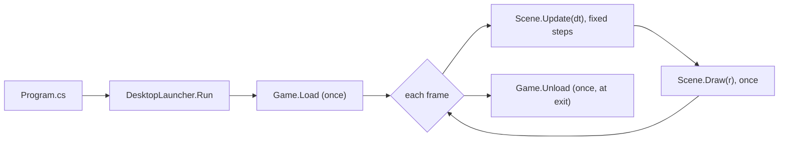

# Your first game

This page creates a game from the official template, runs it, and explains every file it contains and how MicroEngine
runs your code. It assumes the SDK is installed ([Install the SDK](getting-microengine.md)).

## Create and run it

```bash
microengine new StarCourier --id com.yourstudio.starcourier --title "Star Courier"
cd StarCourier
microengine run
```

`new` creates the folder `StarCourier` with a complete project; `run` builds it and opens a window. Move the hero with
the arrow keys, WASD, a gamepad's d-pad or left stick, or the on-screen controls of a touch screen, and collect coins.
Close the window to quit; F11 or Alt+Enter toggles fullscreen. Next SDK version (not published yet: arrives with the
next SDK version): that is the engine's `fullscreen` action, which your game can rebind or turn off like any other
([Full screen](../manual/input.md#full-screen)).

`<Name>` becomes the project and the C# namespace, `--id` the application id stores and phones identify the game by
(reverse domain, letters, digits and underscores: see [Name, id, version and icon](app-identity.md)), `--title` the
name players see. Without `--id` the id is `com.example.<name>`; change it before you publish.

## What is in the project

```text
StarCourier/
  StarCourier.csproj    the project: .NET 10, the MicroEngine.Desktop package, and the game's identity
  Program.cs            the entry point: one line that starts the game on the desktop platforms
  MainGame.cs           the game class: settings, assets every scene shares, the first scene
  Scenes/PlayScene.cs   the first scene: input, movement, drawing
  Content/hero.png      asset files, shipped with the game and loaded through Game.Assets
  icon.png              the game's icon (square PNG, 256, 512 or 1024 pixels)
  README.md             the commands above
  .gitignore            keeps bin/, obj/ and dist/ out of source control
```

Nothing in it comes from MicroEngine's repository: the engine arrives as NuGet packages. The listings below are the
template's files, with `MyGame` where your project's name goes.

### The project file

<!-- code: templates/MicroEngine.Templates/content/MicroEngineGame/MyGame.csproj -->
```xml title="StarCourier.csproj"
<Project Sdk="Microsoft.NET.Sdk">
  <PropertyGroup>
    <OutputType>Exe</OutputType>
    <TargetFramework>net10.0</TargetFramework>
    <Nullable>enable</Nullable>
    <ImplicitUsings>enable</ImplicitUsings>
    <RootNamespace>MyGame</RootNamespace>
  </PropertyGroup>

  <!-- The game's identity: every package `microengine package` builds (Windows, Linux, macOS, Android, iOS, web) takes
       its name, id, version and icon from here. https://github.com/NastMz/MicroEngine/blob/main/docs/guide/app-identity.md -->
  <PropertyGroup>
    <ApplicationTitle>MyGameTitle</ApplicationTitle>
    <ApplicationId>com.example.mygameid</ApplicationId>
    <Version>0.1.0</Version>
    <Description>A game made with MicroEngine.</Description>
    <MicroEngineIcon>icon.png</MicroEngineIcon>
    <MicroEngineOrientation>landscape</MicroEngineOrientation>
  </PropertyGroup>

  <ItemGroup>
    <!-- The engine with the desktop platforms (SDL 3 by default, raylib). A game that ships SDL only can reference
         MicroEngine.Sdl instead. -->
    <PackageReference Include="MicroEngine.Desktop" Version="MICROENGINE_VERSION" />
  </ItemGroup>

  <!-- Files under Content/ (images, atlases, fonts, sounds) ship with the game on every platform without an item here;
       Game.Assets loads them. -->
</Project>
```

In your project `MICROENGINE_VERSION` is the tool's version (`0.4.0-alpha.2`). The second group is the game's
identity: every package `microengine package` builds takes its name, id, version, icon and orientation from there, and
nowhere else. `MicroEngineGameFactory` is the C# expression that creates the game in the hosts that build it
themselves (browser, Android, iOS); keep it in step with `Program.cs` if your game's constructor takes arguments.
Next SDK version (not published yet: arrives with the next SDK version): the template has no `MicroEngineGameFactory`;
the browser, Android and iOS hosts call the game's `Configure` entry point instead (below), the same one `Program.cs`
uses, so there is nothing to keep in step.

### The entry point

<!-- code: templates/MicroEngine.Templates/content/MicroEngineGame/Program.cs -->
```csharp title="Program.cs"
using MicroEngine.Desktop;
using MyGame;

// Runs the game on the desktop platforms: SDL 3 by default; --platform raylib, --list-platforms and the other launcher
// options work from the command line (microengine run -- --list-platforms). Browser, Android and iOS builds call the
// same MainGame.Configure, so whatever it composes reaches every platform.
return DesktopLauncher.Run(MainGame.Configure, args);
```

`DesktopLauncher.Run` reads the command line, picks a platform (SDL 3 unless told otherwise), opens the window, runs
the game loop and returns the exit code. The game never names a platform; that is why the same game also runs in a
browser or on a phone ([Platforms](platforms.md)).

The template above is the next SDK version's (not published yet: arrives with the next SDK version): `Program.cs`
hands the launcher `MainGame.Configure`, the game's composition, which the browser, Android and iOS hosts call too
([One composition for every platform](../manual/backends.md#one-composition-for-every-platform)). With the published
SDK, `Program.cs` reads `return DesktopLauncher.Run(new MainGame(), args);` and the project declares
`<MicroEngineGameFactory>new MyGame.MainGame()</MicroEngineGameFactory>`.

### The game class

<!-- code: templates/MicroEngine.Templates/content/MicroEngineGame/MainGame.cs -->
```csharp title="MainGame.cs"
using System.Numerics;
using MicroEngine;
using MicroEngine.Audio;
using MicroEngine.Audio.Retro;
using MicroEngine.Core;
using MicroEngine.Graphics;
using MicroEngine.Hosting;
using MyGame.Scenes;

namespace MyGame;

/// <summary>The game: its settings, the assets every scene shares, and the first scene.</summary>
public sealed class MainGame : Game
{
    /// <summary>
    /// The game's composition, called by every build (desktop Program.cs, browser, Android, iOS): it chooses the game, and
    /// may add platforms (host.Platforms()), change the platform request or register engine services.
    /// </summary>
    public static void Configure(HostBuilder host) => host.UseGame(() => new MainGame());

    /// <summary>A 320x180 virtual screen, scaled to the window without blurring the pixels.</summary>
    public override GameSettings Settings { get; } = new("MyGameTitle") { Background = Color.Hex("1d2b53") };

    public SpriteAtlas Sprites { get; private set; } = null!;

    protected override void Load()
    {
        // An image file from the Content folder (Assets reads it), and a sound made in code.
        Sprites = new SpriteAtlasBuilder()
            .Add("hero", Assets.Image("hero.png"), new Vector2(8, 8))
            .Build(Graphics);
        Audio.AddSound("coin", Synth.Render(new SfxParams { Wave = Wave.Square, Frequency = 988, Arpeggio = [1f, 1.33f], Sustain = 0.04f, Decay = 0.15f }));
        Scenes.Push(new PlayScene(this));
    }

    protected override void Unload() => Sprites.Dispose();
}
```

A game is one subclass of `Game` with two required members:

- `Settings`: the title of the window and the size of the **virtual screen**, 320x180 pixels by default. Every scene
  draws into that small canvas; the platform scales it to the window by whole factors so pixels stay square.
- `Load()`: runs once, after the window exists. It builds what scenes share (here a sprite atlas from
  `Content/hero.png` and a sound made by the synthesizer) and pushes the first scene.

`Unload()` runs once at the end; it releases the atlas's texture.

### The first scene

<!-- code: templates/MicroEngine.Templates/content/MicroEngineGame/Scenes/PlayScene.cs -->
```csharp title="Scenes/PlayScene.cs"
using System.Numerics;
using MicroEngine;
using MicroEngine.Graphics;
using MicroEngine.Scenes;

namespace MyGame.Scenes;

/// <summary>
/// Move the hero with the arrow keys, a gamepad or the on-screen controls, and collect coins. Input is read as actions
/// ("left", "confirm"...), never as keys, so every device works the same. These are the default actions; a game adds
/// its own by overriding CreateInput in MainGame.
/// </summary>
public sealed class PlayScene(MainGame game) : Scene
{
    private Vector2 _hero = new(160, 100);
    private Vector2 _coin = new(240, 70);
    private int _coins;

    public override void Update(float dt)
    {
        var move = new Vector2(Input.Axis("left", "right"), Input.Axis("up", "down"));
        if (move.LengthSquared() > 1) move = Vector2.Normalize(move);
        _hero = Vector2.Clamp(_hero + move * 90 * dt, new Vector2(8, 24), new Vector2(312, 172));
        if (Vector2.Distance(_hero, _coin) < 10)
        {
            _coins++;
            Audio.Play("coin");
            _coin = new Vector2(Game.Random.Next(16, 304), Game.Random.Next(32, 164));
        }
    }

    public override void Draw(IRenderer r)
    {
        Font.Draw(r, $"Coins: {_coins}", new Vector2(8, 6), Color.Hex("fff1e8"));
        r.FillCircle(_coin + new Vector2(0, MathX.Wave(Age, 2f, 1.5f)), 4, Color.Hex("ffec27"));
        r.Draw(game.Sprites["hero"], _hero);
        Font.DrawCentered(r, "Arrows, a gamepad or touch to move", new Vector2(160, 168), Color.Hex("c2c3c7"));
    }
}
```

A scene has two methods the engine calls for you:

- `Update(float dt)` advances the game by one **fixed step** of `dt` seconds (1/60 by default). Here it reads input
  *actions* (`"left"`, `"right"`, `"up"`, `"down"`), moves the hero, and plays a sound when it touches the coin.
- `Draw(IRenderer r)` draws the current state, in virtual pixels from the top-left corner (y grows downwards).

The template's `MainGame` does not override `CreateInput`, so the scene uses the default actions: arrows/WASD, d-pad and
left stick for the directions, Z/Space/Enter or the gamepad's A for `confirm`, and so on ([Input](../manual/input.md)).
The tutorial adds an action of its own.

## How MicroEngine runs your code



- **Fixed steps.** The simulation always advances in steps of exactly `1 / UpdateRate` seconds. If a frame took
  longer, several updates run before the next draw; on a fast screen some frames draw without an update. Game logic
  therefore behaves the same on every machine, and scripted test runs are reproducible.
- **Scenes on a stack.** The top scene updates; overlays (a pause menu) draw over the scene below. Scene changes
  requested during an update happen between updates ([Scenes](../manual/scenes.md)).
- **Services.** Inside a scene, `Input`, `Audio`, `Font` and `Game` are always available; `Game.Graphics` creates
  textures, `Game.Random` gives random numbers seeded per run.

The full order of a frame, quitting and phone suspension are in [Game lifecycle and time](../manual/lifecycle.md).

## Edit, run, repeat

Change a colour or the hero's speed (`90` in `Update`), save and run `microengine run` again. Useful variations:

```bash
microengine run -c Release                    # optimised build (Debug is the default)
microengine run --platform raylib             # the same game on the raylib platform
microengine run -- --scale 2                  # options after -- go to the game: a smaller window
microengine run -- --list-platforms           # the platforms this machine can run
```

IDEs work as with any .NET console project: open `StarCourier.csproj` in Visual Studio, Rider or VS Code with the C#
extension and press Run or Debug; breakpoints in `Update` stop the game at that step.

## Build and package

```bash
microengine build              # compile in Release and check the identity
microengine package windows    # a ZIP players unzip and run (or linux, macos, android, ios, web)
```

[Packaging a game](packaging.md) describes each target; the tutorial packages its game in
[step 12](../tutorial/12-packaging.md).

## Next

The [tutorial](../tutorial/README.md) builds a complete small game, Gem Garden, from this template: scenes, sprites
from files, animation, a tile map with collisions, a camera, sound and music, a HUD, menus, a save file and packages
for several platforms. Prefer a quick answer? [How do I...?](../howto.md) and the [focused examples](../examples/focused.md).
