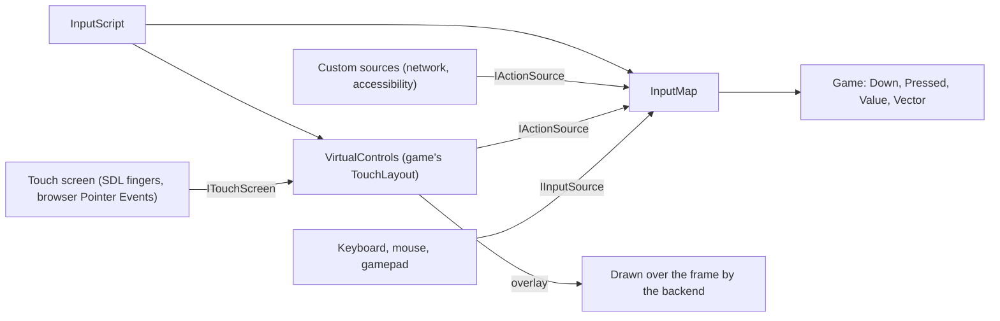

# Input

Games never ask whether a key is down: they ask whether an *action* is, such as `"jump"` or `"confirm"`. An
`InputMap` binds each action to keyboard keys, gamepad buttons, stick directions and analog axes, reads any number of
*action sources* (the on-screen touch controls are one), samples everything once per fixed step and computes press and
release edges per step. Scripted input forces the same actions and touches the same controls, so automated runs
exercise exactly the code players do.



## Default actions

`InputMap.CreateDefault()` is what `Game.CreateInput()` returns unless a game overrides it:

```csharp
public static InputMap CreateDefault() => new InputMap()
    .Bind("left", [Key.Left, Key.A], [PadButton.DPadLeft], StickDirection.Left)
    .Bind("right", [Key.Right, Key.D], [PadButton.DPadRight], StickDirection.Right)
    .Bind("up", [Key.Up, Key.W], [PadButton.DPadUp], StickDirection.Up)
    .Bind("down", [Key.Down, Key.S], [PadButton.DPadDown], StickDirection.Down)
    .Bind("confirm", [Key.Z, Key.Space, Key.Enter, Key.J], [PadButton.A])
    .Bind("cancel", [Key.X, Key.Backspace, Key.K], [PadButton.B])
    .Bind("action", [Key.C, Key.L], [PadButton.X])
    .Bind("pause", [Key.Escape, Key.P], [PadButton.Start]);
```

Source: [`src/MicroEngine/Input/Input.cs`](../../src/MicroEngine/Input/Input.cs)

## Custom bindings and remapping

Override `CreateInput` and chain `Bind` calls. Binding an existing action adds keys and buttons to it; binding a
new name creates it.

```csharp
protected override InputMap CreateInput() => InputMap.CreateDefault()
    .Bind("jump", [Key.Z, Key.Space, Key.J], [PadButton.A])
    .Bind("fire", [Key.X, Key.K], [PadButton.X, PadButton.B])
    .Bind("lock", [Key.C, Key.L, Key.LeftShift], [PadButton.RightShoulder, PadButton.LeftShoulder]);
```

Source: [`games/NeonRift/RiftGame.cs`](../../games/NeonRift/RiftGame.cs)

| Method | Use |
| --- | --- |
| `Bind(action, params Key[] keys)` | Keys only, e.g. `Bind("action", Key.X)` |
| `Bind(action, Key[] keys, PadButton[] buttons, StickDirection stick = None)` | Keys, pad buttons and a left-stick direction |
| `BindAxis(action, PadAxis axis, bool positive = true)` | One side of an analog axis: a trigger (`PadAxis.RightTrigger`) or the right stick (`PadAxis.RightX`, `positive: false` for left) |
| `Unbind(action)` | Removes every binding of the action, to bind it again (a rebinding screen) |
| `GetBindings(action)` | What the action is bound to (`ActionBindings`), to show it |

The `Key` enum covers letters, digits, arrows, Space, Enter, Escape, Backspace, Tab, Shift, left Control and
F1-F5, F11, F12. `PadButton` uses Xbox names (`A`, `B`, `X`, `Y`, `Start`, `Back`, shoulders, d-pad, stick clicks).
`PadAxis` has both sticks and both triggers. Rebinding is code; there is no rebinding screen in the engine.

## Querying actions

| Method | Returns |
| --- | --- |
| `Down(action)` | The action is held (or was tapped during this step) |
| `Pressed(action)` | First step after it went down, even if it was released within the same frame |
| `Released(action)` | First step after it went up |
| `Value(action)` | Strength 0..1: 1 for a key or button, the deflection beyond the dead zone for a stick, trigger or touch joystick |
| `Axis(negative, positive)` | -1, 0 or 1 from two opposing actions (digital) |
| `AnalogAxis(negative, positive)` | -1..1 from two opposing actions (analog) |
| `Vector(left, right, up, down)` | A 2D direction at most 1 long: keys give unit vectors with normalised diagonals, sticks their deflection |
| `LastDevice` | `Keyboard`, `Gamepad`, `Touch` or `Other`: what pressed an action last |
| `PadConnected` | Whether a gamepad is connected |
| `Pointer` | The mouse over the virtual canvas: position in canvas pixels and buttons |
| `Actions` | Every bound action name |

Digital code keeps working everywhere: a stick or touch joystick also presses the direction actions past its
threshold. Analog code reads `Value` or `Vector`:

```csharp
// Analog: keys give unit directions (as before), a stick or the touch joystick also gives how far it is pushed.
var dir = input.Vector("left", "right", "up", "down");
...
var velocity = dir * Speed;
```

Source: [`games/CourtyardKey/Entities/Hero.cs`](../../games/CourtyardKey/Entities/Hero.cs)

## Showing controls to the player

> **Not in a published SDK yet.** Action prompts arrive with the next SDK release
> ([release notes](../guide/release-notes.md#next-release)); the published SDK does not have them.

Text that names a control ("press Z to jump") is wrong for a player holding a gamepad or touching a phone. Name the
action instead and let `Game.Prompts` (an `ActionPrompts`) say which control presses it on the device being played:

```csharp
// Dialogue, tutorials and hints: {action} becomes the player's own control.
Font.DrawCentered(r, Game.Prompts.Format("THE END  ·  press {confirm}"), new Vector2(160, 166), Pal.White, 1, Pal.Ink);
```

Source: [`games/CourtyardKey/Scenes/TitleScene.cs`](../../games/CourtyardKey/Scenes/TitleScene.cs)

| Device | `{confirm}` with the default bindings | Where it comes from |
| --- | --- | --- |
| Keyboard | `Z` | the action's first key; `TextAll` lists them all (`Z / Space / Enter / J`) |
| Xbox pad (and unknown pads) | `A` | the first gamepad button, by its Xbox name |
| PlayStation pad | `×` (`○`, `□`, `△`, `Options`, `L1`...) | the same button, named as printed on that pad |
| Nintendo pad | `B` (A/B and X/Y swapped, `+`, `ZR`...) | the same position, named as printed |
| Touch | `A` | the label of the touch button that presses the action (or `↑`, `←`... on a d-pad or joystick) |

The device is the one that last pressed an action (`InputMap.LastDevice`); before any press it is touch on a
touch-first screen or while the on-screen controls are shown, otherwise the keyboard (a pad left plugged in takes over
with its first press). The text follows remapping (`Unbind`, `Bind`) and the touch layout, and changes the moment the
player switches device, so read it when drawing, or lay text out again when `Prompts.Version` changes.

| Member | Gives |
| --- | --- |
| `Format(template)` | the template with each `{action}` replaced; `{move}` is the movement controls; `{{` and `}}` are braces; unknown names stay as written |
| `Text(action)`, `Get(action)` | the first control's text, or the `ActionPrompt` (kind, key, button, pad style, touch control) |
| `TextAll(action, separator)`, `All(action)` | every control that presses it on the device |
| `Directions(separator: " / ")` | movement as a group: `↑←↓→ / WASD`, `D-pad`, or the touch d-pad or stick |
| `Device`, `PadStyle` | what prompts are shown for; `Override` and `PadStyleOverride` force them (an options menu, tests) |
| `SetLabel(action, device, text)` | your own words for an action on one device or all ("tap the screen") |

Help screens build their rows from the same calls, so one screen fits every device:

```csharp
var prompts = Game.Prompts;
bool touch = prompts.Device == InputDevice.Touch;
(string Key, string What)[] rows =
[
    (prompts.Directions(separator: " / "), touch ? "Move; push less, go slow" : "Move"),
    (prompts.TextAll("confirm"), "Sword, talk, read, open"),
    (prompts.TextAll("action"), "Throw the boomerang"),
    (prompts.TextAll("pause"), "Pause, map and inventory"),
];
```

Source: [`games/CourtyardKey/Scenes/TitleScene.cs`](../../games/CourtyardKey/Scenes/TitleScene.cs)

`DialogueBox.Prompts` resolves `{action}` in dialogue pages ([UI widgets](ui.md#dialoguebox)) and `PromptText` draws
prompts as glyphs: key caps, coloured face buttons, touch rings ([UI widgets](ui.md#prompt-glyphs)). The SDL backend
names the pad family from `SDL_GetGamepadType`, the browser host from the pad's name; other sources report Xbox
(`IInputSource.PadStyle`).

## Sticks, dead zones and directions

| Property | Default | Meaning |
| --- | --- | --- |
| `StickDeadZone` | 0.2 | Radial dead zone of the left stick; beyond it the deflection is rescaled to 0..1, so a light push is a slow walk, not a jump from 0 to 0.2 |
| `StickThreshold` | 0.35 | Deflection (after the dead zone) at which a stick direction action goes down |
| `StickMode` | `Eight` | `Eight`: 45° sectors, diagonals press two directions. `Four`: only the dominant direction (grid movement, menus) |
| `AxisDeadZone` | 0.1 | Dead zone of axes bound with `BindAxis` |

Trail Duel moves on a grid, so it sets `StickMode = StickDirections.Four`: a slightly diagonal push never steps
sideways. `InputMap.ApplyDeadZone` and `InputMap.Directions` are public for code of your own.

## Touch controls

Every game has on-screen controls (`Game.Touch`, a `VirtualControls`). They are drawn and read wherever the platform
has a touch screen: SDL on Android, iOS and touch-screen desktops, and the browser page (phones, tablets, touch
laptops). A game picks its controls by overriding `CreateTouchLayout`; the default is a d-pad and A/B/C/pause for the
default actions.

```csharp
protected override TouchLayout CreateTouchLayout() => TouchLayout.Of(
    new TouchDPad { Offset = new(104, 100), Diagonals = false },
    new TouchButton("jump", "jump", "A") { Anchor = TouchAnchor.BottomRight, Offset = new(70, 92), Radius = 40, Also = ["confirm"] },
    new TouchButton("run", "run", "B") { Anchor = TouchAnchor.BottomRight, Offset = new(164, 62), Radius = 34, Also = ["cancel"] },
    new TouchButton("pause", "pause", "II") { Anchor = TouchAnchor.TopRight, Offset = new(30, 30), Radius = 20 }) with { SlideBetweenButtons = true };
```

Source: [`games/MeadowRun/MeadowGame.cs`](../../games/MeadowRun/MeadowGame.cs)

### Controls

| Control | Use | Options |
| --- | --- | --- |
| `TouchDPad(id, left, right, up, down)` | Discrete directions, no analog value: platformers, grids, menus | `Diagonals` (eight sectors, or four with only the dominant direction), `DeadZone` (centre fraction pressing nothing) |
| `TouchStick(id, left, right, up, down)` | Analog movement with intensity and true diagonals; also presses the direction actions past `Threshold` | `Placement` (`Floating`: appears under the thumb in `Zone` and follows a thumb that slides past its rim; `Fixed`), `DeadZone`, `Threshold`, `Directions` |
| `TouchButton(id, action, label)` | One action, or several (`Also`) as a key bound to several actions | `Mode` (`Hold`, or `Toggle`: each tap switches it) |

Every control has `Anchor` (a corner or the top/bottom centre of the safe area), `Offset` (its centre from the anchor,
in dp, pointing into the screen), `Radius` (dp) and `Visible`. A dp is 1/160 inch: controls keep their physical size on
any screen, and the layout shrinks them only when the screen cannot hold them (each corner's controls stay within half
the safe area's height and 45 % of its width, so the thumbs' areas never overlap).

Choose a d-pad when an exact press matters more than a smooth one, a joystick when the game moves in any direction or
needs intensity. The four demos show both:

| Game | Movement | Buttons |
| --- | --- | --- |
| Meadow Run | Four-way d-pad (a rolled thumb never crouches or drops through a platform) | A jump/confirm, B run/cancel, roll between them |
| Neon Rift | Floating joystick, eight-way aim | FIRE, JUMP (roll between them), LOCK toggle |
| Courtyard Key | Floating joystick, analog walking | A sword/talk, C boomerang, B cancel, II pause |
| Trail Duel | Four-way d-pad (grid, menus, battle grid) | A, B (held: run), C (move details), MENU |

### Layout options

| `TouchLayout` property | Default | Meaning |
| --- | --- | --- |
| `Opacity` | 0.6 | Opacity of idle controls; pressed ones are always more opaque |
| `Scale` | 1 | Size factor on top of the density (a player setting) |
| `HitScale` | 1.3 | Touchable radius as a multiple of the drawn one; overlapping areas go to the nearest control |
| `SlideTolerance` | 1.6 | A held button stays pressed until its finger is this many touchable radii away; beyond, it releases (no stuck button), and coming back presses it again |
| `SlideBetweenButtons` | false | A finger sliding onto another button presses it instead (roll from fire onto jump); toggle buttons only switch on a press that starts on them |
| `Haptics` | true | A short vibration on each press and d-pad direction change, where the device can vibrate |
| `Visibility` | `Auto` | `Auto`: shown on touch-first screens and after any touch, hidden while a keyboard or gamepad plays, back on the next touch. `Always`, `Never` |
| `Tint`, `PressedTint` | white, light blue | Outline and label colour; fill of a pressed control |
| `ButtonStyle`, `DPadStyle`, `StickStyle`, `Skin` | the default look | How each kind of control looks ([Look](#look-styles-skins-and-images)); not in a published SDK yet |

At run time: `Touch.SetVisible(id, bool)` hides a control (hidden controls release their finger and ignore touches),
`Touch.Layout = ...` switches layouts (fingers are released), `Touch.IsPressed(id)`, `Touch.ValueOf(id)` and
`Touch.Geometry(id)` describe a control, `Touch.Shown` says whether they are drawn. Help screens explain the controls of
the device in use with [prompts](#showing-controls-to-the-player).

### Controls by context

A scene says which actions it needs from the touch controls with `TouchActions`; while it is on top, only the controls
that press at least one of them are shown and touchable (null, the default, shows all). The game applies it every
frame, so a scene may change it with its own state. A dialogue keeps the buttons that advance and close it and removes
the movement control from over its text:

```csharp
/// <summary>Only A (advance) and B on touch screens: the joystick and the other buttons leave the text.</summary>
public override IReadOnlyCollection<string>? TouchActions { get; } = ["confirm", "cancel"];
```

Source: [`games/CourtyardKey/Scenes/DialogueScene.cs`](../../games/CourtyardKey/Scenes/DialogueScene.cs). Trail Duel
does the same for its overworld text, battle narration and evolution, and keeps the d-pad for questions (`up`, `down`).
Controls hidden by context release their fingers; the game frame keeps its size.

### Keeping the game visible

While the controls are shown, the backend asks them where to draw the game frame (`ITouchOverlay.Frame`). On wide
phones the letterbox bars hold most of the controls; on screens near 16:9, and whenever a control would cover the
largest frame, `VirtualControls` moves the frame to the top of the safe area and makes it as large as it can be without
any control overlapping it, keeping a whole-number scale when that costs less than 10 %. It never goes below
`MinimumFrameFraction` (half the largest frame); `KeepFrameClear = false` turns this off. Context changes do not resize
the frame; a keyboard or gamepad hiding the controls gives the frame its full size back.

How large the frame stays depends on the screen's shape and on the layout. As a guide, with a joystick or d-pad and two
or three buttons of the default sizes at a typical phone density, a 19.5:9 phone in landscape keeps about 80 % of the
largest frame, a 20:9 phone about 75 % and a 16:9 screen about 60 %; tablets keep nearly all of it, because the
controls fit in the letterbox bars. Smaller controls (`Radius`, `TouchLayout.Scale`) leave a larger frame.

### How touches are handled

- **Every finger belongs to the control it started on** until it lifts. Two thumbs are independent: hold a direction
  and press jump, aim and fire, then add a third finger. A finger that starts on nothing presses nothing, even if it
  slides onto a control.
- **A d-pad or stick keeps its finger anywhere on the screen.** A thumb that drifts off the d-pad keeps its direction;
  a floating stick's base follows a thumb that slides past its rim, so easing back is not a reversal.
- **Buttons tolerate small slides** (`SlideTolerance`) and release beyond them; nothing stays pressed after a finger
  leaves.
- **Quick taps are never lost.** A tap that starts and ends within one frame is kept until a simulation step has read
  it, as keys are.
- **Cancellation.** A cancelled touch, a rotation or resize (the layout moves), focus loss and suspension release every
  finger. Toggled buttons keep their state.
- **Coexistence.** Touch, keyboard and gamepad are read together: a keyboard can jump while a thumb holds the d-pad.

### Feedback

Controls react in the same frame as the touch, before the simulation step. Idle controls are outlined discs at
`Opacity`; a pressed control is filled with `PressedTint`, outlined thicker and drawn 8 % smaller (pressed in), so the
press reads by shape and size as well as colour, even at low opacity. A dark halo keeps outlines legible on light
scenes. A d-pad lights the arrows it presses and marks where the thumb is; a joystick shows its base, its dead zone, the
knob at the thumb's deflection and an arrow on the rim whose opacity follows the intensity. Release fades out over
0.12 s; presses never wait for an animation. Where the device can vibrate (Android apps, Android browsers) each press
gives a short tick; iOS gives no vibration (SDL drives only controllers there, and Safari has no Vibration API), so
nothing depends on it.

### Look: styles, skins and images

> **Not in a published SDK yet**: styles, skins and images arrive with the next SDK release.

The look of the controls is separate from how they work: a style or skin changes the drawing only, never where a
control is, how large its touch area is, or which actions it presses. Each game can match its own art:

```csharp
new TouchButton("pause", "pause", "MENU") { Anchor = TouchAnchor.TopRight, Offset = new(40, 30), Radius = 26 }) with
{
    // Rounded squares in the menus' cream and coral, like the boxes of its handheld-style interface.
    Tint = Pal.Cream,
    PressedTint = Pal.Coral,
    ButtonStyle = new TouchStyle { Shape = TouchShape.RoundedSquare, Corner = 0.4f },
    DPadStyle = new TouchStyle { Shape = TouchShape.RoundedSquare, Corner = 0.3f },
};
```

Source: [`games/TrailDuel/TrailDuelGame.cs`](../../games/TrailDuel/TrailDuelGame.cs)

| `TouchStyle` property | Default | Meaning |
| --- | --- | --- |
| `Shape`, `Corner` | `Circle` | `Circle` or `RoundedSquare` (corner radius as a fraction of the control's radius) |
| `Fill`, `PressedFill` | from `Tint`, `PressedTint` | Fill of an idle and a pressed control |
| `Outline`, `PressedOutline` | from `Tint` | Outline and d-pad arrows; outline and lit arrows while pressed |
| `Label` | `Tint`, white when pressed | Colour of a button's label |
| `OutlineWidth` | 2.2 dp | Outline thickness (0: none) |
| `Halo` | true | A dark ring outside the outline, for light scenes |
| `PressedScale` | 0.92 | Size of a pressed button (1: no shrink) |
| `Opacity` | the layout's | Opacity of idle controls with this style |
| `Image`, `PressedImage` | none | A `PixelImage` drawn over the control's square instead of fill and outline; the pressed image (or the image tinted) while pressed |
| `KnobImage`, `KnobSize` | a disc, 0.46 | A joystick's knob |
| `Arrows` | true | Whether a d-pad draws its arrows (an image may already show them) |

`TouchLayout.ButtonStyle`, `DPadStyle` and `StickStyle` style every control of a kind; `TouchControl.Style` styles one
control. For a look styles cannot give, set `TouchLayout.Skin` to an `ITouchSkin`: it draws each control from a
`TouchControlView` (centre, radius, pressed, held, glow, deflection, value, directions) with the `IOverlayCanvas`
primitives (`FillCircle`, `Ring`, `FillTriangle`, `FillRect`, `Text`, `Image`) and `OverlayShapes`
(`FillRoundedRect`, `RoundedRectOutline`), and may hand the controls it does not change to `DefaultTouchSkin.Instance`.
Images keep pixel art sharp; pass the same `PixelImage` instance every frame (backends keep one texture per image).

When choosing a look, keep what makes touch controls usable on a small screen: pressed controls must look different
from idle ones by more than colour (the default shrinks and fills them), outlines must stay visible on the game's
lightest and darkest scenes, and labels must be short. The touch area stays the drawn radius times `HitScale` whatever
the shape, so a rounded square's corners are slightly outside it.

### Safe areas, density and orientation

`IPlatform.Touch` (`ITouchScreen`; next SDK version: the platform's `ITouchScreen` capability, `Game.TryGetCapability<ITouchScreen>`) reports the drawable size, the **safe area** (the part no notch, rounded corner,
system bar or home indicator covers), pixels per dp and whether touch is the main input. Controls are anchored to the
safe area. The game frame is also fitted inside the safe area (`FrameLayout.Fit`), and on a portrait screen it sits at
the top so the controls get the space below. Rotating re-lays the controls out.

| Platform | Touches | Safe area | Density | Vibration |
| --- | --- | --- | --- | --- |
| SDL (Android, iOS, touch desktops) | Finger events, cancelled on focus loss and suspension | `SDL_GetWindowSafeArea` | `SDL_GetWindowDisplayScale` | Android: device vibrator through SDL's haptic API (`VIBRATE` permission); iOS, desktop: none |
| Browser page (raylib) | Pointer Events (touch and pen) with pointer capture and coalesced moves; the mouse stays with raylib | CSS `env(safe-area-inset-*)` with `viewport-fit=cover` | canvas pixels per CSS pixel | `navigator.vibrate` (Android browsers) |
| Headless | `HeadlessTouchScreen.Down/Move/Up/Cancel` | settable | settable | counted |

The browser page also keeps the game from scrolling, zooming (pinch and double tap), selecting text, opening a
context menu or the long-press callout (`touch-action: none` and event handlers), releases fingers when the page loses
focus or is hidden, suspends the game while hidden, and re-sends the safe area on every resize, rotation and
browser-bar change ([web host](../../web/README.md#how-the-host-works)).

## Custom sources

Anything that is not a key can press actions through `IActionSource`:

```csharp
sealed class Switch : IActionSource
{
    public bool On;
    public bool IsDown(string action) => On && action == "confirm";
    public InputDevice Device => InputDevice.Other;
}

Input.AddSource(new Switch());
```

Source: [`tests/MicroEngine.Tests/AnalogInputTests.cs`](../../tests/MicroEngine.Tests/AnalogInputTests.cs)

`Value(action)` (default: 1 when down) makes a source analog; `Actions` lists actions it presses that need no key
binding (a touch `LOCK` toggle, for example). Device-level sources (another gamepad library, a network keyboard) can
also be added as an `IInputSource` through `PlatformRequest.ExtraInput` ([Backends](backends.md#replacing-a-part)).

## How edges are computed

- `Sample(source)` runs before each fixed step and records which actions are down and their values. An action that
  goes down is also *latched*, so a tap shorter than a step still produces one `Pressed`.
- `EndUpdate()` runs after each step: the current state becomes the previous state and latches clear. A tap is
  therefore never lost and never reported twice.
- `Reset()` runs on every scene push and pop: held actions count as already held, so the key that opened a menu
  does not immediately press its first option.

Both backends add one more guarantee: a key pressed and released between two frames is reported as down until a
simulation step has read it (see `RaylibInput.CollectTaps` in
[`RaylibPlatform.cs`](../../src/MicroEngine.Raylib/RaylibPlatform.cs) and `SdlInput` in
[`SdlInput.cs`](../../src/MicroEngine.Sdl/SdlInput.cs)); touch taps are kept the same way.

## Scripted input

`InputScript` drives actions and touches by update number. It is used by the desktop `--script` argument, by tests,
by development web packages and by the phone checks.

```text
# comment
30 press confirm          # down for 2 updates
60 hold right 90          # down for 90 updates
60 down jump / 75 up jump # explicit edges
200 capture title.png
240 touch 1 dpad 1 0      # finger 1 on the d-pad, one radius to the right (or moves there)
250 tap 2 jump            # finger 2 taps the "jump" control (lifted 2 updates later)
260 touch 3 0.5,0.5       # finger 3 at the middle of the screen (fractions of its size)
300 lift 1
900 quit
```

Source: format documented on `InputScript` in [`src/MicroEngine/Core/GameRunner.cs`](../../src/MicroEngine/Core/GameRunner.cs)

| Command | Effect |
| --- | --- |
| `N press action` | Down at update N for 2 updates |
| `N hold action D` | Down at update N for D updates |
| `N down action` / `N up action` | Explicit edges |
| `N touch F control [DX DY]` | Finger F down on a touch control (offset in its radii; on a stick or d-pad the finger lands in the middle, then pushes), or moved there |
| `N touch F X,Y` | Finger F at a point given as fractions of the screen |
| `N tap F control` | Finger F taps the control and lifts 2 updates later |
| `N lift F` | Finger F lifts |
| `N capture file.png` | Save the frame after update N into the capture directory |
| `N prompts device [style]` | From update N, prompts name the controls of `keyboard`, `gamepad` (optionally `xbox`, `playstation`, `nintendo`) or `touch`; `auto` follows the player again (not in a published SDK yet) |
| `N quit` | End the run at update N |

`@+N` instead of an absolute number means N updates after the previous command. A malformed line throws a
`FormatException` naming the line. Scripts force actions through `InputMap.SetForced`, which tests can also call
directly; scripted fingers go through `VirtualControls.ScriptTouch`, with the same hit testing as real fingers on the
platform's real layout. In code the same script can be built with `Press`, `Hold`, `Touch`, `Lift`, `Capture` and
`QuitAfter`. Each demo has a `touch.script` that plays two thumbs at once.

On the desktop, a game started through `DesktopLauncher` plays a script when it is given
`--script FILE`; `--hidden`, `--mute` and `--captures DIR` run it without a visible window or sound and choose
where captures go ([Backends](backends.md#choosing-a-platform)).

On desktop a script implies a fixed step (one update per frame) and seed 1 unless `--seed` is given, so the run and its captures are reproducible.
Next SDK version (not published yet: arrives with the next SDK version): the fixed step is the loop's deterministic
time mode; `--time realtime` plays a script in real time instead, and a hidden window alone no longer implies either.

## Testing with touches

`HeadlessPlatform.TouchScreen` is a touch screen tests can touch, resize, rotate, give a safe area or a density, and
read vibrations and overlay drawing from:

```csharp
var (pad, padRadius) = game.Touch.Geometry("dpad");
screen.Down(1, pad + new System.Numerics.Vector2(padRadius * 0.8f, 0));
for (int i = 0; i < 20; i++) game.StepForTest();
Assert.IsTrue(player.Position.X > x0 + 5, "the right thumb on the d-pad walks right");
```

Source: [`tests/MeadowRun.Tests/TouchTests.cs`](../../tests/MeadowRun.Tests/TouchTests.cs)

## Browser input

In a browser the same bindings and touch layouts apply. The page keeps keys that would scroll or trigger browser
features (arrows, Space, Tab, `/`, `'`) away from the browser while playing, and leaves Ctrl/Cmd shortcuts and function
keys to it; touches go to the game's controls as described above. On touch screens the page's own buttons (fullscreen,
sound) move to the bottom centre, between the thumbs. Details: [Embedding](../examples/embedding.md#the-iframe).

## Limitations

- One gamepad at a time (the first connected; the next one takes over when it is unplugged). No gamepad rumble API.
- The mouse is readable (`Input.Pointer`) but cannot be bound to actions; no game uses it.
- No rebinding screen and no layout editor: bindings and touch layouts are code.
- iOS gives no haptic feedback (see Feedback). Android vibration needs the `VIBRATE` permission (the demo host has it).
- Touch controls are drawn in screen pixels with simple shapes and the backend's own font (SDL's 8×8 debug font,
  raylib's default font); there are no images or custom fonts on controls.
- In browsers, gamepads come through the Gamepad API, whose support and button layout vary by browser and
  controller.
