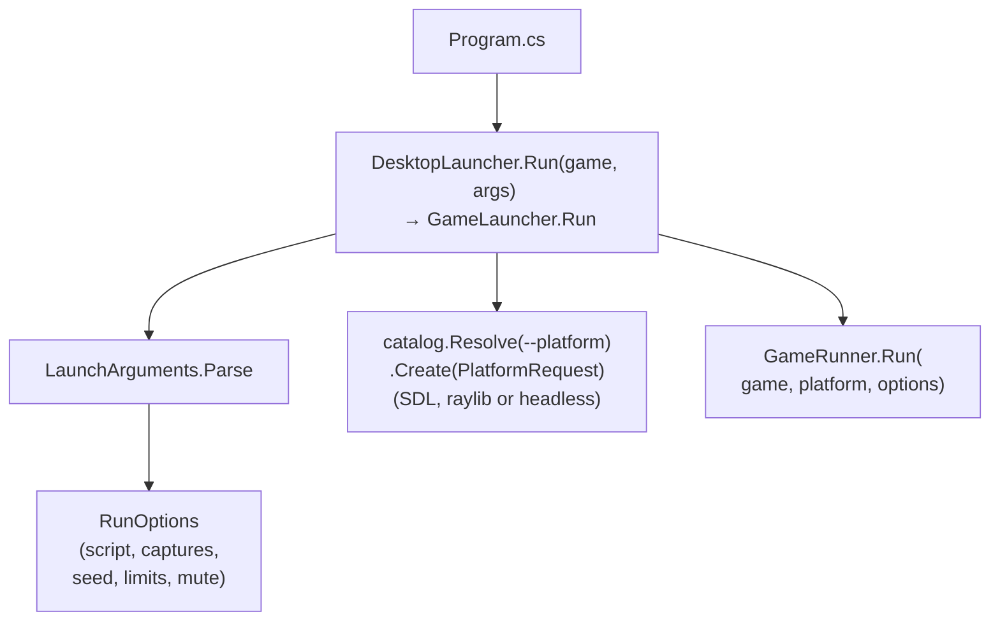
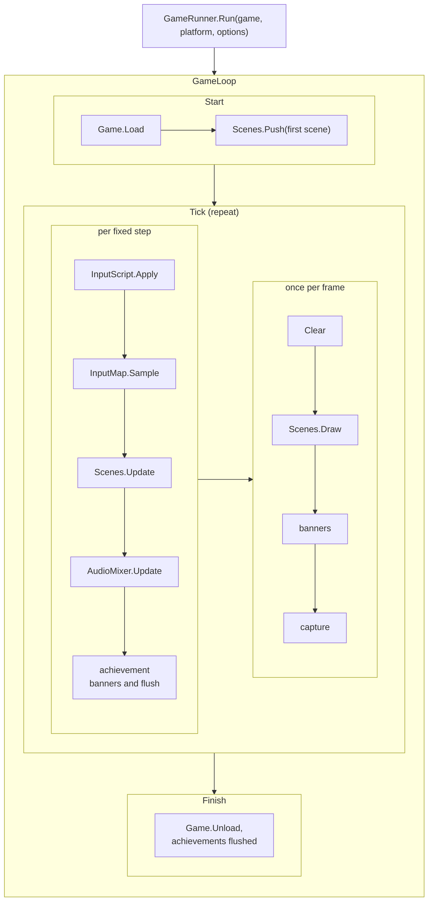
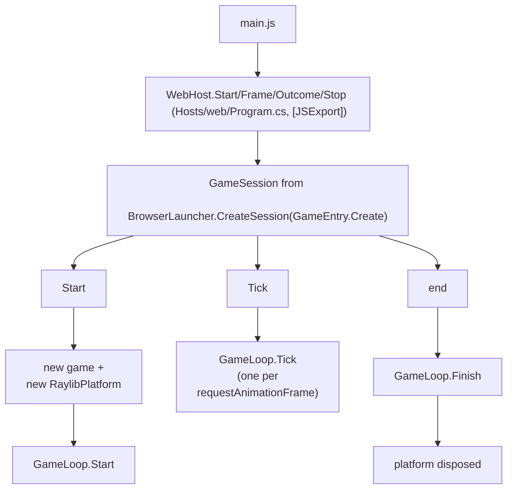
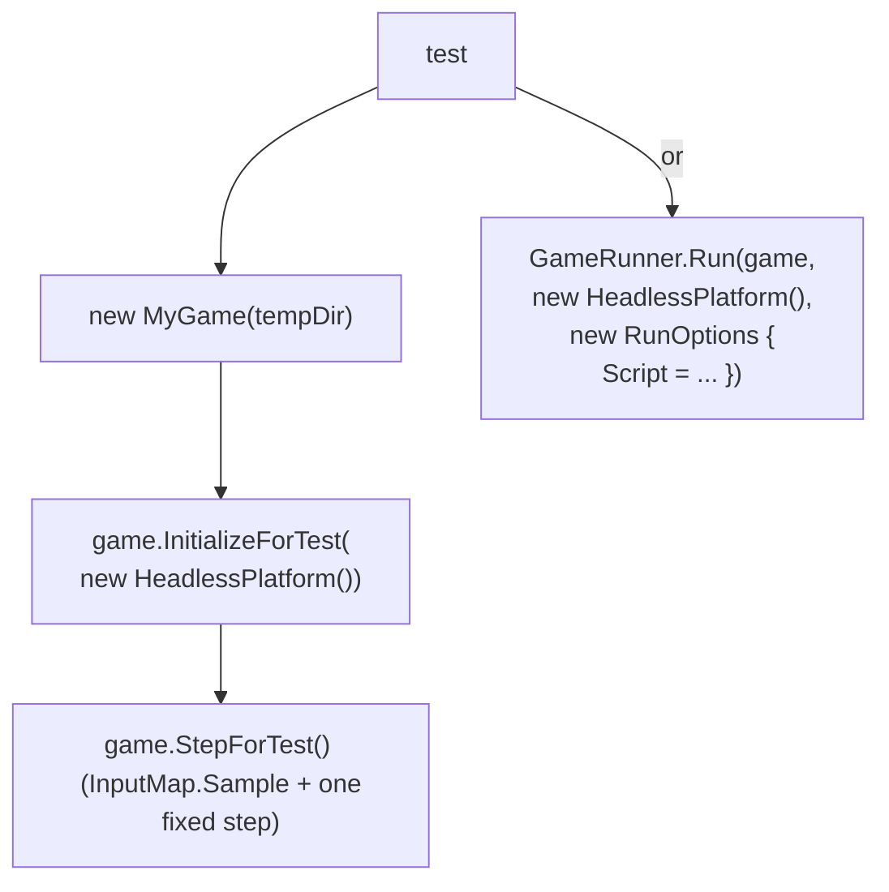

# Components

This page lists every project and engine namespace of MicroEngine with its responsibility and its
dependencies, and then traces what calls what during a run. Use it to find where a change belongs: the core,
the backend, a game, or the browser host.

## Projects

| Project | Kind | Responsibility | References |
| --- | --- | --- | --- |
| `src/MicroEngine` | Library | Backend-independent core: loop, scenes, input, graphics model, world, audio synthesis, UI, saves, achievements, headless platform | Nothing outside the .NET base library |
| `src/MicroEngine.Sdl` | Library | SDL 3 backend (`SdlPlatform`, `SdlAudioDevice`): the default on Windows, Linux, macOS, Android and iOS | `MicroEngine`, NuGet `ppy.SDL3-CS`, `NVorbis` |
| `src/MicroEngine.Raylib` | Library | raylib backend (`RaylibPlatform`, `RaylibAudioDevice`), a raylib-only `DesktopLauncher`, `BrowserLauncher`, `BrowserSaveStorage` | `MicroEngine`, NuGet `Raylib-cs` 8.1.0 |
| `src/MicroEngine.Desktop` | Library | `DesktopLauncher` with the official desktop catalog (`sdl`, `raylib`, `sdl-software`, `headless`) | `MicroEngine.Sdl`, `MicroEngine.Raylib` |
| `src/MicroEngine.Hosting` | Library (inside the `MicroEngine` package; next SDK version) | The launcher model every host shares: `LaunchRequest` and its rules, `ProfileSelection`, `HostEnvironment`, `HostBuilder` (the composition a game configures with its `Configure` entry point) | `MicroEngine.Kernel`, `MicroEngine.Platform` |
| `tests/MicroEngine.Cli.Tests` | MSTest | The tool's own logic: finding a game's `Configure` entry point in its built assembly | `MicroEngine.Cli`, `CourtyardKey` |
| `games/MeadowRun`, `games/CourtyardKey`, `games/TrailDuel`, `games/NeonRift` | Executable | One complete game each: rules, scenes, art, audio, content | `MicroEngine.Desktop` |
| `samples/HelloEngine` | Executable | Minimal example game | `MicroEngine.Desktop` |
| `tests/MicroEngine.Tests` | MSTest | Engine contracts | `MicroEngine` |
| `tests/MicroEngine.Desktop.Tests` | MSTest (native) | SDL and raylib draw the same frames; replacing audio; platform errors | `MicroEngine.Desktop` |
| `tests/<Game>.Tests` | MSTest | Game rules, headless playthroughs, content checks | The game project |
| `src/MicroEngine.Cli` (`microengine`) | .NET tool | Creates, runs, builds and packages games ([the microengine tool](../guide/cli.md)); holds the browser, Android and iOS host templates (`Hosts/`) | `MicroEngine` (icons) |
| `src/MicroEngine.Cli/Hosts/web` | WebAssembly host template, built by `microengine package web` | The page bridge (`WebHost`) and page files; one package per game | The game project, and through it its platforms; it runs on `MicroEngine.Raylib` |
| `templates/MicroEngine.Templates` | `dotnet new` template package | `microengine-game`: a complete starting game | `MicroEngine.Desktop` (package) |

The core references no backend library. Games reference only `MicroEngine.Desktop`, which brings the backends and the core with it. The phone and browser hosts are templates inside `microengine`, built for each game by `microengine package`.

## Core namespaces

| Namespace | Folder | Responsibility | Main types |
| --- | --- | --- | --- |
| `MicroEngine` | `Math/` | Value types and maths helpers | `Color`, `RectF`, `MathX`, `Ease` |
| `MicroEngine.Core` | `Core/` | Game lifecycle, the loop, platform boundary, runs and scripts, saves, content files, achievements | `Game`, `GameSettings`, `IPlatform`, `GameRunner`, `GameLoop`, `GameSession`, `RunOptions`, `InputScript`, `HeadlessPlatform`, `SaveStore`, `ISaveStorage`, `FileSaveStorage`, `ContentFolder`, `Achievement`, `AchievementTracker` |
| `MicroEngine.Scenes` | `Scenes/` | The scene stack, transitions, per-scene coroutines and tweens | `Scene`, `SceneManager`, `Transition`, `CoroutineRunner`, `Tweener` |
| `MicroEngine.Input` | `Input/` | Device state, named actions (digital and analog), touch controls | `Key`, `PadButton`, `PadAxis`, `IInputSource`, `IActionSource`, `InputMap`, `ITouchScreen`, `TouchLayout`, `TouchDPad`, `TouchStick`, `TouchButton`, `VirtualControls`, `FrameLayout` |
| `MicroEngine.Graphics` | `Graphics/` | CPU images, procedural art, PNG decoding, sprites, animation, camera, parallax, particles, lighting, font, drawing interfaces | `PixelImage`, `Art`, `SpriteAtlasBuilder`, `SpriteAtlas`, `Sprite`, `Animator`, `Camera2D`, `ParallaxLayer`, `ParticleSystem`, `LightMap`, `BitmapFont`, `IRenderer`, `IGraphicsDevice`, `Texture` |
| `MicroEngine.World` | `World/` | Tile maps, swept collision, autotiling, entities | `TileLayer`, `TileGrid`, `TileMotion`, `Autotile`, `TileRenderer`, `Entity`, `EntityList<T>` |
| `MicroEngine.Audio` | `Audio/` | PCM clips and WAV decoding, the device interface, mixing, synthesis, sequenced music | `AudioClip`, `IAudioDevice`, `SilentAudioDevice`, `AudioMixer`, `Synth`, `Song` |
| `MicroEngine.UI` | `UI/` | Text boxes, menus, themes, achievement banners and list | `Typewriter`, `DialogueBox`, `SelectionList`, `UiTheme`, `AchievementToasts`, `AchievementsScene` |

The manual covers each area: [lifecycle](../manual/lifecycle.md), [scenes](../manual/scenes.md),
[rendering](../manual/rendering.md), [input](../manual/input.md), [audio](../manual/audio.md),
[assets](../manual/assets.md), [UI](../manual/ui.md), [persistence](../manual/persistence.md),
[achievements](../manual/achievements.md), [backends](../manual/backends.md).

## Backend types

| Type | Responsibility |
| --- | --- |
| `RaylibPlatform` | `IPlatform` over raylib: window, scaled and letterboxed canvas, renderer, texture creation, keyboard, gamepad and mouse, touches from the browser page (`BrowserTouch`), captures, F11 and Alt+Enter fullscreen on desktop. In a browser it leaves fullscreen and minimum size to the page |
| `RaylibAudioDevice` | `IAudioDevice` over raylib audio, including streamed OGG and MP3 music |
| `SdlPlatform` | `IPlatform` over SDL 3: window (full screen on phones), SDL renderer into a virtual-size texture, keyboard, mouse, gamepad, touch screen (safe area, density, Android vibration), lifecycle events, captures; `CreateProfile(renderer)` fixes a render driver |
| `SdlAudioDevice` | `IAudioDevice` over SDL audio streams; WAV and OGG (NVorbis) music; usable with another platform |
| `GameLauncher` (core) | Parses launcher flags, builds `RunOptions` and a `PlatformRequest`, resolves a profile from a `PlatformCatalog`, calls `GameRunner.Run`, returns an exit code |
| `DesktopLauncher` | `GameLauncher` with the official desktop catalog (in `MicroEngine.Desktop`) or with raylib only (in `MicroEngine.Raylib`) |
| `BrowserLauncher` | Sets `SaveStore.DefaultStorage` to `BrowserSaveStorage` and returns a `GameSession` that creates a `RaylibPlatform` per run (next SDK version: composes every run with the game's `Configure` and the shared launch rules, on the raylib platform of one `BrowserPage`) |
| `GameHost` (core, next SDK version) | The one launch path: composes a host (its defaults, then the game's `Configure`), decides `RunOptions` and the `PlatformRequest` from a `LaunchRequest`, chooses and starts the platform, applies the composition to the engine; `GameLauncher`, `BrowserLauncher`, the phone hosts and tests call it |
| `BrowserSaveStorage` | `ISaveStorage` over `localStorage`, keys `microengine/<Game>/<slot>` (next SDK version: `MicroEngine.Platform.BrowserStorage`, the default medium in browsers) |

## What calls what

### Desktop

### Browser

`GameEntry` is generated at build time from the game's entry in the browser build configuration, so the browser
builds the game with the same constructor expression as its desktop `Program.cs`. Next SDK version (not published yet:
arrives with the next SDK version): `GameEntry.Configure` calls the game's own `Configure` entry point, which
`microengine` finds in the built game; `BrowserLauncher.CreateSession(GameEntry.Configure, page)` composes each run
with it through `GameHost`, and `Start` takes a `LaunchRequest` (the script, when there is one), decided by the same
rules as a desktop `--script` run.

### Tests

## Where a change belongs

| Change | Place |
| --- | --- |
| A rule specific to one genre or game | `games/<Name>` |
| Something genre-neutral, or needed by two games | `src/MicroEngine` (with tests in `tests/MicroEngine.Tests`) |
| Anything that touches raylib or the browser | `src/MicroEngine.Raylib` or `web/` |
| A new windowing or audio library | A new `IPlatform` implementation; no game changes |
| A significant architectural change | Also a recorded design decision |
