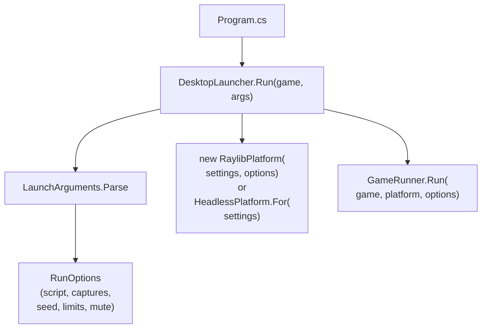
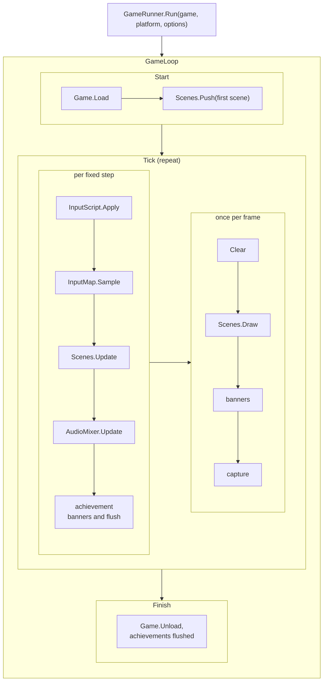
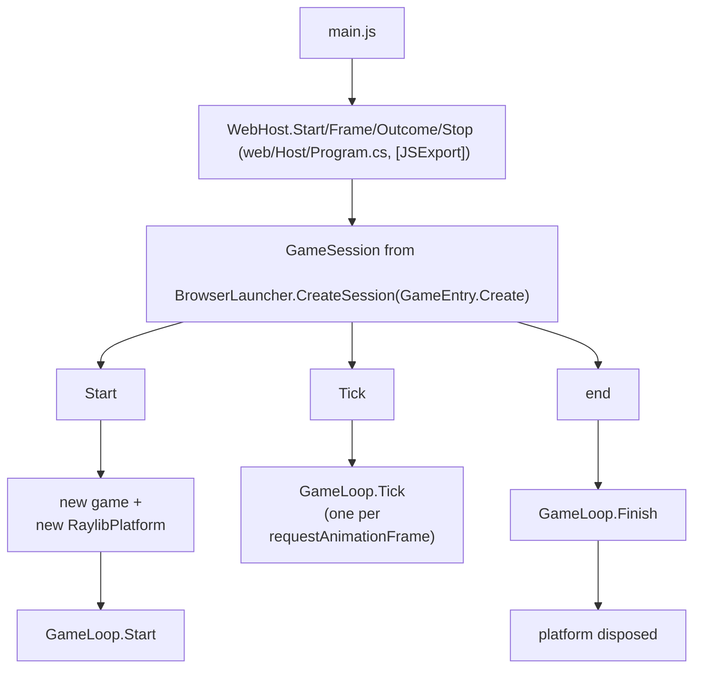
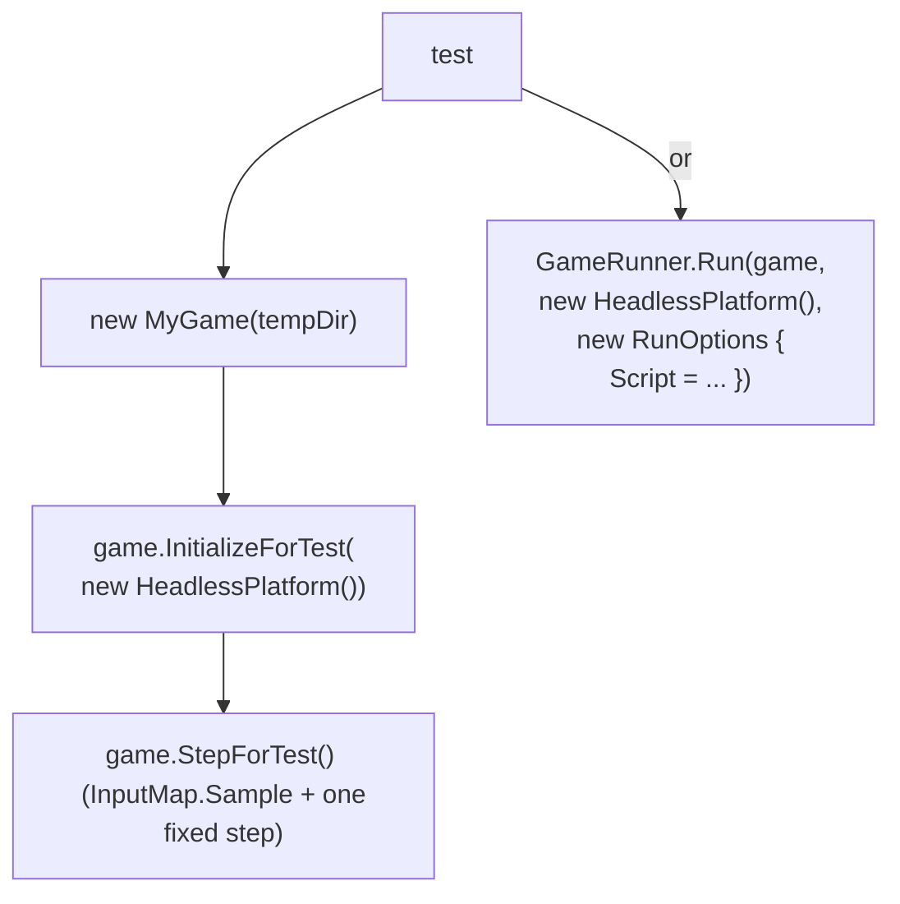

# Components

This page lists every project and engine namespace of MicroEngine with its responsibility and its
dependencies, and then traces what calls what during a run. Use it to find where a change belongs: the core,
the backend, a game, or the browser host.

## Projects

| Project | Kind | Responsibility | References |
| --- | --- | --- | --- |
| `src/MicroEngine` | Library | Backend-independent core: loop, scenes, input, graphics model, world, audio synthesis, UI, saves, achievements, headless platform | Nothing outside the .NET base library |
| `src/MicroEngine.Raylib` | Library | raylib backend (`RaylibPlatform`, `RaylibAudioDevice`), `DesktopLauncher`, `BrowserLauncher`, `BrowserSaveStorage` | `MicroEngine`, NuGet `Raylib-cs` 8.1.0 |
| `games/MeadowRun`, `games/CourtyardKey`, `games/TrailDuel`, `games/NeonRift` | Executable | One complete game each: rules, scenes, art, audio, content | `MicroEngine.Raylib` |
| `samples/HelloEngine` | Executable | Minimal example game | `MicroEngine.Raylib` |
| `tests/MicroEngine.Tests` | MSTest | Engine contracts | `MicroEngine` |
| `tests/<Game>.Tests` | MSTest | Game rules, headless playthroughs, content checks | The game project |
| `web/Host` (`MicroEngine.Web.csproj`) | WebAssembly executable, built by internal tooling | The page bridge (`WebHost`) and page files; builds one selected game per package | The selected game project, and through it `MicroEngine.Raylib` |
| `experiments/web/RaylibProbe` | Experiment, outside the build | WEB-0 feasibility record | — |

The core never references raylib. Games reference only the backend project, which brings the core with it.

## Core namespaces

| Namespace | Folder | Responsibility | Main types |
| --- | --- | --- | --- |
| `MicroEngine` | `Math/` | Value types and maths helpers | `Color`, `RectF`, `MathX`, `Ease` |
| `MicroEngine.Core` | `Core/` | Game lifecycle, the loop, platform boundary, runs and scripts, saves, content files, achievements | `Game`, `GameSettings`, `IPlatform`, `GameRunner`, `GameLoop`, `GameSession`, `RunOptions`, `InputScript`, `HeadlessPlatform`, `SaveStore`, `ISaveStorage`, `FileSaveStorage`, `ContentFolder`, `Achievement`, `AchievementTracker` |
| `MicroEngine.Scenes` | `Scenes/` | The scene stack, transitions, per-scene coroutines and tweens | `Scene`, `SceneManager`, `Transition`, `CoroutineRunner`, `Tweener` |
| `MicroEngine.Input` | `Input/` | Device state and named actions | `Key`, `PadButton`, `IInputSource`, `InputMap` |
| `MicroEngine.Graphics` | `Graphics/` | CPU images, procedural art, PNG decoding, sprites, animation, camera, parallax, particles, lighting, font, drawing interfaces | `PixelImage`, `Art`, `SpriteAtlasBuilder`, `SpriteAtlas`, `Sprite`, `Animator`, `Camera2D`, `ParallaxLayer`, `ParticleSystem`, `LightMap`, `BitmapFont`, `IRenderer`, `IGraphicsDevice`, `Texture` |
| `MicroEngine.World` | `World/` | Tile maps, swept collision, autotiling, entities | `TileLayer`, `TileGrid`, `TileMotion`, `Autotile`, `TileRenderer`, `Entity`, `EntityList<T>` |
| `MicroEngine.Audio` | `Audio/` | PCM clips and WAV decoding, the device interface, mixing, synthesis, sequenced music | `AudioClip`, `IAudioDevice`, `SilentAudioDevice`, `AudioMixer`, `Synth`, `Song` |
| `MicroEngine.UI` | `UI/` | Text boxes, menus, themes, achievement banners and list | `Typewriter`, `DialogueBox`, `SelectionList`, `UiTheme`, `AchievementToasts`, `AchievementsScene` |

The manual covers each area: [lifecycle](../manual/lifecycle.md), [scenes](../manual/scenes.md),
[rendering](../manual/rendering.md), [input](../manual/input.md), [audio](../manual/audio.md),
[assets](../manual/assets.md), [UI](../manual/ui.md), [persistence](../manual/persistence.md),
[achievements](../manual/achievements.md), [backends](../manual/backends.md).

## Backend types

| Type | Responsibility |
| --- | --- |
| `RaylibPlatform` | `IPlatform` over raylib: window, scaled and letterboxed canvas, renderer, texture creation, keyboard and gamepad, captures, F11 and Alt+Enter fullscreen on desktop. In a browser it leaves fullscreen and minimum size to the page |
| `RaylibAudioDevice` | `IAudioDevice` over raylib audio, including streamed OGG/MP3 music |
| `DesktopLauncher` | Parses launcher flags, builds `RunOptions`, picks `RaylibPlatform` or `HeadlessPlatform`, calls `GameRunner.Run`, returns an exit code |
| `BrowserLauncher` | Sets `SaveStore.DefaultStorage` to `BrowserSaveStorage` and returns a `GameSession` that creates a `RaylibPlatform` per run |
| `BrowserSaveStorage` | `ISaveStorage` over `localStorage`, keys `microengine/<Game>/<slot>` |

## What calls what

### Desktop

### Browser

`GameEntry` is generated at build time from the game's entry in the browser build configuration, so the browser
builds the game with the same constructor expression as its desktop `Program.cs`.

### Tests

## Where a change belongs

| Change | Place |
| --- | --- |
| A rule specific to one genre or game | `games/<Name>` |
| Something genre-neutral, or needed by two games | `src/MicroEngine` (with tests in `tests/MicroEngine.Tests`) |
| Anything that touches raylib or the browser | `src/MicroEngine.Raylib` or `web/` |
| A new windowing or audio library | A new `IPlatform` implementation; no game changes |
| A significant architectural change | Also a recorded design decision |
