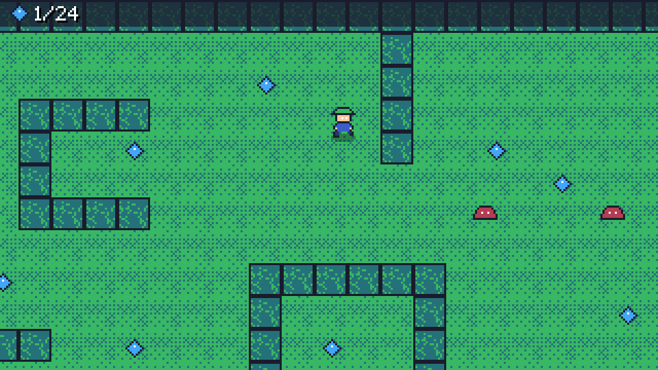

# 9. Text and HUD

A heads-up display shows the game's state over the world: here, the gems collected out of the total. This step draws it
with the engine's pixel font, and finishes part 3.

## The HUD

The play scene's `Draw` (step 6) ends with `DrawHud(r)`, after `PopCamera`, so the HUD is in screen pixels and stays
put while the camera moves:

<!-- code: samples/GemGarden/part3-garden/Scenes/PlayScene.cs#hud -->
```csharp title="Scenes/PlayScene.cs"
private void DrawHud(IRenderer r)
{
    r.FillRect(new RectF(0, 0, Game.Width, 13), Color.Hex("1a1c2c").WithAlpha(0.75f));
    r.Draw(_game.Sprites["gem"], new Vector2(9, 6));
    Font.DrawShadowed(r, $"{Gems}/{TotalGems}", new Vector2(17, 3), Color.White, Color.Black);
}
```

- A translucent bar (`FillRect` with `WithAlpha(0.75f)`) keeps the text readable over any part of the garden.
- The gem sprite doubles as an icon: sprites can be drawn in screen space too.
- `Font.DrawShadowed` draws the text twice, a shadow one pixel down and right, then the text.

## The built-in font

Every game has `Font` (in a scene) or `Game.Font`: a proportional pixel font, 5 pixels wide and 7 high for most
characters, made for a 320x180 screen. It covers printable ASCII (letters in both cases, digits, punctuation) and a few
symbols games use: `♥ ▶ ▼ ★ ♪ → ← ↑ ↓ × © ·`. Any other character (accented letters, `ñ`, other alphabets) is drawn as
`?`.

| Call | Draws |
| --- | --- |
| `Font.Draw(r, text, position, color, scale)` | text from its top-left corner |
| `Font.DrawShadowed(r, text, position, color, shadow)` | with a shadow |
| `Font.DrawOutlined(r, text, position, color, outline)` | with an outline, readable on anything |
| `Font.DrawCentered(r, text, center, color, scale, shadow)` | centred on a point (titles, menus) |
| `Font.MeasureWidth(text)`, `Font.Measure(text, scale)` | the size of a text, to align or box it |
| `Font.Wrap(text, maxWidth)` | lines that fit a width, split at spaces |

`scale` enlarges by whole pixels (the title uses 3). MicroEngine has one font: there is no loading of TTF or bitmap
font files, and no rich text or right-to-left layout. A game that needs another typeface draws its glyphs as sprites.
[Text](../manual/text.md) covers wrapping, measuring and these limits; the [text example](../examples/focused.md#text)
shows every call.

## Run part 3

Part 3 is complete: your project matches [`part3-garden`](../../samples/GemGarden/part3-garden). Run it:



The gardener walks the garden, the camera follows, hedges block him, gems sparkle away with a chime, slimes push him
back, the music plays on the title. What is missing is a game: a goal, an end, a reason to play again.

## Next

[Part 4](10-states.md) adds a round timer, a title menu, a pause menu, a results screen and a saved best score.
