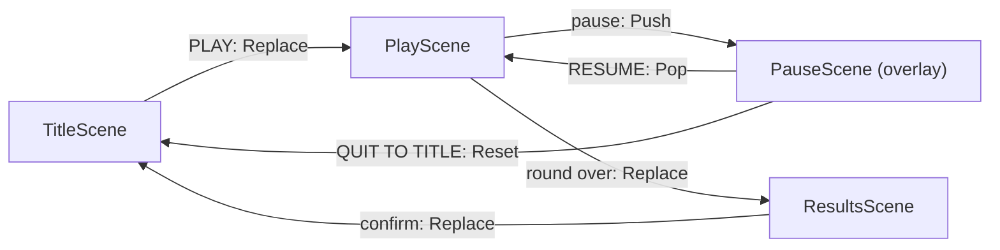

# 10. Game states and menus

Part 4 turns the garden into a game. A round lasts 60 seconds; touching a slime costs 5 of them; the round ends when the
time runs out or every gem is found; a results screen shows the score; a title menu starts and quits; a pause menu
freezes the round. This step builds all of that with scenes, which are MicroEngine's game states.

## Scenes are the game's states

Gem Garden's flow:



Each screen with its own input and drawing is a scene; moving between them is a stack operation. State *inside* a
scene (the time left, a hero's hurt timer) is ordinary fields. MicroEngine has no state-machine type: the scene stack
covers screens, and plain C# covers the rest.

## The round timer

The play scene gains the round's rules: two constants, the time left and a flag, in its fields:

<!-- code: samples/GemGarden/part4-complete/Scenes/PlayScene.cs#fields -->
```csharp title="Scenes/PlayScene.cs"
public const float RoundSeconds = 60, HitPenalty = 5;

private static readonly ParticleSpec Sparkle = new()
{
    StartColor = Color.Hex("73eff7"), EndColor = Color.Hex("41a6f600"), Speed = (20, 60), Life = (0.3f, 0.6f),
};

private readonly MainGame _game;
private readonly Level _level;
private readonly Player _player;
private readonly List<Vector2> _gems;
private readonly List<Slime> _slimes;
private readonly Camera2D _camera;
private readonly ParticleSystem _sparkles = new(capacity: 128);
private float _timeLeft = RoundSeconds;
private bool _finished;

public PlayScene(MainGame game)
{
    _game = game;
    _level = new Level(game.Sprites);
    _player = new Player(game.Sprites, _level.PlayerStart);
    _gems = [.. _level.GemSpots];
    _slimes = [.. _level.SlimeStarts.Select(p => new Slime(game.Sprites, p))];
    // The camera shows a 320x180 window of the 640x320 garden and never looks outside it.
    _camera = new Camera2D(game.Width, game.Height) { Bounds = _level.Area };
    _camera.CenterOn(_player.Position);
}

public int Gems { get; private set; }
public int TotalGems => _level.GemSpots.Count;
public float TimeLeft => _timeLeft;
```

`Update`:

<!-- code: samples/GemGarden/part4-complete/Scenes/PlayScene.cs#update -->
```csharp title="Scenes/PlayScene.cs"
public override void Update(float dt)
{
    if (Input.Pressed("pause"))
    {
        Game.Scenes.Push(new PauseScene(_game));
        return;
    }

    _player.Update(dt, Input, _level);
    foreach (var slime in _slimes) slime.Update(dt, _level);
    CollectGems();
    CheckSlimes();

    _sparkles.Update(dt);
    _camera.Follow(_player.Position, dt);
    _camera.Update(dt);

    _timeLeft = MathF.Max(0, _timeLeft - dt);
    if (_timeLeft == 0 || _gems.Count == 0) Finish();
}
```

- `pause` now **pushes** a pause scene instead of leaving: the play scene stays on the stack underneath, intact.
- The timer counts down by `dt`. Because updates are fixed steps, 60 seconds of simulation are exactly 3600 updates,
  whatever the frame rate.
- `CheckSlimes` also subtracts `HitPenalty` from `_timeLeft`.

When the round ends, `Finish` replaces the play scene with the results (and records the score, [step 11](11-saving.md)):

<!-- code: samples/GemGarden/part4-complete/Scenes/PlayScene.cs#finish -->
```csharp title="Scenes/PlayScene.cs"
private void Finish()
{
    if (_finished) return;
    _finished = true;
    bool newBest = _game.RecordScore(Gems);
    Game.Scenes.Replace(new ResultsScene(_game, Gems, TotalGems, newBest), Transition.Fade(0.8f));
}
```

Scene changes are queued until the end of the update, so `Update` keeps running for the rest of this step; the
`_finished` flag makes sure the round ends only once. The HUD shows the clock, red in the last ten seconds:

<!-- code: samples/GemGarden/part4-complete/Scenes/PlayScene.cs#hud -->
```csharp title="Scenes/PlayScene.cs"
private void DrawHud(IRenderer r)
{
    r.FillRect(new RectF(0, 0, Game.Width, 13), Color.Hex("1a1c2c").WithAlpha(0.75f));
    r.Draw(_game.Sprites["gem"], new Vector2(9, 6));
    Font.DrawShadowed(r, $"{Gems}/{TotalGems}", new Vector2(17, 3), Color.White, Color.Black);

    var clock = $"TIME {MathF.Ceiling(_timeLeft)}";
    var color = _timeLeft < 10 ? Color.Hex("ef7d57") : Color.White;
    Font.DrawShadowed(r, clock, new Vector2(Game.Width - 6 - Font.MeasureWidth(clock), 3), color, Color.Black);
}
```

## A menu

A menu is a few widgets: buttons in a stack. A scene's `Widgets` lays them out in the UI view, moves the focus with
`up` and `down`, and clicks the focused button on `confirm` or under the mouse. The title scene becomes a menu:

<!-- code: samples/GemGarden/part4-complete/Scenes/TitleScene.cs -->
```csharp title="Scenes/TitleScene.cs"
using System.Numerics;
using MicroEngine;
using MicroEngine.Graphics;
using MicroEngine.Scenes;
using MicroEngine.UI;

namespace GemGarden.Scenes;

/// <summary>The title screen: a menu to play or quit, and the best score from the save file.</summary>
public sealed class TitleScene(MainGame game) : Scene
{
    public override void Enter()
    {
        Audio.PlayMusic("garden");
        Widgets.Content = new Stack { Spacing = 4 }
            .Add(new Button("PLAY", Play) { Width = 64 })
            .Add(new Button("QUIT", Game.Quit) { Width = 64 });
        Widgets.Offset = new Vector2(0, 30);                           // below the title, from the centre
        Widgets.FocusChanged += change =>
        {
            if (change.From is not null) Audio.Play("select");         // a click when the focus moves
        };
    }

    private void Play()
    {
        Audio.Play("select");
        Game.Scenes.Replace(new PlayScene(game), Transition.Fade());
    }

    public override void Update(float dt) { }

    public override void Draw(IRenderer r)
    {
        Font.DrawCentered(r, "GEM GARDEN", new Vector2(160, 44), Color.Hex("a7f070"), scale: 3, shadow: Color.Hex("257179"));
        r.Draw(game.Sprites["hero0"], new Vector2(160, 80));
        Font.DrawCentered(r, $"BEST {game.BestScore}", new Vector2(160, 164), UiTheme.Default.Muted);
    }
}
```

- `Widgets.Content` is what the scene shows in the UI view. `new Button(text, action)` calls `action` when it is
  clicked; `Stack` puts its children one under the other, `Spacing` units apart.
- `Widgets.Offset` moves the content from the centre of the screen, here below the title.
- `FocusChanged` is raised when the focus moves to another button: a click sound. The first focus, when the menu
  opens, comes from nothing (`From` is null) and makes no sound.
- `Update` has nothing to do: the widgets read their own input.
- Widgets are drawn in the UI view, at the window's resolution, in UI units of one window pixel by default: small
  next to 320 × 180 pixel art. Gem Garden makes them three window pixels each, in `MainGame`'s settings:
  `Presentation = Presentation.PixelArt with { UiScale = 3 }` ([The world view and the UI
  view](../manual/rendering.md#the-world-view-and-the-ui-view)).
- `Game.Quit()` ends the game after the current frame (the window closes; in a browser the page shows its own screen).
- `game.BestScore` comes from the save file ([step 11](11-saving.md)).

Menus answer keyboard, gamepad, mouse and touch. The buttons use the engine's colours (`UiTheme.Default`); a game
can make its own `UiTheme` and set it as `Widgets.Theme`. More widgets (labels, panels, scrolling lists, grids):
[UI widgets](../manual/ui.md).

## The pause overlay

<!-- code: samples/GemGarden/part4-complete/Scenes/PauseScene.cs -->
```csharp title="Scenes/PauseScene.cs"
using MicroEngine;
using MicroEngine.Graphics;
using MicroEngine.Scenes;
using MicroEngine.UI;

namespace GemGarden.Scenes;

/// <summary>An overlay over the frozen round: resume it or go back to the title.</summary>
public sealed class PauseScene(MainGame game) : Scene
{
    /// <summary>The play scene is drawn first, below this one, and stops updating while this one is on top.</summary>
    public override bool IsOverlay => true;

    public override void Enter()
    {
        Audio.PauseMusic(true);
        Widgets.Content = new Panel(new Stack { Spacing = 4 }
            .Add(new Label("PAUSED") { Color = UiTheme.Default.Accent })
            .Add(new Button("RESUME", () => Game.Scenes.Pop()) { Width = 100 })
            .Add(new Button("QUIT TO TITLE", () => Game.Scenes.Reset(new TitleScene(game), Transition.Fade())) { Width = 100 }))
        { Padding = 8 };
        Widgets.FocusChanged += change =>
        {
            if (change.From is not null) Audio.Play("select");
        };
    }

    public override void Exit() => Audio.PauseMusic(false);

    public override void Update(float dt)
    {
        if (Input.Pressed("pause") || Input.Pressed("cancel")) Game.Scenes.Pop();
    }

    public override void Draw(IRenderer r) => r.FillRect(new RectF(0, 0, Game.Width, Game.Height), Color.Black.WithAlpha(0.5f));
}
```

- `IsOverlay => true` makes the scene below draw first: the frozen garden stays visible under a darkening rectangle.
- The menu is a `Panel` (a bordered box in the theme's colours) around a label and two buttons; a widget tree is
  centred on the screen unless the scene moves it.
- Only the top scene updates (unless an overlay sets `BlocksUpdateBelow => false`), so the round, its timer and its
  slimes stop while the menu is open.
- `Enter` and `Exit` pause and resume the music. `Exit` runs whether the menu is closed with `Pop` or the stack is
  emptied with `Reset`.
- `Reset(new TitleScene(game), ...)` empties the stack (pause and play scenes) and starts again from the title.

On phones the system can send the game to the background (a call, the home button). The engine then pauses itself and
calls `Game.OnSuspended()`; a game can override it to push its pause menu, so the player comes back to a paused round
([Game lifecycle and time](../manual/lifecycle.md#suspension)).

## The results screen

<!-- code: samples/GemGarden/part4-complete/Scenes/ResultsScene.cs -->
```csharp title="Scenes/ResultsScene.cs"
using System.Numerics;
using MicroEngine;
using MicroEngine.Graphics;
using MicroEngine.Scenes;
using MicroEngine.UI;

namespace GemGarden.Scenes;

/// <summary>The end of a round: how many gems, whether it is a new best, then back to the title.</summary>
public sealed class ResultsScene(MainGame game, int gems, int total, bool newBest) : Scene
{
    private const float InputDelay = 0.6f;   // so a button held at the end of the round does not skip this screen

    public override void Update(float dt)
    {
        if (Age > InputDelay && Input.Pressed("confirm"))
            Game.Scenes.Replace(new TitleScene(game), Transition.Fade());
    }

    public override void Draw(IRenderer r)
    {
        var heading = gems == total ? "EVERY GEM FOUND!" : "THE SUN HAS SET";
        Font.DrawCentered(r, heading, new Vector2(160, 48), Color.Hex("ffcd75"), scale: 2, shadow: Color.Black);
        Font.DrawCentered(r, $"YOU FOUND {gems} OF {total} GEMS", new Vector2(160, 84), Color.White);
        Font.DrawCentered(r, newBest ? "NEW BEST!" : $"BEST {game.BestScore}", new Vector2(160, 100), UiTheme.Default.Accent);
        if (Age > InputDelay) Font.DrawCentered(r, "PRESS CONFIRM", new Vector2(160, 140), UiTheme.Default.Muted);
    }
}
```

`InputDelay` ignores input for the first 0.6 seconds: a player still holding the run button (which is also `confirm`)
when the time runs out would otherwise skip the screen without seeing it. It is the kind of small rule a game owns;
the engine already resets input edges on every scene change, so only a key *held* across the change needs it.

## Next

`RecordScore` and `BestScore` remember the best round. [Step 11](11-saving.md) makes them survive closing the game.
