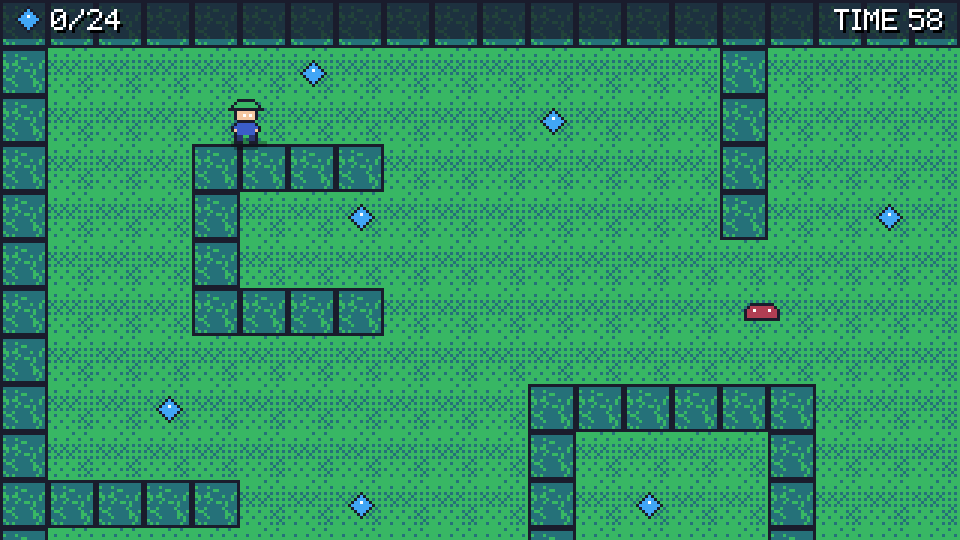

# Tutorial: build Gem Garden

This tutorial builds a complete small game from the official template, one idea at a time. The game is **Gem
Garden**: a gardener walks through a walled garden collecting gems before the sun sets, while slimes patrol the paths.
It has a title menu, a pause menu, a results screen, a best score saved between sessions, sound effects, music, and
packages for Windows, Linux, the web and phones.

Along the way you will use every part of MicroEngine a typical 2D game needs:

| Step | You learn |
| --- | --- |
| [1. Create the project](01-project.md) | the template, the project file, running the game |
| [2. Scenes](02-scenes.md) | the game class, scenes, the scene stack, transitions |
| [3. Drawing the hero](03-drawing.md) | the renderer, sprites from a PNG file, sprite atlases, art made in code |
| [4. Input and movement](04-input.md) | input actions, custom bindings, gamepads, touch controls, moving with `dt` |
| [5. Animation](05-animation.md) | animation clips and the animator |
| [6. Tile map and camera](06-garden.md) | tile maps written as text, world and screen coordinates, the camera |
| [7. Gems, slimes, collisions](07-collisions.md) | collisions with walls, overlaps between objects, enemies, particles |
| [8. Sound and music](08-sound.md) | sound files, sounds made in code, music |
| [9. Text and HUD](09-hud.md) | the pixel font, a heads-up display in screen space |
| [10. Game states and menus](10-states.md) | a round timer, menus, a pause overlay, a results screen |
| [11. Saving the best score](11-saving.md) | save files that survive restarts, everywhere the game runs |
| [12. Build and package](12-packaging.md) | the game's identity, Release builds, packages for players |
| [13. Other platforms](13-other-targets.md) | another backend, the browser, Android |

## Before you start

- The SDK installed: .NET 10 and the `microengine` tool ([Install the SDK](../guide/getting-microengine.md)).
- Some C#: classes, properties, lambdas, `List<T>`. No game programming experience is needed.
- About two hours, in as many sittings as you like.

## The code

Every listing in this tutorial is part of a project that builds and runs: the four checkpoints below are complete
games, compiled and played by MicroEngine's automated tests against the published SDK. If your code stops compiling,
compare it with the checkpoint of the part you are in.

| Part | Steps | Checkpoint |
| --- | --- | --- |
| 1. A project with scenes | 1-2 | [`part1-scenes`](../../samples/GemGarden/part1-scenes) |
| 2. The hero | 3-5 | [`part2-hero`](../../samples/GemGarden/part2-hero) |
| 3. The garden | 6-9 | [`part3-garden`](../../samples/GemGarden/part3-garden) |
| 4. A complete game | 10-13 | [`part4-complete`](../../samples/GemGarden/part4-complete) |

Within a part, a step may use something the next step of the same part adds (the hero's movement, for example, is
written in step 4 and drawn with the animation of step 5). Each listing shows a whole method or a whole file as it is at
the end of its part; the game compiles and runs again at the end of every part.

The checkpoints are MIT licensed, like the engine: copy anything you like into your own games. Their two asset files
(`hero.png` and `pickup.wav`) were made for this tutorial with MicroEngine itself.

## What MicroEngine does and what your game does

MicroEngine gives you a loop, scenes, input actions, drawing, tile collision, sound, a pixel font, a few UI widgets and
saves. It deliberately has no entity-component system, no physics engine and no visual editor: a game is plain C#
classes (the next SDK version adds a scene world and physics worlds for tile games, which this tutorial does not need). Where Gem Garden needs something the engine does not provide (an enemy that patrols, a round timer, a
knock-back), the tutorial writes it in the game and says so.

Start with [step 1](01-project.md).
