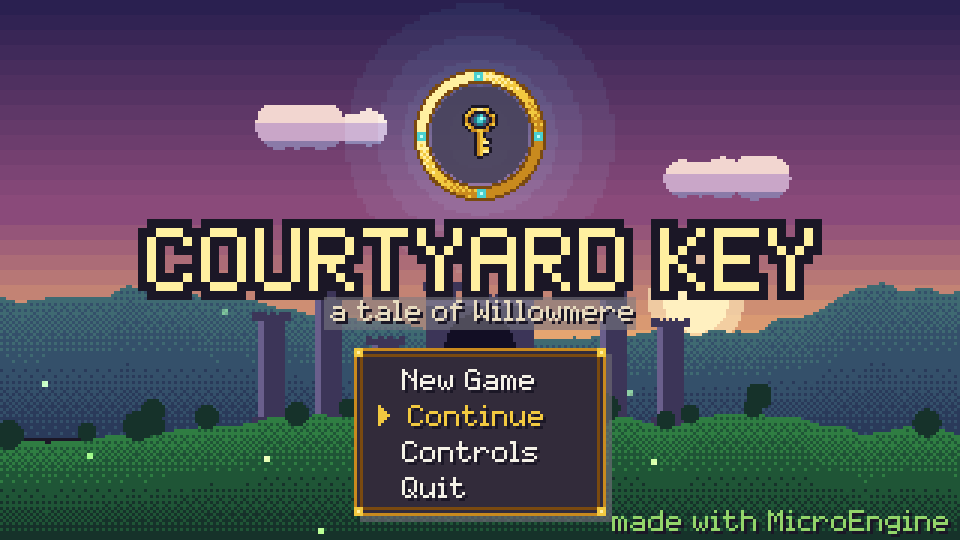
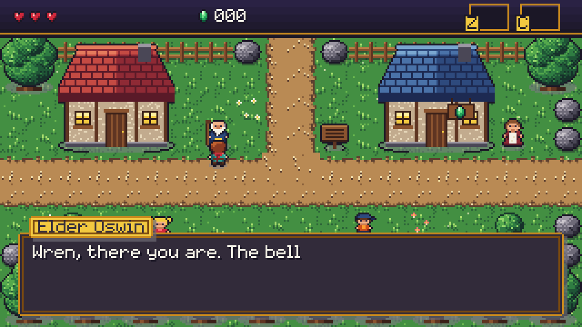
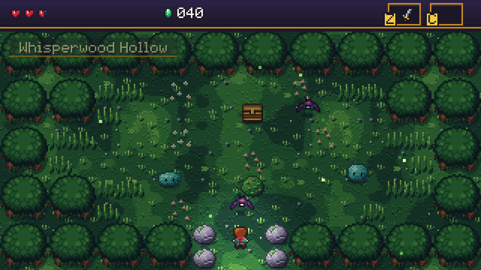
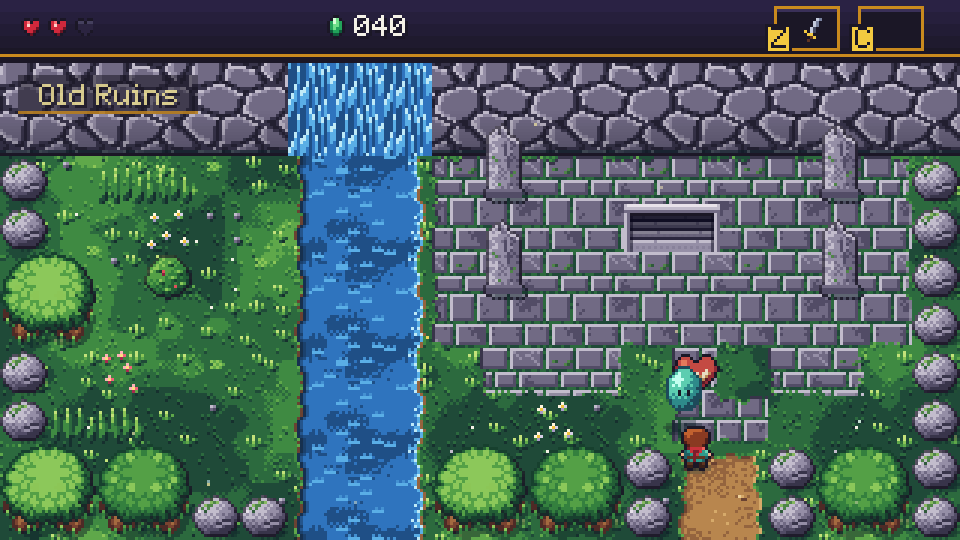
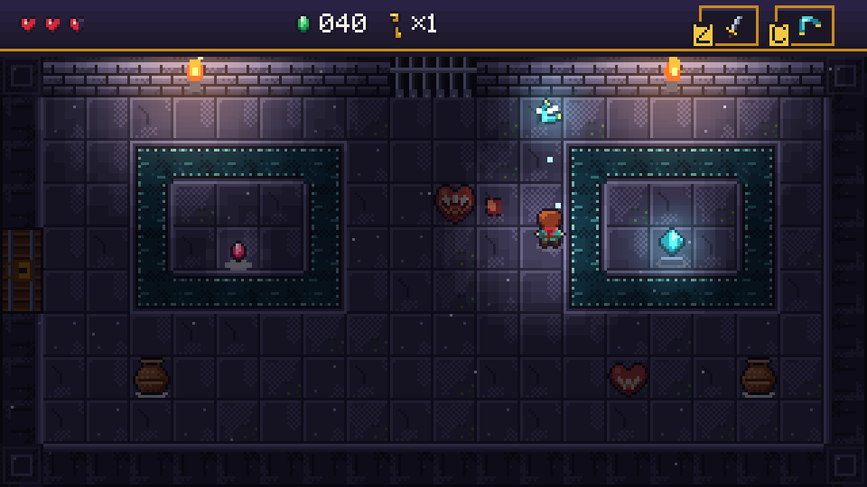
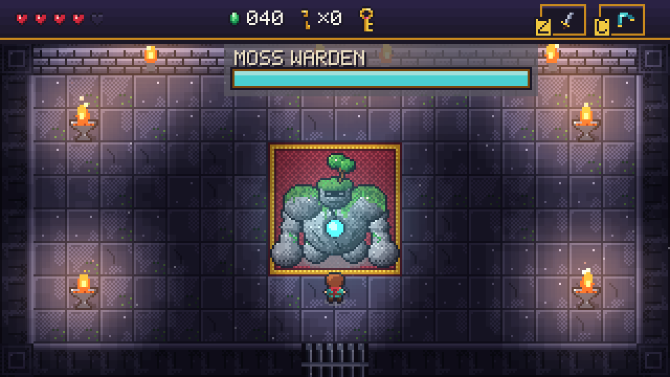

# Courtyard Key

A top-down action-adventure in the spirit of classic screen-by-screen 2D adventures, built on
MicroEngine. All characters, names and music are original. It is a hybrid: the world, hero, villagers,
the slime, bat and knight, the Moss Warden, items and all audio are generated in code; the seed-spitting
heart-trap is a hand-drawn CC0 monster repainted in the game's palette (see [CREDITS](CREDITS.md)).

> The bells beneath the old ruins rang again last night. Elder Oswin hands Wren his old sword:
> cross the vale, descend into the Sunken Courtyard, and take the Courtyard Key back from the
> Moss Warden.








## Controls

| Key | Action |
| --- | --- |
| Arrows / WASD | Move (8 directions, 4 facings) |
| Z / Space / Enter | Swing the sword · talk · read · open chests · menu confirm |
| C / X | Throw the Wind Boomerang (once found) |
| Esc / P | Pause: inventory, quest items and the map of visited rooms |
| Walk into a locked door | Use a small key (or the Warden's Key on the great door) |
| Lean on a stone block | Push it one tile |

On a phone or tablet the game shows on-screen controls: a joystick that appears under the left thumb (push lightly to
walk slowly, fully to walk at full speed), **A** (sword, talk, confirm), **C** (boomerang) and **B** (back) on the
right, and **II** (pause) at the top centre, clear of the hearts and item slots.

## Achievements

Listed from the title menu ("Achievements"), announced with a banner when earned, saved with the
game's progress in its own folder. First Strike (defeat a monster), Vale Defender (defeat 30), Wind Catcher (find the boomerang),
Cartographer (visit all nine chambers of the Sunken Courtyard) and Warden Felled. Catalog in `Model/Achievements.cs`.

## Content

- **Willowmere Vale** (3x3 screens): the village (elder, shop, villagers), West Meadow, the Old Road,
  Whisperwood and its dark Hollow (a hidden Heart Container), Lookout Hill, the River Bridge,
  Riverside and the Old Ruins with the stairway down.
- **The Sunken Courtyard** (9 rooms): Entrance Hall, the Courtyard, the Hall of Weights (push-block
  puzzle → small key), the Bell Chamber (ambush → small key), the Pillar Hall, the Trial of Wind
  (ambush → Wind Boomerang), the Flooded Gallery (crystal switch only the boomerang can reach),
  the Warden's Vault (knights guard the Warden's Key) and the Warden's Court.
- **Enemies**: slimes (telegraphed hops), bats (erratic fliers, die to the boomerang), thorn-bulb
  spitters (swell, then fire at you; the sword knocks seeds away), shield knights (block frontal
  strikes: flank them or stun them), and the **Moss Warden** boss: armoured, telegraphed charge,
  leap with a shockwave ring, and an enraged phase with radial ember volleys. Bait its charge into
  a wall or stun it with the boomerang, then strike its glowing heart.
- **Systems**: half-heart damage, invulnerability frames and knockback, gems (rolling counter),
  hearts and gems from bushes, pots and enemies, small keys and the boss key, chests with an
  "item get" fanfare, NPC dialogue and signs, Marla's shop (Heart Tonic, a one-time Hearty Pie),
  three extra hearts to earn (a Heart Container in the forest, the shop pie, the boss's Heart Container), autosave at area entrances and
  on major items, game over with Continue (back to the last entrance, items kept), pause screen
  with inventory and map, ending with story, credits and run statistics.

## Art and audio direction

- A deliberate master palette (`Visuals/Pal.cs`): warm, lush greens for the vale; cool violet stone
  for the dungeon; a teal-and-crimson hero; gold for everything precious. Dark ink outlines,
  top-left lighting, dithered ramps.
- Tiles are procedural: 16-mask autotiles for paths, water shorelines, carpets and channels,
  animated water, waterfalls, swaying flowers and tall grass, bevelled dungeon walls with door arches.
- Characters are hand-authored char maps (hero walk cycles in four facings, item-get pose, six
  villagers rounded by a light pass toward the top-left light); slimes are sculpted from lit blobs, the
  bat and knight are char maps.
- The Moss Warden is a towering 64x60 stone guardian built from lit blobs: boulder shoulders, long
  knuckle-dragging arms, a sapling rooted in its crown and a rune core. It raises both fists as its
  tell, slumps with the core split open when dazed, and smoulders with embers once enraged.
- The seed-spitting heart-trap comes from the Ninja Adventure pack (`Content/monsters`);
  `Visuals/MonsterArt.cs` repaints it at load with the game's own ramps and ink outline.
- The ruin stairwell is drawn as one opening: a stone lintel, cheek stones and steps that sink into
  darkness.
- Darkness: woods and dungeon rooms multiply a stepped light map over the scene, while torches,
  braziers, the boomerang, the crystal, the pedestal and the Warden's core add coloured glows.
- Y-sorted actors, drop shadows, particles for leaves, shards, sparks, embers, fireflies, pollen,
  dust motes and river spray.
- 40 synthesized sound effects plus six jingles (item get, heart container, secret, save, game
  over, victory). Five looping themes (title, vale, dungeon, boss, ending) share one rising "key
  motif".

## Code map

| Folder | Contents |
| --- | --- |
| `CourtyardKeyGame.cs` | Game settings, input bindings, content loading, debug checkpoints (`DebugStart`) |
| `Model/` | Rules with no rendering: `Health`, `Combat` (damage, knockback, shield cone), `Progress` and `SaveSlots`, `Dir` |
| `Content/` | Tile ids, map legend, the overworld and dungeon room maps, NPC dialogue, chest contents |
| `World/` | Runtime `Room`, `RoomGrid` collision (edges look into the neighbour room), `AreaMap`, `RoomRenderer`, `Lighting`, particle recipes (`Fx`) |
| `Entities/` | `Hero`, `Enemy` base and `Enemies` (slime, bat, spitter, knight, projectile), `Boss` (Warden, shockwave), `Objects` (pickups, boomerang, pots, chests, signs, NPCs, push blocks, doors, crystal, pedestal) |
| `Scenes/` | `PlayScene` (partial: core, rooms/transitions/rules, combat, events, drawing), `Spawner`, title/ending, dialogue, pause/map, shop, game over |
| `UI/` | HUD (hearts, gems, keys, items, boss bar, toasts, banners) and the shared panel style |
| `Visuals/` | Palette, procedural art modules, the heart-trap sheet loader (`MonsterArt`) and the single sprite atlas |
| `Audio/` | `SoundBank` (SFX and jingles) and `MusicBank` (songs) |

## Run, test, capture

```
dotnet build games/CourtyardKey/CourtyardKey.csproj -c Release
games/CourtyardKey/bin/Release/net10.0/CourtyardKey.exe
```

Tests (rules, content lint, save round-trip, and headless bots that play the opening from the title
to the dungeon and the whole dungeon through the boss to the ending):

```
dotnet build tests/CourtyardKey.Tests/CourtyardKey.Tests.csproj -c Release
dotnet test tests/CourtyardKey.Tests/CourtyardKey.Tests.csproj -c Release --no-build
```

Scripted captures (PNG, 3x) use the scripts in `scripts/`. `COURTYARD_START` jumps to a checkpoint
(`village`, `town`, `road`, `woods`, `bridge`, `ruins`, `dungeon`, `blocks`, `trial`, `channel`,
`boss`, `ending`) and `COURTYARD_SAVE_DIR` redirects the save slot:

```
COURTYARD_START=boss games/CourtyardKey/bin/Release/net10.0/CourtyardKey.exe --script games/CourtyardKey/scripts/boss.script --hidden --mute --captures captures
```

Saves live in `%LOCALAPPDATA%/MicroEngine/CourtyardKey/adventure.json`.

## License

This game is a MicroEngine demo, **not** covered by the engine's MIT License: all rights reserved
([games/LICENSE](../LICENSE)). Read and build it to learn MicroEngine; do not redistribute or sell it. The image and audio files under `Content/` are third-party CC0 works listed in [CREDITS.md](CREDITS.md); they keep their own licence.
