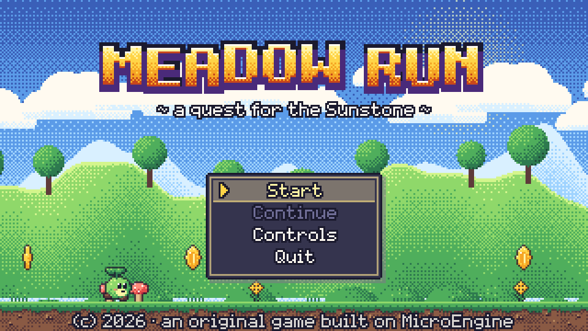
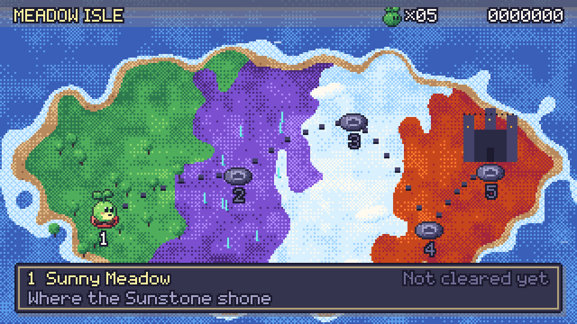
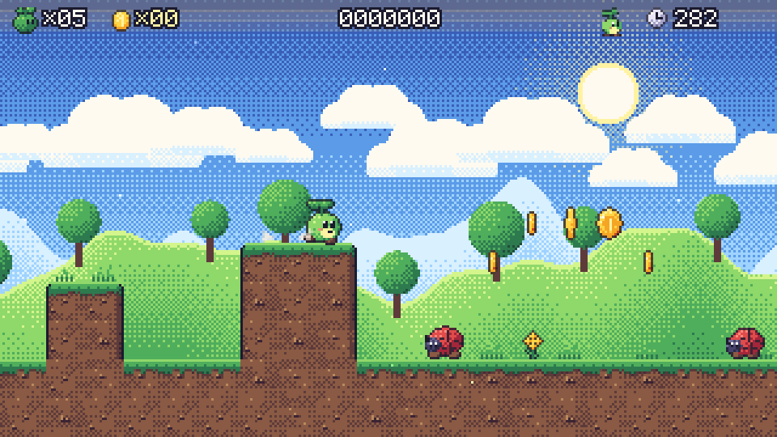
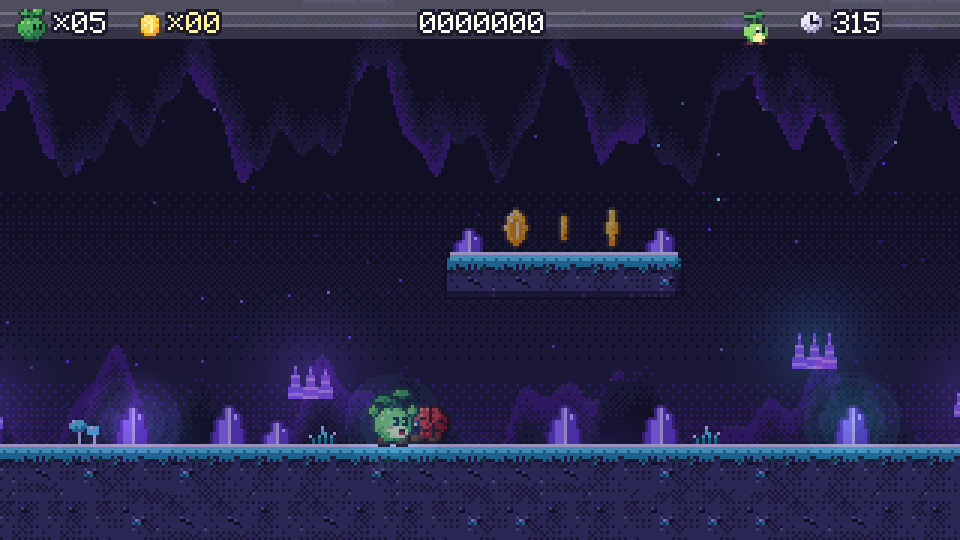
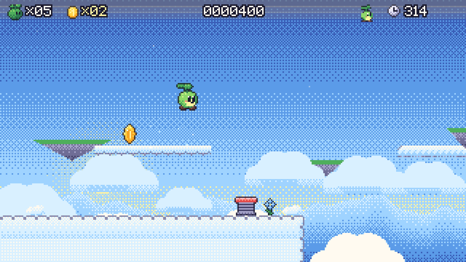
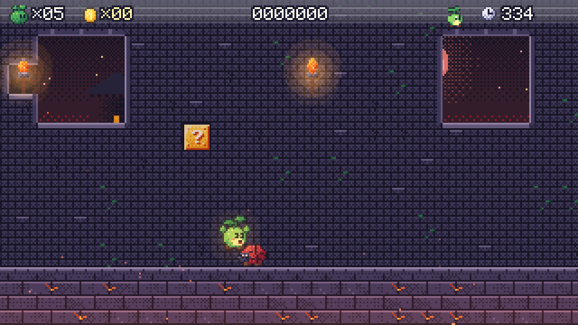
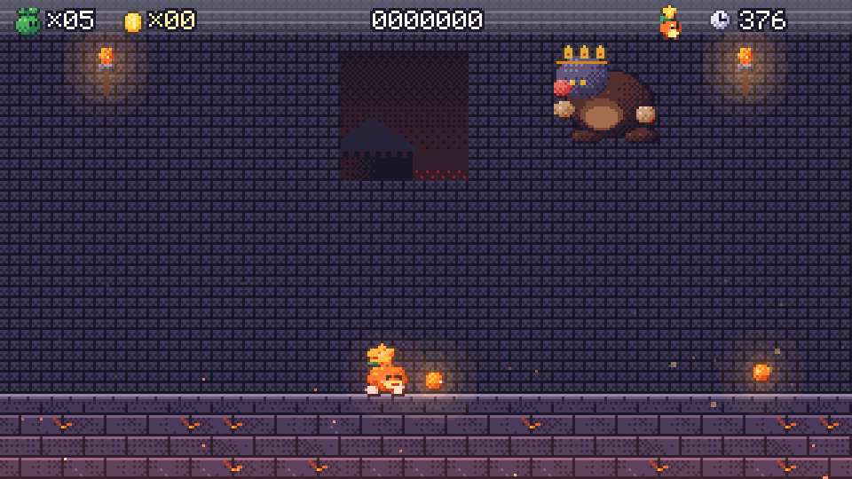

# Meadow Run

A side-scrolling platformer built on MicroEngine. Grumbold the Cinder Mole King has stolen the
Sunstone, and Pip, a round sprout spirit, runs from the sunny meadow through crystal caves and
cloud heights to the Mole King's ember castle to bring it home.

Every pixel and every note is generated in code at load time. The game ships no asset files.









## Controls

| Action | Keyboard | Gamepad |
| --- | --- | --- |
| Walk | Arrows / A D | D-pad, left stick |
| Jump (hold to jump higher) | Z, Space, J | A |
| Run / throw ember seeds | X, C, K, L, Left Shift | X, B |
| Drop through a plank | Down + Jump | Down + A |
| Pause | Esc, P | Start |
| Menus | Arrows, Z/Enter to confirm, X to go back | |
| Fullscreen | F11 | |

On a phone or tablet (the app, or the browser demo) the game shows on-screen controls: a four-way d-pad on the left
(precise, so a rolled thumb never crouches or drops through a plank), **A** (jump, confirm) and **B** (run, throw seeds,
back) on the right, and **II** (pause) at the top right. Hold a direction with one thumb and jump with the other; the
right thumb can roll from B onto A to jump while running. The controls hide while a keyboard or gamepad is used and
come back on the next touch.

## Features

- **Movement feel**: acceleration with a skid on reversal, a run modifier, variable jump height,
  coyote time (0.1 s), jump buffering (0.12 s), lighter gravity at the apex, terminal velocity,
  ceiling corner correction, one-way planks with drop-through, and moving platforms that carry Pip.
  All tuning lives in `Gameplay/PlayerTuning.cs`.
- **Juice**: squash and stretch, run dust, landing puffs, hit-stop and screen shake on stomps and
  hits, bumped blocks that bounce, brick shards, sparkles, floating score popups, and per-biome
  ambient particles (pollen, crystal motes, wind, embers).
- **Mechanics**: coins (100 give an extra life), "?" blocks with coins, power-ups or 1-ups,
  multi-coin bricks, hidden blocks, bricks that break once Pip has bloomed, springs (higher when
  jump is held), checkpoints, spikes, lava, pits, fire bars, falling platforms, a timer, a score,
  stomp chains (100, 200 ... 8000, then 1UP), and a goal pole that scores by grab height, followed
  by a time-bonus tally.
- **Forms**: Sprout, then Bloom (Sunpetal: one extra hit, breaks bricks), then Ember (Ember Seed:
  throws bouncing seeds, at most two on screen). A hit drops one form, followed by invulnerability frames.
- **Enemies**: Bumblet (stompable walker), Thornback (spiny, cannot be stomped, keeps to its ledge),
  Hopkin (crouches as a tell, then leaps at Pip), Mothwing (sine-path flyer), Spitpod (swells as a
  tell, then spits thorns).
- **Boss**: Grumbold has three phases. Phase 1 telegraphs a charge (pawing and dust). Phase 2 adds
  a leap and slam that shakes rocks loose; their shadows grow on the floor before they land.
  Phase 3 adds a burrow ambush: a trembling dirt mound tracks Pip before Grumbold erupts. Every
  attack ends in a dazed window, shown by stars, when his helmet can be stomped. Ember seeds chip
  at his health. When he falls, the arena door has already sealed behind Pip, and the Sunstone appears.
- **Structure**: an animated title (logo drop, living diorama, menu with Start, Continue, Controls
  and Quit) and a world map whose paths draw themselves in on unlock. A card before each attempt
  shows the world name and lives. The pause menu offers Resume, Restart level and Quit to map.
  Then come the death and retry flow, game over with Continue, and end credits after the boss.
  `SaveStore` keeps unlocked levels and the best score and coins per level. A corrupt save falls
  back to a fresh one.

## Achievements

Listed from the title menu ("Achievements"), announced with a banner when earned, saved with the
game's progress in its own folder. First Steps (clear the first course), Stomp Squad (stomp 25 enemies), Coin Purse (collect 300 coins),
Ember Heart (become Ember Pip) and Sunstone Home (defeat Grumbold). Catalog in `Gameplay/Achievements.cs`.

## Content

| # | World | Biome | Highlights |
| --- | --- | --- | --- |
| 1 | Sunny Meadow | meadow | Tutorial through level design: coin arcs show the jumps, a spring that needs a held jump, a brick gallery, a hidden 1-up |
| 2 | Crystal Caves | caves (darkened, additive glows) | Low ceilings, a bottomless chasm with crystal ledges, spike lake rafts, Spitpods |
| 3 | Cloud Heights | sky | Moving rafts and lifts, crumbling bridges, springs to the high route, Mothwings |
| 4 | Ember Castle | castle (lava) | Fire bars over lava pits, a broken lava bridge, a furnace corridor, crumbling stones |
| 5 | Throne of Cinders | castle | A last power-up room, then the sealed throne room and the Mole King |

Levels are ASCII chunks in `Content/Levels.cs` and `Content/Levels.Worlds.cs`. The legend is
documented on `LevelDef`.

## Art and audio direction

- **Palette**: one 32-colour master palette (`Art/Pal.cs`) with 4-step ramps per material. Light
  comes from the top-left. Sprites are shaded procedurally (`Art/Brush.cs`), with dithered steps
  and selective dark outlines.
- **Sprites**: Pip is composed from a pose description (`Art/HeroArt.cs`), so 10 clips across 3
  forms share exact proportions. Enemies, props, autotiled ground (16 masks × 3 variants × 4
  biomes), seamless parallax strips, the logo's custom letterforms and the world map are all
  generated at load and packed into one atlas.
- **Lighting**: caves and the castle get a multiply darkening pass, then additive glows for
  crystals, torches, lanterns, fire bars, seeds and a faint halo around Pip. Castle halls mix
  plain, pale, cracked and mossy stones, frame their windows with carved jambs and sills, and show
  stars and a blood moon through them.
- **Audio**: 46 synthesized effects. The jump pitch rises with run speed. Each stomp in a chain
  pitches up, and sounds pan by screen position. There are 11 tracks: title, map, four biome
  themes, boss, clear fanfare, victory, game over and credits. Melodies are hand-written; bass
  lines and arpeggios are generated from chord symbols (`Audio/MusicBank.cs`).

## Code map

| Folder | Contents |
| --- | --- |
| `MeadowGame.cs` | Game subclass: bindings, asset and audio loading, save data, launch options |
| `Art/` | Palette, shading brushes, hero, enemies, tiles, items, decorations, backdrops, UI art, atlas registry |
| `Audio/` | `SoundBank` (SFX) and `MusicBank` (songs) |
| `Content/` | Biomes, tile ids, legend, level chunks |
| `Gameplay/` | `Player` (pure movement controller), `Session` (lives, score rules), `Level` (parsing), `Stage` (headless simulation split into core, rules and effects) |
| `Gameplay/Actors/` | Items, props and platforms, enemies, projectiles, boss |
| `Scenes/` | Title, map, level card, play, pause, game over, credits, stage renderer, HUD and UI helpers, a dev sprite sheet |

The simulation (`Stage`) never draws and never plays audio directly. It raises sound and music
requests and exposes its state, so tests can play whole levels headlessly.

## Run, test, capture

```sh
dotnet build games/MeadowRun/MeadowRun.csproj -c Release
games/MeadowRun/bin/Release/net10.0/MeadowRun.exe

dotnet build tests/MeadowRun.Tests/MeadowRun.Tests.csproj -c Release
dotnet test tests/MeadowRun.Tests/MeadowRun.Tests.csproj -c Release --no-build

# Scripted capture (scripts live in games/MeadowRun/scripts):
games/MeadowRun/bin/Release/net10.0/MeadowRun.exe --script games/MeadowRun/scripts/smoke.script --hidden --mute --captures captures
```

Developer environment variables (the launcher rejects unknown arguments):

- `MEADOW_START`: `title`, `map`, `level`, `credits`, `gameover` or `sheet`.
- `MEADOW_LEVEL`: the level number (1 to 5).
- `MEADOW_CHECKPOINT`: the checkpoint to start from.
- `MEADOW_FORM`: `sprout`, `bloom` or `ember`.
- `MEADOW_SAVE_DIR`: a separate save folder, for captures.

The tests cover:

- Movement feel: variable jump height, run jump, run speed, skid, terminal velocity, coyote time,
  jump buffer, one-way planks and drop-through, and corner correction.
- Rules: coins to lives, stomp chains, lives and continue, flag points, stomp versus side hits,
  Thornbacks, power-down, blocks, pits, time-out, the seed limit and springs.
- Level integrity: start, goal or boss, closed sides and legal characters.
- An autopilot that beats level 1 under full rules and proves every platforming level is
  traversable. It plans jumps by simulating a cloned `Player` and predicting platforms.
- A boss fight to victory, and a full headless run: title, new game, map, level 1, tally, map,
  with progress persisted to disk and no missing sounds.

## License

This game is a MicroEngine demo, **not** covered by the engine's MIT License: all rights reserved
([games/LICENSE](../LICENSE)). Read and build it to learn MicroEngine; do not redistribute or sell it. Every sprite, tile, sound and song is generated in code, so the whole game is covered.
