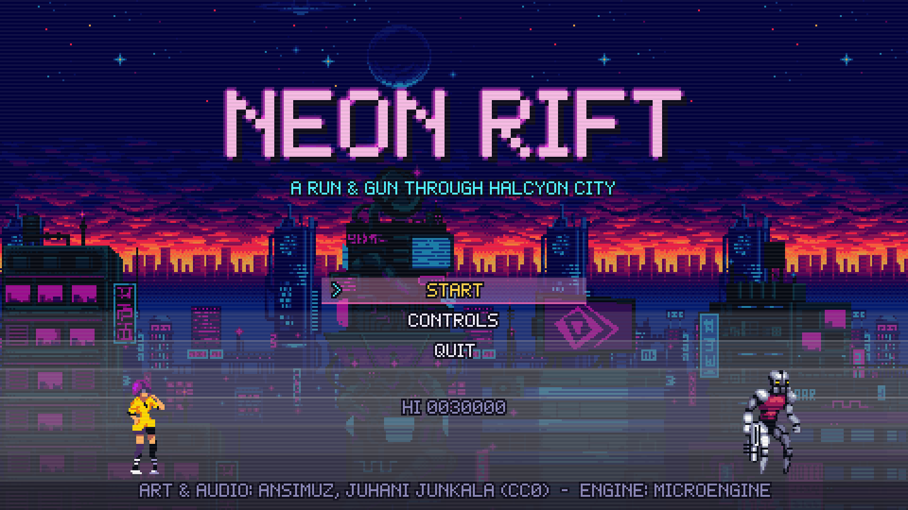
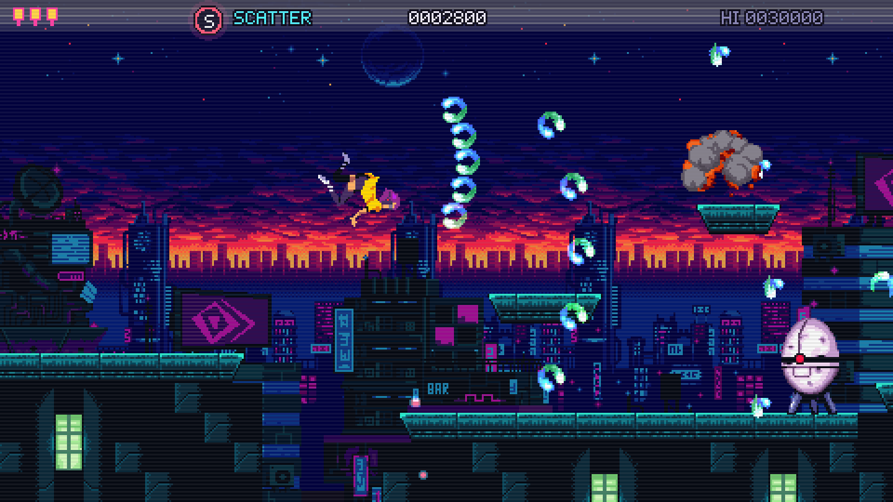
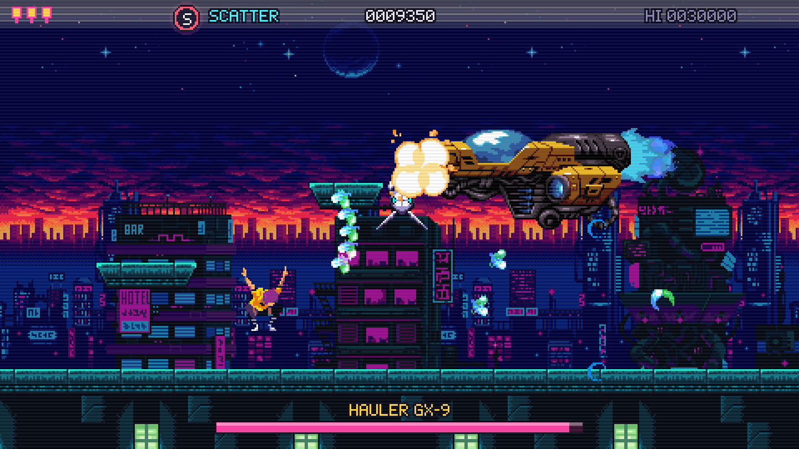
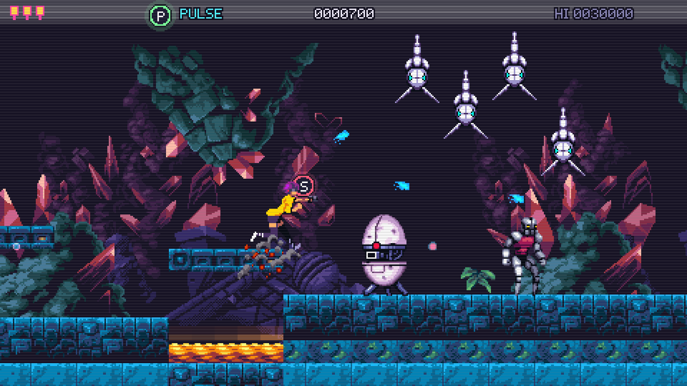
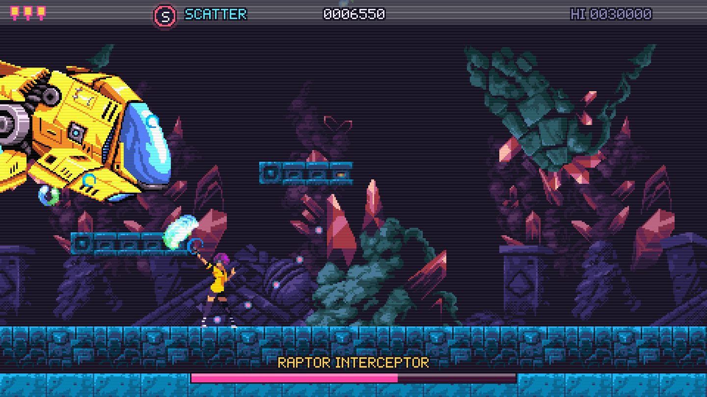
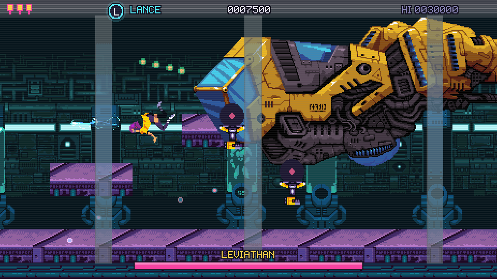

# Neon Rift

A run & gun built on MicroEngine, in the tradition of the 8-bit classics. The Halcyon corporation is
assembling the Leviathan, a flying dreadnought, under its tower district. Vela, a courier with a pulse
pistol, crosses the neon rooftops, the drowned grotto beneath the foundations and the assembly lab to
take it down before it launches.

Unlike the other MicroEngine games, Neon Rift is built from existing CC0 asset packs (Ansimuz's
"Warped" series and Juhani Junkala's music and sound effects); see [CREDITS.md](CREDITS.md).








## Run

```bash
dotnet run --project games/NeonRift -c Release
```

## Controls

| Action | Keyboard | Gamepad |
| --- | --- | --- |
| Move | Arrows / WASD | D-pad, left stick |
| Jump (release early for a short hop) | Z, Space, J | A |
| Fire (hold for auto-fire) | X, K | X, B |
| Aim up / diagonals | Up, Up + direction, Down + direction while walking | |
| Kneel (shots pass overhead) | Down on the ground | |
| Aim straight down | Down in the air | |
| Drop through a ledge | Down + Jump | |
| Plant feet to aim diagonally in place | C, L, Left Shift (hold) | Shoulders |
| Pause | Esc, P | Start |
| Fullscreen | F11 | |

## Game

- **Three stages**, each ending in a locked boss arena: Neon Rooftops (Hauler GX-9 gunship),
  Drowned Grotto (Raptor Interceptor) and Halcyon Lab (Leviathan, whose core opens only after its three
  hull turrets fall). Stages scroll forward only, with pits, lava pools, ledges, walls and cover.
- **Enemies**: troopers released from the screen edges, riflemen that fire eight-way bursts, hover
  drones that swoop and dive, gun emplacements that fan out at close range, armoured egg pods that can
  only be hurt while open, and skiff squadrons in sine formation.
- **Weapons** dropped by supply carriers (shoot them down): Pulse (default), Scatter (five-way fan),
  Lance (piercing beam, heavy damage) and Rapid (stream of bolts). Dying returns you to Pulse.
- **Lives**: one hit is fatal, as in the genre's classics. Three spare lives, an extra life every 20 000
  points, a short invulnerability after respawning in place, and three continues that restart from the
  last checkpoint passed.
- **Presentation**: three-layer parallax per stage, a foreground layer in the lab, arm poses for every
  aim direction derived from the authored sprites, hit flashes, explosions, screen shake, a boss
  warning sequence, health bars, stage cards, pause menu, game over and an ending with credits.

## Achievements

Listed from the title menu ("Achievements"), announced with a banner when earned, saved with the
game's progress in its own folder. FIRST SCRAP (destroy a robot), SCRAP DEALER (destroy 100), ROOFTOP RUNNER (clear stage 1), NOT A
SCRATCH (clear a stage from its start without losing a life) and LEVIATHAN DOWN. Catalog in `Gameplay/Achievements.cs`.

## Developer switches

The desktop launcher accepts `--script`, `--captures`, `--hidden`, `--mute` and the other flags listed
in [CONTRIBUTING](../../CONTRIBUTING.md). Extra options come from environment variables:

| Variable | Effect |
| --- | --- |
| `RIFT_START` | `title` (default), `stage`, `card`, `gameover`, `ending` |
| `RIFT_STAGE` | Stage number for `stage`/`card` (1-3) |
| `RIFT_CHECKPOINT` | Start at checkpoint N of the stage |
| `RIFT_WEAPON` | `Pulse`, `Spread`, `Lance` or `Rapid` |
| `RIFT_GOD=1` | Shots and contact do not kill (pits and lava still do) |
| `RIFT_AUTO=1` | The test autopilot plays |
| `RIFT_SAVE_DIR` | Separate folder for achievements (capture runs) |

Full-stage capture tour used for the screenshots:

```bash
RIFT_START=stage RIFT_STAGE=2 RIFT_AUTO=1 RIFT_GOD=1 dotnet run --project games/NeonRift -c Release -- --script games/NeonRift/scripts/autotour.script --hidden --mute --captures captures
```

## Code map

| Folder | Contents |
| --- | --- |
| `Art/` | Asset loading (`Assets`), tile cutting and choice (`Tiles`), sound registration |
| `Content/` | `StageBuilder` and the three stage definitions; `Content/` files are the shipped assets |
| `Gameplay/` | `Stage` (rules), `Player`, enemies, bosses, weapons, projectiles, pickups, `Autopilot` |
| `Scenes/` | Title, stage card, play, pause, game over, ending; `StageView` draws a stage and the HUD |

Tests live in `tests/NeonRift.Tests`: movement and aiming, weapons, lives and continues, enemy rules,
stage sanity, asset loading, and an autopilot that must clear every stage without falling.

## License

This game is a MicroEngine demo, **not** covered by the engine's MIT License: all rights reserved
([games/LICENSE](../LICENSE)). Read and build it to learn MicroEngine; do not redistribute or sell it. The image and audio files under `Content/` are third-party CC0 works listed in [CREDITS.md](CREDITS.md); they keep their own licence.
