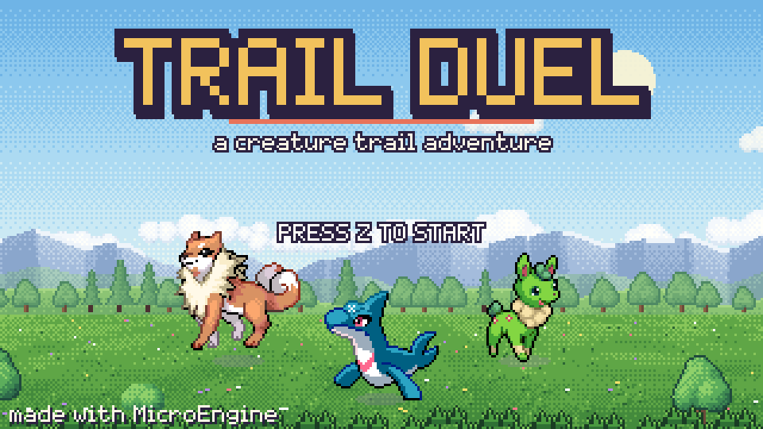
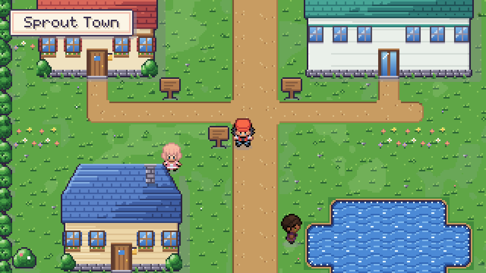
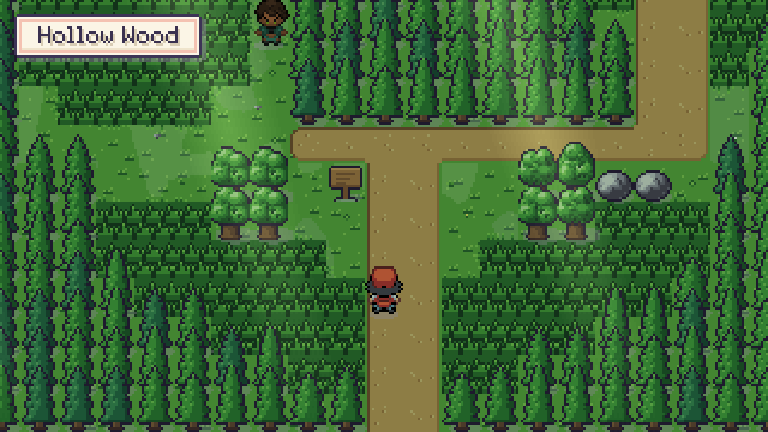
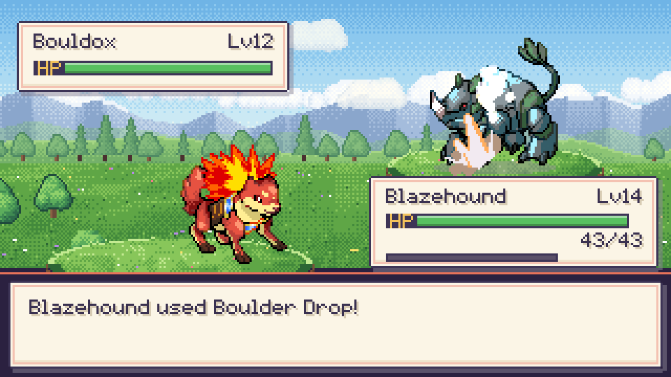
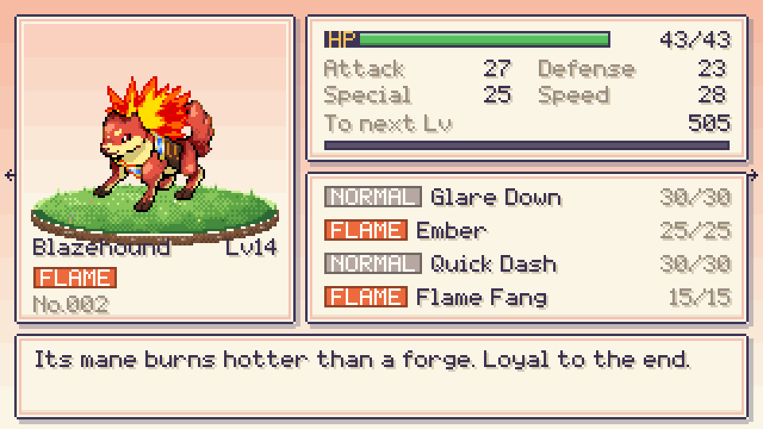
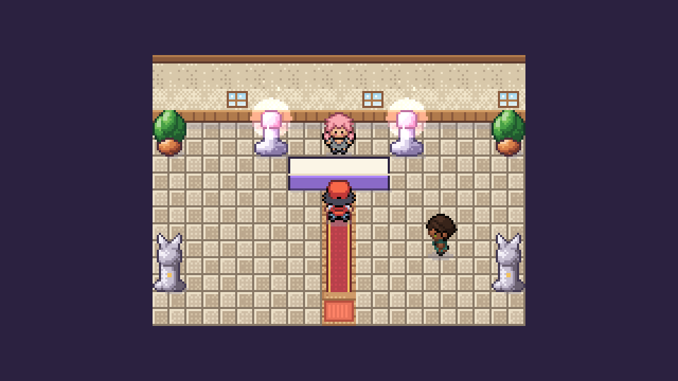
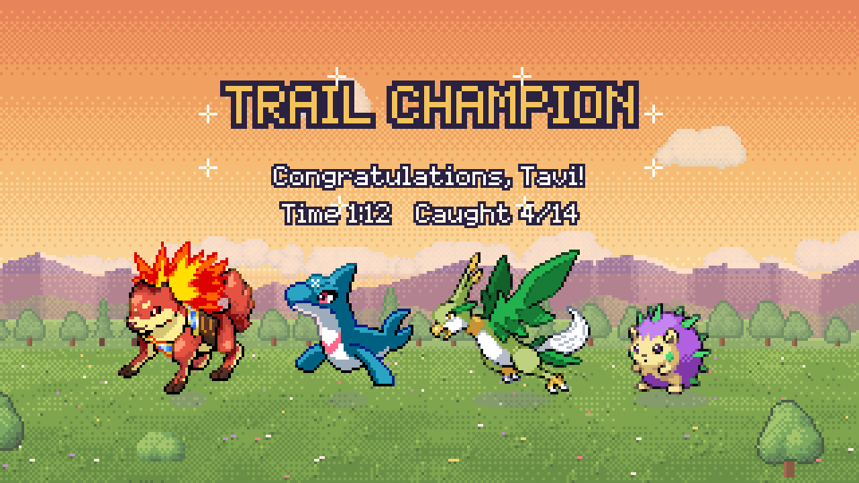
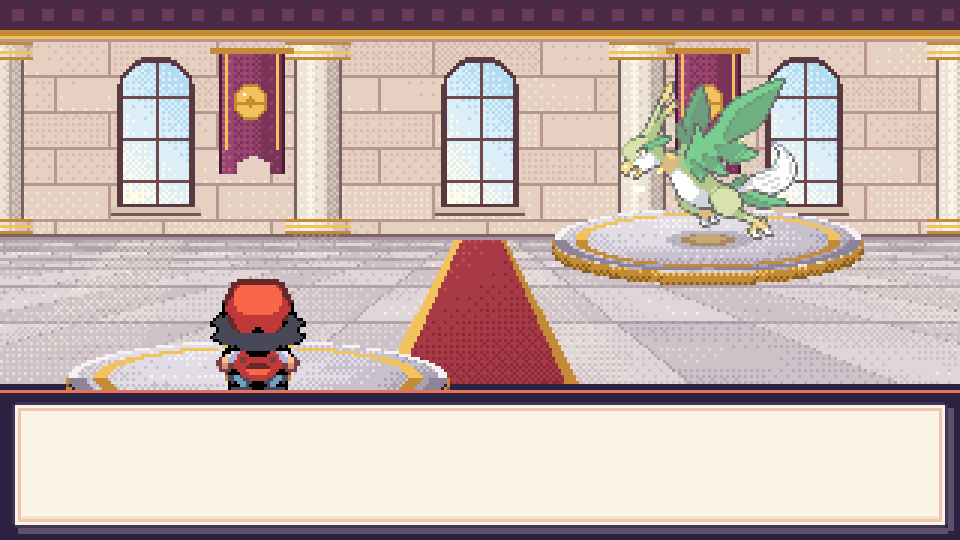
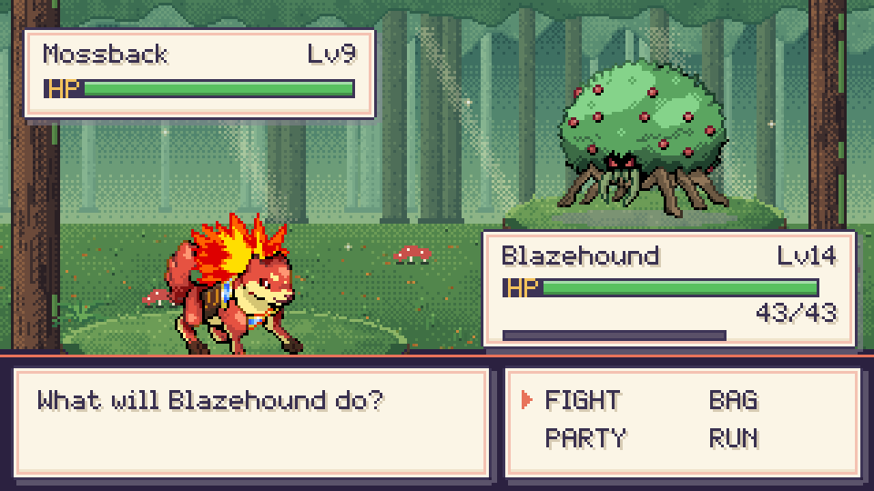

# Trail Duel

A small creature-collecting, turn-based adventure in the spirit of the classic handheld RPGs, with
an original world, cast and bestiary. Leave Sprout Town with a partner creature, walk Route 1 and
Hollow Wood, beat your rival twice, and earn the title of Trail Champion by defeating Master Odessa
in Brookhaven's hall.











## Controls

| Input | Action |
| --- | --- |
| Arrows / WASD | Walk (tap to turn in place), move cursors |
| Z / Space / Enter | Confirm, talk, read signs, advance text |
| X / Backspace | Back. Hold while walking to run |
| Esc / P | Start menu (Creatures, Bag, Trail Log, Save, Controls) |
| C | In the battle move menu: show or hide the full move card |
| F11 | Fullscreen |

On a phone or tablet the game shows on-screen controls: a four-way d-pad on the left for grid steps, menus and the
battle grid; **A** (confirm), **B** (back; hold while walking to run) and **C** (move card) on the right; **MENU** (start
menu) at the top right. A gamepad stick also moves in four directions only, so a slightly diagonal push never steps
sideways.

## Features

- **Overworld**: 16 px grid movement with a three-frame walk cycle, turn-in-place, bump sound and
  leg shuffle against walls, running, ledges you can only hop down, tall grass that rustles and hides
  your feet, doors and edge warps with fades, swaying flowers, animated autotiled water and paths,
  wandering NPCs, signs, item balls, and trainers who spot you along their line of sight (`!` bubble,
  walk-up, challenge).
- **Story**: Mom's wake-up, Mentor Ilse's lab and the three starter orbs (with a preview card), the
  rival Wren picking the type that beats yours and challenging you on the spot, the Mentor's orb gift,
  a forest ambush rematch, the apprentice and Master Odessa, then the champion celebration and credits.
  An objective line in the start menu always says what to do next.
- **Battles**: speed order with priority moves, type/power/accuracy/PP, STAB, a 7-type chart with
  effectiveness messages, critical hits, burn/poison/sleep, stat stages, drain and healing moves,
  Struggle at 0 PP, XP shared among participants, level-ups with a stat-gain panel, move learning
  with a forget prompt, animated evolution (starters at level 12, Breezel at 10, Pebblit and Fizzbit at 12), capture orbs with up to three shakes,
  party of six with switching and forced switches, potions/remedies, running from wild battles,
  trainer AI that scores moves by expected damage and situational status value, prize money,
  white-out back to the last rest point.
- **Presentation**: classic layout with platforms, back sprites, sliding HUD panels, smooth HP drain
  that shifts green to yellow to red, XP bar, typewriter text that auto-advances, band-wipe battle
  intro after flashing, orb send-outs, physical lunges and elemental projectiles with per-type
  particles (flames, bubbles, leaves, sparks, rocks, wind), hit blink and screen shake, faint slide.
- **Move cards**: every move can be inspected with its type, category, power, accuracy, PP and a
  plain description of what it does (status chances and what the status does, stat stages, healing,
  drain, priority, critical rate), generated from the battle rules (`Rules/MoveText.cs`). Press C in
  the battle move menu for the card (with how the move fares against the current foe), use up/down on
  a creature's summary for its moves page, and compare cards while choosing a move to forget.
- **Menus**: title with Continue/New Game (overwrite confirmation), start menu, party list with
  reordering, summary cards, bag, Trail Log (seen/caught), shop with quantities, healing shrine with
  altar glow and jingle, save/load through `SaveStore`.

## Achievements

Listed from the title menu ("Achievements"), announced with a banner when earned, saved with the
game's progress in its own folder. First Victory, Seasoned Trainer (win 10 battles), New Friend (catch a wild creature), Growing Up
(see an evolution) and Trail Champion (defeat Master Odessa). Catalog in `Rules/Achievements.cs`.

## Content

- 4 outdoor areas (Sprout Town, Route 1, Hollow Wood, Brookhaven) and 6 interiors (home, neighbour,
  lab, shrine, shop, Trail Master Hall).
- 14 species over 7 types (Normal, Flame, Tide, Leaf, Volt, Stone, Gale) in six evolution lines,
  Emberpup/Blazehound, Puddlepip/Tidefang, Sprigfawn/Grovestag, Breezel/Gustwing, Pebblit/Bouldox and
  Fizzbit/Voltiger, plus Puffmop and Mossback, which never evolve and are sturdier to make up for it.
  34 moves, 5 items.
- 6 trainers plus two rival duels and the Master; wild encounter tables per area.

## Art and audio direction

Trail Duel is a hybrid with one visual language: the confident outlines, saturated mid-tones and
three-quarter poses of a handheld creature RPG, lit from the top-left everywhere.

- **Creatures and trainers** are hand-drawn CC0 sprites from Screen Smith's Openmon collection
  (`Content/creatures`, `Content/characters`; see [CREDITS](CREDITS.md)). Each species is a 64x64
  battle sprite with a strong silhouette; your own creature is the same drawing mirrored, so both
  sides of a battle show a face. Evolution lines read as growth: a fluffy pup becomes a flame-maned
  hound, a shark pup a sea wolf, a fawn a blossom stag, a songbird a leaf-winged raptor. Two sprites
  are recoloured at load so their lines match: Bouldox wears Pebblit's browns and Fizzbit wears
  Voltiger's charcoal and yellow. Capture orbs are the trail's own design, drawn in code: a glass globe
  with a glowing core under a bronze cap (gold and violet for the Super Orb); the Trail League emblem
  in the Master's hall is the same capped orb in gold. Overworld characters are 18x26 trainers with
  three-frame walks in four directions; in battle they are doubled with Scale2x and their outline is
  thinned back to one pixel.
- **The world is procedural**, painted to match those sprites: natural grass with outlined tufts,
  flat dirt paths with a clean rim, two-row encounter grass, ledges with an earth face and shadow,
  ponds with ripple bands, a dark waterline and a sand shore, ink-outlined trees in several shapes,
  and buildings whose roofs and walls use flat ramp steps. Each map bakes one ground layer
  (`Visuals/GroundArt`) with clover, pebbles, tall-grass fringes and a single union shadow mask.
- In battle, creatures breathe on the spot, stand on contact shadows, glow in their element's colour
  while charging, crouch before lunging, and flash and recoil when hit. `TRAIL_DEBUG=zoom` and
  `TRAIL_DEBUG=cast` show every creature and every character walk frame for review.

Battles take place on painted stages (`Visuals/BattleStageArt`) built in depth layers: a meadow with a
cloud bank, two mountain ranges, a treeline and a mown field; a forest of fading trunk ranks with light
shafts and drifting motes; the Master's hall with arched windows, columns, banners and a marble floor;
and Ilse's lab for indoor battles. Platforms are mounds with a visible front face. Trainers appear at
battle size, doubled from their overworld frames with Scale2x so they keep the creatures' pixel density.
Each element has its own hand-animated impact (flames or an explosion, splash or geyser, leaves, twin
lightning bolts, falling rocks or rock spikes, a wind slash, claws), and stat boosts, healing, faints,
send-outs and captures get matching effects; `TRAIL_DEBUG=fx` replays one move of every element. The
title screen and the ending share the meadow panorama, by day and at sunset.

Music and sound effects are synthesized (a recorded soundtrack was tried and dropped as too calm): UI blips, bump, rustle, door, encounter sting, one attack
voice per type, hit / super-effective / resisted, faint, orb throw, shakes and click, and thirteen
original eight-bar tunes for title, both towns, the route, the forest, the shrine, the hall, wild,
trainer and Master battles, victory, evolution and credits. Four recorded jingles play for level-up,
healing, items and captures.

## Code map

| Folder | Contents |
| --- | --- |
| `Rules/` | Pure game rules, no rendering: types, moves, species, creatures, formulas (damage, crits, accuracy, capture, escape, XP), progression, the turn-based `Battle` engine emitting `BattleEvent`s, trainer AI, items/bag, `GameState` (save data). |
| `World/` | Map data (`Maps`), map runtime (collision, ledges, warps, trainer sight), grid `Actor`. |
| `Scenes/` | Title, overworld (core / scripts / drawing), battle (flow / presentation / drawing / fx), party, summary, bag, shop, start menu, evolution, credits, debug starts. |
| `Visuals/` | Palette, creature and trainer sheet loaders, tile/building/ground/UI art, battle stages, effect sheets (`FxArt`), atlas factory. |
| `Sound/` | Synthesized sound effects and the music/jingle file list. |
| `Ui/` | Shared boxes, bars, badges, the text panel and choice menus. |

The battle scene never decides anything: it replays the events the rules produce, which keeps the
rules fully testable without a window.

## Run, test, capture

```sh
dotnet build games/TrailDuel/TrailDuel.csproj -c Release
games/TrailDuel/bin/Release/net10.0/TrailDuel.exe

dotnet build tests/TrailDuel.Tests/TrailDuel.Tests.csproj -c Release
dotnet test tests/TrailDuel.Tests/TrailDuel.Tests.csproj -c Release --no-build

# scripted captures (960x540 PNGs)
games/TrailDuel/bin/Release/net10.0/TrailDuel.exe --script games/TrailDuel/scripts/newgame.script --hidden --mute --captures out
```

`TRAIL_DEBUG` jumps ahead for captures: `gallery`, `zoom`, `cast`, `orbs`, `lab`, `town`, `route`, `route-mid`, `route-top`, `defeat`, `forest`, `brook`, `hall`,
`battle`, `battle-meadow`, `battle-indoor`, `fx`, `learn`, `trainer`, `party`, `summary`, `bag`, `shop`, `evolve`, `credits`
(e.g. `TRAIL_DEBUG=trainer` with `scripts/master-battle.script`; `TRAIL_EVOLVE=<species id>` picks who
evolves under `evolve`). Saves live in
`%LocalAppData%/MicroEngine/TrailDuel/adventure.json` (achievements in `achievements.json` beside it);
`TRAIL_SAVE_DIR` points both at another folder, e.g. for capture runs.

Tests cover the type chart, damage (STAB, effectiveness, crits, burn, stages), seeded accuracy and
crit rates, XP/level-ups/move learning/evolution, capture bounds, statuses, party/faint/switch rules,
trainer AI, save/load, shop, map integrity, ledges and trainer sight, difficulty simulations, and
headless playthroughs (new game to starter, rival duel and a wild victory; the forest rival ambush;
the hall, Master and credits).

## License

This game is a MicroEngine demo, **not** covered by the engine's MIT License: all rights reserved
([games/LICENSE](../LICENSE)). Read and build it to learn MicroEngine; do not redistribute or sell it. The image and audio files under `Content/` are third-party CC0 works listed in [CREDITS.md](CREDITS.md); they keep their own licence.
