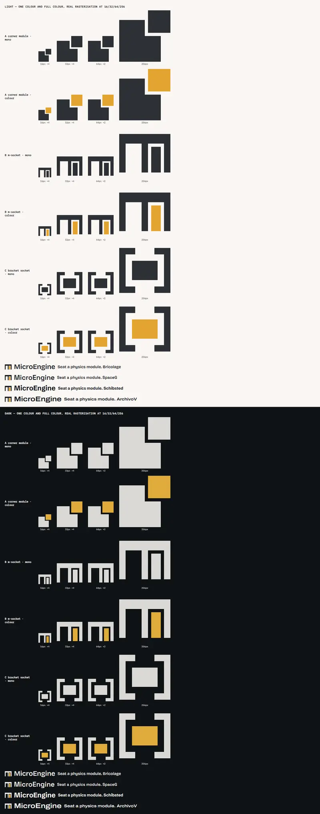
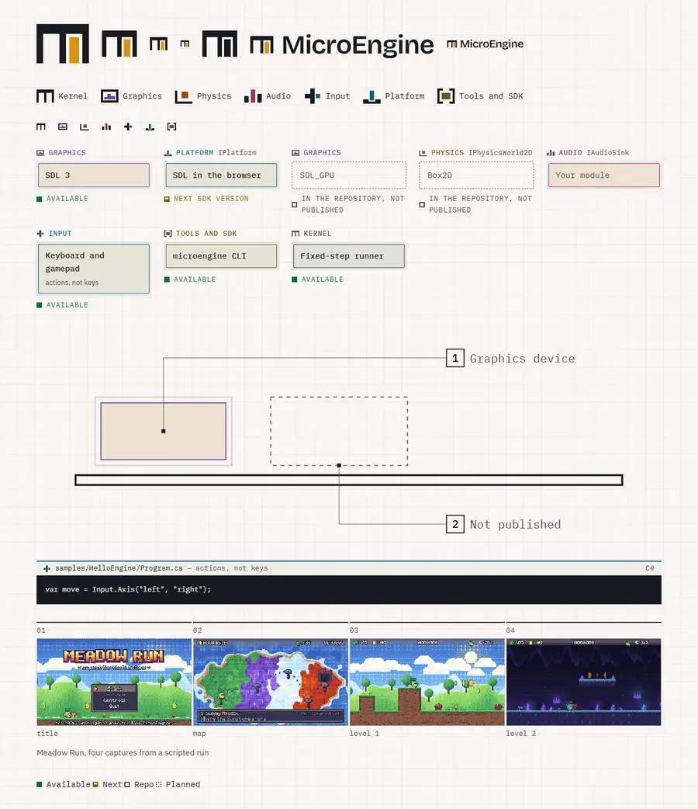

# MicroEngine art direction: "Socket"

MicroEngine is drawn as **a board of labelled sockets with modules seated in them**. The kernel is the board; graphics,
physics, audio, input, platform hosts and tools are modules that seat into it and can be swapped. One device, the
socket and its module, is repeated everywhere: in the mark, the family icons, the diagrams, the status of every
capability, and the Open Graph image.

This folder is design material for people working on the site. The site does not publish it
(`src/lib/repo-docs.mjs` lists the only Markdown it publishes, and this file is not on that list).

## Quick path

| You need | Use |
|---|---|
| A colour, a size, a font | A token from `src/styles/tokens.css`. Never a literal value. |
| The logo in a page | `<Lockup />` or `<Mark />` from `src/components/brand/` |
| The logo as a file | `src/assets/brand/` (`mark-*.svg`, `lockup-*.svg`; light, dark, mono) |
| A subsystem, a capability, a backend | `<Socket family=… module=… status=… />`, or `empty` for anything not published |
| A family icon | `<FamilyIcon family="physics" />` |
| A diagram | Inline SVG with `class="illustration"` plus `<Callout />` |
| A code panel | `<CodeLabel file=… lang=… />` before the block; the block is a `.code-surface` |
| What code produces | `<FrameStrip frames=… caption=… />` with real captures |
| A status on its own | `Next SDK version` |

Checks: `node scripts/contrast.mjs` (WCAG AA for every token pair, both themes) and `npm test` (it also fails when the
logo files or the favicon colours drift from their sources).

## 1. Concept

### Why "Socket"

The research (Godot, Unity, Unreal, Defold, MonoGame, Bevy, raylib, LÖVE, Stride, FNA, PICO-8, Flax, Heaps; and
outside games Zig, Rust, Astro, Linear, Stripe docs, Teenage Engineering, Playdate, Tailwind) gave four findings:

1. **Recognition comes from one product-true artifact repeated everywhere** (the PICO-8 cartridge, the Playdate crank,
   a labelled anatomy drawing, the raylib cheatsheet), and from marks built as geometric constructions that hold at
   16 px in one colour.
2. **Show the engine's own output** next to the code that made it (Zig's test output, Tailwind's and Stripe's
   side-by-side docs, Bevy's live examples).
3. **Keep present and future visibly apart** (Godot's priorities page, Bevy's "still in development").
4. **A stance beats adjectives.** FNA says "do it right or not at all"; raylib calls itself spartan.

MicroEngine's own particularity is architectural: a small kernel that orchestrates existing technology (SDL, raylib,
Box2D, .NET, WebAssembly) behind one contract, with subsystems that can be replaced. A socket is the honest picture of
that: the contract is the socket, an implementation is the module, and an empty socket is a place where something is
not yet available. The device carries the product's truth, so it can be repeated without becoming decoration.

### Rejected directions

| Direction | Idea | Why not |
|---|---|---|
| Fixed Step | The engine's fixed-step loop as the visual system: frame strips, ticks, timelines | Austere and niche alone; it survives as the documentation device (the frame strip) |
| Resolution | Pixel art resolving into HD, 2.5D and 3D across the page | Promises 3D before it ships, which the site must not do |
| Standing on shoulders | Upstream technologies drawn as the hero | Credits others over MicroEngine's own value; survives as credited modules |
| Pixel workbench (the previous site) | Pixel display face, amber on a night grid | Reads as a retro pixel-art tool; it boxed the engine into its first demos |

### Traps this direction avoids

Generic SaaS (dark hero, gradient glow, three icon cards); stock Starlight with an accent colour; retro costume (pixel
font everywhere, CRT, PICO-8 cosplay); hardware cosplay of Teenage Engineering (the copy stays plain, there are no fake
knobs or screws); showing 3D or unpublished backends as available.

## 2. The mark

### Construction

Drawn on a 16-unit grid; every edge falls on a whole unit, so the 16 px favicon is pixel-exact.

- **Board**, the kernel bar (3 units tall) with three walls (2 units wide) and two sockets (5 units wide) open at the
  bottom. Read together, it is a lowercase **m**.
- **Module**, 3 × 8 units, seated in the right socket with a **one-unit gap** on its sides and top, resting on the
  baseline. The left socket stays empty: there is always room for another module.
- The drawing spans y 2..14; lockups crop to that box so it aligns with the wordmark's capitals.

Source of truth: `src/components/brand/geometry.mjs`. The files in `src/assets/brand/` are generated from it by
`node design/tools/build-assets.mjs`; a test fails if they drift.

### Why this one

Three constructions were drawn and rasterised at 16, 32, 64 and 256 px (`explorations/`):

| Candidate | Reading | Verdict |
|---|---|---|
| A: corner module, a square with a block pulled out of its corner | Strong at 16 px | Rejected: reads as a generic "copy" or "layers" icon; says "detached", not "seated" |
| **B: m-socket**, the kernel bar with two sockets, one module seated | "m" for MicroEngine, a board, a seated module and an empty socket in one shape | **Chosen**: holds at 16 px in one colour (the 1 px gap survives), and tells the product's story |
| C: bracket socket, `[■]` | Code-first, legible | Rejected as the mark: generic code glyph, no letter, no board. Kept as the Tools and SDK family icon |

### Versions

| File or component | Use |
|---|---|
| `<Mark />`, `<Lockup />` | In pages: colours from tokens, so they follow the theme |
| `mark-light.svg`, `lockup-light.svg` | On light backgrounds, outside the site |
| `mark-dark.svg`, `lockup-dark.svg` | On dark backgrounds, outside the site |
| `mark-mono.svg`, `lockup-mono.svg` | One colour (`currentColor`), for print, embossing, single-ink use |
| `/favicon.svg` | The mark with fixed colours for the browser's light and dark schemes |
| `/og.png` | Built at build time from the lockup and the socket board (`src/pages/og.png.ts`) |

The wordmark is Bricolage Grotesque SemiBold at -0.02 em tracking. In files it is outlined
(`src/assets/brand/outlines.json`, made by `design/tools/outline-text.mjs`), so it does not depend on installed fonts.

### Usage rules

- **Clear space:** at least the module's width (3/16 of the mark's width) on every side; in a lockup, the gap between
  mark and wordmark is 0.3 em and nothing enters it.
- **Minimum size:** the mark at 16 px; the lockup at 14 px font size. Below that, use the mark alone.
- **Colour:** board in ink, module in amber, on paper. Or everything in one colour. Never a family colour on the
  module (that would claim the mark is one subsystem), never the board in amber.
- **Do:** place it on plain paper or graphite; let the module animate into its socket once (`<Mark seat />`).
- **Don't:** rotate, outline, add shadows or gradients, fill the empty socket, separate the module from the board,
  put it on a busy screenshot without a solid plate behind it, set "MicroEngine" in another face beside it.

## 3. Colour

Colours are OKLCH tokens in `src/styles/tokens.css`, each written once as `light-dark(light, dark)`. Every text and
background pair is checked against WCAG AA in both themes by `scripts/contrast.mjs` (4.5:1 text, 3:1 focus ring), and
every colour is checked to lie inside sRGB so the computed ratio is the one the browser shows.

### Two first-class themes, the landing included

| Theme | Neutral base | Character |
|---|---|---|
| Light | warm paper `oklch(97.5% 0.006 85)`, graphite ink | A printed manual: diagrams and labels read like a product sheet |
| Dark | graphite `oklch(18% 0.01 260)`, warm paper ink | The workbench at night, continuity with the previous site |

**Decision: the landing and demo pages get both themes**, following the reader's system, and the documentation's
theme switch (stored by Starlight as `starlight-theme`) applies to them too. Reasons: the owner asked that the landing
and the documentation not look like two projects, and the docs already switch; a manual-like light theme is where the
socket diagrams read best; and dark-only was part of the "retro tool at night" perception the redesign leaves behind.
Exceptions, by rule: **code panels and game stages stay graphite in both themes** (`.code-surface`, `.astro-code`,
`[data-stage]` set `color-scheme: dark`, so every token inside resolves to its dark value). Code uses a dark
highlighting theme, and a game's picture is its own light.

### Roles

| Role | Tokens | Rule |
|---|---|---|
| Neutral | `--color-paper`, `-paper-2`, `-paper-3`, `--color-rule`, `--color-ink`, `-ink-2`, `-ink-3`, `-ink-4` | 95% of every page. `ink-4` is never text |
| Signal | `--color-accent` (text), `--color-accent-fill` (buttons, the mark's module), `--color-accent-ink`, `--color-focus` | MicroEngine's own voice: links, the primary action, the module in the mark |
| Families | `--family-kernel`, `-graphics`, `-physics`, `-audio`, `-input`, `-platform`, `-tools` | Mean a kind of module, nothing else. Never decoration, never a status |
| Status | `--status-available`, `-next`, `-repo`, `-planned` | See section 7 |
| Verdicts | `--color-ok`, `-partial`, `-no` | Compatibility answers (player, platform tables) |
| Games | `--color-meadow`, `-courtyard`, `-trail`, `-neon` | Kept from each game's palette; only inside that demo's own frame |

Family hues: graphics violet 295, physics orange 45-50, audio rose 355, input blue 245, platform teal 195, tools
chartreuse 125; the kernel is neutral because it is the board. A family colour always travels with its icon and its
written name, so colour is never the only signal. A socket's fill is its family colour mixed into the paper at
`--tint` (12%); text on it stays in the family colour or ink, and both pairs are in the contrast check.

## 4. Typography

| Face | Role | Weights shipped | Licence |
|---|---|---|---|
| Bricolage Grotesque | Display: page titles, section heads, the wordmark | 600 (Latin) | SIL OFL 1.1 |
| IBM Plex Sans | Reading text, UI | 400, 600 (Latin) | SIL OFL 1.1 |
| IBM Plex Mono | Code, panel legends, labels, step numbers | 400, 500 (Latin) | SIL OFL 1.1 |

All self-hosted through @fontsource, Latin subset, only the weights above (`src/styles/fonts.css`). Bricolage was
chosen against Space Grotesk (ubiquitous in developer tooling), Schibsted Grotesk (too plain to carry a brand beside
Plex) and Archivo Expanded (strong "equipment plate" voice, but its width axis costs a 90 KB variable file). Bricolage's
ink traps and open forms give character at display sizes and stay sober at 18 px; its grotesk skeleton sits well over
Plex.

- Headings are roman, never italic; emphasis is weight or colour.
- Display tracking `--tracking-display` (-0.02 em), leading `--leading-tight`.
- Legends are Plex Mono, uppercase, `--tracking-label` (0.06 em), `--text-xs`: the voice of a label on a module.
- Scale: `--text-xs` 13 px to `--text-display` (fluid, 40 to 76 px), roughly 1.25 between steps.
- Pixel faces are not part of the brand. A game may use its own inside its screenshots.

## 5. Layout and grid

- Page: `--page-max` 76 rem, side gutter `--gutter` (16 px at 320 px wide, 40 px on desktop), reading measure 66 ch.
- Spacing comes from the 4 px scale (`--space-2xs` 4 px to `--space-4xl` 104 px). Sections breathe at `--space-3xl`.
- Shapes are square-cornered (`--radius-sm` 2 px), with hairline rules. The **gap** between a module and its socket
  is `--rule-gap` (2 px): the same gap as in the mark. Use it for anything seated in anything (a frame in a strip, a
  module in a bay).
- Compositions read like a board: things line up on a shared rail (the kernel bar), modules sit on it, labels sit
  above what they name. Avoid centred hero stacks and three-card rows.
- Mobile: no horizontal page scroll at 320, 375, 414 and 768 px; wide drawings and frame strips scroll inside their own
  box; grid tracks with images use `minmax(0, 1fr)`; tap targets at least `--tap` (44 px) on coarse pointers.

## 6. Illustration

- Orthographic, flat, hairline: no perspective, no gradients, no glow, no drop shadows.
- A board line (2 px ink), sockets (1 px rule colour), modules (family tint with a 1 px family stroke).
- Parts are named with **numbered callouts**: a 4 px square anchor on the part, a hairline leader that runs vertically
  then horizontally, an 18 px numbered square and a mono legend (`<Callout />`). Like the parts list of a manual.
- Upstream technologies (SDL, raylib, Box2D, .NET, WebAssembly, glTF) are drawn as **credited modules**: their name on
  the module, never their logo, and only where MicroEngine really uses them.
- Every illustration is inline SVG with a `<title>` (or `aria-labelledby`) that says what it shows; the legends are real
  text.
- Family icons (`<FamilyIcon />`) use the mark's construction: a board in the text colour, one module in the family
  colour, a one-unit gap.

## 7. Present and future

The rule: **only what ships gets colour.** The drawing says the status first; the colour repeats it; the words are
always written.

| Status | Drawing | Colour | Words |
|---|---|---|---|
| Available (in the published SDK) | Solid module seated in a solid socket; solid square marker | `--status-available` | "Available" |
| Next SDK version (merged, not published yet) | Module seated; half-filled square marker | `--status-next` (amber) | "Next SDK version" |
| In the repository, not published (experimental) | **Empty dashed socket**, module named inside in mono; dashed marker | `--status-repo` (neutral) | "In the repository, not published" |
| Planned | Empty dashed socket; dotted marker | `--status-planned` (neutral) | "Planned" |

`<Socket empty status="repo" module="Box2D" />` is how an unpublished backend appears. The SDL_GPU device ships in the
next SDK version (inside the `MicroEngine.Sdl` package, desktops, opt-in), so it is a seated module with the next
status: `<Socket family="graphics" module="SDL_GPU" status="next" />`. The 3D path (Graphics3D), Box2D physics
and any other unpublished system is never drawn as a seated module until it ships in the SDK. The Open Graph image
shows four seated families that ship today and one empty dashed socket, unlabelled.

## 8. Motion

- Mechanical and short: `--dur-fast` 120 ms, `--dur-mid` 220 ms, `--ease-out`; seating uses `--ease-seat`, a small
  overshoot, so a module "clicks" into place.
- The signature motion is the module sliding into its socket (`<Mark seat />`, once, on load). A socket's module lifts
  2 px on hover, as if about to be swapped.
- Nothing loops, nothing moves on scroll, no parallax.
- Under `prefers-reduced-motion: reduce` every animation and transition is removed (components check it; `site.css`
  also shortens all transitions globally).

## 9. Code and screenshots

- **Code** sits on graphite in both themes, under a `<CodeLabel>` strip: the file path, an optional family icon and
  note, the language. It is a label, like the legend on a module, not a window: no title bar, no traffic-light dots,
  no fake tabs.
- Quoted code equals its sample region (`<!-- code: path#region -->`, checked by the site build).
- **What code produces** is shown with `<FrameStrip>`: real frames captured by the engine's scripted, headless runs,
  numbered 01, 02, 03 in mono above each frame, with alt text for each and a caption that says what the run did.
- **Screenshots** are real captures, pixel-sharp (`image-rendering: pixelated` for pixel-art games), in a hairline
  frame, never tilted, never in a device mock-up, never under a gradient.

## 10. Pixel-art origins

The four demos are pixel-art games and stay exactly that: their screenshots, their colours (the game tokens) and their
own fonts live inside their frames. The brand around them is not pixel art: no pixel display face in the chrome, no
pixel grid as identity. The mark's construction keeps a quiet trace of the origin (whole units on a 16-grid, crisp at
16 px), and the landing's sprite-from-code figure can stay as one example of what the engine draws, not as the
costume of the whole site. The site shows pixel art as *one thing MicroEngine renders*, so it can later show HD and
other output with the same frames and strips.

## 11. Licences

| Asset | Licence | Credit |
|---|---|---|
| Bricolage Grotesque (shipped, and outlined in the logo files and Open Graph image) | SIL OFL 1.1 | Copyright 2022 The Bricolage Grotesque Project Authors |
| IBM Plex Sans, IBM Plex Mono (shipped, Plex outlined in the Open Graph image) | SIL OFL 1.1 | Copyright 2017, 2019 IBM Corp. |
| The mark, family icons, components, illustrations, Open Graph image | MIT, with the rest of the site | MicroEngine |
| Game screenshots used in strips and figures | All rights reserved (the demos), plus the CC0 assets in each game's `CREDITS.md` | Each demo page carries its notice |

The fonts are listed in `THIRD-PARTY-NOTICES.md` (section "This website"), which holds the OFL text. The outlined
glyphs in `src/assets/brand/outlines.json` are a use of the fonts under the OFL (documents made with the fonts are
not bound by it); they are credited the same way.

## 12. Exploration evidence

`explorations/` keeps the three mark candidates as SVG, the comparison sheet (16/32/64/256 px, one colour and full
colour, light and dark, rasterised at real size and enlarged) and the brand kit rendered in both themes.

## Notes for the units that apply this

- **Shell and landing:** use `<Lockup />` (already in the header) and the Socket board for the architecture story;
  move the hero code figure to `.code-surface` and delete `.sprite-code` from `brand.css`; the 32 px grid background is
  a leftover of the pixel workbench and is yours to keep or drop.
- **Demos and player:** game tones stay inside each demo's frame; the player stage is graphite in both themes.
- **Docs:** Starlight's variables already map onto the tokens for both schemes (`starlight.css`); code blocks are
  Expressive Code, not `.astro-code`, so give them the `CodeLabel` treatment there.
- **Content:** anything not in the published SDK is an empty dashed socket with its status written out.

## Landing and shell

Added by the shell and landing unit; this section extends the rules above, it changes none of them.

- **Background:** plain paper. The 32 px grid of the pixel workbench is gone; drawings, rules and modules carry the
  identity. (`--color-grid` in `tokens.css` is no longer used by `site.css`.)
- **Header:** the lockup left, the navigation right in Plex Mono. Under 48 rem the navigation takes its own line under
  the lockup, never wraps, and spreads its five links across the width. The current page has a short amber bar under
  its name: a module, not an underline. The skip link stays the first Tab stop.
- **Footer:** opens with a 2 px ink line (the board's edge), on `--color-paper-2`: the lockup and the statement
  ("A small kernel, modules you can swap, games written in C#."), the links in three groups, then the licence line with
  the demos' "all rights reserved".
- **Buttons:** flat and square-cornered; they press 1 px on `:active`. The old 4 px offset shadow is gone.
- **The socket board** (`src/components/landing/SocketBoard.astro`, `BoardSlot.astro`): the mark's construction at page
  size. The kernel is the solid ink bar at the top with its own modules in sockets cut into it; the other families hang
  from it in paper bays separated by 2 px ink walls, open at the bottom like the mark. Each module is a tinted module in a
  hairline socket (seated: available or next), an empty dashed socket (in the repository) or an empty dotted socket
  (planned), always with its status written under it. It reads `src/data/capabilities.ts` and nothing else, so the board
  changes when the capability list does. In the dark theme the board inverts with the mark (light board, dark bays).
- **The opening drawing** (`BoardDrawing.astro`): the same construction as an SVG parts drawing, five sockets with
  four shipping families seated and one empty dashed socket for 3D, named by three `<Callout>`s. The modules seat once
  on load, one after another (`--ease-seat`), and not at all under reduced motion.
- **Credited modules:** upstream technologies on the landing are mono names in a neutral module (ink-3 stroke on
  paper-2) inside a hairline socket, with their role beside them: no family colour, because they are not MicroEngine's
  families.
- **`DemoCard`** (`src/components/DemoCard.astro`): the screenshot sits one gap under a 2 px rule in the game's colour,
  then a plate with a game-coloured square and genre label, the title in the display face, the tagline and how its
  content is made. The game's colour stays inside the card; the card is paper and rules. Hover lifts it 2 px and turns
  its border to the game's colour. The default slot adds lines (sizes, downloads) to the plate.
- **Code panels** on the landing are `.code-surface` figures: `<CodeLabel>` then the block, both graphite in both
  themes. The block takes `--color-paper-2` as its background so it matches the label.
